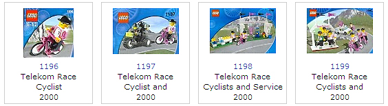
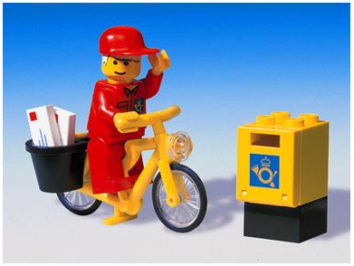
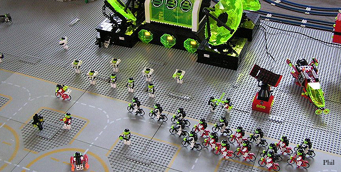
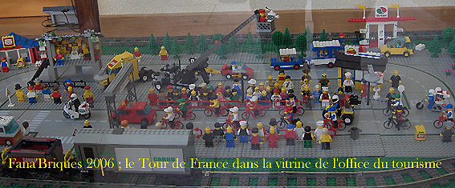
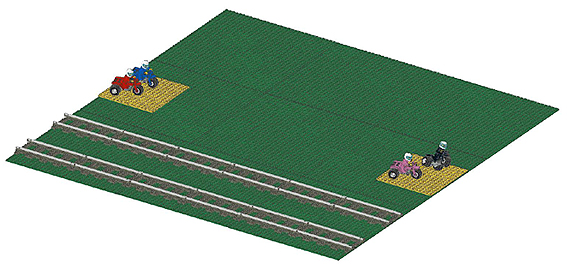

Le Tour est très populaire partout en France et pourquoi ne le verrait-on pas tout au long de l’année prochaine dans nos expositions LEGO ?

## Le tour de France

Le Tour de France (TDF), c’est 3 500 Km de paysage, 200 coureurs, la caravane publicitaire, des centres villes et des routes de montagne, bref il y en a pour tous les goûts.

L’idée est que le Tour de France puisse servir de fil rouge pour des layouts collectifs lors de nos prochaines expositions, petites ou grandes.

Il est à noter que la société LEGO a sorti seulement quatre sets privés Deutsche Telekom en 2000 sur ce thème ; sets avec les fameux vélos roses.

Et pour le vélo jaune , un seul set à l’appel : le 6420 ’Post Office’

[Tous les autres sets ayant au moins une bicyclette](http://www.bricklink.com/catalogItemIn.asp?P=4719c01&in=S)

## Petit clin d’œil...

[Fana’Briques 2006](/articles/fana-briques-2006-une-reussite/) : le Tour de France passe à Rosheim devant la salle d’exposition !

## Le Tour de France FreeLUG ? ( TDFF)

Echelle minifig et véhicules en conséquence selon le principe général 468 (Voiture/Camion/Train).

Plusieurs façons de participer à ce tour de France :  
**–** faire un module complet paysage plus scène du TdF en situation,  
**–** faire juste un ’paysage’ ou d’autres positionneront leur(s) équipe(s) ou leurs véhicules,  
**–** faire une équipe complète : coureurs, véhicules suiveurs, bus...  
**–** les véhicules publicitaires,  
**–** le village VIP,  
**–** les plateaux télé,  
**–** l’arrivée,  
**–** les cols mythiques,  
**–** Les Champs-Elysées (sans le défilé militaire),  
**–** des scènes historiques (hé oui c’est la 100ème édition),  
**–** L’équipe SW avec les véhicules...  
**–** etc.

## Quelques considérations générales

Il faut que des trains puissent circuler devant le Tour de France car en exposition il y a souvent un train qui circule.

Pour que les différents modules puissent se raccorder sans problème, il faut (un peu comme le GBB) définir un point d’entrée et un point de sortie standard pour le module type du TDFF ainsi qu’une dimension minimum.

## Taille d’un module TDFF

La largeur minimum d’un module TDFF est de 32 tenons (une plaque 32x32).

Il n’y a pas de largeur maximum.

La profondeur minimum d’un module TDFF est de 96 tenons (trois plaques 32x32)

Il n’y a pas de profondeur maximum si ce n’est la limite des tables.

## Point entrée/sortie d’un module TDF

L’entrée et la sortie d’un module standard TDFF doit être sur la deuxième plaque en profondeur (vue du public).

Il sera malgré tout bien sûr possible de déroger à cela si les voisins d’une exposition se mettent d’accord pour modifier ce point de connexion standard et cela avec l’accord du commissaire de course ;-).

Mais ne jamais prévoir de points de connexions entre deux modules sur la première plaque en profondeur : possible passage de trains, ou alors faites un module facilement adaptable à cette éventualité.

* * *

Alors maintenant et avec tout cela, il doit être possible en 2013 de faire d’exposition en exposition des dioramas TDFF de 7 à 77 mètres.

cdhd
