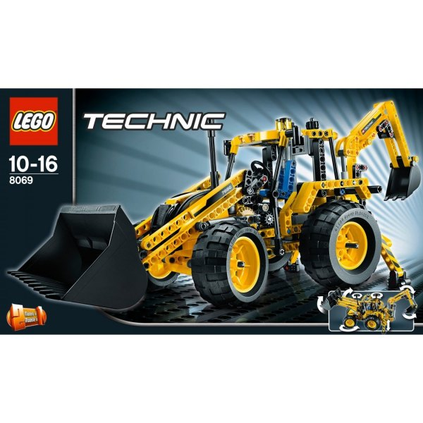

**8069 model-A**

Le set comporte 609 pièces. Il n’est pas très compliqué à construire, restez attentif aux notices papiers (deux en tout) car il a une coquille sur le premier livret au montage 6 concernant un pin cruciforme bleu qui n’est pas à sa place.

Les dimensions des dents du godet avant jusqu’au bras replié, entre les stabilisateurs (les pneus sont plus petits de environ 1,5t de chaque cotés) en passant par le coude du bras le point le plus haut, Longueur x largeur x hauteur : 53t x 23t x 24t.

[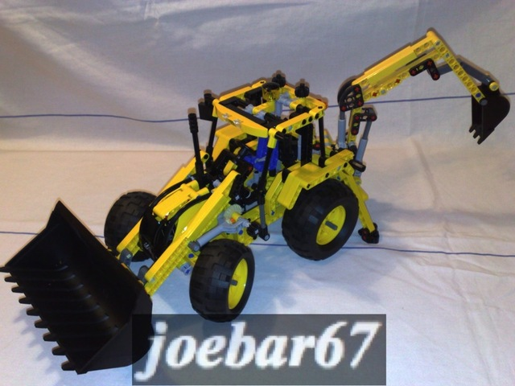](https://www.freelug.org/IMG/jpg/tracto_pelle_20.jpg)

Il possède comme on le voit sur la photo encart dans le coin en bas, 2 mouvements manuels qui sont le déploiement des stabilisateurs , et 5 mouvements mécaniques qui sont :  
**–** Basculement du godet avec la rotation de la cheminée  
**–** Lever/baisser du bras avec les 12t noirs sur les cotés des mini Linaire Actuator ( mLA )  
**–** La direction des roues avant sur le centre du toit par le gyrophare (HOG)  
**–** Rotation gauche/droite du bras par l’axe joiner noir horizontal sur le coin du garde-boue arrière gauche (dans le sens de marche)  
**–** Montée/descente du bras par la 12t noire sur le toit à droite  
**–** Lever/baisser de la flèche et le godet qui est associé au même mouvement , est actionné par la 12t noire sur le toit à gauche.

Nous reviendrons plus en détail sur les fonctions du set au fil de la revue.

Donc la grande nouveauté de ce set, c’est les mLA qui fonctionnent sur le principe du tube de rouge à lèvres (ainsi que les LA).

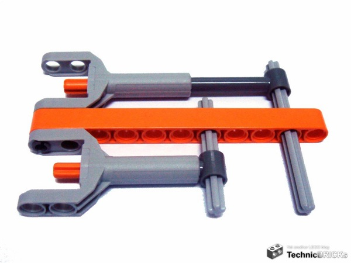

**mLa 7t x 3t + 3t**

Les mLA font 7t de long sur 3t de large et ils sortent de 3t ce qui fait 10t de long au total.

Ils ont un système de clutch à l’intérieur du corps du vérin qui débraye quand on force dessus pour éviter de tout casser.

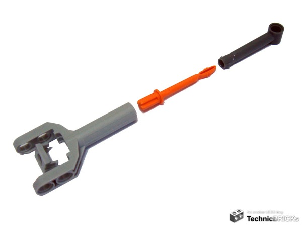

**vue éclaté du mLA**

Pour plus d’informations, vous pouvez [voir ces articles sur TB’s](http://technicbricks.blogspot.com/2010/12/tbs-techreview-14-mla-under-magnifying.html)

Bon maintenant, rentrons dans le vif du sujet, les mécaniques !

[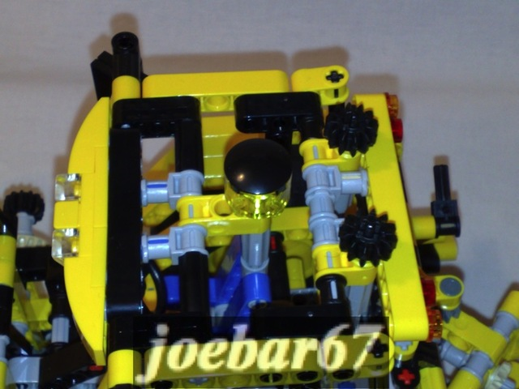](https://www.freelug.org/IMG/jpg/tracto_pelle_29.jpg)

[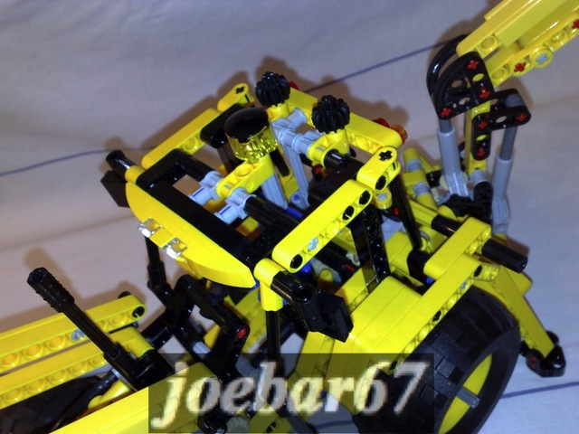](https://www.freelug.org/IMG/jpg/tracto_pelle_23.jpg)

[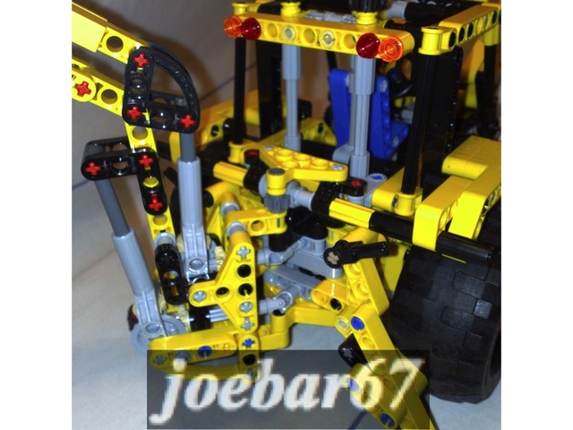](https://www.freelug.org/IMG/jpg/tracto_pelle_24.jpg)

**–** La direction, qui part de la HOG, le gyrophare sur le toit, renvoi d’angle par knob/knob sous le siège du conducteur, et une 12t double bevel noir sur une crémaillère de 7t de long.

Le chargeur avant comporte deux mouvement :  
**–** montée/descente du bras, se commande par des 12t double bevel noir, l’axe passe à travers deux cotés juste au niveaux des mLA, 20t simple bevel tan/12t simple bevel tan qui articulent les mLA.  
**–** L’inclinaison du godet se fait par la cheminée sur le capot moteur, il actionne une VSF (vis sans fin)/24t dark gray/12t noir double bevel, qui actionne à son tour un jeu de bielle et biellette (dont la poutre studless de 5t dark bluish gray peut aussi faire office de pédale vue qu’elle sort dans la cabine au niveau des pieds du conducteur) pour retransmettre le mouvement par la poutre de 15t jaune qui est parallèle au bras pour arriver au godet.

[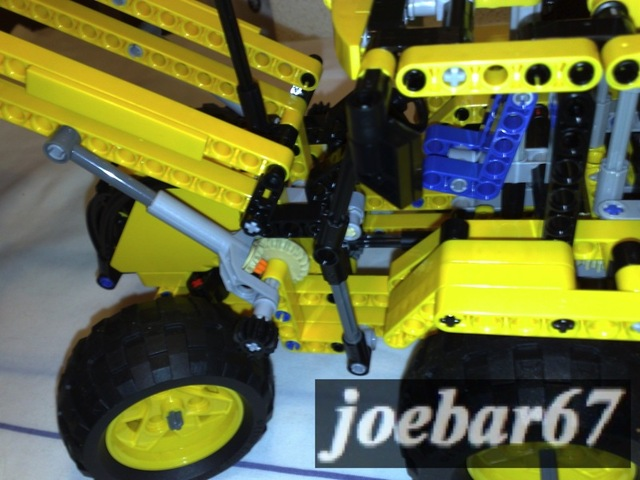](https://www.freelug.org/IMG/jpg/tracto_pelle_05.jpg)

[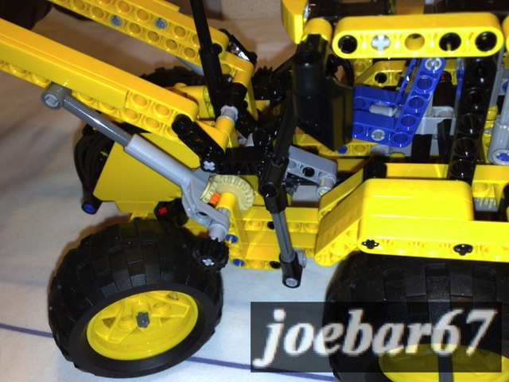](https://www.freelug.org/IMG/jpg/tracto_pelle_06.jpg)

**–** Les deux stabilisateurs sont indépendants du reste, ils sont actionnés par des Technic pole reverser handle, qui verrouillent un jeu de biellette pour assurer l’irréversibilité du mouvement.

À noter que les pieds des stabilisateurs sont des nouvelles pièces, les mêmes que pour la mini grue 8067 en bout de flèche là où la corde passe.

**–** Rotation du bras gauche/droite se fait par l’axe joiner noir placé à l’horizontal derrière le garde-boue arrière gauche (petit détail, TLG aurait du passer l’axe de part et d’autre de l’engin, pour augmenter encore la jouabilité du set). Celui-ci actionne une VSF/8t qui est prisonnière du châssis du bras rétro. À noter que la VSF est maintenue des deux cotés par la nouvelle pièce.

À l’opposé de la manette de rotation du bras qui est à gauche sur le garde-boue mais sur le toit du set à droite.

**–** Montée/descente du bras, la manette 12t double bevel noir qui descend du toit dans le châssis pour arriver sur une 20t double bevel tan/12t noir/renvoie d’angle par 12t noir aussi, nous arrivons sur le cardan du bas qui assure la liaison du mouvement avec le châssis du bras, 12t simple bevel tan/20t simple bevel (roue folle dark bluish gray)/12t simple bevel tan du mLA inférieur.

**–** Lever/baisser de la flèche ainsi que du godet qui est associé. La manette est la 12t double bevel noir à gauche également sur le toit qui commande une mécanique identique juste au dessus de la précédente, le cardan est celui du haut et assure la liaison avec le mLA supérieur.

[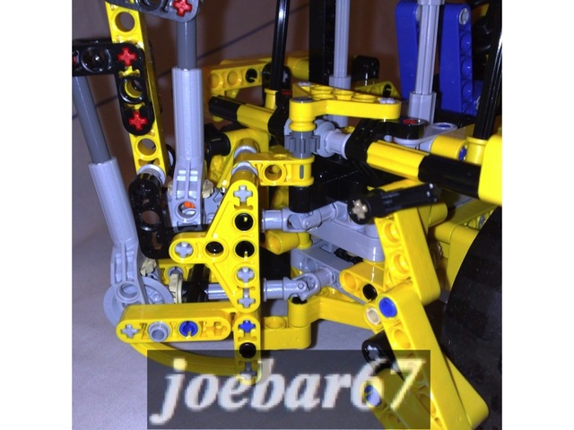](https://www.freelug.org/IMG/jpg/tracto_pelle_27.jpg)

Coté esthétique : la proportion est bonne, il est agréable à l’oeil.

Coté jouabilité, dans l’ensemble la prise en main est très simple mais l’inclinaison du godet qui fonctionne bien manque un peu de quelque chose. Ainsi que l’axe de la rotation du bras arrière qui aurait aisément traversé l’engin pour retrouver une manette aussi de l’autre coté. (ce que j’ai fait).

Dans l’ensemble le set présente très bien et fonctionne correctement aussi avec fluidité.

[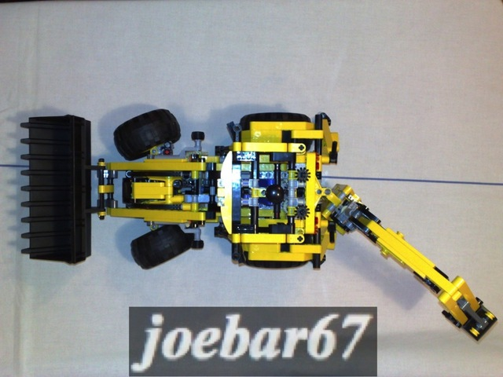](https://www.freelug.org/IMG/jpg/tracto_pelle_21.jpg)

[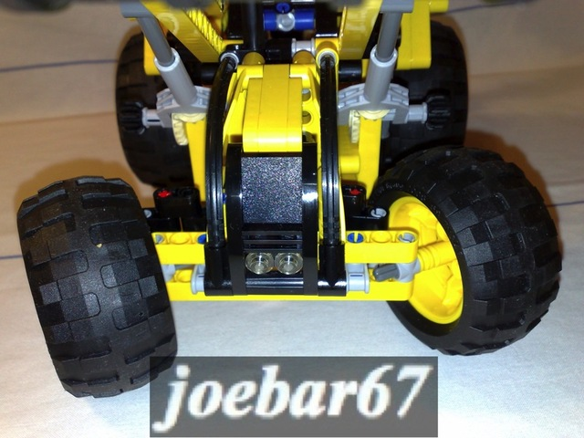](https://www.freelug.org/IMG/jpg/tracto_pelle_22.jpg)

[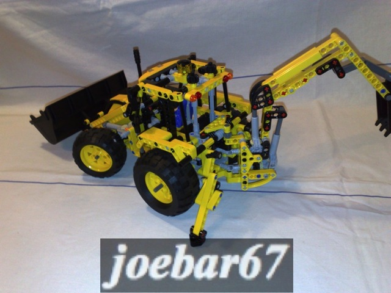](https://www.freelug.org/IMG/jpg/tracto_pelle_28.jpg)

[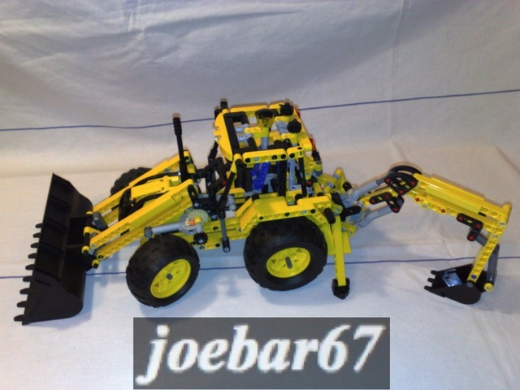](https://www.freelug.org/IMG/jpg/tracto_pelle_33.jpg)

[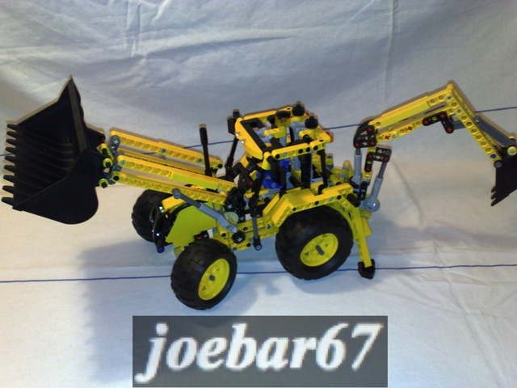](https://www.freelug.org/IMG/jpg/tracto_pelle_35.jpg)

[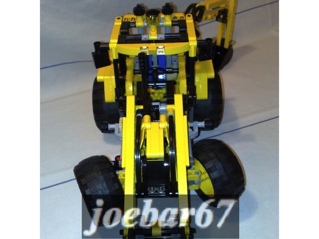](https://www.freelug.org/IMG/jpg/tracto_pelle_34.jpg)

Ah oui aussi un petit bonus, le capot moteur s’ouvre, ce qui fait un grand coffre :)

[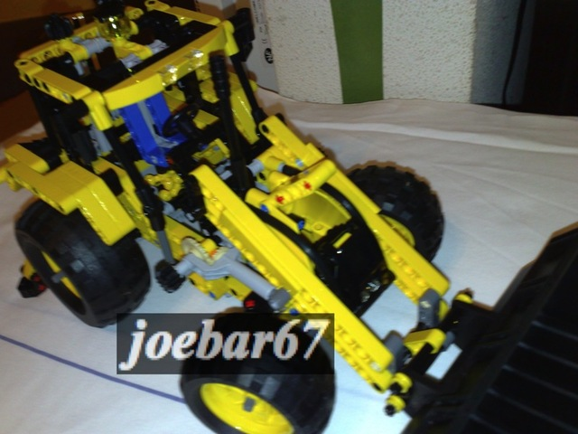](https://www.freelug.org/IMG/jpg/tracto_pelle_02.jpg)

Le model-B est un grumier.

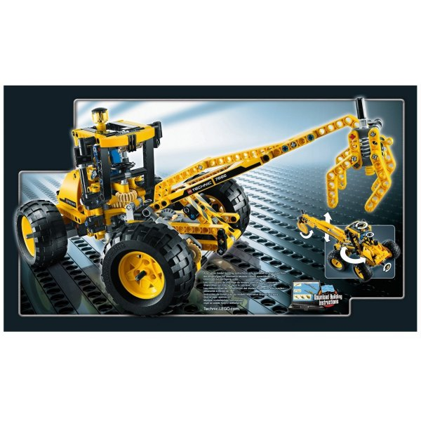

**8069 model-B**

La notice est sous forme de PDF à télécharger sur LEGO Direct.
