Profitant d’une promotion sur le set, à moins de 19 Euros, je me jette dessus, comme un affamé de camions LEGO !

**–** Prix : un peu moins de 20 Euros  
**–** Disponibilité : dans tous les magasins en ce moment.  
**–** Taille de la boîte : 47,5 X 28 cm  
**–** Nombre de pièces : 254  
**–** Gamme : City  
**–** Contenu : un camion, une remorque, un bateau qui flotte et 2 minifigs.  
**–** Temps de montage : environ une heure.

## La boîte

Et bien, elle est toujours immense, on ne peut pas la rater. Mais, vu le prix de lancement très attractif, c’est un modèle phare de la gamme. Du coup il faut qu’on puisse le voir. Je ne l’ai pas raté, puisque trouvé en tête de rayon du grand magasin qui faisait la promotion. La boîte est plus grosse que celle du modèle Playmobil aussi en promotion.

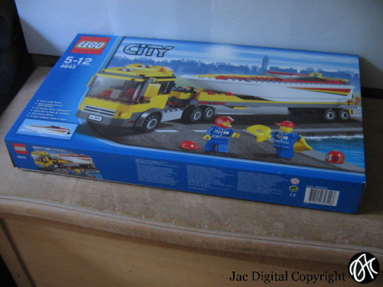

**La boîte**

## Le contenu

Et bien forcément, dans une si grande boîte, on trouve qu’il n’y a pas grand chose. Pourtant il y a pas mal de pièces dans ce set, malgré quelques métapièces connues comme le châssis de train.

Il y a 3 sachets numérotés, le châssis, la coque du bateau, une planche d’autocollants et les notices sans protection.

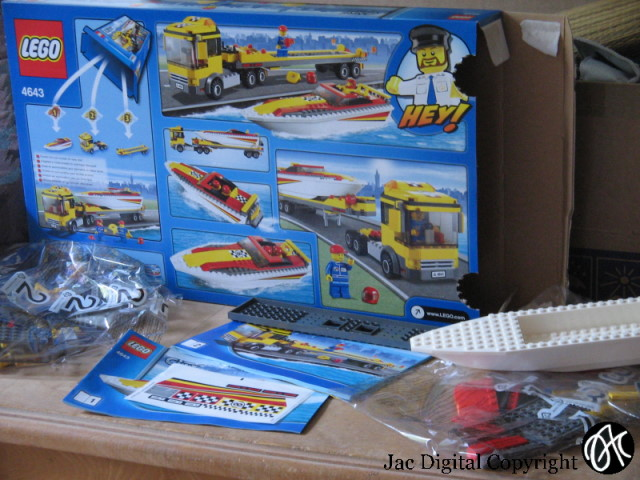

**Contenu**

Comme à mon habitude, j’ouvre les 3 sachets sans tenir compte des numéros, je fais tout de même 2 tas, un pour les grandes l’autre pour les petites pièces.

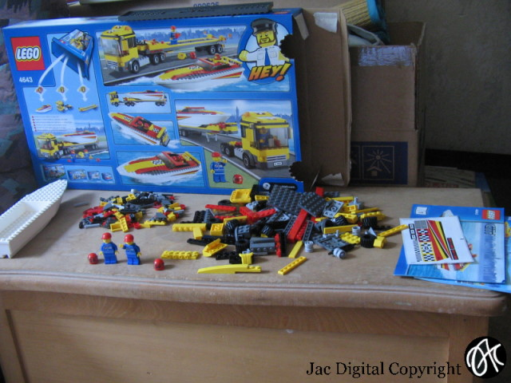

**Dans les sachets**

## Le montage

Comme à l’accoutumé et aussi par plaisir, je commence par assembler les minifigs qui sont au nombre de 2. On peut les placer indifféremment dans le camion ou dans le bateau, car il y a un équipement complet pour chacune d’elle.

**Le bateau**

J’attaque ensuite le montage du bateau. Histoire de garder le camion pour ma faim ! Euh non, pour la fin.

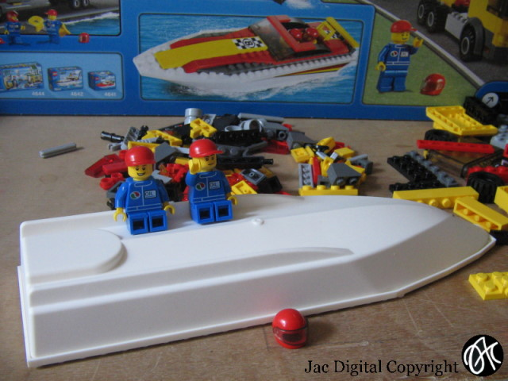

**La coque d’une pièce**

La construction n’est pas bien compliquée. J’ai très vite un beau petit bateau à mettre sur les flots. Mais par contre, où est passé l’attache pour mettre le moteur à piles ? Il n’y a plus qu’à pousser, comme pour les vieux trains. Car la coque flotte, c’est écrit sur la boîte. Et puis, tiens, du coup, on ne peut pas connaître le type de moteur de propulsion puisqu’il n’y a rien sous le capot. Ca sera une chose à modifier, une fois que j’aurais retrouvé mes caisses de briques...

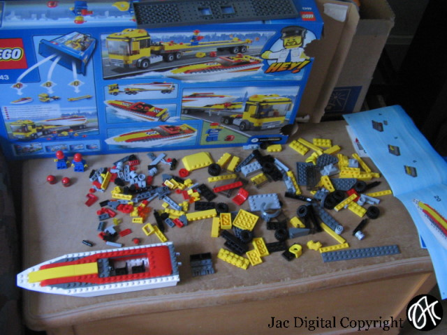

**En cours de construction**

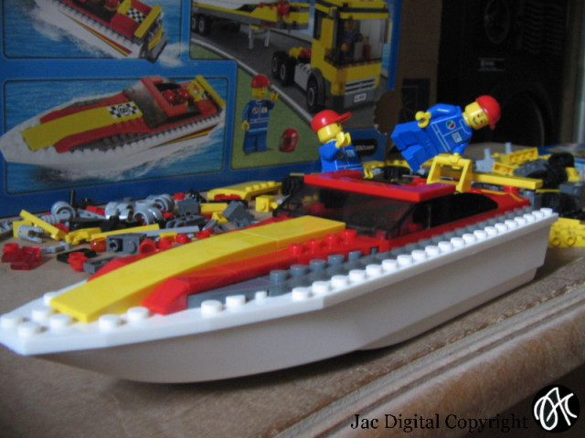

**Accès au bateau, mais sans se disputer !!**

**Le camion**

Le camion a des allures de bus. Ce qui est un peu normal puisqu’il reprend le même pare brise. Il a aussi les mêmes couleurs, ce qui fait que l’on pourrait les confondre.

Le chassis est très simple. Pas de coffre pour mettre des outils car il n’y en a pas dans la boîte.

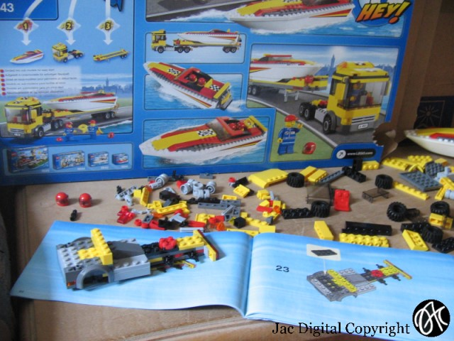

**Le chassis**

Le conducteur est placé au milieu. Je fais donc une petite modification pour le mettre côté gauche. Il devra se contenter d’une tasse à café à la place du levier de vitesse. Mais bon, on va dire que le bahut est en boîte automatique !

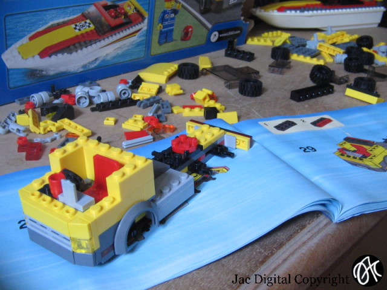

**Une modif !!!**

Une foi le camion fini, le seul accès pour le conducteur est de passer par le toit. J’en connait qui voudront mettre des portes, là quelque part ! Il n’y a qu’une place dans la cabine. La seconde minifig devra voyager dans le bateau. J’espère qu’elles ne vont pas se battre...

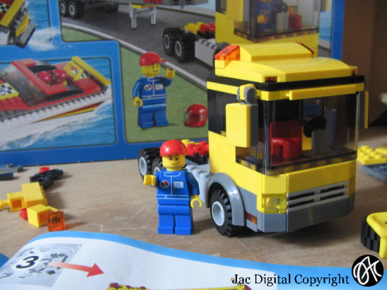

**Le camion**

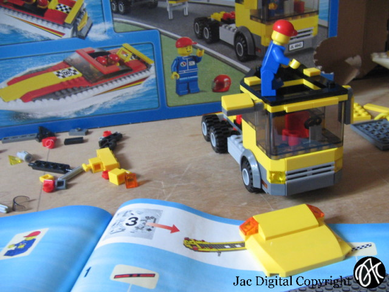

**L’accès à la cabine**

**La remorque**

La remorque est d’une simplicité... Une fois que l’on a fait le tandem arrière, c’est pratiquement fini. Le plus long est de placer les pneus sur les jantes. On placera avec plaisir les gilets de sauvetages sur leur emplacement, à l’avant de la remorque. Les casques ont, quant à eux, un crochet bien connu.

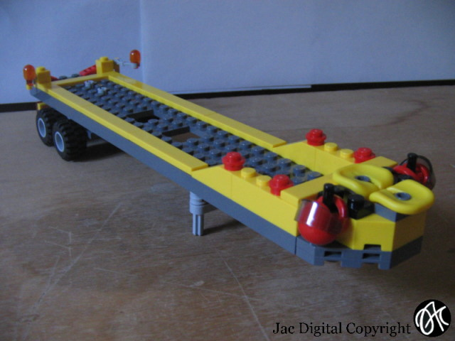

**La remorque**

Dans le premier [semi remorque Octan, référence 6594](http://www.peeron.com/inv/sets/6594-1) de 1992, j’avais vraiment adoré le système de suspension indépendant à chaque essieu de la remorque. Sur les modèles actuels, on a tout le tandem qui est suspendu d’un bloc. Je trouve moins amusant. C’est à dire que les essieux ne bougent pas indifféremment l’un de l’autre. C’est dommage comme petite évolution, à mon gout. De plus, le montage n’est pas forcément plus simple.

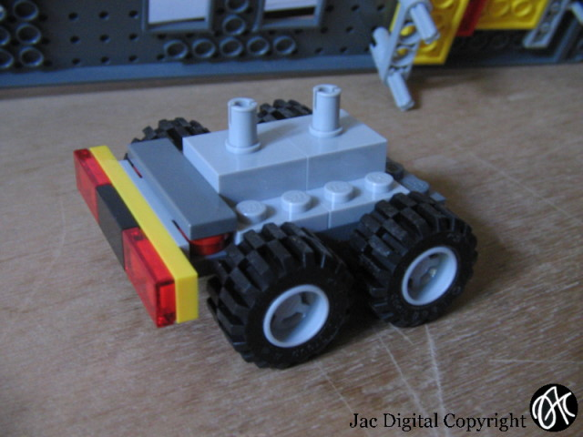

**Le tandem monobloc**

Il y a des pièces en extra. C’est un joli petit tas.

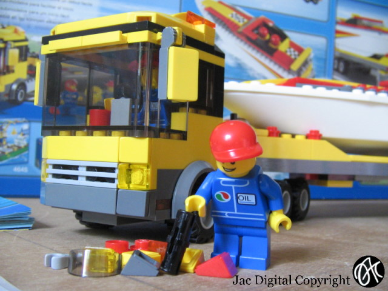

**Les pièces en extra**

## Pour conclure

Pour le prix, c’est un petit set sympa et vite monté. C’est un véhicule à faire rouler, donc forcément très jouable. Il me reste la flottaison du bateau à tester.

Bon, si vous en avez assez du rouge et du jaune et que vous n’êtes pas fan de camion LEGO, passez votre chemin !

Pour ma part, j’en prendrais sûrement un deuxième pour faire un catamaran ou un "robot bateau" !

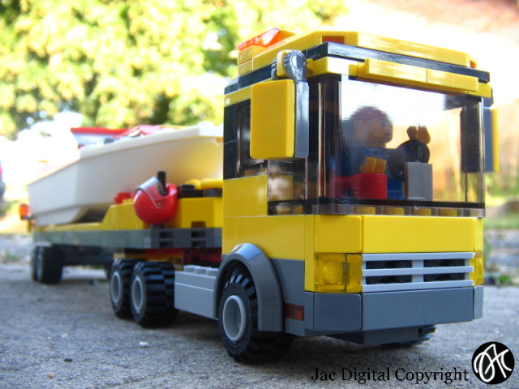

**Le beau camion.......**
