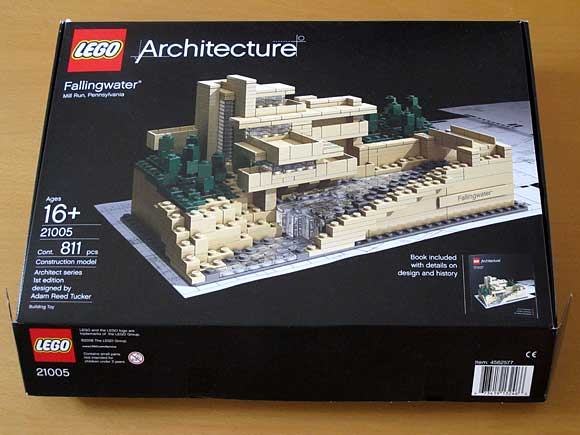
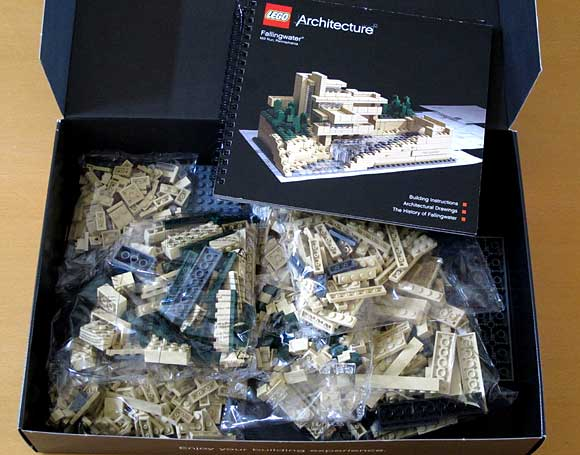
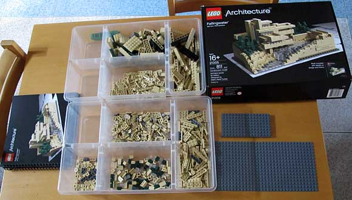
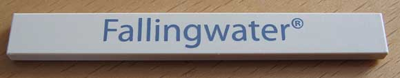
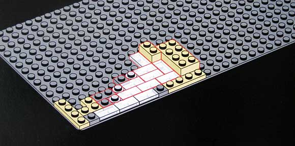
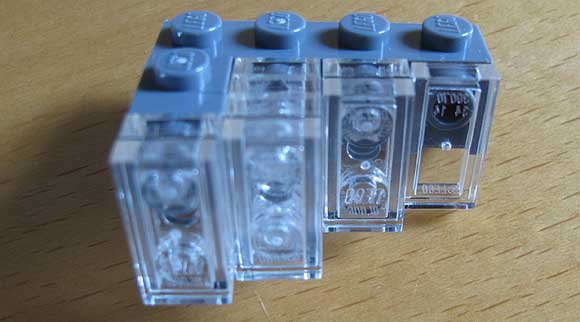
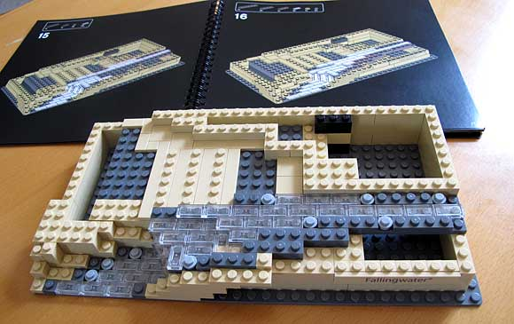
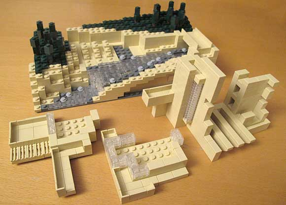
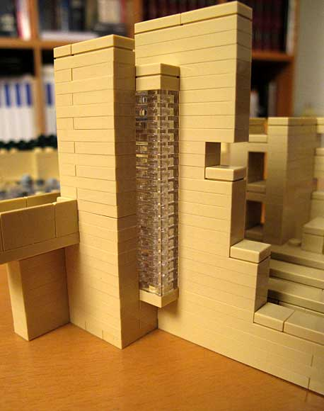
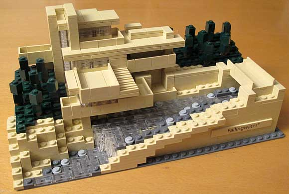

Je n’avais pas été enthousiasmé par les premiers modèles de la gamme Architecture, mais lorsque "Fallingwater" est sorti, j’ai tout de suite su qu’il ferait un cadeau parfait pour Annie...

Comme il n’est pas disponible en France, je l’ai commandé via Bricklink à [Adam Tucker](http://www.bricklink.com/store.asp?p=Brickstructures), l’architecte américain qui a lancé cette gamme en [collaboration avec LEGO](http://shop.lego.com/product/?p=21005&LangId=1036&ShipTo=US). Le modèle représente la [maison "Fallingwater"](http://fr.wikipedia.org/wiki/Fallingwater), conçue par l’architecte Frank Lloyd Wright en 1934.

La boîte est arrivée rapidement, et j’ai du patienter quelques temps avant l’anniversaire d’Annie. J’ai suivi le montage en photos...

**La boîte...**

La boîte, sur fond noir, fait très chic ! Elle s’ouvre par un rabat, sans nécessiter de charcutage.

**...et son contenu**

La reliure spiralée de la documentation a souffert, mais c’est probablement un problème lors du brochage et non durant le transport.

**On ouvre les sachets !**

On prépare les pièces dans les [boîtes à compartiment](/articles/des-boites-a-tri-bien-pratiques/). Les pièces sont très classiques, principalement des briques et plates en tan, vert foncé et transparent.

**La seule pièce spéciale de ce set !**

Une seule pièce spécifique : la plaque-nom sérigraphiée.

**Le manuel de montage**

La notice de montage est très claire, les pièces ajoutées à chaque étape étant surlignées de rouge.

**Un peu de SNOT**

Le montage est principalement réalisé par empilage simple, la seule section en SNOT constitue la chute d’eau.

**On monte d’abord le "terrain". Au premier plan, la chute d’eau qui donne son nom au set**

Le plus gros volume de pièces est utilisé pour former le terrain sur lequel est implantée la maison.

**La maison est constituée de modules, empilés et emboîtés**

Un intéressant contraste entre le terrain avec ses tenons apparents et le bâti, lisse grâce à un habillage de tiles.

**Les murs utilisent des plates, traduisant la construction en pierres plates.**

**On n’a plus qu’à pendre la crémaillère !**

Et voici le résultat final !
