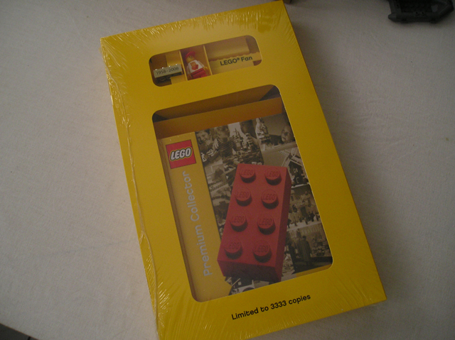
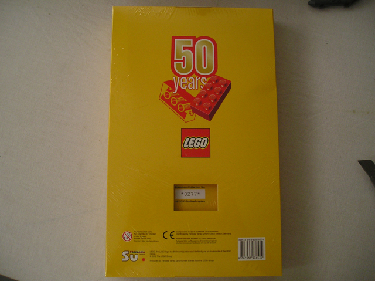
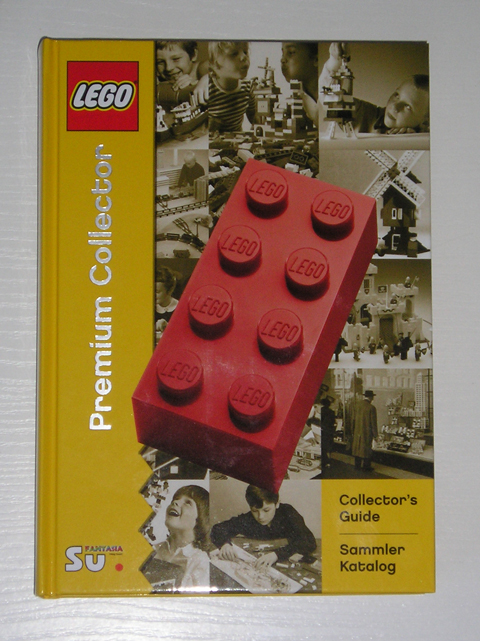
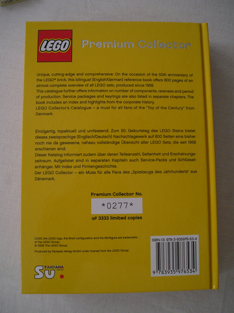
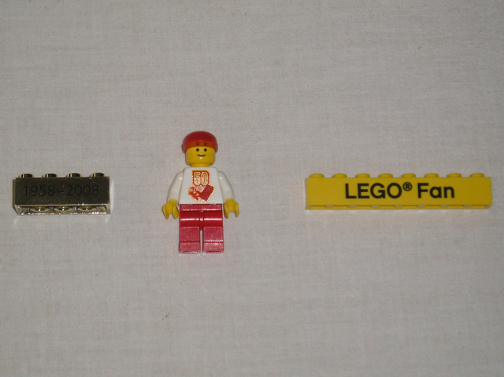
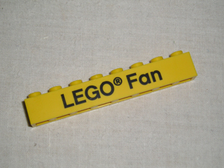
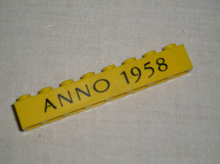
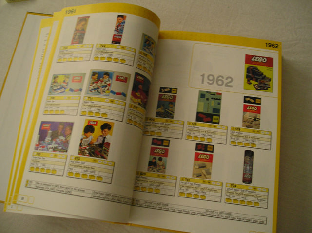
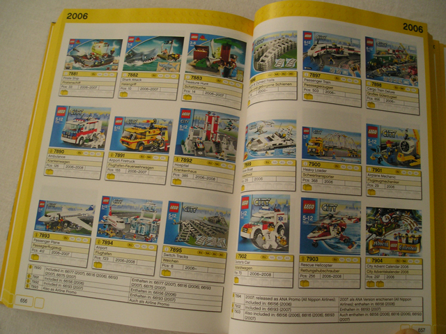

Pour les 50 ans de notre petite brique préférée, LEGO avec les éditions Fantasia Verlag GmbH nous proposent un livre regroupant tous les sets sortis depuis 1958.

Il existe deux versions de cet ouvrage : une dans une version simple, que l’on trouve sur le [shop](http://shop.lego.com/ByCategory/Product.aspx?p=810003&cn=59&d=275) ainsi que sur le [site de Fantasia](http://www.fantasia-design.de/shop/product_info.php?info=p92_Lego-Collector.html), l’autre dans [une version premium](http://www.fantasia-design.de/shop/product_info.php?info=p91_Lego-Collector.html) que l’on peut trouver que sur le site de Fantasia (à ma connaissance).

Lorsque je voulais le commander, il n’était disponible que sur le site de Fantasia. Là, j’avais le choix entre les deux versions...

Et puis je me suis dit que la version Premium allait surement proposer un petit plus.

Et j’ai bien fait...

En effet, cette version Premium est magnifique.

Je l’ai donc reçu par La Poste. Après ouverture du carton d’emballage on découvre le coffret.

**la boîte recto**

**la boîte verso**

On ouvre alors ce coffret et on en sort le livre emballé dans un plastique.

**le livre recto**

Au verso du livre, il mette bien en avant que c’est un ouvrage "collector" puisqu’il nous indique que j’ai en ma possession le numéro 277 sur 3 333 copies..... Quelle chance !

**le livre verso**

Pourquoi me demanderez-vous 3 333 copies ? Et bien je ne sais pas du tout... surement parce que l’on sera que 3 333 à posséder ce livre...

Ce livre a donc une couverture cartonnée, ce qui en fait un vrai livre "collector". En plus de cet ouvrage, il y a trois petit plus...

**les petits plus !**

Il nous est offert avec ce livre une brique dorée 2x4 marqué dessus 1958-2008, accompagné d’une Minifig avec le logo des 50 ans, et enfin une brique jaune 1x8 avec d’un côté ça :

**brique face 1**

et de l’autre ça :

**brique face 2**

Les briques sont sérigraphiées et non gravées... Tant pis.

Revenons donc au livre en lui même. C’est donc un ouvrage regroupant pratiquement tous les sets sortis depuis 1958 jusqu’à aujourd’hui.

Mais avant les nouveautés de juin 2008 puisqu’elles ne sont pas répertoriées.

Il est bilingue anglais-allemand, ce qui évite de se poser la question de la langue. On regrettera peut être qu’il ne soit pas en français mais finalement cela ne gène en rien puisque à part les 10 premières pages où on a droit à une petite introduction et à l’histoire de LEGO (que l’on connait tous par coeur...), et bien il n’y a rien d’autre à lire.

**pages intérieures**

Les sets sont donc classés par année de 1958 à 2008. Le classement se fait par le numéro des boîtes à l’intérieur de chaque année.

Il y a 9 vignettes par pages. Chaque vignette comporte une photo de la boîte, lorsque celle-ci est disponible... Puis vient le numéro du set et le continent dans lequel il a été commercialisé ( Europe, Amérique du Nord, Australie et Asie ).

Il y a inscrit ensuite le nom de la boîte en anglais puis en allemand. Puis le nombre des pièces suivi des années de productions et une dernière case pour signifier si ce set est dit "special", c’est à dire si il a été produit pour une campagne promotionnelle ou pour une autre exclusivité.

Sur la dernière ligne on trouve 6 briques, qui servent à définir la rareté du set... Plus les briques passent au jaune plus le set est dit rare.  
Ils ont surement du définir la rareté d’un set en fonction du nombre de production réalisé.

**pages intérieures**

Voilà pour ce qui est de la description de cet ouvrage.

La version simple de ce livre est normalement identique à l’exception de la couverture qui n’est pas cartonnée et bien évidement des petits plus...

Un petit mot tout de même sur les prix :  
**–** 22,90 euros pour la version simple  
**–** 39,90 euros pour la version premium  
**–** à rajouter les frais de port bien entendu.

Je ne regrette en rien d’avoir choisi cette version premium. Les trois suppléments en valent la peine. On l’apprécie encore plus le fait qu’elle soit cartonnée, cela fait que c’est un vrai ouvrage de référence et non un simple catalogue.

Pour conclure, je vous conseille de vous le procurer. C’est un livre qui peut rassembler du monde, se replonger dans les belles années de LEGO, retrouver Le Set que l’on a toujours voulu avoir...

Un seul petit regret tout de même, ils n’ont pas pu trouver toutes les photos des boîtes, c’est étonnant venant de la part de LEGO... Tant pis.

Un livre pour tous les fans de LEGO, qu’il soit collectionneur ou simple amateur.

A dans 50 ans pour le futur livre collector !
