Le thème dinosaure a un double aspect ludique et éducatif. La société LEGO ne s’y est pas trompé, les terribles lézards apparaissant aussi bien dans des sets DACTA (ligne "éducation") que dans des sets "action" surfant sur le succès du film Jurassic Park.

Avant de vous plonger dans cet article, consultez l’[article wikipédia sur les dinosaures](http://fr.wikipedia.org/wiki/Dinosaure). Vous retrouverez par ailleurs la plupart de ces "dinosaures" [^1] sur [wikipédia](http://fr.wikipedia.org/).

Cependant le dinosaure est un animal "neuf" chez LEGO. Il apparaît seulement en 1997 en Duplo. Quatre espèces célèbres sont disponibles dans ces sets (adultes et juvéniles) :

## DUPLO Dinosaure

**–** le brachiosaure (le lézard à bras - sans doute le plus grand dinosaure herbivore, plus grand encore que le fameux diplodocus),

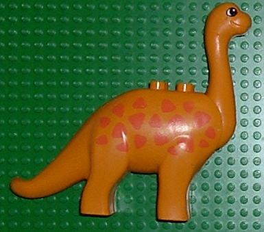

**–** le ptéranodon (aile sans dent - un des plus grands ptérosaures, reptiles volants),  
**–** le tyrannosaure (T-rex - le lézard tyran étant le plus grand carnivore de son temps)  
**–** et le tricératops (tête à trois cornes est un herbivore).

Certes les couleurs LEGO peuvent sembler manquer de réalisme. En fait, nous ne connaissons les dinosaures qu’à travers des fossiles et il est impossible de prouver quelles étaient leurs couleurs réelles ;-).

Les DUPLO sont sympathiques, mais ils sont très grossiers. La sortie en 2000 d’une série ["Dino Island"](http://guide.lugnet.com/set/?qc=lego/system/adventurers/dinoisland) offre des modèles plus précis.

## Adventurers : Dino Island

Dans cette série, les dinosaures sont au format "System" et constitués d’une à quelques pièces :

**–** Un [tyrannosaure](http://www.bricklink.com/catalogItem.asp?P=30457c01)  
**–** avec son [bébé](http://www.bricklink.com/catalogItem.asp?P=x92)  
**–** un [tricératops](http://www.bricklink.com/catalogItem.asp?P=4465c01),  
**–** un [ptéranodon](http://www.bricklink.com/catalogItem.asp?P=30478)  
**–** et un [stégosaure](http://www.bricklink.com/catalogItem.asp?P=stegc01).

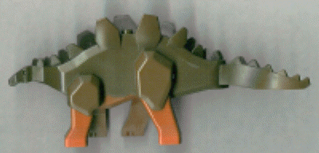

Ces éléments sont appréciés (ce sont les premiers disponibles en System) mais il faut reconnaître que leur intérêt pédagogique est très réduit. L’échelle avec les minifigs n’est d’ailleurs pas respectée. Heureusement nous n’aurons qu’une année à attendre pour voir apparaître la gamme "Dinosaurs".

## Dinosaurs

Ces [modèles](http://guide.lugnet.com/set/?q=6719%2C6720%2C6721%2C6722) ne sont pas faits d’une pièce mais se composent d’éléments caractéristiques interchangeables : corps, membres, têtes, cous, cornes et queues. Nous y reviendrons en détails plus tard.

Cette gamme se compose de quatre jeux de pièces différents, permettant de construire non pas 4 modèles mais 16. (pour chaque jeu, un modèle phare et 3 modèles alternatifs). Voici le détails de ces modèles :

Le [6719](http://guide.lugnet.com/set/6719) :

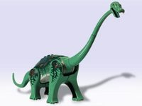

**–** Platéosaure (le lézard plat),  
**–** Diplodocus,  
**–** Brachiosaure,  
**–** Plesiosaure (qui ressemblerait au monstre du Loch Ness).

Le [6720](http://guide.lugnet.com/set/6720) :

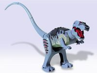

**–** Tyrannosaure,  
**–** Parasaurolophus (typique avec sa crête derrière le crane) ,  
**–** Spinosaure (lézard épineux),  
**–** Ouranosaure (lézard courageux).

Le [6721](http://guide.lugnet.com/set/6721.9) :

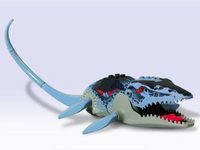

**–** Mosasaurus (lézard de la Meuse, reptile marin),  
**–** Postosuchus (surnommé "crocodile qui court"),  
**–** Iguanodon (dent d’iguane - un herbivore sympathique),  
**–** Dimetrodon (ancêtre des premiers mammifères).

et le [6722](http://guide.lugnet.com/set/6722) (bêtes à cornes) :

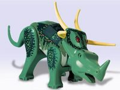

**–** Styracosaurus (avec de nombreuses cornes),  
**–** Triceratops (bien connu),  
**–** Centrosaurus (lézard à pointe),  
**–** Camarasaure (le seul sans corne dans ce set).

Faire 4 modèles avec un jeu de pièces aussi réduit est exceptionnel. Ceci s’explique par le fait que les "dinosaures" se ressemblent, et qu’en conséquence les différences entre modèles sont parfois réduites à la plus simple expression : une simple interversion entre membres antérieurs et postérieurs pour le diplodocus et le brachiosaure ou encore une crête dorsale en plus pour l’ouranosaure qui le distingue de l’iguanodon.

Une conséquence de l’utilisation d’éléments interchangeables est que les échelles ne sont pas respectées. Le tricératops LEGO à la même taille que l’imposant brachiosaure.

On remarque aussi que les couleurs employées, peu courantes dans l’univers LEGO, sont plus "réalistes". Ces couleurs que nous appelons dans le jargon des "sand" (sand green, sand blue) sont désaturées, mois clinquantes.

Enfin dans cette gamme, on trouve :  
**–** des animaux terrestres ou marins mais aucuns volants,  
**–** des bipèdes et quadrupèdes,  
**–** des herbivores et des carnivores.

Les bipèdes ne sont, par nature, pas très stables. Le couvercle de la boîte, servant de socle, permet de leur fournir la stabilité nécessaire ([comme l’a bloggué Virginie](http://brick-a-pickwick.over-blog.com/article-12348215.html)).

Si ces sets vous plaisent, vous pouvez retrouver en gris foncé les éléments du set 6720 dans le set 1371 ["Spinosaurus Attack"](http://www.peeron.com/inv/sets/1371-1).

Revenons aux pièces qui les composent :

Le corps est principalement composé de 6 pièces qui une fois assemblées forment une structure oblongue avec des points d’attache permettant de fixer de manière articulée les membres, le cou et la queue.

Ce corps existe en différentes couleurs et différentes décorations (pièces [40373](http://www.peeron.com/cgi-bin/invcgis/psearch?query=40373&limit=parts), [40374](http://www.peeron.com/cgi-bin/invcgis/psearch?query=40374&limit=parts) et [40375](http://www.peeron.com/inv/parts/40375)).

Outre la gamme dinosaure, ces pièces servent aussi pour faire des [éléphants](http://www.peeron.com/inv/sets/7414-1?showpic=7050) , des [dewbacks](http://www.peeron.com/inv/sets/4501-1?showpic=6724) et [bogas](http://www.peeron.com/inv/sets/7255-1?showpic=4520) (créatures de l’univers Star Wars) et autres [monstres imaginaires](http://www.peeron.com/inv/sets/4797-1?showpic=585).

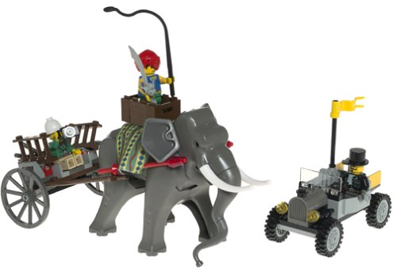

Les "pattes" sont de deux types (40380c0x et 40382c0x), plus ou moins grandes, appairées.

Les membres réduits (bras) droit [6127](http://www.peeron.com/inv/parts/6127) et gauche [6128](http://www.peeron.com/inv/parts/6128) sont aussi utilisés pour servir aux dragons de la gamme château.

Les nageoires [40386](http://www.peeron.com/inv/parts/40386) sont aussi utilisées dans un [set BatMan](http://www.peeron.com/inv/sets/7783-1) pour le véhicules du Pingouin ou pour un [serpent de mer](http://www.peeron.com/inv/sets/7018-1) viking.

Les pieds [40393](http://www.peeron.com/inv/parts/40393) sont symétriques (à la fois droit et gauche)et équipés de griffes. Ils rendent les carnivores plus agressifs.

Les éléments formant les queues ([378](http://www.peeron.com/inv/parts/378),  
[40378](http://www.peeron.com/inv/parts/40378),  
[40395](http://www.peeron.com/inv/parts/40395cx1),  
et [40396](http://www.peeron.com/inv/parts/40396) servent aussi aux cous (ou inversement) et autorisent des tailles variées tout en suggérant des mouvements reptiliens. Ils sont par ailleurs largement utilisés comme [pattes d’araignées](http://www.peeron.com/inv/sets/4727-1), [tentacules de calamar](http://www.peeron.com/inv/sets/4796-1), [corps de serpent](http://www.peeron.com/inv/sets/4730-1) et comme cornes.

Les têtes, au nombre de 4, sont les éléments les plus spécifiques de ces dinosaures.

Celle des grands herbivores est toute petite, c’est nécessaire pour respecter l’échelle avec le corps.

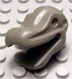

Celle des bêtes à cornes est plus grande, pleine de trous pour y placer leurs appendices pointues.

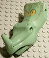

Les méchants carnivores profitent du choix entre deux gueules, dans les deux cas articulées et équipées de dents acérées et d’une langue... qui n’est pas sans rappeler la tête d’un crocodile ! La tête la plus allongée convient mieux aux reptiles, le tyrannosaure appréciant une gueule plus ramassée.

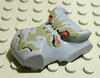

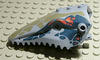

En conclusion, cette gamme peut s’avérer être un bon support pour un exposé à l’école.

Par contre, ne vous arrêtez pas sur [les versions "jeunes"](http://guide.lugnet.com/set/?q=7000_1%2C7001%2C7002%2C7003) de ces modèles qui sont pour le moins ratées.

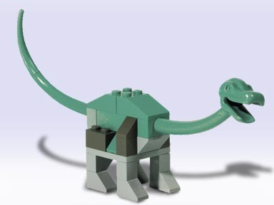

Comme nous l’avons déjà dit auparavant, LEGO a aussi surfé cette même année 2001, sur le film "Jurassic Park III".

## Studio - JPIII

Nous avons déjà cité le set 1371 ["Spinosaurus Attack"](http://www.peeron.com/inv/sets/1371-1).  
(JPIII est d’ailleurs tatoué sur la cuisse gauche du spinosaure).

Mais Studio nous réserve aussi un ["Raptor Rumble 1370"](http://www.peeron.com/inv/sets/1370-1) avec des Velociraptors et un Pteranodon.

Le ["Dino Head Attack" 1354](http://guide.lugnet.com/set/1354) permettra avec des pièces basiques de reconstituer une tête de tyrannosaure.

## Dino Attack (Dino 2010)

C’est [la gamme la plus récente](http://www.peeron.com/inv/theme/LEGO/SYSTEM/Town/Dino_2010) sur le sujet.

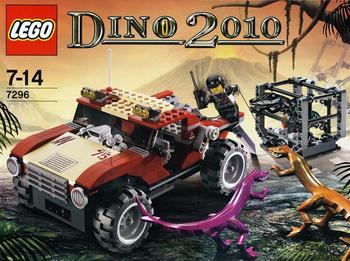

Au programme : velociraptor, tyrannosaure, ptéranodon et beaucoup d’action. Les éléments sont très spécifiques et ne sont pas réutilisés dans d’autres sets hors gamme. L’intérêt pédagogique est réduit à néant, les animaux étant stylisés à l’extrême méritant leur qualificatif de mutant.

**Technic, Designer et Creator**

En 1995, le [Control Center II](http://www.bricklink.com/catalogItemPic.asp?S=8485-1) présente en modèle alternatif un tyrannosaure qui n’est pas sans rappeler celui, tout récent (2007), équipé du nouveau système de motorisation "Power Function System" [4958](http://guide.lugnet.com/set/4958). Leur plus se situe bien sûr dans l’animation motorisée des modèles.

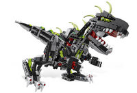

Le set Designer "Prehistoric creatures" [4507](http://www.peeron.com/inv/sets/4507-1) est très intéressant aussi car il vous permet de reconstituer, en plus de l’indétrônable tyrannosaure, un ptéranodon, un diplodocus ou un stégosaure.

Des petits sets plus fantaisistes comme :  
**–** le X-pod [4418](http://guide.lugnet.com/set/4418)  
**–** ou les Creator [7604](http://guide.lugnet.com/set/7604)  
**–** et [7605](http://guide.lugnet.com/set/7605) tout trois de 2006  
**–** le Designer set [7219](http://www.bricklink.com/catalogItem.asp?S=7219-1) de 2004  
**–** ainsi que le calendrier de l’avent 2002 (4524) et ses [modèles](http://www.bricklink.com/catalogItemPic.asp?S=4524-11) de dinosaures.

Pour être complet rappelons aussi ces produits confidentiels :  
**–** le livret d’activité DACTA 9702 ["dino motorisé"](http://www.bricklink.com/catalogItemPic.asp?B=9702b4) de 1993  
**–** le [Dino mosaic](http://www.bricklink.com/catalogItemPic.asp?S=k34432-1)

## Conclusion

Rien de parfait dans toutes ces gammes. Ma préférence va à la plus réaliste et qui offre le plus de possibilité, je veux parler de la gamme "Dinosaurs" qui malheureusement n’a pas rencontré de succès. La solution consiste très certainement à mélanger les éléments disponibles comme dans cette [re-création de l’univers de Jurassic Park](http://www.brickshelf.com/cgi-bin/gallery.cgi?f=264180) par Eccohawk.

[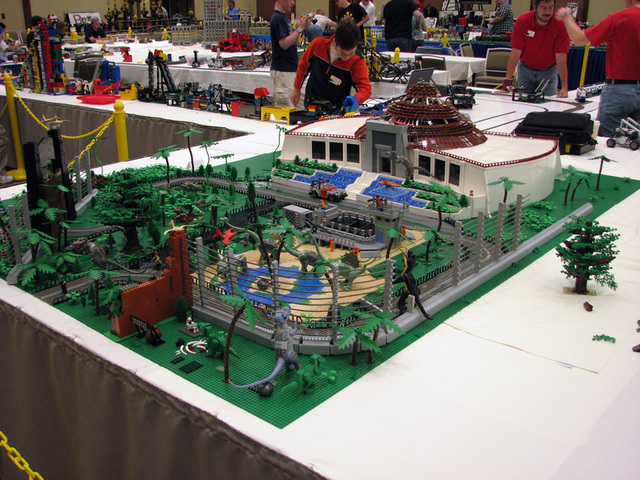](https://www.freelug.org/IMG/jpg/bwjurassicpark1426.jpg)

## Crédits photographiques

Les photos utilisées ici à titre d’illustration sont issues de :  
**–** [Guide Lugnet](http://guide.lugnet.com/)  
**–** [Peeron](http://www.peeron.com/)  
**–** [Bricklink](http://www.bricklink.com/)  
**–** [Galerie Brickshelf de PepaQuin](http://www.brickshelf.com/cgi-bin/gallery.cgi?m=PepaQuin)

et restent la propriété de leurs auteurs.

[^1]: Toutes les espèces citées ne sont pas obligatoirement des dinosaures au sens scientifique du terme mais parfois des reptiles
