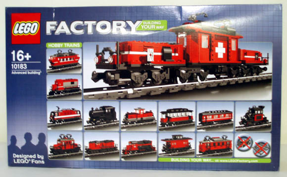
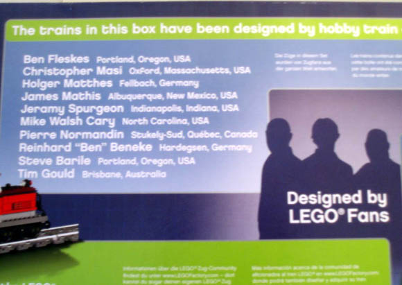
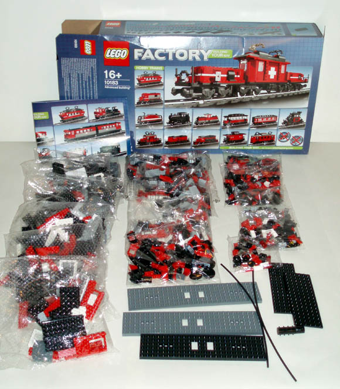
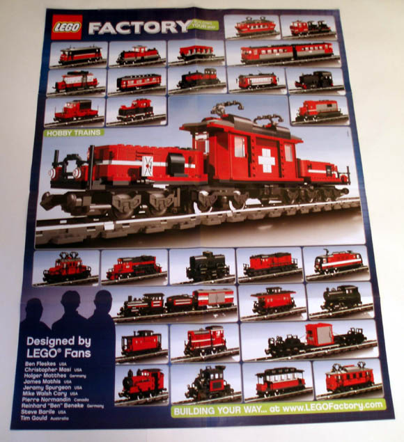
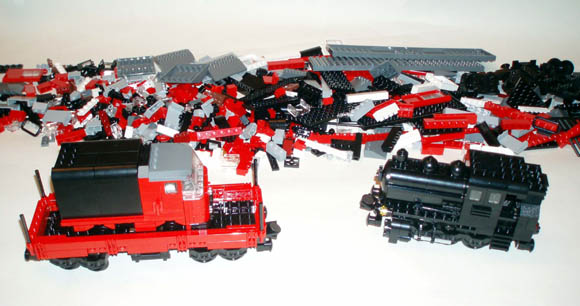
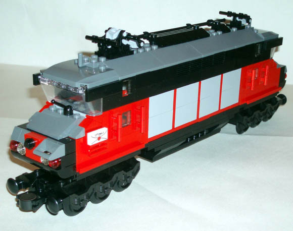
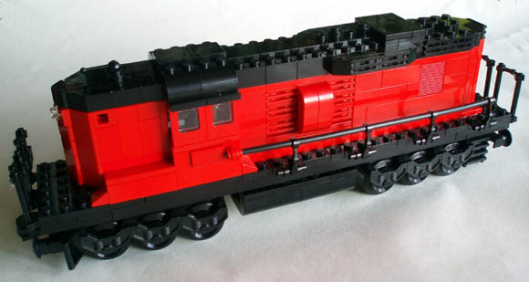
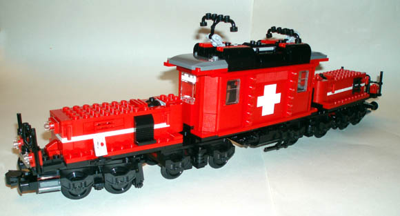

Les fans l’attendent avec impatience. C’est avec plaisir que j’ai reçu en avant première le set 10183 - Hobby Train - et je vais vous faire partager mes premières impressions avant sa sortie officielle prévue pour le 19 Mars.

**Introduction**

Vous allez devoir patienter encore quelques jours avant de pouvoir enfin commander sur [le shopAtHome](http://shop.lego.com/Product/?p=K10183) ce set fait par des fans pour des fans. Vous avez peut-être déjà étudié attentivement les [premières images](http://www.iltco.org/gallery/view_album.php?set_albumName=album47) diffusées sur ILTCO qui dévoilent les visuels composant la boîte.

Les modèles ont été conçus par 10 fans de trains LEGO sélectionnés par TLC : Pierre Normandin (membre de FreeLUG), Steve Barile, Reinhard "Ben" Beneke, Ben Fleskes, Tim Gould, Chris Masi, James Mathis, Holger "HoMa" Matthes, Jeramy Spurgeon et Mike Walsh.

Ils ont travaillé sur le projet depuis le printemps 2006, pour sélectionner d’abord une palette de pièces et ensuite pour créer un maximum de modèles possibles avec cette palette. Environ 80 modèles ont été créés, et 30 ont été retenus au final.

**La boîte**

Sur la boite, on lit "16+" - oui c’est un produit "pour adultes". Ne nous y trompons pas, il s’agit toujours ici d’un jouet et pas encore de modélisme (bien que...) mais une certaine jouabilité - un montage rapide pour un jeu immédiat - a laissé place à plus de réalisme. C’est un produit où le plaisir de construire et de créer a (re)trouvé la place que nous lui connaissions auparavant.

Une partie des 30 modèles est présentée sur l’emballage, mais un modèle y a la part belle - nous y reviendrons plus tard. L’oeil averti remarque immédiatement les roues chromées qui trahissent le moteur train 9V. Toutefois comme l’indique les images barrées d’une croix, la boîte ne contient ni rail, ni moteur. Le système est ouvert, et le set conviendra même à ceux qui sont en 12V.

_En savoir plus :_

La société LEGO ne cesse d’innover et propose depuis l’année dernière un nouveau système pour les trains, télécommandé et à pile, adapté aux jeunes enfants. Ce système, dit "RC", est moins apprécié des fans adultes qui redoutent la disparition progressive du système en alimentation 9V par les rails (dit "9V") - il existe même un système encore plus ancien (dit "12V"). Le set que je vous présente ici semble conçu pour le "9V" et c’est très positif pour notre hobby.

**Le contenu**

Vous connaissez déjà [l’inventaire](http://www.iltco.org/gallery/view_photo.php?set_albumName=album47&id=10183_Elements) des pièces car il est disponible dans la galerie d’ILTCO.

Au niveau des couleurs, vous trouverez une dominante de rouge - couleur très employée dans de nombreux pays pour le matériel roulant ferroviaire car il offre une bonne visibilité. C’est donc un choix logique. Le noir est aussi bien présent (de nombreuses plaques de grandes tailles). Vous trouverez aussi du blanc, du gris mais surtout un peu de rouge foncé fort apprécié.

Vous ne serez pas dépaysés par la sélection de pièces si vous côtoyez LEGOFactory ou si vous appréciez les gammes Designer et Creator. Parmi les petites pièces, beaucoup de pièces "SNOT" (voir [cet article en anglais](http://www.iltco.org/gallery/view_album.php?set_albumName=album35)), comme la "[brique machine à laver](http://www.peeron.com/inv/parts/4070)".

On trouve bien sûr des pièces plus spécifiques au train comme les essieux. On se réjouira de la présence des portes (pivotantes et coulissantes). Petite déception, l’absence de minifigs alors que celles-ci sont disponibles sur LEGOFactory !

Une grande satisfaction au final pour moi, c’est de voir que dans cet assortiment de 1080 pièces, on ne trouve pas trop de pièces "peu utiles" comme les briques et plaques simples dont nos tiroirs regorgent déjà.

_En savoir plus_

Parmi les petites pièces fortement appréciées des AFOLs, vous trouverez les [petites briques pentues 1x1x2/3](http://www.peeron.com/inv/parts/50746) dites "cheesie slopes", en rouge, noir et gris foncé : 36 en tout.

**Les modèles**

Dans la boîte vous trouverez les instructions imprimées pour construire la locomotive "crocodile" [^1]. Les instructions pour les 29 autres modèles seront à télécharger au format LEGO Digital Designer (le logiciel de montage 3D de LEGO) sur le site LEGOFactory. A noter que LDD fait peau neuve et que vous pourrez télécharger la version 2.0.

Il va sans dire que les 30 modèles ne peuvent pas être construits tous à la fois, mais en fonction des modèles choisis, on peut éventuellement en construire deux en même temps et l’on s’apercevra qu’il reste encore des pièces pour construire autre chose (par exemple il y a 12 essieux et 6 couplages ce qui donne l’occasion de créer un train composé de trois véhicules).

Pour la construction, je me suis d’abord intéressé à un wagon emportant en guise de fret un petite camionnette, le design me plaisant particulièrement. Les montages utilisés sont ingénieux, rendant la construction palpitante. Un véritable plaisir de voir enfin des sets utilisant des techniques de montage un peu extrêmes qui permettent de mieux détailler les modèles. C’est aussi un modèle complet en lui même comportant deux éléments distincts : wagon + camionnette.

Note : Le set ne comportant pas de pneus, le créateur de ce modèle a joué le coup en utilisant les petites roues de trains qui font office de jantes : la camionnette est transportée dans l’attente de recevoir ses pneus ! Un très bel exemple de créativité qui repousse les limites.

J’ai pris pas mal de temps pour monter ce modèle. Pourquoi ?

La lecture sur LDD de la notice de montage est aisée, ce n’est pas cela qui m’a ralenti. Au contraire le fait de pouvoir bouger le modèle virtuel dans tout les sens permet de mieux voir l’emplacement des pièces.

Ce qui m’a le plus gêné... c’est le temps pris à rechercher les pièces parmi les 1080. A titre de comparaison, un très beau modèle comme la Santa-Fe (Burlington) ne comporte que 407 pièces.

* * *

**1080, c’est vraiment beaucoup de pièces.**

* * *

Au point que je me suis dit : allons y, essayons de construire en plus la petite loco vapeur qui est proposée. La construction fut plus rapide, plus classique aussi mais toujours avec quelques astuces sympa comme les barres latérales qui donne l’impression que les embiellages de roues sont présents. Et il ne me manquait vraiment que quelques pièces déjà utilisées que j’ai pu facilement remplacer par d’autres.

Maintenant que je m’étais familiarisé avec l’assortiment de pièces, j’ai décidé de construire mon propre modèle. J’ai pris une soirée pour faire une "nez cassé" (ces locos qui ont le pare-brise incliné vers le bas).

Je ne suis pas très satisfait de mes dons de créateur :-D.

En tout cas, c’est très plaisant de pouvoir faire quelque chose aussi rapidement grâce à une sélection de pièces bien faite... pour le train bien sur, vous aurez bien du mal à faire un château avec ce set :-D (bien que je sois toujours surpris par la créativité des fans).

J’ai par la suite construit bien d’autre modèles proposés sans les épuiser tous et j’en suis sûr, vous les trouverez tous intéressants.

Les connaisseurs y retrouveront le style des fans de trains LEGO reconnus comme James Mathis ou Reinhard Beneke et c’est déjà une belle promesse de satisfaction. Comme nous l’avons évoqué au début de cet article, ne passez pas à côté de la fabuleuse "crocodile". C’est un superbe modèle aussi bien à construire qu’à faire rouler sur votre réseau avec sa double articulation.

**Conclusion**

Bon alors, il est "cool" ce set ou pas ?

C’est sûr les fans adultes vont aimer. Une belle sélection de pièces, des modèles très "AFOL" (Adult Fan Of LEGO), beaucoup de SNOT, des designs plus réalistes au prix parfois d’une petite fragilité. Tout ce que l’on pouvait attendre d’une telle interaction entre la société LEGO et les fans pour avoir un set "fait par les fans".

Pour le public plus large, on retiendra surtout le grand nombre de notices de montage disponibles (30 !!). Des heures de jeu sont assurées grâce aux nombreux montages proposés. Je doute que vous les épuisiez tous.

[^1]: J’ai reçu une boîte "prototype" qui ne comportait pas ce livret d’instructions
