Pour mes 50 ans, j’ai reçu en cadeau cette superbe boite. Puisque cela vient de membres de l’association, je leur ai promis une review sur le site. Ne vous inquiétez pas, ce n’est pas une punition, c’est aussi parce que ça me fait plaisir :)

C’est une référence issue de la série "LEGO Idea" qui permet de reproduire en briques LEGO la superbe petite sportive anglaise Caterham Seven 620R. Je ne vous ferai pas un historique de ce petit bolide ici, je vais me contenter de l’analyse du montage de cette très belle boite. Vous avez sûrement déjà croisé ces petites voitures, peut-être même sans y faire plus attention. Grâce à cette nouvelle référence, vous ne pourrez plus les rater.

-   Référence 21307, sortie en 2016
-   Prix du Shop : 84.99
-   Nombre de pièces : 773
-   Rapport : 0,10 Euros la pièce...
-   Environ 3h de montage.

Le rapport prix des pièces n’est pas au top, mais c’est un modèle particulier sans vraiment de précédent dans la marque, de plus avec une licence donc on est pas si mal...

Je trouve la boite très belle avec une présentation en quelques photos du modèle fini. Ça donne envie de commencer le montage très vite. Mais je vais quand même m’arrêter aux étapes importantes, ne vous inquiétez pas. Déjà la présentation de la boite en deux photos, recto et verso...

[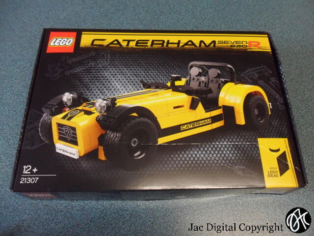](https://www.freelug.org/IMG/jpg/SAM_6195.jpg)

[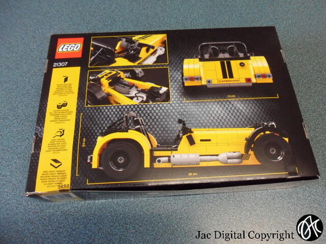](https://www.freelug.org/IMG/jpg/SAM_6196.jpg)

L’ouverture de la boite est très bien pensée. Deux petits scotch à couper pour assurer le maintien et ensuite, même sans, elle reste très facilement refermable. Ce qui incite fortement à la conserver pour pouvoir un jour (lointain...) démonter la maquette. Bin oui il faudra peut-être faire de la place pour d’autres.

Le contenu remplit bien l’espace. On y trouve 7 sachets numérotés de 1 à 5 et la notice.

[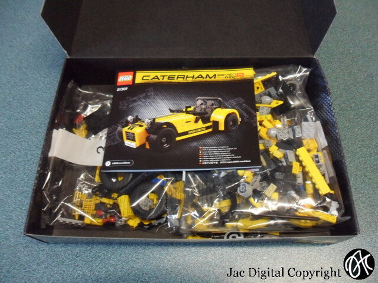](https://www.freelug.org/IMG/jpg/SAM_6199.jpg)

La notice est un très beau livret avec les deux premières pages consacrées au modèle réel. Bon c’est en anglais mais c’est tout de même très intéressant. Elle n’est pas protégée dans un emballage, mais bien disposée au fond de la boite.

[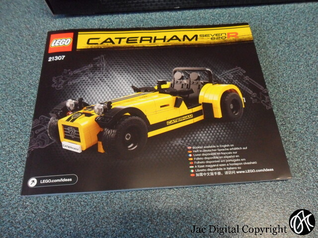](https://www.freelug.org/IMG/jpg/SAM_6200.jpg)

Ici, pas de minifig, on commence directement le montage par des pièces importantes pour un véhicule : les béquilles. Vous allez me dire que ça sert surtout pour un véhicule en panne et vous n’auriez pas tort. Sauf que là, ces petites trouvailles au nombre de 4 permettent de placer votre Caterham en position éclatée du plus bel effet. On peut ainsi enlever les roues, le capot moteur et les pièces que l’on veut sans gêner la stabilité de la construction finie.

[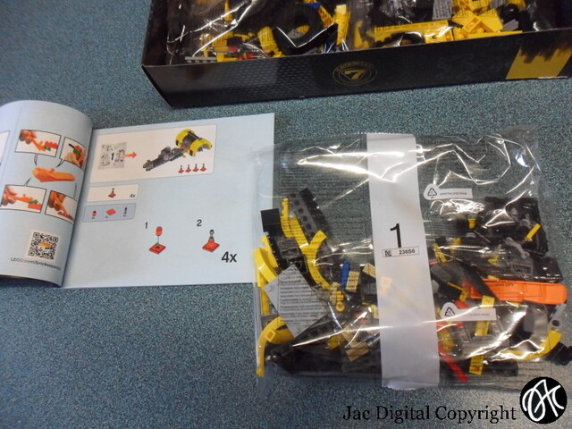](https://www.freelug.org/IMG/jpg/SAM_6203.jpg)

Quelques photos pour vous montrer le premier tas de pièces, les pièces nouvelles, enfin que je n’avais pas vues avant dans d’autres boites et les pièces en extra. Pour ces dernières, je me retrouve avec deux plates de 1X2. En général ça n’arrive pas, mais j’ai repris la notice et je n’ai pas trouvé où j’aurais pu les rater. En tout cas je ne vois pas de manque sur le modèle, donc je passe. On trouve aussi dans ces premiers sachets un démonte briques. On peut se dire que l’on ne va pas démonter notre Caterham tout de suite, enfin, je me disais ça. Puis je me suis trompé sur un emplacement de pièce. Heureusement qu’il était là finalement...

[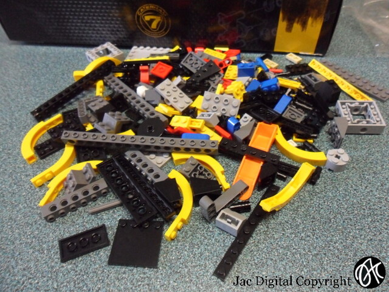](https://www.freelug.org/IMG/jpg/SAM_6210.jpg)

Des pièces nouvelles, enfin pour moi, le micro et une plate 2X4 avec trou sur le dessous. Si vous avez le nom plus court allez-y !! Pour la "tile" noire 2X3 par contre, j’en suis sûr.

[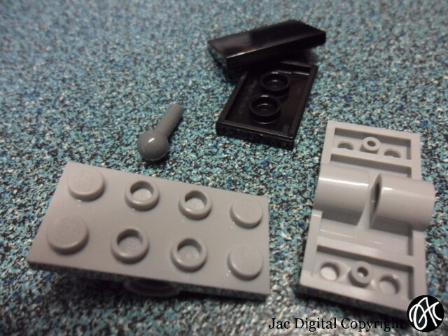](https://www.freelug.org/IMG/jpg/SAM_6213.jpg)

Là on va dire que le châssis est terminé...

[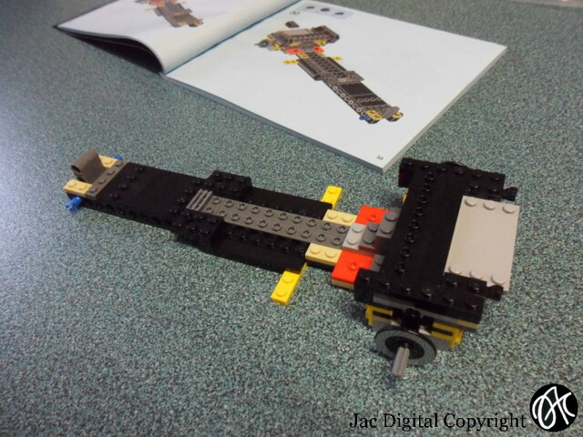](https://www.freelug.org/IMG/jpg/SAM_6220.jpg)

Voilà ce que l’on obtient après avoir vidé le premier sachet. Les béquilles sont très bien faites et vont être très pratiques.

[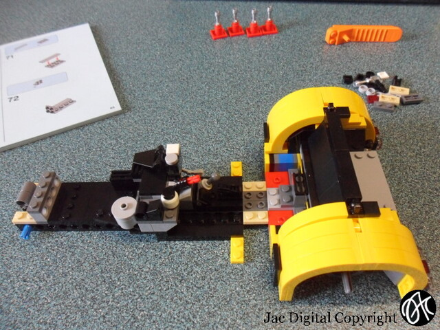](https://www.freelug.org/IMG/jpg/SAM_6223.jpg)

À nouveau un beau tas de briques pour la deuxième partie du montage. C’est une technique de tout vider sur la table, mais on peut aussi laisser les petites pièces dans les petits sachets. Ça aide pour la recherche, surtout au début.

[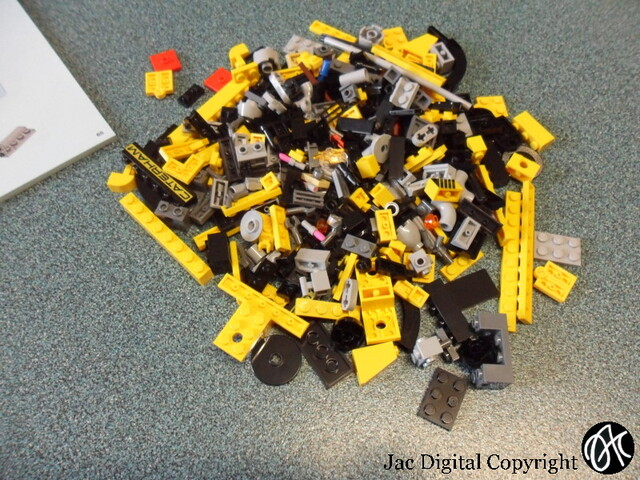](https://www.freelug.org/IMG/jpg/SAM_6232-2.jpg)

On trouvera dans cette partie de superbe pièces sérigraphiées comme les disques de freins ou simplement les briques marquées "CATERHAM", ainsi que des pièces bizarres. Bin oui, on se demande ce que viennent faire des tubes de rouge à lèvres Friends dans l’inventaire d’une boite qui permet de construire une voiture. Mais je ne vais rien dévoiler sur la technique de montage ici, vous trouverez en montant la maquette..... Il faut bien garder quelques surprises.

[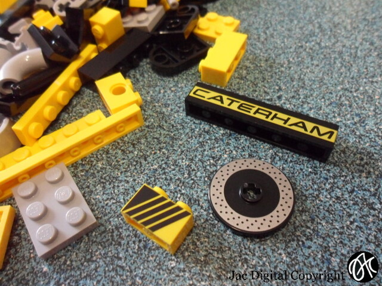](https://www.freelug.org/IMG/jpg/SAM_6237.jpg)

[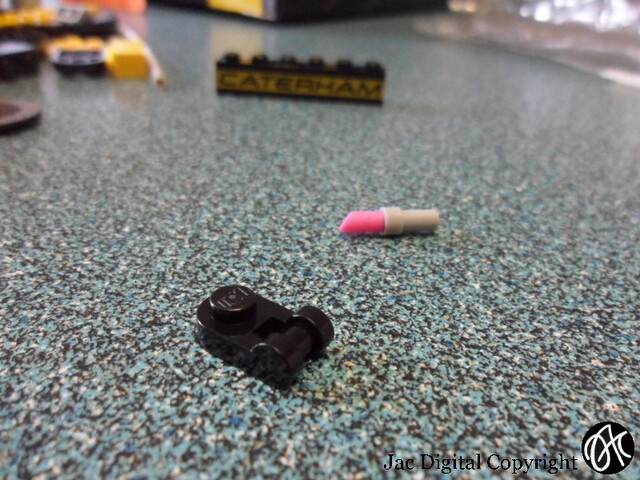](https://www.freelug.org/IMG/jpg/SAM_6239.jpg)

Voilà, on peut attaquer maintenant la troisième partie. Le moteur est très bien représenté, à mon avis. Le montage des gardes boues avant est très ingénieux. J’ai eu un peu de soucis pour le montage du pot d’échappement. Mais la notice est bien faite. Tout se passe très bien et on arrive à un excellent résultat.

[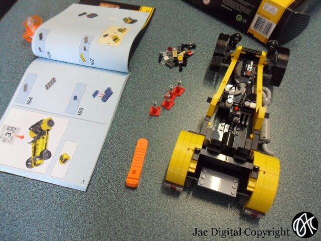](https://www.freelug.org/IMG/jpg/SAM_6348.jpg)

Je vous fait grâce du tas du troisième sachet, par contre, je vais m’attarder sur les pneus que je trouve magnifiques. Je ne pense pas qu’ils existent pour un autre modèle de la gamme LEGO, ils sont vraiment spécifiques à la Caterham, pour l’instant. La sculpture de la bande de roulement, la taille, le montage sur la jante. Tout ça rajoute au modèle fini un plus indéniable.

[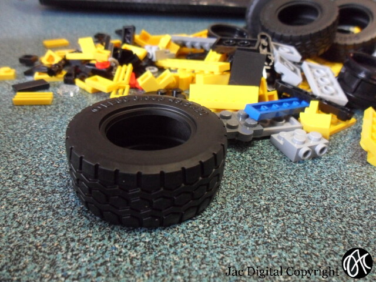](https://www.freelug.org/IMG/jpg/SAM_6355.jpg)

On retrouve aussi dans ces derniers sachets une belle palette de pièces sérigraphiées. On peut juste se demander à quoi ça sert de mettre une bande toute noire sur une "tile" jaune, mais pourtant, c’est ce qui correspondra au mieux à un bon rendu final, enfin à mon avis aussi...

[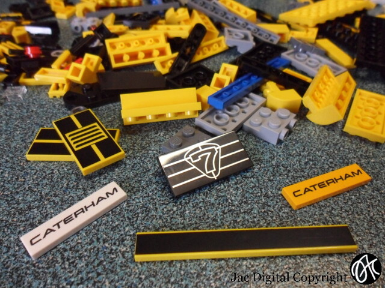](https://www.freelug.org/IMG/jpg/SAM_6359.jpg)

Voilà ce que nous avons une fois la construction finie. Des pièces en extra qui viennent grossir le tas existant, les béquilles et une fin de notice qui comporte 2 interviews importantes, mais en anglais...

[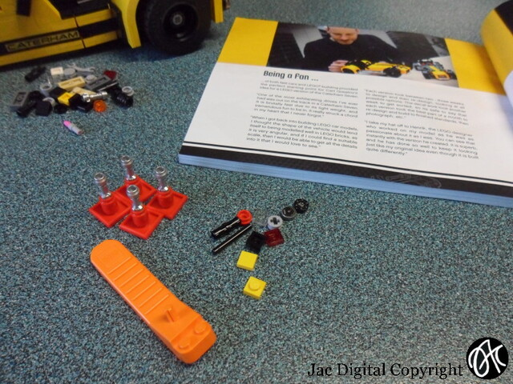](https://www.freelug.org/IMG/jpg/SAM_6362.jpg)

Bien sûr nous avons aussi une très belle reproduction de la Caterham, mais ça vous vous en doutez quand même hein ??? Voilà une de mes meilleures photos.

[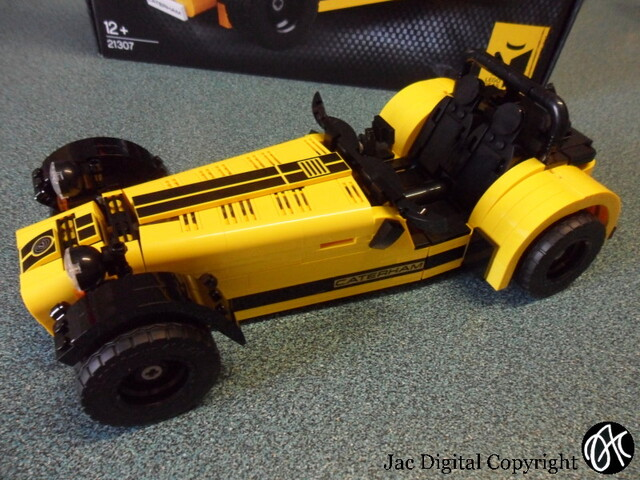](https://www.freelug.org/IMG/jpg/SAM_6389.jpg)

C’est vraiment un très beau modèle mais...  
**–** Les roues ne sont pas directrices. C’est un gros moins, par contre, si on veut faire le montage il y a beaucoup de boulot. Du coup on peut se dire que la boite aurait pu être beaucoup plus chère avec ce détail supplémentaire.  
**–** J’ai mis ma voiture en vitrine, sur une étagère en verre. Mais ça sert à rien de montrer le dessous. Il n’y a pas vraiment de détails importants sur cette partie...  
**–** Le volant est à droite comme sur toutes les anglaises ou japonaises, bien évidement. Pour notre pays, j’aurais bien aimé faire la modification. Malheureusement, je n’ai pas mon stock de briques à portée de main et la modification n’est pas si simple à faire. En plus du volant et du pédalier il faut aussi déplacer les équipements moteur qui se trouvent derrière le tableau de bord. De plus, cette voiture étant tellement particulière, je ne sais pas si les modèles réels sont modifiés.  
**–** J’aurai vu aussi des compteurs différents plutôt que trois fois les mêmes. Peut-être revoir un peu le tableau de bord car avec le volant on ne les voit plus.  
**–** L’échappement chromé, ça aurait fait top aussi.

Ça fait beaucoup de points négatifs mais c’est une construction très intéressante. Il ne faut pas oublier qu’à la base ce sont des briques LEGO destiné à jouer, même si cette référence est plus destinéees à un public adulte. On a au final un modèle qui tient une belle place sur une étagère à maquette, à côté de la Mini ou du combi VW. La ligne est magnifique, les proportions bien tenues. Je ne prendrai pas mon mètre pour mesurer mais vous pourrez le constatez grâce à toutes les photos de ma galerie. L’idée des béquilles est très bonne, même si je ne m’en suis pas servi pour l’instant.

Sur le net, on pourra trouver des versions de différentes couleurs. C’est ce qui est bien avec nos briques, une fois que l’on a la notice, on peut varier les constructions selon nos goûts. Il faut juste trouver les bonnes briques et faire les autocollants adaptés...

Justement, on trouve des articles sur cette Caterham. Il y a donc "facilement" de quoi encore améliorer son modèle, surtout pour reproduire encore plus fidèlement le moteur Ford Duratec 2.0, ici associé à un compresseur pour atteindre 315 ch (7 700 tr/min) et 296 Nm (7 350 tr/min). Ou simplement rajouter une capote ce qui change franchement le look et me plaît moins mais ce sont mes goûts personnels...

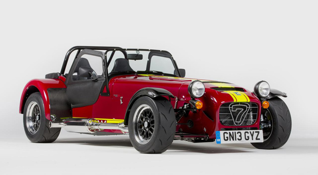

**Caterham Seven "Autonews"**

Photo issue d’un article parue sur le site "autonews"

**Photo issue d’un article parue sur le site "autonews"**

Pour voir plus de photos du montage, cliquez directement sur ma [galerie.](http://photos.freelug.org/main.php/v/JAC/review/21307/)
