Cette année encore, la participation de FreeLUG au LEGOWorld fut importante (nous êtions 25 au plus fort de notre présence). Et cette année encore notre présence fut remarquée :-)

FreeLUG avait réservé une très grande place pour son stand. Celui-ci était constitué des éléments suivants.

## Stand FreeLUG

**Diorama**

Nous avions un diorama d’une vingtaine de mètres de long qui faisait référence à un plateau de cinéma. Nous pouvions y retrouver des thèmes divers et variés comme la ville, le train, le bateau, le château, le western, StarWars, etc.

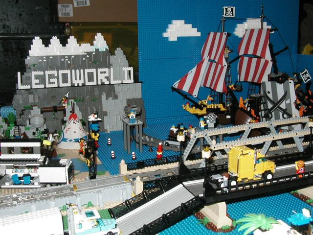

**FreeLUG fait son Holywood au LEGOWorld**

Avec la bataille navale de Marc à proximité

Par manque de préparation (oui on s’y met toujours trop tard) ce diorama manquait d’homogénéité, mais cela a bien plu à toutes ces petites têtes blondes qui de toute facon ne font pas forcément attention à la cohérence entre les différents éléments.

Cela a beaucoup plus notamment aux plus jeunes pour une raison simple, notre stand était à leur hauteur. En effet de nombreux stands, faits par des adultes, ont tendance a être à plus d’un mètre, trop haut pour les cherubins.

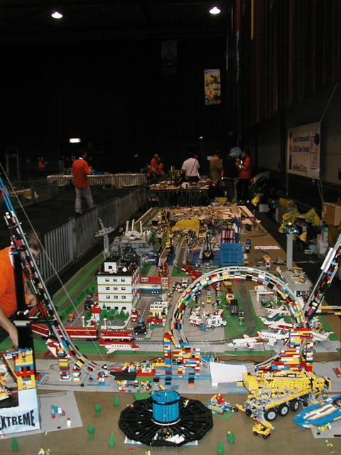

**Le layout FreeLUG**

Avec en premier plan le cirocco d’Eric

Nous avions aussi le manège de flouflou qui avait de quoi faire tourner la tête à certains.

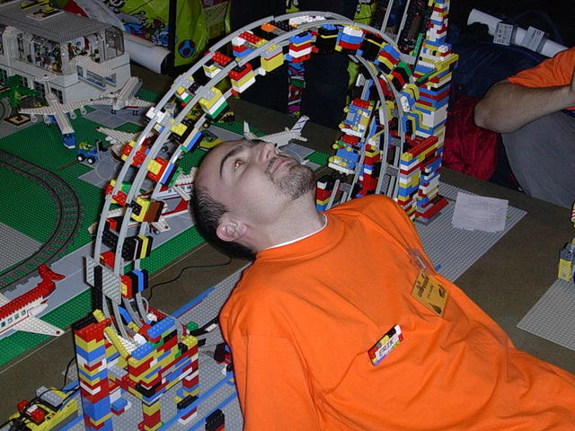

**Tu me fais tourner la tête...**

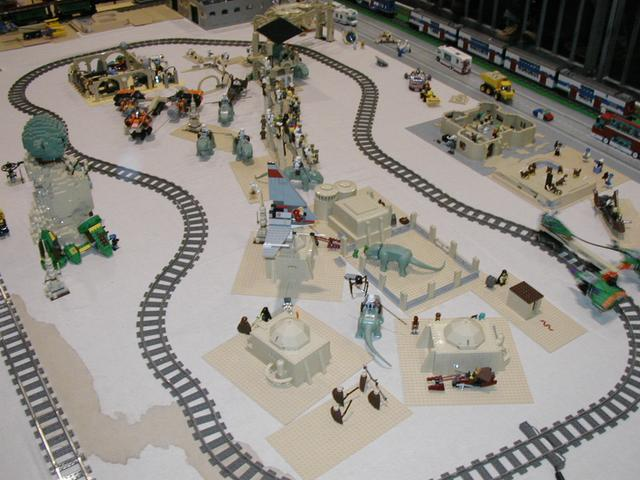

**Le layout Tatooine**

Vue de derrière. Notez la rivière naturelle de café ;)

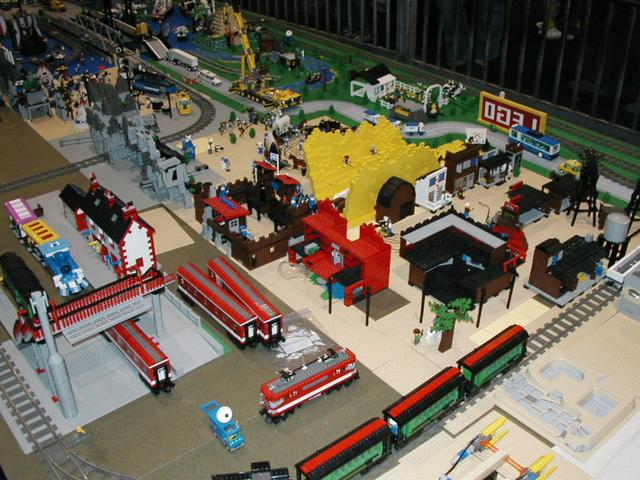

**La zone Western**

Vue de derrière...

**GBB**

C’était sans conteste le gros succès de notre présentation. Le système a fonctionné en continu avec un minimum de défaillance et il nous a permis également d’avoir nos amis Italiens en réalisation live sur notre stand. Et voir les frères Ferrari, en live, extirper les pièces du dernier camion grue pour réaliser un module GBB, faisait qu’il y avait également du spectable en coulisse !

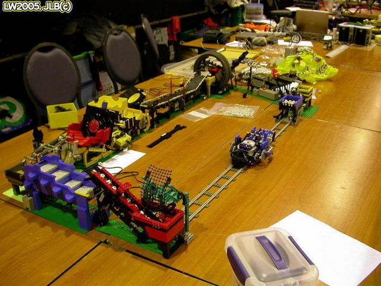

**Des p’tites billes partout ..**

**Fraiseuse**

Richard n’a pas hésité à déplacer son aspirateur pour nettoyer la tonne de poussière que sa fraiseuse a généré durant cette semaine. Elle a eu aussi beaucoup de succès, et même KKK a eu le droit à sa plaque gravée par un Richard tout ému :-)

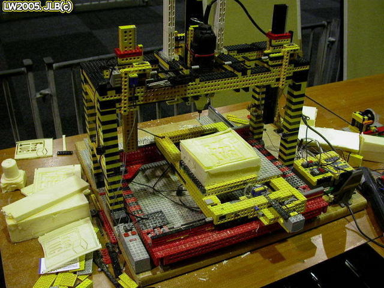

**bzzzzzzzzzzzzzzt !!!**

Philo a eu son moment de gloire, justement lors du passage de KKK sur notre stand. Il s’est fait un plaisir de lui montrer son horloge à billes.

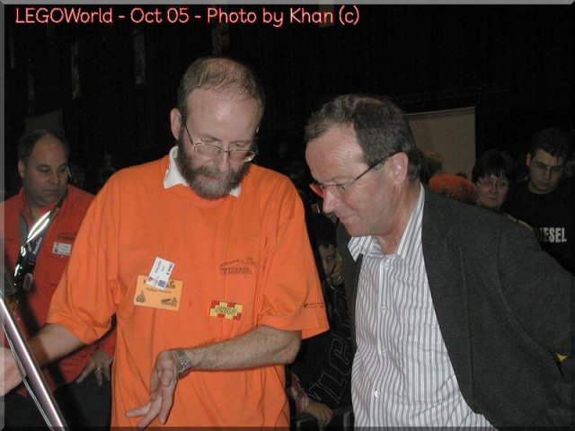

**Philo demo**

Philo en plein demonstration de son horloge a billes devant KKK.

**Divers autres**

Si on avait collecté un euro à chaque fois qu’on nous demandait s’il était possible d’acheter les Minifig du Prez, nous serions revenus avec un paquet d’argent ;-) !

## Et le reste ?

Il y avait, heureusement, beaucoup d’autres belles choses exposées par d’autres LUG (De bouwsteen, Belug, Itlug ...), dont voici un essai d’aperçu (non exhaustif).

Il est clair que les points forts de cette édition du LEGOWorld étaient dans un ordre non exhaustif...

**–** L’impressionnant réseau de nos amis de Belug,

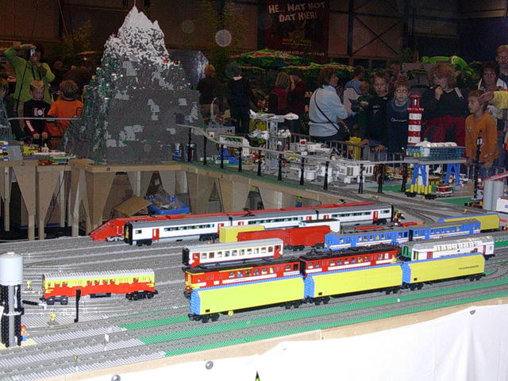

**Le réseau de BeLug**

Leur réseau est en général très détaillé et très bien integré. C’est une force qu’ils ont et dont il faut s’inspirer.

**–** Le réseau de notre ami Allemand Ben, toujours prêt à faire passer des messages personnels :

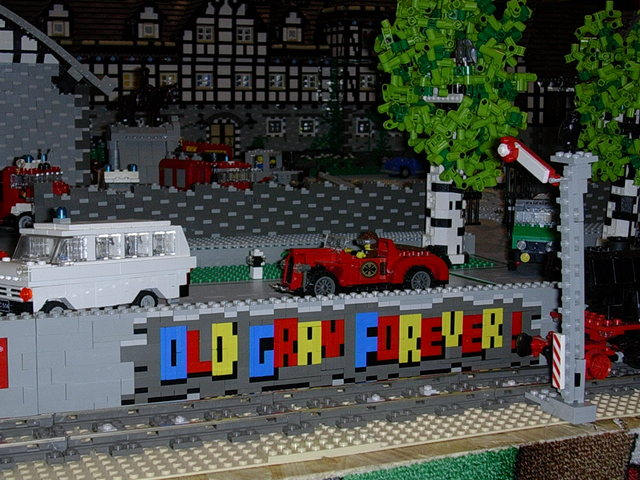

**Le réseau de Ben**

**–** Le flipper,

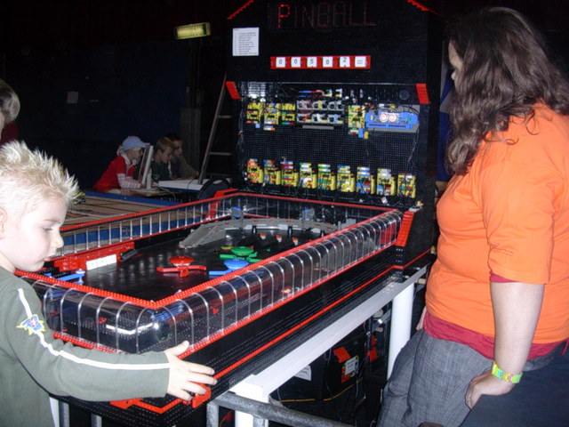

**Flipper et un dos pas fin...**

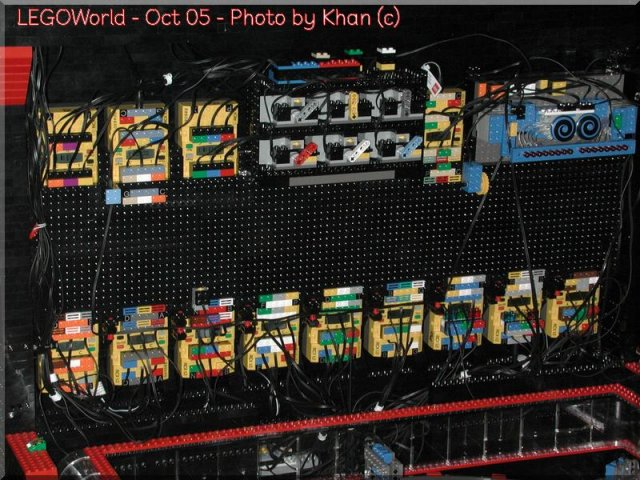

**Gros plan sur les RCX**

Le coeur du flipper, compose des 15 RCX et de plusieurs metres de cable. Impressionant

Réalisé uniquement en briques LEGO et contrôlé par 15 RCX qui communiquent entre eux. Ce flipper est tout à fait jouable.

**–** Une belle collection historique de Technic, juste en face de nous, par nos amis Maiko et Astrid.

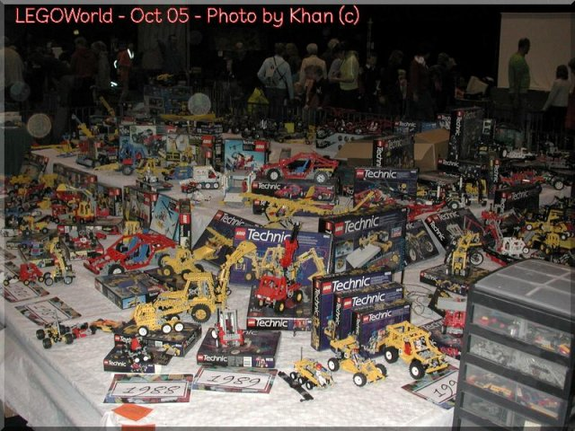

**Collection Technics**

Stand de Maiko : Superbe presentation, avec toutes les boites.

D’ailleurs régulièrement Manu a été embauché pour en faire le gardienage.

**–** Nos amis anglo-americano-hollandais, lui avec une présentation très spatiale et elle avec des oeuvres très originales notamment à base de Clikits ou de Knights’ Kingdom.

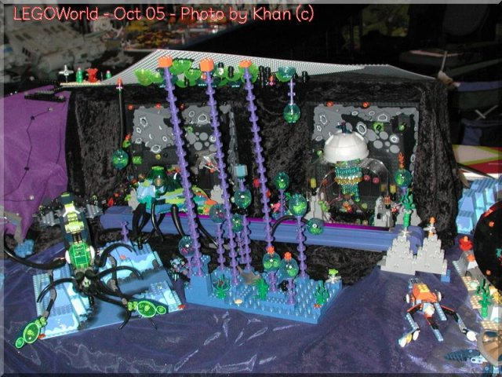

**Clickits sous lumiere noire**

Oeuvre de Meg, original.

## Ambiance

Comme chaque année, l’intérêt du LW résidait aussi dans l’ambiance qu’il y avait en dehors de l’exposition (la vie communautaire renvoit certains d’entre nous à l’âge des colonies de vacances... et les blagues s’en ressentent). Cela nous permis aussi de lier des liens plus forts avec d’autres LUG ou avec les responsables LEGO. Les soirées Pizzas, pâtes (par notre toulousain-Rital) ou crêpes, arrosées de cidre et de chouchen, ont été des parties de bonnes rigolades.

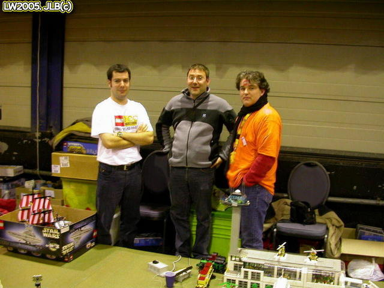

**De quoi ca parle quand un ambassadeur rencontre un responsable AFOL ?**

On sait pas, mais ca parle beaucoup en tout cas (surtout quand un italo francais s’en mele :-))

Quoiqu’il en soit, il faut se mefier des Clikits. A trop forte dose cela peut rendre un peu .. heu .. bizarre .. comme l’atteste cette photo :

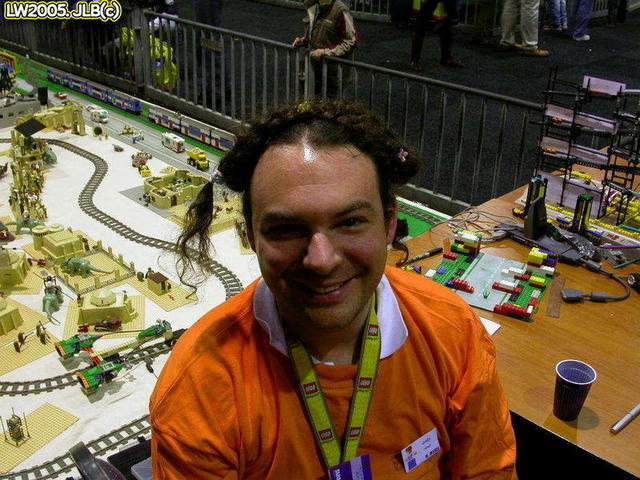

**Oh sheila ! .. ah non c’est que Khan ..**

Les LEGO rendent-ils fou ? On peut se le demander en voyant ces deux la...

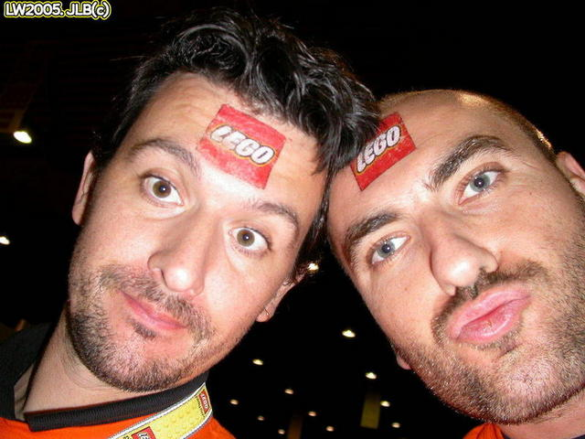

**oh je me vois dedans :-)**

Erik et Khan ont aussi reussi à s’illustrer en posant LA question dont tout le monde aimerait connaitre la réponse : "dans quel sens mettre les fleurs LEGO". On se demande si cette "quête" était pour faire un réel sondage ou bien pour draguer les jolies hollandaises ;)

Pour ceux qui aimeraient connaître la réponse de cette "daisy Bloem en quete" :  
**–** stud up (le tenon vers le haut) : 131  
**–** stud down (le tenon vers le bas) : 59  
**–** les deux : 11

La meilleure réponse restant celle de KKK : à partir du moment où on prend du plaisir, les deux sens sont les bons ;)

En parlant de fleurs, un projet collaboratif a débuté pendant le LW. Le but est de réaliser le logo FreeLUG en fleurs sur une grande plaque grise de base.

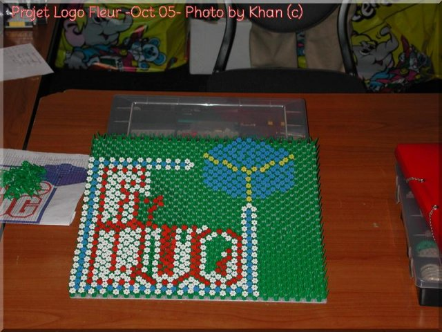

**Projet Logo Fleurs**

Le logo Freelug en fleurs ...

## Les reportages des uns et des autres

**–** Les photos de Qdm : [http://photos.freelug.org/v/La-Gall...](http://photos.freelug.org/v/La-Gallerie-de-qdm/Expositions/LW2005/)  
**–** la gallerie FreeLUG : [http://gallery.freelug.org/v/FreeLU...](http://gallery.freelug.org/v/FreeLUG/Expositions_parcs/LEGOWorld_2005/)  
**–** Photo de Khan :  
[http://gallery.freelug.org/v/khan/L...](http://gallery.freelug.org/v/khan/LEGOWORLD/lw05/)
