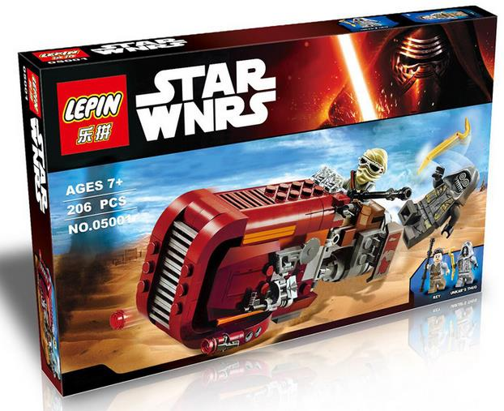
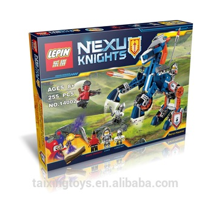
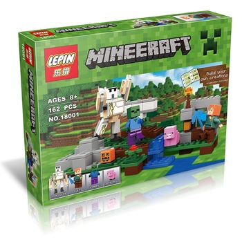
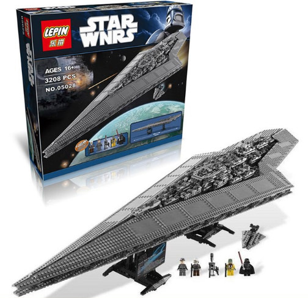
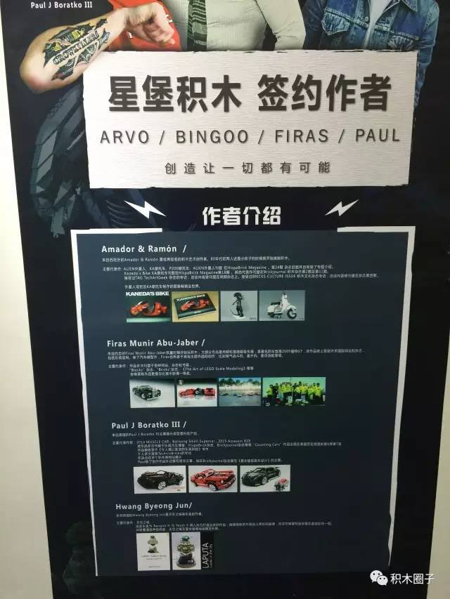

LEPIN - En premier lieu vous vous demandez sans doute comment prononcer ce mot. A la française, avec un accent, à l’anglaise (même si la marque est chinoise).

Faites comme vous le désirez, car la société derrière cette marque n’a pas publié de bonnes pratiques concernant la communication visant ses produits et ses marques contrairement à la société LEGO dans sa [charte de fairplay](https://www.lego.com/fr-fr/legal/legal-notice/fair-play).

_Star Wnrs. Quand on a pas la licence pour le vrai, on change juste une lettre pour tromper le client. Pathétique.  
_

Et d’ailleurs, parlons-en de fairplay. Car LEPIN est une marque clone qui copie les produits LEGO : pièces, modèles, logo, notices...tout y passe. En soit cela n’est pas une nouveauté, et la communauté des fans sont familiers des clones et ceci depuis des décennies qu’existent Tente, Cobi, Megablocks, Sluban...

**Mais ce qui est nouveau, c’est que LEPIN le fait de mieux en mieux.**

Attention, je n’encourage pas à acheter les produits de cette marque. Il y a des raisons morales à ne pas le faire, comme par exemple le fait qu’ils copient les modèles LEGO et tentent de manière délibérée de tromper les consommateurs sur l’origine des produits en copiant aussi le design des marques et logos (LEGO, StarWars,...). On peut aussi se poser des questions sur la sécurité du produit pour le consommateur en particulier en ce qui concerne un produit destiné aux enfants.

_  
NEXU Knights. Sans doute cela sonne-t-il mieux aux oreilles asiatiques qu’aux françaises._

Toutefois ces points se retrouvent confrontés à un contre-argumentaire : des modèles proposés par LEPIN ne sont plus disponibles chez LEGO, la concurrence serait donc fairplay. Et les modèles copiés sont des modèles "adultes" (UCS, Modular, Expert), les risques de sécurité sont minimes.

_MINEERAFT. Encore une fois pas d’erreur de typo mais bien la volonté de tromper._

Alors, assez logiquement, l’Europe et l’Amérique du Nord s’intéressent à ces produits trois fois moins chers qui ont déjà conquis l’Asie et des pays à faible niveau de revenu. Car il reste une question, c’est celle de la qualité intrinsèque des produits LEPIN. Une réponse est fournie dans une [revue de modèle](https://brickset.com/article/29578/) (un Star Destroyer) parue sur le site britannique [Brickset.com](https://brickset.com/).

_Le Super Star Destroyer Star Wars façon LEPIN - Notez sur la boîte le logo façon "LEGO" et le contournement de la marque "Star Wars"_

En tant que consommateur on peut se réjouir. La qualité des clones s’améliore, et en particulier le fameux "clutch power" (tenue à l’emboïtement) des pièces LEPIN est très similaire à celui des pièces LEGO. La fidélité des couleurs est aussi au rendez-vous et le plastique est de qualité et "sonne" bien. L’auteur de la revue reconnaît qu’il a pris plaisir à construire le modèle, oubliant parfois que cela n’était pas un produit LEGO.

Les clones font des progrès, LEPIN en est le plus bel exemple, et cela doit interroger profondément la société LEGO. On peut penser que l’innovation constante est une solution - de nouveaux modèles, de nouveaux concepts - pour toujours garder une longueur d’avance.

Mais LEPIN lui aussi innove. A l’image du programme de crowdsourcing LEGO Ideas, LEPIN fait appel aux fans pour proposer de nouveaux modèles. A travers une de ses filiales, Xiangbao, LEPIN a recruté des grands noms AFOLs comme Arvo Brothers ou Crowkillers comme l’explique encore une fois Brickset dans [cet article](https://brickset.com/article/27554/lepin-subsidiary-now-licensing-afol-designs).

Pour la société LEGO, une réponse à double tranchant se met en place : éliminer la concurrence et concurrencer celle-ci sur son propre marché. Ainsi sur le plan légal, une cour chinoise a accepté de se saisir d’une [plainte de la société LEGO contre LEPIN](https://www.hothbricks.com/contrefacon-lego-sattaque-a-marque-lepin/) (sept. 2016). Mais cela prendra plus d’un an avant qu’une décision soit prise - décision elle-même sujette à un appel. Sur le terrain, la société LEGO "attaque" le marché asiatique en investissant dans une usine [^1] sur le sol chinois, alors même qu’elle était déjà présente avec ses bureaux de Shangaï.

Cela marque-t-il pour autant le début de la fin pour les clones ? Rien n’est moins sûr.

[^1]: L’usine sera pleinement opérationnelle cette année avec 2000 salariés. Elle regroupe la production et le packaging. Situé à Jiaxing, à 100 km de Shangaï qui verra par la suite ouvrir un centre de distribution.
