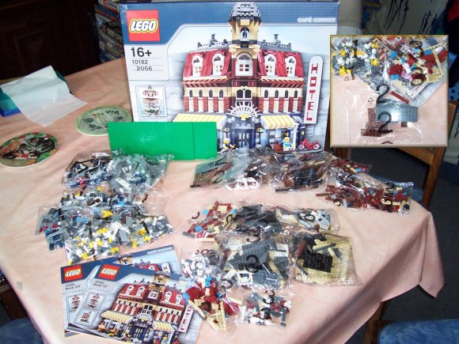
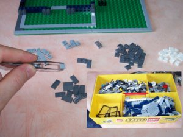
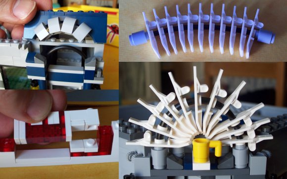
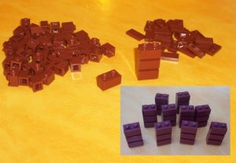
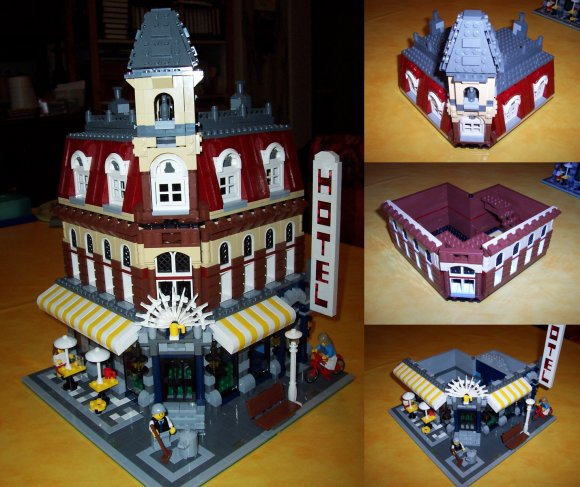

Il s’agit là bien sûr d’une description du set 10182 - Café Corner. LEGO a bien su me faire apprécier l’attente de livraison, donc je vais déguster l’ouverture de cette belle boîte.

C’est la première fois que j’ouvre une boîte avec autant de pièces. Et 2056 pièces, ça fait quand même pas mal de sachets qui remplissent bien la boite. Il y a aussi deux livrets d’instructions, un pour le rez-de-chaussée, et l’autre pour les deux étages supérieurs. Il y a bien sûr les deux plaques vertes 16x32. Comme il n’y a pas de proposition de modèles alternatifs (sauf une simple photo) le choix des deux plaques vertes 16x32 au lieu d’une plaque 32x32 reste un mystère entier !! :)

Beaucoup de pieces, sachets numerotés dans la vignette

Les sachets sont numérotés de 1 à 3. En fait, 1 pour le premier niveau, 2 pour le second et 3 pour le troisième bien évidemment ! :)

Outillage indispensable

Au début du montage, on voit tout de suite quel sport nous est proposé. Imaginez : étape 4, vous avez encore quasiment toutes les pièces du premier niveau, et vous devez commencer le trottoir, et donc trouver ... 93 plates 1x1 .... pas glop !! :)

Soit vous faites un pré-tri avant le montage, soit vous usez d’ustensiles bioniques. :)

Sur ce premier niveau, il y a quelques astuces de montage très intéressantes.

Quelques astuces de montage

Une arche de porte est constituée de quatres [briques arrondies](http://peeron.com/inv/parts/6091) enchassées sous une grande arche 1x8, mais il y a dessous une tige flexible qui permet le maintien des quatres briques.

Comme beaucoup de monde l’avait déjà remarqué, la "grille décorative" au dessus de la porte principale est donc constituée de [skis](http://peeron.com/inv/parts/6120). Alors en fait, ils sont empilés les uns sur les autres avec là aussi une tige flexible qui passe dans le trou présent sur les skis. Il suffit ensuite de maintenir la courbure grace à deux briques rondes à chaque extrémité de la tige.

L’enseigne "Hotel", elle aussi, utilise un montage particulier, le fameux [SNOT](https://www.freelug.org/spip.php?breve198) pour implanter la lettre E. D’ailleurs, le montage des lettres est un excellent travail, qui peut compléter notre article précédemment publié sur [les lettrages en LEGO](/articles/la-technique-du-lettrage-application-au-trains-lego/).

Quand on attaque le second niveau, sachet 2 donc, on ouvre aussi le second livret. Et là... Patatras !!.. Le problème récurrent des couleurs sur les notices revient à pleine charge. En étant sous lumière artificielle, j’ai immanquablement confondu le gris clair avec le beige et le noir avec le marron foncé... Je m’en suis rendu compte seulement parce que je ne trouvais plus les pièces...

Beaucoup de pieces pour des petits murs

Les murs du second niveau sont montés en briques apparentes. C’est esthétiquement parfait, mais c’est aussi une des raisons qui explique le grand nombre de pièces dans cette boite.

Au niveau du troisième étage, on retrouve encore une pièce "détournée" ! Il s’agit [des passages de roues](http://www.peeron.com/inv/parts/50745) qui servent à l’encadrement supérieur des fenêtres, dans lequel une grenouille grise ( un crapaud quoi !! ) sert de gargouille.

Au final, quand on a terminé le montage, nous avons trois modules qui se superposent. Sur les livrets, il y a quelques illustrations montrant les bâtiments que nous pouvons obtenir avec plusieurs boites.

**Montage final**

J’ai passé un excellent moment à monter ce set et à examiner les différents montages. Tous les AFOLs qui, comme moi, ont du mal à réaliser des maisons trouveront là plein d’idées à reprendre pour leur futurs MOCs.

Bon montage !
