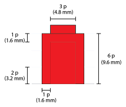
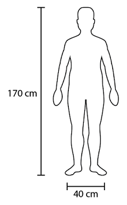
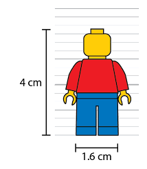
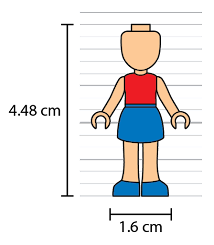
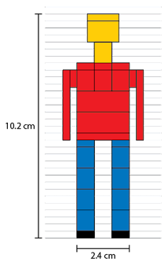
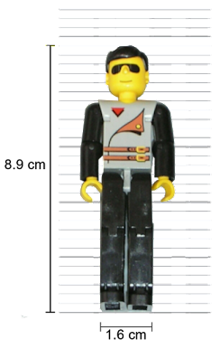
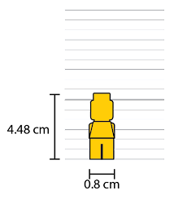
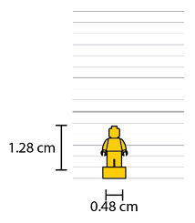
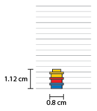

Cet article vous montre comment calculer l ‘« échelle » de différentes figures LEGO en les comparant à la taille réelle des humains.

Cet article a été traduit à partir de celui de **Tom Alphin**, auteur du livre à succès The LEGO Architect, qui explore la façon de construire 7 styles d’architecture en utilisant les briques LEGO. Cette page détaille les calculs suite à un autre article paru dans [le numéro 13 de Bricks Magazine](https://brickarchitect.com/2016/matters-of-scale/). (Juin 2016.). Un grand merci à Catherine de Brisy pour son aide dans la traduction !

Quand on procède à des calculs, on obtient le ratio approximatif suivant pour chaque figure classique LEGO® (du plus grand au plus petit). Les calculs utilisés pour atteindre ces valeurs sont inclus ci-dessous :

-   Miniland – 1:17
-   Technic – 1:19
-   Minidoll (Friends) – 1:38
-   Minifig ou Figurine classique – 1:42
-   Microfig – 1:80
-   Trophée fig – 1 : 130
-   Figurine à trois plates – 1 : 150

Il n’est pas évident d’inclure des figurines dans vos montages à une échelle inférieure à environ 1 : 125.

**Unités LEGO®**  
La plus petite dimension commune du système LEGO® est l’épaisseur d’une brique de mur LEGO®. Cette unité sera nommée 1 plastique, ou simplement « 1 p ». (1 p = 1,6 mm ou 0,063 pouces) 1 plastique représente la moitié de la hauteur d’une plate LEGO® (à l’exclusion des tenons), 1/5 de la largeur d’une brique LEGO 1×1, ou 1/6 de la hauteur d’une brique LEGO® (à l’exclusion des tenons).

Mesures dans une brique LEGO® 1 × 1 de base.

Presque chaque mesure dans les éléments LEGO® est un multiple entier de 1 p. Une seule exception, c’est l’épaisseur d’un tenon creux, qui n’est que de 1/2 p.

**Taille d’un humain « moyen » ?**

La taille moyenne des adultes varie considérablement selon le pays et le sexe. Une bonne approximation de la taille moyenne des deux sexes pour les régions riches où LEGO est populaire est de 170 centimètres (5’7 « / 67 pouces).

Dimension d’un adulte assez moyen.  
Pour information, la taille moyenne d’un homme européen ou américain est de 175 cm (5’9″ / 69 pouces) et la taille moyenne d’une femme des mêmes régions est de 165 cm (5’5″ / 65 pouces). (Source : Wikipedia.)

**Les différentes minifigurines LEGO®**

Les premières minifigurines LEGO® ont été commercialisées en 1978 avec les thèmes “City“, “Castle” et “Space”.

Malheureusement pour les constructeurs de modèles LEGO®, les proportions de la minifigurine LEGO classique sont extrêmement imprécises par rapport à un humain. En tant que tel, nous devons calculer séparément le ratio d’échelle de la largeur et de la hauteur.

**Figurine LEGO® (calcul basé sur la hauteur)**

La figurine LEGO® classique mesure 4 briques. Si vous incluez le tenon sur le dessus de la tête d’une figurine, il mesure 4 cm de haut. (25 p).

Largeur et hauteur de la figurine LEGO classique.

25 p \* 1,6 mm / p = 40 mm (4 cm)

-   180/4 = 45
-   175/4 = 43,75 \[homme moyen\]
-   170/4 = 42,5
-   165/4 = 41,25 \[femme moyenne\]
-   160/4 = 40

En arrondissant légèrement, on peut conclure que 1:42 est une bonne estimation de l’échelle des figurines LEGO® en fonction de leur taille. (L’arrondi explique également la légère augmentation de la hauteur lorsque vous ajoutez des cheveux ou un chapeau.)

_REMARQUES :_

Le tenon sur le dessus d’une figurine est toujours légèrement plus haut que le tenon sur le dessus d’un élément LEGO® standard. L’origine de cet écart subtil n’est pas connue et n’est donc pas inclue dans les calculs.

Les minifigurines LEGO® adultes ont presque toujours la même taille, quel que soit le sexe, à l’exception des figurines portant une robe qui sont 1 plate plus hautes que la figure classique. Cela est dû au fait que les jambes LEGO mesurent 5 plates, mais la pente 2x2x2 utilisée comme robe est de 6 plates.

**Figurine LEGO (calcul basé sur la largeur)**  
Étant donné que les proportions de la figurine LEGO sont si étranges, nous obtenons un résultat radicalement différent quand on essaie de calculer le ratio en se basant sur la largeur d’une figurine. C’est pourquoi le ratio d’échelle est différent verticalement et horizontalement. (Un torse de figurine a la même largeur et la même profondeur qu’une brique LEGO® 1 × 2, ou un rapport de 2 : 1. Heureusement, les humains ont à peu près le même rapport de 2 : 1.)

Une largeur « standard » (mesurée) au niveau des hanches est de 40 cm (16 pouces), valeur qui sera utilisée dans les calculs ci-dessous. Il n’y a pas autant de données disponibles sur la largeur moyenne au niveau du torse ou des hanches que la hauteur, mais un rapide survol de certaines sources suggère que 40 cm est assez typique pour les deux sexes.

-   10 pl \* 1,6 mm / pl = 1,6
-   40 cm / 1,6 cm = 25

Sur la base de la largeur de la figurine LEGO, nous obtenons une échelle d’environ 1:25.

Il serait facile de modifier la hauteur d’une figurine LEGO pour qu’elle soit proportionnelle à sa largeur. Cela se traduirait par un rapport 1:25 cohérent verticalement et horizontalement.

**LEGO Minidoll**

Les minidolls LEGO® ont été introduites dans la gamme « Friends », qui s’est agrandie pour inclure la gamme « Disney Princess », et plus récemment « Elves ». Une minidoll LEGO® mesure 4,5 briques de hauteur. En incluant le tenon sur le dessus de la tête d’une figurine, une minidoll mesure 4 2/3 briques (28 p de hauteur).

Largeur et hauteur d’une Minidoll LEGO®  
Pour une comparaison humoristique des différences de proportions entre la figurine LEGO® et la minidoll LEGO, regardez cette vidéo YouTube : Dolls vs.Figs : Size Matters – une bataille de comparaison LEGO.

28 p \* 1,6 mm / p = 44,8 mm (4,48 cm)

-   180 / 4,48 = 40,18
-   175 / 4,48 = 39,06 \[homme moyen\]
-   170 / 4,48 = 37,94
-   165 / 4,48 = 36,83 \[femme moyenne\]
-   160 / 4,48 = 35,71

L’échelle approximative pour les minidolls LEGO® est de 1:38.

Lorsque l’on tient compte du fait que la plupart des ensembles Disney / Friends présentent des femmes ou des adolescents, l’arrondi à 1:35 peut être plus précis dans certains scénarios.

**LEGO Miniland**

Les figurines LEGO® du Miniland sont construites à l’aide de briques LEGO® standard. La taille exacte variera en fonction des préférences du constructeur, mais la taille la plus couramment utilisée est d’environ 11 briques de hauteur. (60 p de hauteur) Il est facile de donner à chaque figurine Miniland une hauteur différente, comme dans la vraie vie.

Largeur et hauteur d’une figurine LEGO® du Miniland

64 p \* 1,6 mm / p = 102 mm (10,2 cm)

-   170 cm / 10,2 cm = 16,67

Les calculs montrent une échelle d’environ 1:17 pour ce type de figurine.

**LEGO Technic**

Les figurines LEGO® Technic sont multi articulé et issu de la gamme Technic des années 90

Largeur et hauteur d’une figurine LEGO® Technic

8 p \* 1,6 mm / p = 89.8 mm (8,9 cm)

-   170 cm / 8,9 cm = 19,11

Les calculs montrent une échelle d’environ 1:19 pour ce type de figurine.

**Microfig LEGO**

Une microfig LEGO® mesure 1 brique de large et 2 briques de haut. Si vous incluez le tenon sur le dessus de la tête d’une figurine, il fait 13 p de haut.

Largeur et hauteur de la Microfig LEGO®

13 pl \* 1,6 mm / pl = 20,8 mm (2,08 cm)

-   170 cm / 2,08 cm = 81

Étant donné que les microfigs sont des représentations grossières des gens et comme la figurine classique, elles sont trop larges pour leur hauteur, vous pouvez raisonnablement les utiliser pour représenter une gamme d’échelles d’environ 1:60 à 1 : 100.

**Nanofig LEGO® ou Trophy fig**

Les nano figurines LEGO® ont commencé avec les séries de minifig à collectionner, mais elles se trouvent également dans d’autres thèmes, y compris dans LEGO® Architecture.

Une nanofig mesure 1 brique de large et environ 5 tenons de haut, mais le chiffre est beaucoup plus petit que cela. Une approximation de 3 p de large et 8 p de haut semble plus proche.

Largeur et hauteur d’une nanofig LEGO®

8 pl \* 1,6 mm / pl = 12,8 mm (1,28 cm)

-   170 cm / 1,28 cm = 132

Etant donné les approximations initiales, l’arrondi peut être fait à 1 : 130 Il est incroyablement difficile d’estimer leur échelle avec précision étant donné la grande base ronde, et que la conception de la figure est basée sur la figurine classique qui elle-même a des proportions inexactes. Une échelle comprise entre 1 : 100 et 1 : 150 est une bonne approximation.

**Figurine à trois plates**

Vous pouvez faire une approximation très grossière d’une silhouette en utilisant trois plates rondes 1 × 1. Choisissez différentes couleurs pour représenter différentes personnes et vêtements. Largeur et hauteur de la figure à trois plates.

Largeur et hauteur de la figure à trois plates.

7 pl \* 1,6 mm / pl = 11,2 mm (1,12 cm)

-   170 cm / 1,12 cm = 151,79

Pour résumer, si votre figurine fait :

-   3 plates, l’échelle la plus proche sera d’environ 1 : 150
-   4 plates, l’échelle la plus proche sera d’environ 1 : 120 (très proche de la nanofig)

Le rapport largeur / hauteur des figurines à trois plates est extrêmement inexact, donc vous ne pourrez pas adapter autant de figures à trois plates dans votre scène que de vraies personnes.

Il est incroyablement difficile d’estimer leur échelle avec précision étant donné la grande base ronde, et que la conception de la figure est basée sur la figurine classique qui elle-même a des proportions inexactes. Une échelle comprise entre 1 : 100 et 1 : 150 est une bonne approximation.

[Source](https://brickarchitect.com/scale/)

Voir en ligne : [Source (article en anglais)](https://brickarchitect.com/scale/)
