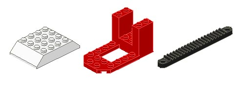
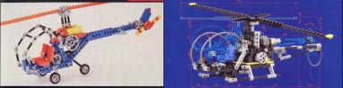
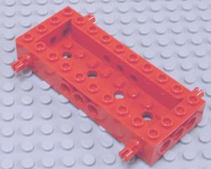
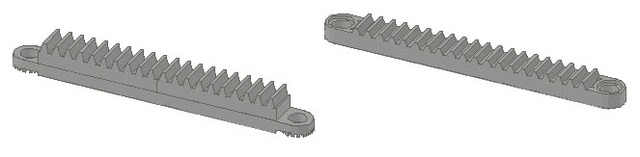
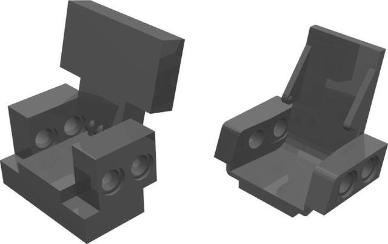
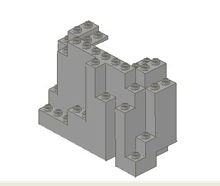

Les metapièces sont des pièces complexes créés pour répondre à une fonction précise. Cette définition est relativement ambigüe et laisse place à interprétation.

Ici quelques exemples :

élément de toiture de wagon - cockpit d’hélicoptère - élément de direction

Les metapièces sont apparues petit à petit et tardivement. Logiquement, les premières pièces étaient simples (briques) puis les éléments suivants purent être plus complexes et variés.

L’élément de direction présenté ci-dessus date de 1995 ce qui est très récent. Les deux autres éléments datent de la fin des années 1990.

Bien souvent une metapièce remplace plusieurs pièces pour une même fonction. Les modèles sont alors moins chers ou plus complexes à prix égal. Les modèles gagnent aussi en détails.

Les deux hélicoptères ont à peu de choses près le même nombre de pièces : remarquez les sièges et le rotor arrière.

Il y a aussi un besoin de "juniorisation", c’est à dire de rendre les modèles plus faciles à contruire pour les doigts malhabiles de nos bambins : les pièces "Jack Stone" arrivent alors.

L’inconvénient majeur de ces pièces est la perte de versatilité : en dehors de leur fonction première il est difficile de les réutiliser.

Un autre inconvénient réside dans le fait que ces metapièces sont peu courantes : elles risquent fort de vous manquer pour construire un modèle officiel qui en contiendrait avec les briques constituant votre collection.

les anglophones appelent les metapièces des POOPs, un acronyme pour Piece (that can be built) Of Other Pieces (Pièces pouvant être construites avec d’autres).

Cette définition succinte est intéressante car elle montre que vous pouvez vous passez d’une metapièce en utilisant un montage de plusieurs autres pièces plus communes. Rarement on obtient une substitution parfaite mais cela encourage la créativité.

Pour conclure citons d’autres définitions anglophones :

**–** Les pièces tricheuses (Cheat piece) : Une pièce LEGO® qui pourrait (devrait) être faite à partir de plusieurs pièces normales. Un set avec beaucoup de pièces tricheuses perd beaucoup de jouabilité. L’exemple le plus connu est le gros rocher moche :

**–** Un SPUD (Special Purpose Ugly Design) : Pièce à fonction spécifique mais moche.
