## Fiche technique

Ces sets sont au nombre de 3 (c’est donc un set de sets :-))

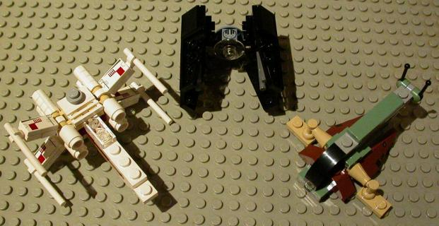

**–** Lugnet : [6963,6964,6965](http://guide.lugnet.com/set/?q=6963%2C6964%2C6965&v=a)  
**–** Peeron : [6963](http://www.peeron.com/inv/sets/6963-1), [6964](http://www.peeron.com/inv/sets/6964-1), [6965](http://www.peeron.com/inv/sets/6965-1)  
**–** Prix neuf : inconnu  
**–** Nombre de pièces : 6963 = 41, 6963 = 25, 6963 = 32  
**–** Signe particulier : distribué au japon avec des bonbons Kabaya

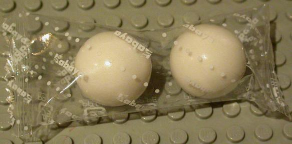

**Les bonbons**

Ce sont des chewing-gum pour etre exact :-)

## Premier contact

Les sets sont emballés dans des jolies boites cartonnées :

-   Le X-wing :

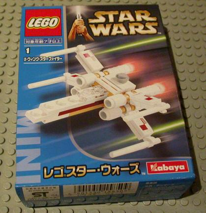

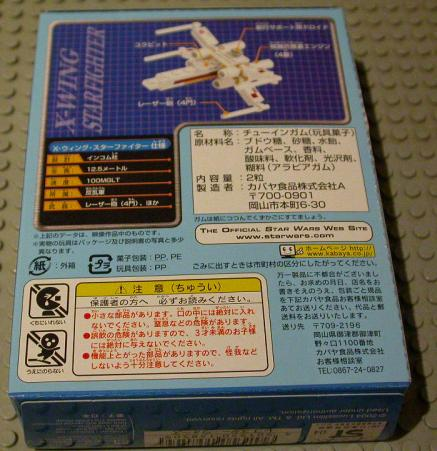

-   Le Slave I

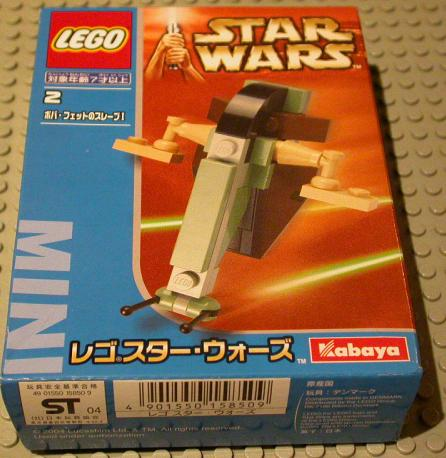

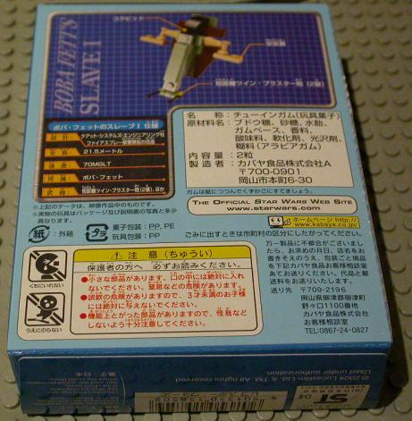

-   Le Tie-Interceptor

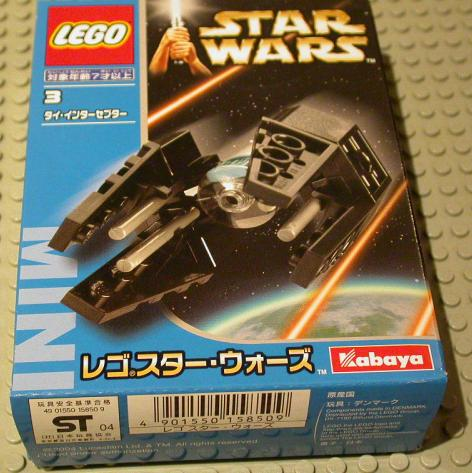

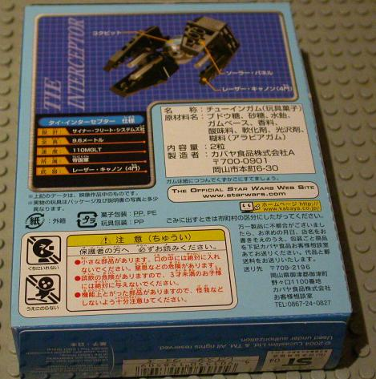

Une fois n’est pas coutume, je garderai précieusement les boites de ces sets, car ce n’est pas tous les jours que j’ai des boites LEGO® avec une description en japonais :-)

Ces boites contiennent des petits sachets imprimés avec le modèle qu’il contient :

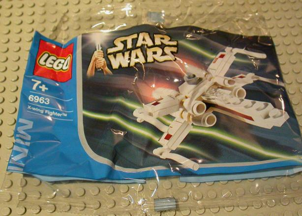

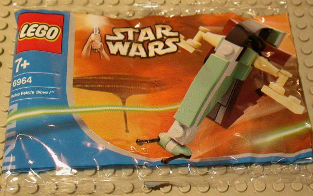

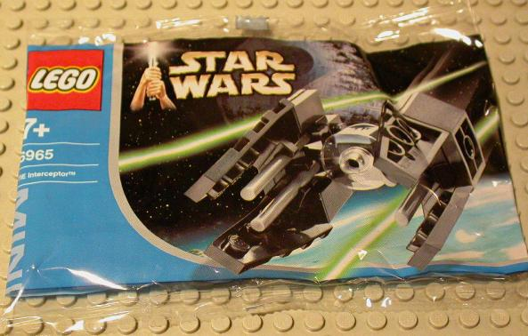

Ces sachets contenant la notice et les pieces. Cela fait un peu poupée russe, mais cela à son charme :-)

Les chewing-gum kabaya se trouvent dans un sachet séparé dans la boite.

Ne vous faites pas avoir en ne récupérant que les sachets plastiques. Chaque set doit venir avec sa petite boite, sinon il n’est pas neuf.

Une fois le déballage fait, on peut s’attaquer à la construction, et à la description qui en découle.

## Le mini X-wing (6963)

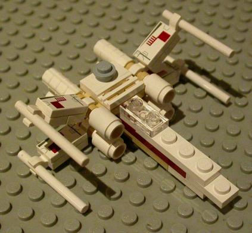

Rien de vraiment particulier à dire la dessus. Il est rigoureusement identique à celui du set [4484](http://guide.lugnet.com/set/4484).

## Le Slave I (6964)

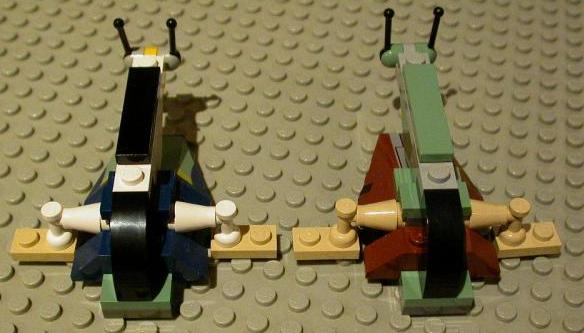

Vous voyez sur la photo ci-dessus, la comparaison du modèle "Kabaya" (à droite) avec le modèle venant du set [4487](http://guide.lugnet.com/set/4487) (à gauche donc).

Le montage est identique, par contre les couleurs changent. Ses couleurs sont plus proches du Slave I original (set [7144](http://guide.lugnet.com/set/7144)) alors que l’autre a des couleurs proches du Slave I de 2002 (celui de Jango Fett) (set [7153](http://guide.lugnet.com/set/7153)).

Ces changements de couleurs sont la seule raison d’avoir ce set, car, hormis cela, les pièces sont identiques.

## Le mini Tie-Interceptor (6965)

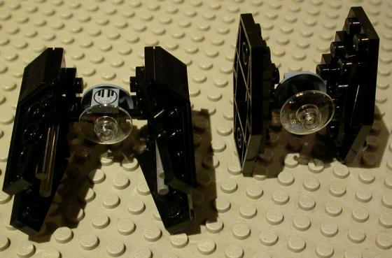

Voila la seule vraie nouveauté de ce triplet de mini modèles StarWars. Il est ici présenté à coté du Tie-Fighter dont il se rapproche le plus. Le principe de construction s’en rapproche beaucoup aussi d’ailleurs. Le cockpit est quasiment identique, à une petite tile imprimée près (regardez sur la photo, la tile au-dessus du cockpit du Tie-Interceptor)

En plus d’être la seule nouveauté de ce triplet de set, je trouve ce Tie-Interceptor plutot réussi, rendant encore plus ce set un "must" pour tout bon collectionneur :-) Le problème sera de réussir à le trouver. Heureusement que [bricklink](http://www.bricklink.com/) est la :-)
