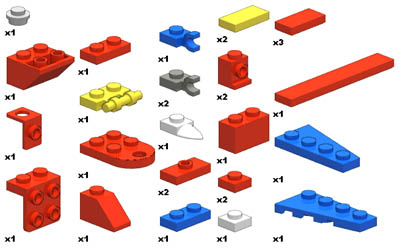
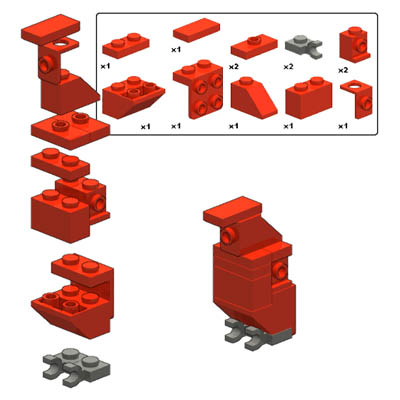
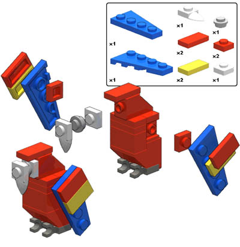
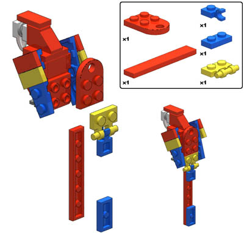
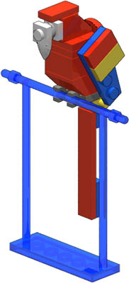

La [galerie de MisaQa](http://www.brickshelf.com/cgi-bin/gallery.cgi?m=MisaQa) est un régal pour les yeux. Ses modèles colorés sont mis en valeur par des photos de qualité. Par leur finesse et leur délicatesse ils se feront apprécier même par les non-AFOLs.

La galerie de MisaQa est principalement constituée de modèles animaliers [^1]. C’est un peu comme si il (ou elle) avait voulu, à la façon d’un peintre naturaliste, faire une collection de specimens.

Au-delà des animaux, vous vous délecterez aussi de ses architectures au travers desquelles vous ressentirez l’influence japonaise, de ses modèles de personnages ([Snoopy](http://www.brickshelf.com/cgi-bin/gallery.cgi?f=185173) - la machine à écrire est excellente :-D - [Wallace et Gromit](http://www.brickshelf.com/cgi-bin/gallery.cgi?f=181231) - ce pingouin plaira aux Linuxiens) et de ses [modèles](http://www.brickshelf.com/cgi-bin/gallery.cgi?f=113673) de [coiffures](http://www.brickshelf.com/cgi-bin/gallery.cgi?f=129114) pour personnages à l’échelle Miniland.

Mais revenons aux animaux. L’oeil apprécie ces modèles non seulement à travers le feu d’artifice de couleurs mais aussi par l’ingéniosité développée pour donner le sens de la silhouette de formes organiques avec des pièces pour le moins hypergéométriques.

MisaQa, à ma connaissance [^2], ne fournit pas de notice de montage de ses modèles. Mais si la plupart des modèles peuvent être remontés simplement à la vue des photos, d’autres sont un peu plus complexes et on doit deviner certaines astuces de montage. [^3]

Nous allons donc monter un des aras [^4] de MisaQa. Voici tout d’abord les pièces dont vous aurez besoins :

Le corps est principalement rouge :

On rajoute le bec et les ailes,

En même temps que l’on ajoute la queue, on en profite pour remplumer un peu le dos :

Et voila le perroquet de MisaQa placé sur son perchoir

Comme vous l’avez vu dans sa galerie, MisaQa à choisi d’autres couleurs et postures. Vous retrouverez les notices de montages pour ces modèles dans la partie adhérent du site FreeLUG.

[^1]: surtout oiseaux et chiens

[^2]: Le site web de MisaQa est en japonais, langue que je ne maitrise pas du tout

[^3]: La notice que je vous propose est donc vraisemblablement un peu différente du modèle original

[^4]: Les aras sont les plus grands représentants des perroquets
