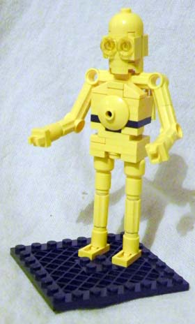
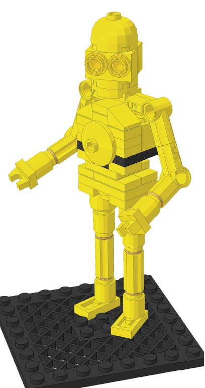
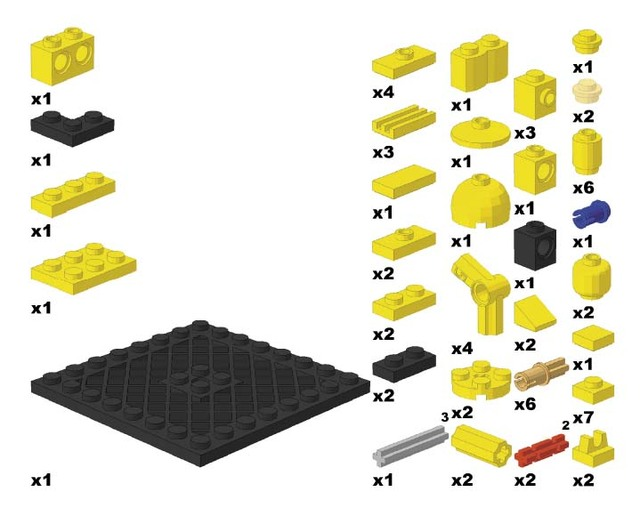
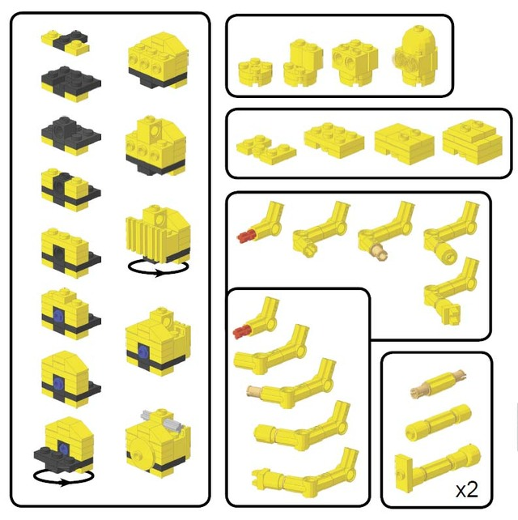
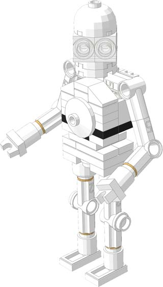
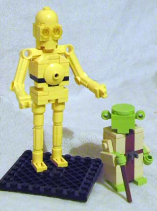

Les constructions qui vous sont proposées ici sont recréés à partir de modèles présentés dans les parcs LEGOLAND ou les LEGO Stores. Elles sont notamment adaptées pour être plus solides et en utilisant des pièces abordables et non modifiées.

Après vous avoir [présenté Yoda](http://www.freelug.org/spip.php?article2001), nous allons rencontrer aujourd’hui un autre "gentil" de l’univers Star Wars. Il n’est pas humain, mais humanoïde, c’est C-3PO.

Selon l’encyclopédie en ligne StarWars [Wookieepedia](http://starwars.wikia.com/wiki/C-3PO), C-3PO mesure 1m67. A l’échelle le modèle devrait faire 10 briques de hauteur mais le modèle proposé ici en fait 12. Tout comme Yoda, il sera donc un peu plus grand que prévu.

Le modèle étant un peu instable, j’ai choisi de remplacer les plaques lisses 1x2 qui lui servent de pieds par des plaques 1x2 avec un tenon (jumpers) et de le fixer sur une plaque 8x8 avec grille.

Il vous faudra donc 68 pièces pour environ 5 euros ([Guide des prix BrickLink](http://www.bricklink.com/catalogPG.asp)) pour construire ce modèle en suivant les étapes :

En ce qui concerne la couleur, C-3PO est de couleur dorée et le choix du jaune est donc naturel, mais les droïdes de la classe 3PO portent de nombreuses autres couleurs, les plus courantes étant l’argent et le blanc. Certaines pièces étant coûteuses ou indisponibles, vous devrez adapter le modèle si vous souhaitez le construire dans d’autres couleurs comme avec le blanc ci dessous.

Une variante du modèle consiste à utiliser pour les bras des connecteurs Technic d’angles différents au niveau des épaules ou des coudes.

Pour finir, voici une photo de famille de C-3PO et Yoda.

