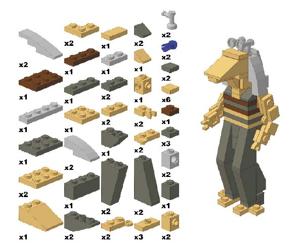
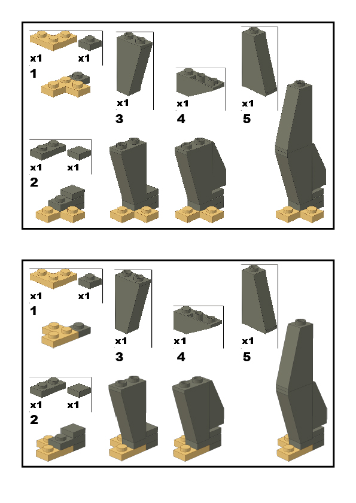
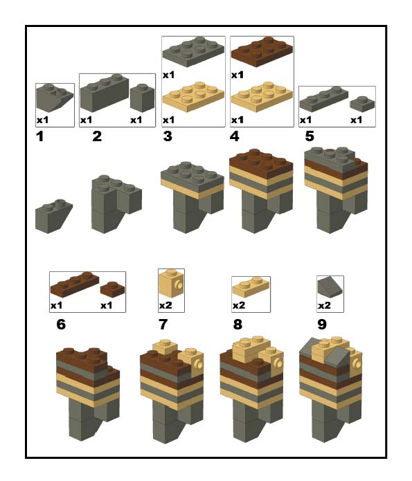
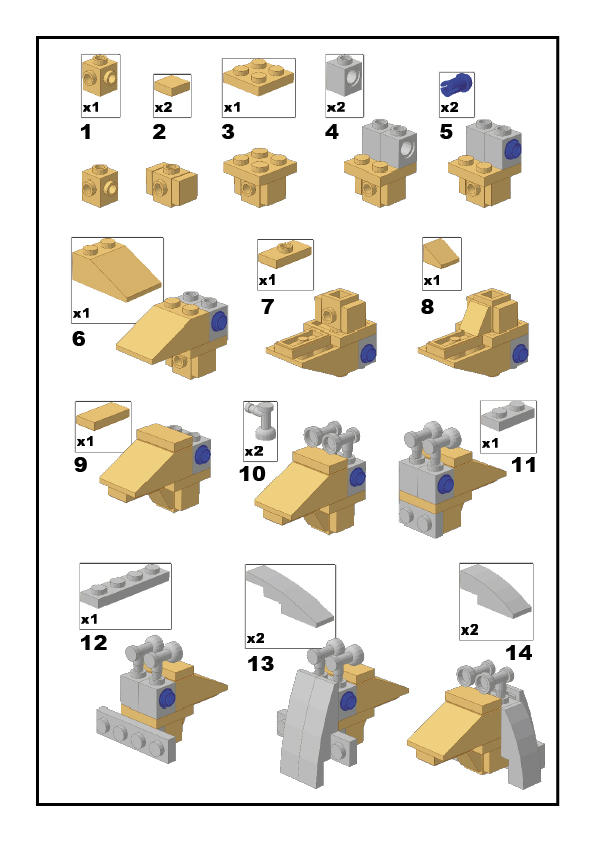
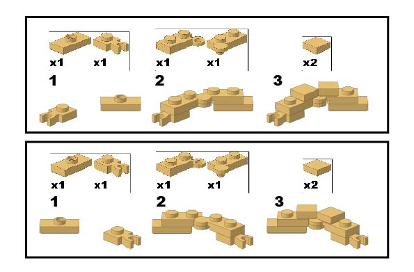

Les constructions qui vous sont proposées ici sont recréés à partir de modèles présentés dans les parcs LEGOLAND ou les LEGO Stores. Elles sont notamment adaptées pour être plus solides et en utilisant des pièces abordables et non modifiées.

Après [Yoda](/articles/les-personnages-miniland-yoda/), voici un autre représentant d’une espèce extra-terrestre de l’empire Star Wars : un Gungan.

Les Gungans sont une espèce amphibie, espèce indigène des marais de la planète Naboo.

Le plus célèbre des Gungan est Jar Jar Binks, particulièrement apprécié des enfants à cause de (ou grâce à ?) ses maladresses naïves.

Jar Jar Binks est particulièrement reconnaissable à sa silhouette élancée - il mesure près de 2m - à ses yeux protubérants et à ses grandes oreilles externes.

Le modèle fait 12,2 cm de haut (ce qui représente 2m20 au 1:18e). Les couleurs utilisées sont relativement neutres (gris, brun et beige). Le personnage se compose de 63 pièces qui vous coûteront environ 8 euros selon le [Guide des prix BrickLink](http://www.bricklink.com/catalogPG.asp). Cependant en remplaçant la coûteuse [Brick, Modified 1 x 1 with Studs on 4 Sides](http://www.bricklink.com/catalogItem.asp?P=4733) beige (tan) par la même pièce en gris clair (light blueish grey) le coût descend environ à 5 euros tout en ne causant qu’un tort minime à l’esthétique du modèle.

Le modèle, grâce à ses larges pieds faits de plaques 2x2 "corner", est très stable. On notera le montage en SNOT des briques pentues au niveau des mollets permettant de recréer le profil ample des jambes.

Le design de la tête fait de nouveau appel au SNOT mais aussi à [d’autres techniques de montage comme l’AZMEP](/articles/le-guide-non-officiel-des-techniques-avancees-de-construction-lego/). Le montage de la nuque constitue une "banbanterie" en ce sens que la liaison en SNOT est incomplète mais comme les pièces sont maintenues en tenaille entre le cou et la tête, la solidité du montage reste satisfaisante pour un modèle d’exposition.

Les Gungan étant tous différents, il n’est pas interdit de modifier ce design, par exemple en remplaçant des pièces gris clair par des pièces gris foncé et reconstituer ainsi toute une armée.
