Après une série consacrée aux personnages de l’Univers Star Wars, nous vous proposons de construire des personnages issus du monde de Batman. Après Batman, Robin et Le Joker, nous finissons avec une super vilaine : Harley Quinn.

Représenter un personnage féminin à l’échelle des personnages MINILAND n’est pas chose aisée. Il faut jouer sur des caractéristiques parfois stéréotypées : longues jambes, taille et hanches marquées, poitrine développée et longs cheveux. Ca tombe bien, Harley Quinn possède tout cela.

[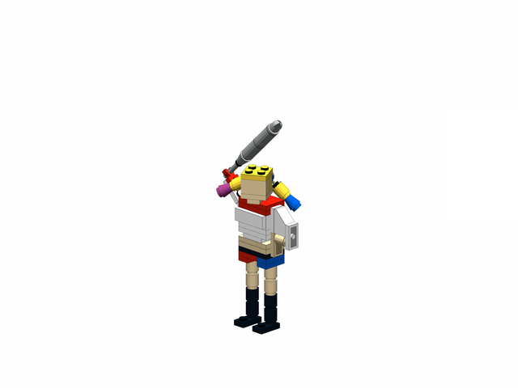](https://www.freelug.org/IMG/png/page_1-2.png)

La construction du buste fait donc appel aux maintenant fameuses "jumper plate" qui permettent de faire un décalage d’un demi-tenon. Comme pour Batman, on utilise des briques avec un tenon sur le côté pour fixer une plaque lisse permettant, ici, de représenter la poitrine.

[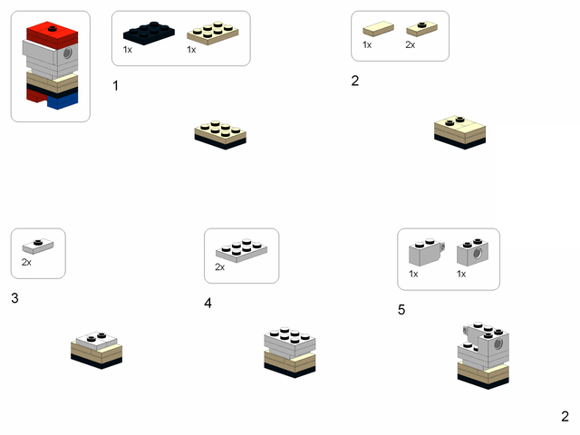](https://www.freelug.org/IMG/png/page_2-4.png)

[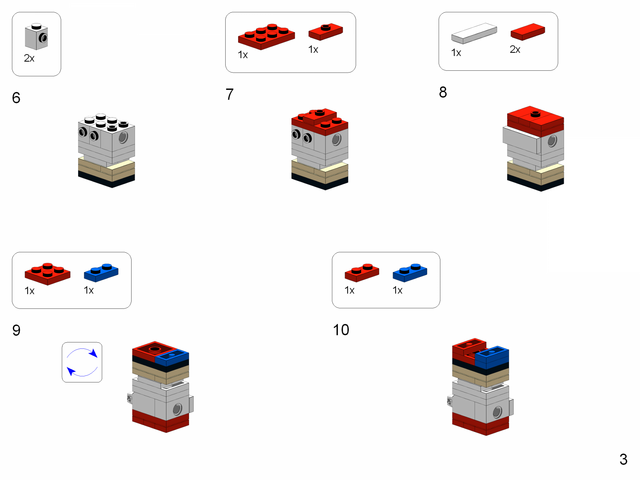](https://www.freelug.org/IMG/png/page_3-4.png)

La tête permet de fixer à l’arrière du crâne des couettes en faisant usage d’un accessoires de minifigurine : une clé à oeil 6 pans (wrench).

[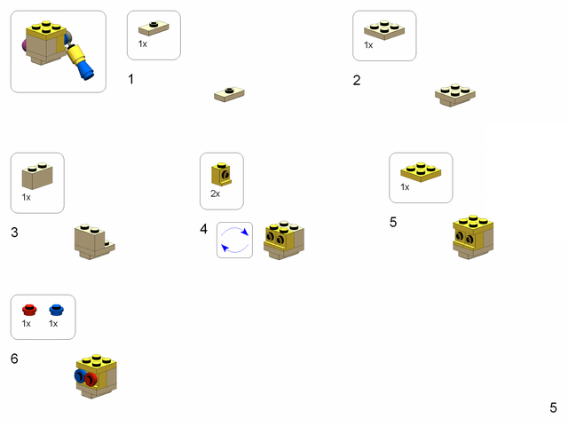](https://www.freelug.org/IMG/png/page_5-4.png)

[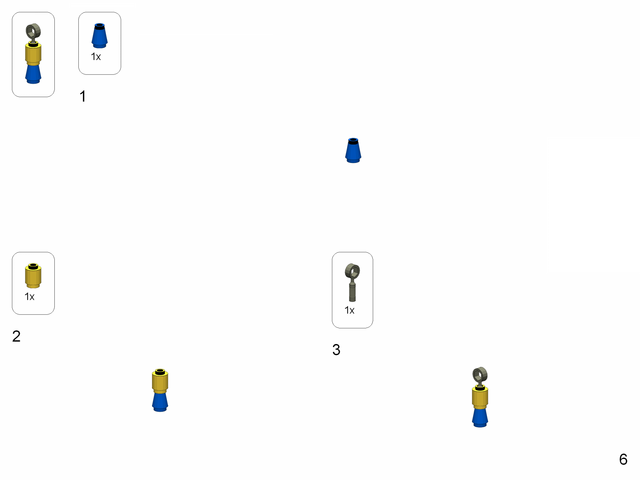](https://www.freelug.org/IMG/png/page_6.png)

[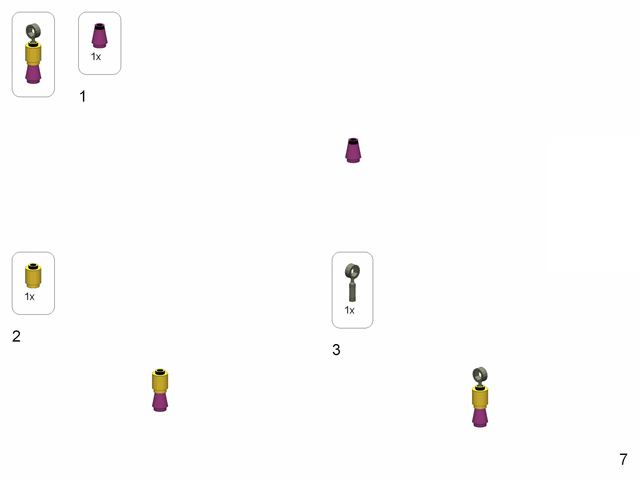](https://www.freelug.org/IMG/png/page_7-4.png)

Nous avons utilisé ici un cône violet-magenta mais vous pouvez utiliser une pièce rouge.

Le main gauche repose sur la hanche. Le montage du bras est très original et est inspiré d’un modèle de patineuse en roller vue au MINILAND de Billund au Danemark.

[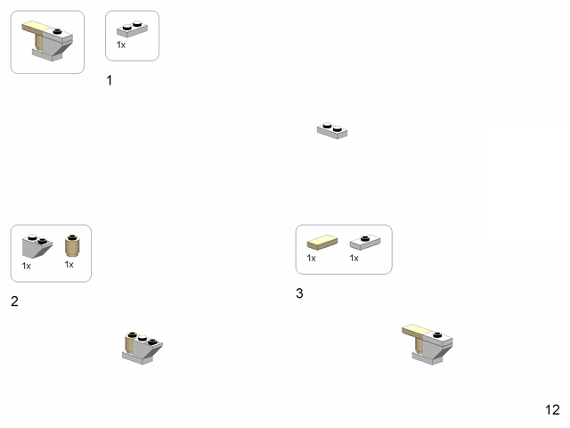](https://www.freelug.org/IMG/png/page_12.png)

Le bras droit lui est beaucoup plus classique avec son épaule constituée d’une jonction charnière à clic (l’autre partie de la jonction est déjà sur le torse) et d’une plaque 1x1 modifiée pour la main.

[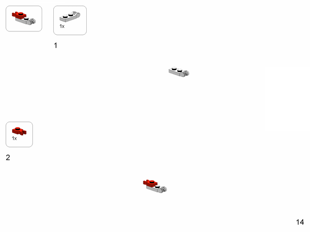](https://www.freelug.org/IMG/png/page_14-2.png)

Cette main tient une batte, accessoire indissociable du personnage de Harley Quinn. Il vous faudra orienter correctement la tête et les couettes pour pouvoir faire tournoyer cet impressionnant objet au dessus de la tête de la blonde déjantée.

[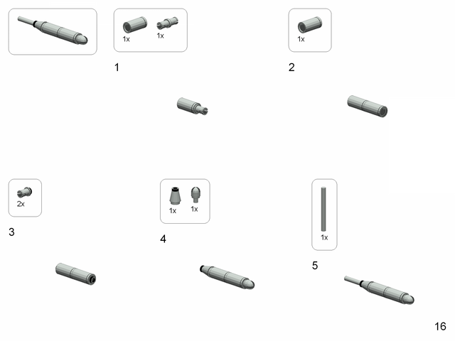](https://www.freelug.org/IMG/png/page_16.png)

Enfin, le personnage est campé sur deux longues jambes. Vous pouvez varier leur positionnement sur le mini-short en trois différents points (avant, milieu, arrière) pour obtenir des posture différentes.

[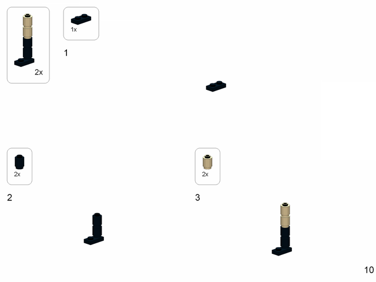](https://www.freelug.org/IMG/png/page_10-2.png)

Les jambes sont fragiles. Vous pouvez les consolider en y insérant une barre (comme celle de la batte).

Ci-après, la liste des 61 pièces qui permettent de construire ce modèle de 22.5g pour 32 plaques de haut (10,2cm, 1m84). Enfin, vous trouverez plus bas la notice complète en format pdf.

[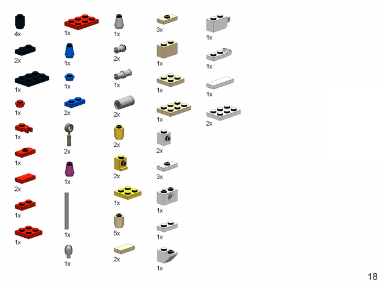](https://www.freelug.org/IMG/png/page_18.png)

**Notice de Harley Quinn**
