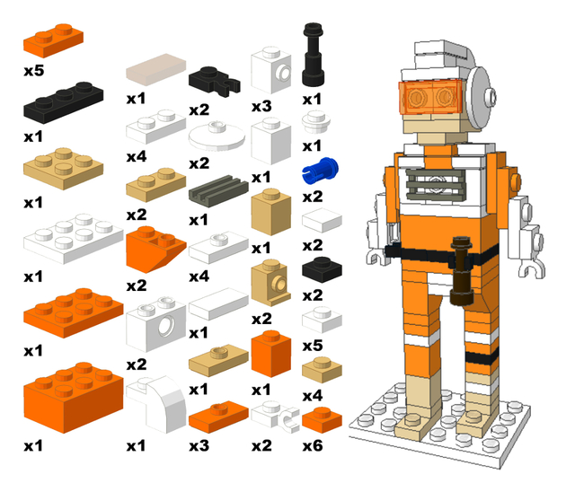
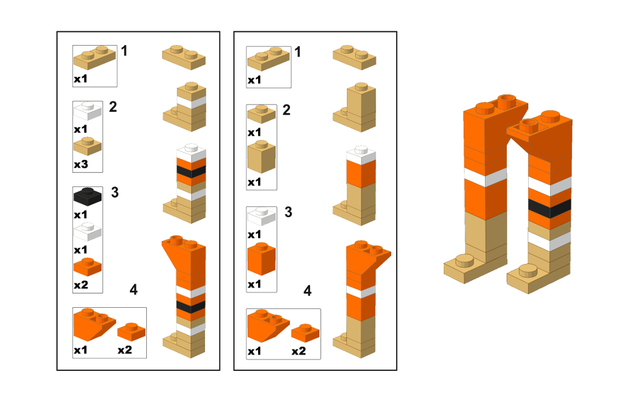
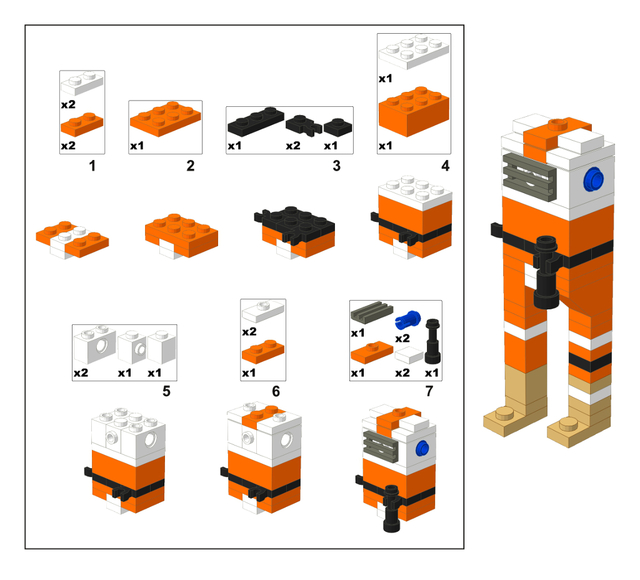
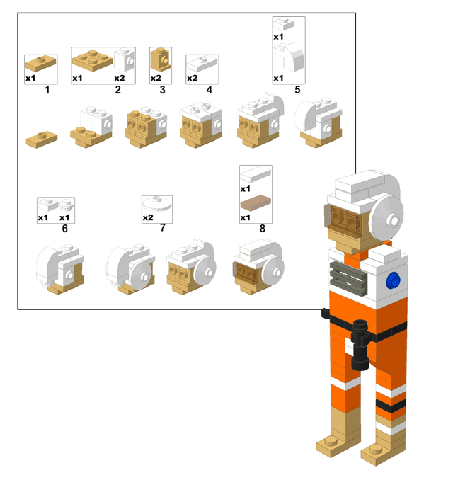
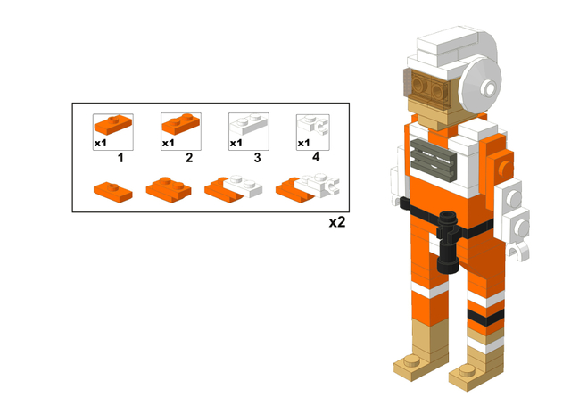

Les constructions qui vous sont proposées ici sont recréées à partir de modèles présentés dans les parcs LEGOLAND ou les LEGO Stores. Elles sont notamment adaptées pour être plus solides et en utilisant des pièces abordables et non modifiées.

Après le [Gungan](/articles/les-personnages-miniland-gungan/) que nous avions présenté précédemment, nous revenons aujourd’hui à un personnage humain. Mais contrairement à ceux déjà présentés ([Officiers de l’Empire](/articles/les-personnages-miniland-officiers-de-l-empire/)), ils font partie de l’Alliance Rebelle : il s’agit d’un pilote de Snowspeeder participant à la Bataille de Hoth.

Composé de 69 pièces, il mesure 11 briques et 1 plaque de hauteur (10.9cm). Les pièces vous coûteront moins de 4 euros (Guide des prix [BrickLink](http://www.bricklink.com/)).

On utilise du tan pour simuler les bottes beiges adaptés aux conditions hivernales de Hoth, mais rien n’empêche d’utiliser le noir ou le gris foncés pour un look plus habituel du pilote rebelle. N’hésitez pas à modifier la position des jambes pour simuler d’autres postures.

L’orange de la tenue est la couleur des pilotes de X-wing. On peut imaginer utiliser le vert (foncé ?) pour des pilotes de A-wing et surtout le plus classique rouge pour des pilotes de B-wing.

Le design du casque est, à cette échelle, particulièrement réussi. Les [disques 2x2](http://alpha.bricklink.com/pages/clone/catalogitem.page?P=4740#T=C) et la [brique arrondie](http://alpha.bricklink.com/pages/clone/catalogitem.page?P=6091#T=C) reprennent bien la forme globale sphérique du casque et la [tile 1x2 trans-orange](http://www.bricklink.com/catalogItemIn.asp?P=3069b&colorID=98&in=A) simule à la perfection la large visière. Si toutefois le casque ne vous plaît pas, penser que les pilotes ne portent pas le casque en permanence, vous pouvez remplacer cette tête casquée par une tête sans casque.

Par contre le design des bras est décevante (on aurait pu employer des plaques charnières comme pour les Officiers de l’Empire) mais il a le mérite de n’utiliser que des pièces extrêmement basiques.

A bientôt avec d’autres constructions, et n’oubliez pas que vous restez les seuls maîtres de ce que vous construisez !
