Il est des nouvelles pièces qui ont un succès quasi unanime auprès des Afols.

La famille des "Slopes, Curved" en font partie. Dans la lignée des pièces en pente ( Slopes) ou dites également de "toit".  
Elles ont eu un développement très important en quelques années dans les modèles officiels et dans les créations personnelles.

Ces pièces ne sont pas très nombreuses du moins au niveau des formes, car il y a eu beaucoup de pièces imprimées ou avec autocollants. C’est pour cela que la rubrique de classement sur Bricklink est aussi garnie ! 270 références, alors qu’il n’y a que ces design différents :

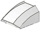

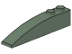

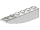

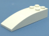

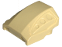

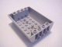

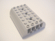

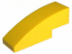

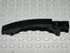

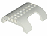

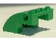

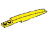

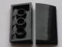

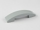

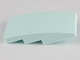

La plupart des véhicules en sont pourvus : trains, bateaux, voitures, avions, camions, vaisseaux spatiaux... Et même dans presque tous les thèmes LEGO !

Pourquoi les utiliser ? Et bien la principale raison est une finition incomparable des modèles. Ou la forme courbe donne un aspect beaucoup plus réaliste. Certaines de ces pièces sont sans tenon apparent et cela donne au modèle réalisé la forme du véritable objet à l’échelle réduite.

Je présente ici quelques-unes de mes réalisations, pas que celles-ci soient des plus réussies. Car je suis en train d’effectuer une refonte complète de mes modèles de trains LEGO :-)

En appliquant justement ce que je décris dans cet article !  
Je ne sais pas si le temps que j’aurais passé à les réaliser sera à la hauteur.

Modèle de wagon :

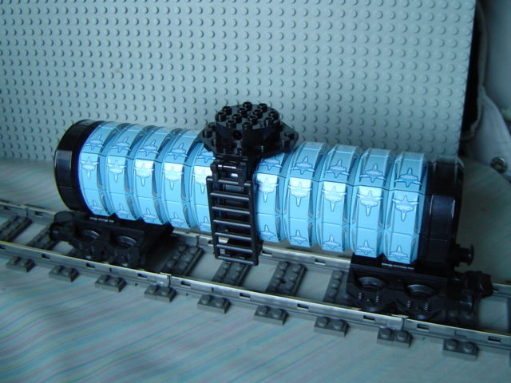

Voiture de voyageurs en 6 de large :  
Le toit se retrouve donc entièrement arrondi ! :-)

[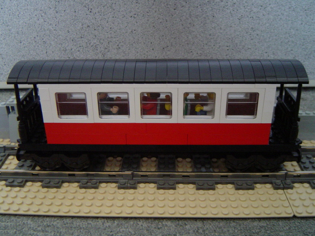](https://www.freelug.org/IMG/jpg/DSC02941.jpg)

Toit de bâtiment, qui utilise les pièces en pente traditionnelles et des courbes 42022 pour la partie haute

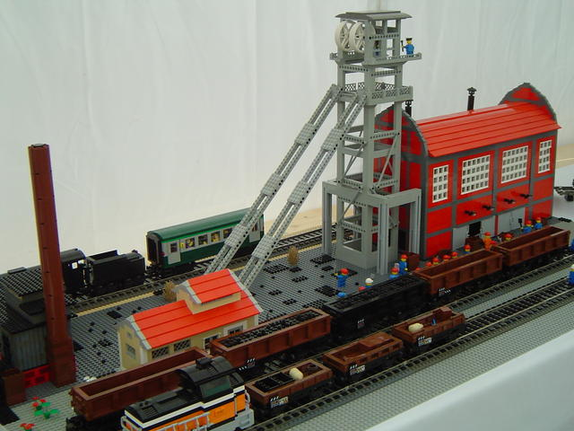

**Puits de mine de Charbon**

Mine de Charbon et desserte ferroviaire

La locotracteur est elle aussi construite avec des pièces courbes. C’est la première réalisation de ce programme de refonte. Vous pouvez apercevoir également la voiture voyageurs UIC qui était hélas dans une version temporaire au moment de l’exposition ! Une partie des pièces devaient arriver par le LugBulk quelques jours plus tard ! Et la finition du bas de caisse pas encore au point !

Pour conclure :

Si les pièces courbes sont appréciées, il y a un bémol, ils nous en faut souvent en de grandes quantités. Et à notre grand désarroi, les fans vendeurs de pièces détachées le savent bien ... :o)
