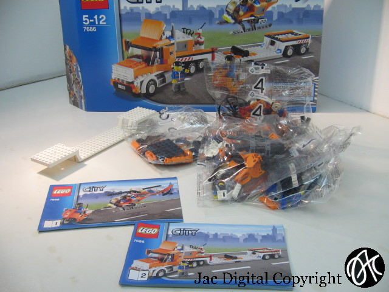
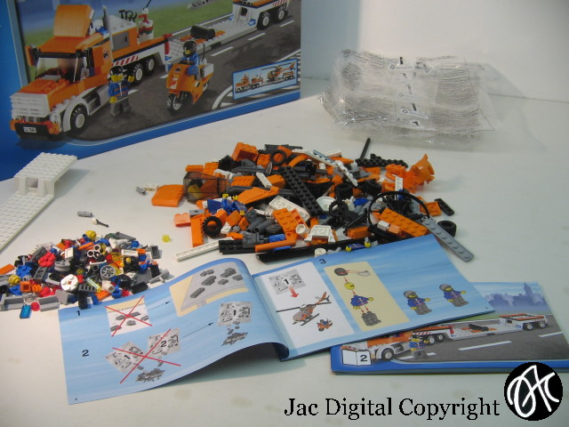
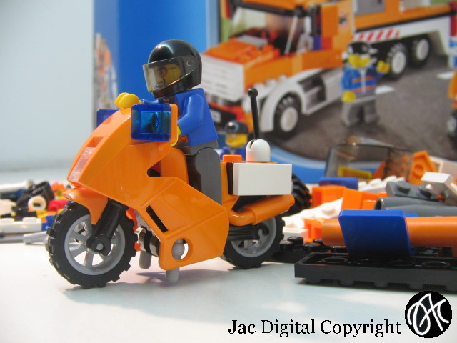
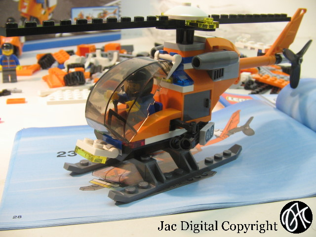
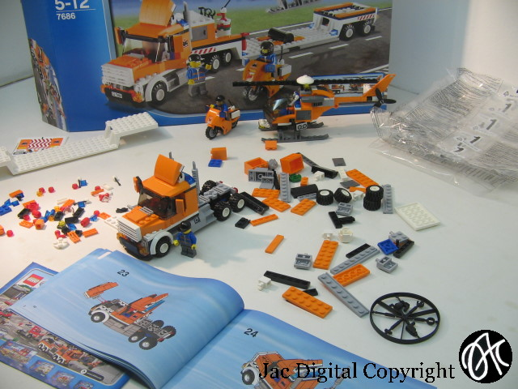
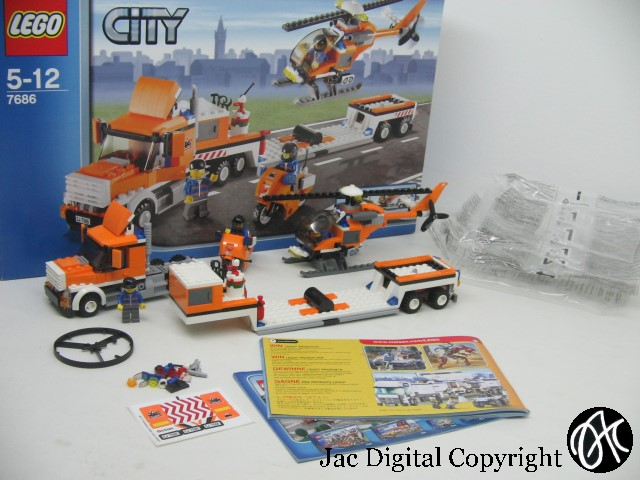
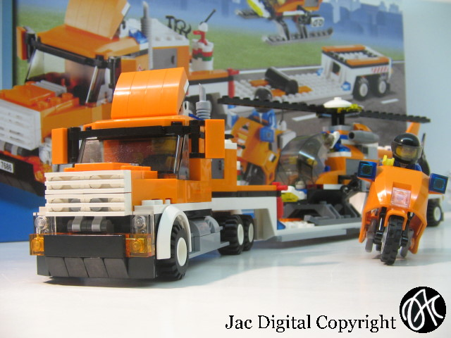
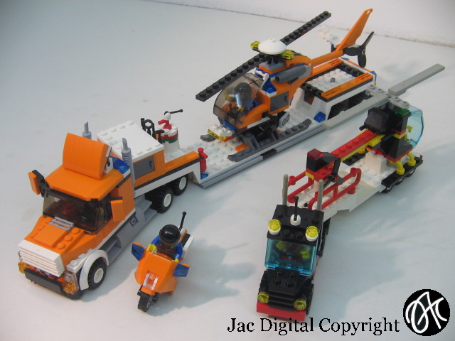
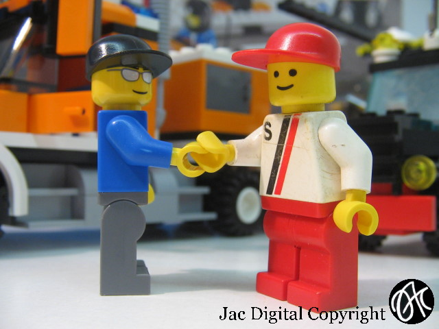

Nouvelle taille de camion, 6 tenons de large, voilà un vrai porte-hélicoptère en LEGO.

Grâce aux listes FreeLUG, j’apprends que le nouveau transport d’hélicoptère 7686 est en promotion dans certains magasins. 25 euros, il ne faut pas laisser passer cette chance.

Les transport des hélicoptères, ce n’est pas vraiment nouveau dans la gamme LEGO : la [référence 6357](http://guide.lugnet.com/set/6357) sortie en 1988, et une [référence Jackstone 4607](http://guide.lugnet.com/set/4607) datant de 2001. Celui d’aujourd’hui n’a rien à voir avec les autres : 6 tenons de large, un vrai porte-char avec tandem suspendu, moto d’escorte, et 3 personnages. Le prix n’est pas si élevé pour un tel modèle. Et en prime, une bonne quantité de pièces oranges.

A l’ouverture de la boîte, encore un peu trop grande, on trouve les sachets habituels au nombre de 4, puis la notice en deux parties.

**Ouverture de la boîte.**

La notice nous conseille de ne pas verser les briques sur la moquette, et d’ouvrir les sachets l’un après l’autre, pour mieux suivre les étapes. Mais, je n’en fais qu’à ma tête ! Je mélange tout. Ca rappellera des souvenirs. Je sépare tout de même les gros sachets des petits. Ces derniers resteront rangés dans un coin, au cas où une pièce y soit restée coincé. Ils seront jetés dans la bonne poubelle à la fin du montage...

**Ouverture des sachets.**

Les autocollants sont glissés dans la notice. Fait exprès ou pas ? Ils sont donc tout propres, mais je ne les colle jamais.

Le montage commence par les personnages, et la moto. Elle est très belle dans ces couleurs.

**La moto.**

Puis on poursuit avec l’hélicoptère. Une ultime version me direz-vous ? Là, je ne vais pas les compter. Celui-là a un très bon rendu. Certaines nouvelles pièces, apparues dans des Bionicle (si, si !) lui vont très bien. Présentes aussi, les nouvelles plates de 1x12 en noir.

**L’hélicoptère.**

Enfin, on attaque le camion. Une très belle gueule, vraiment bravo au designer ! Je ne sais même pas quoi faire pour lui rajouter ma touche personnelle. Un vrai régal à construire, avec beaucoup de pièces. Peut être les roues un peu petites, pour un convoie exceptionnel, et le déflecteur de cabine qui ne sert à rien. Mais, c’est vraiment pour chercher...

Une bonne chose, les phares de la moto et du camion sont blancs.

**Le camion, et les pièces restantes pour le porte-char.**

Pour finir, le porte-char. Rien de particulier, si ce n’est les essieux arrières suspendus. Et puis, des éléments très jouables, comme des caisses à outils faciles à démonter... Il reste pas mal de pièces en extra, et pourtant, je n’ai rien oublié. Un rapide coup d’oeil aux notices me le confirme.

L’ensemble est magnifique. Des heures de jeux en perspective.

**Très beau modèle.**

**Y’a plus qu’à s’amuser......**

La comparaison avec le transport d’hélicoptère de 1988 rend compte de l’évolution des modèles. Pourtant, en le construisant pour l’article, j’y ai pris du plaisir. Surement de la nostalgie, malgré mon esprit "MOCeur" !

**Comparaison avec le modèle de 1988.**

**Une bonne poignée de main....**

Une bonne poignée de main, en conclusion de cet article. Un très beau modèle agréable à construire. En attendant les autres références, peut être l’éolienne. Mais là aucune comparaison avec un modèle existant.
