Je me souviens c’était le temps où je donnais vie à mes LEGO en inventant des histoires de policiers et de voleurs, avec le bruitage des sirènes et des dérapages... Aujourd’hui sous une forme plus sage je continue à animer mon âme d’enfant !

Je vous présenterai une partie de mon histoire et de mes motos de police, et aussi vous présenterai tous les sets motos de police en expliquant leur évolution (le choix de la date est fixé à partir de la véritable naissance de la minifig : 1978).

C’est une vision très personnelle avec des préférences qui ne sont pas forcément les vôtres. Donc n’hésitez pas à expliquer votre point de vue par rapport au mien. Voire de compléter si d’aventure il y en a besoin.

## I) une histoire de gosse

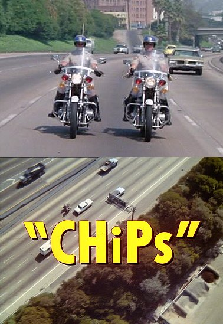

Pour commencer rien de mieux que de se remémorer le départ de tout ça dans ma vie... dans les années 80 je tombe en admiration devant une série américaine : "Chips" qui est en fait les aventures de deux gendarmes motards des autoroutes de la Californie. Et je me souviens que dès l’épisode terminé je prenais les motos de police LEGO et refaisais ce que je venais de voir... ce sont des heures et des heures de jeu. Je me souviens que je prenais une grande antenne grise pour la mettre à l’arrière de la moto... petit JeanG "Mocait" déjà ses motos de police ;)...

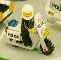

+

**antenne**

\_

Cette passion pour les motos de police LEGO est arrivée jusqu’en 2007 avec mon fameux défilé motorisé du 14 juillet... ce fut un moment de pure émotion de voir les 121 motos alignées sur des plaques LEGO... et je me suis aperçu que j’avais gardé ces yeux qui brillaient quand j’étais gamin quand je voyais du LEGO.

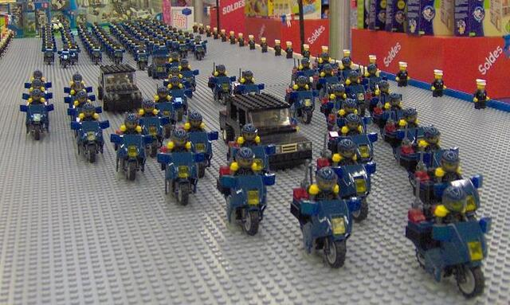

**exposition du 14 juillet 2007 à TRU Dijon**

## II) historique de 23 sets officiels avec des motos de police

**1) le début (1978-1980) : les motos très rock’n’roll**

C’était bien évidemment le temps où LEGO n’avait pas fabriqué de pièces évoluées et où le principe était de tout construire avec des briques. Les premières motos n’ont pas échappé à ce principe usant de briques plates pour la création des motos. Le réalisme est complètement oublié avec des motos rectangulaires où les personnages sont assis comme dans une voiture.Cependant cela n’enlève rien à l’amusement de faire rouler ces motos.

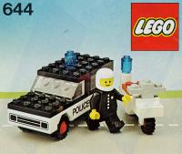

**set 644 de 1978**

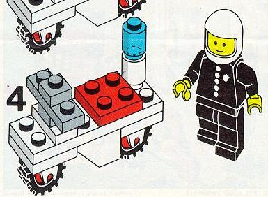

**moto de police du set 644**

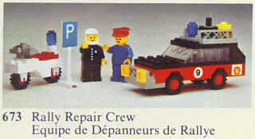

**set 673 de 1978**

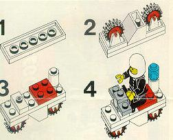

**plan de montage du set 673**

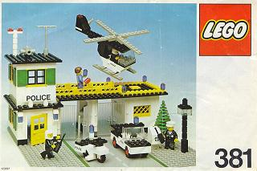

**set 381 de 1979**

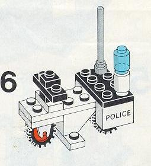

**détail de la moto de police set 381**

**2) une forme qui s’impose(1980-1992) : les motos simples**

Naissance d’une moto qui va tenir plus de 15ans avec une nouvelle pièce très réaliste et efficace : la pièce x81

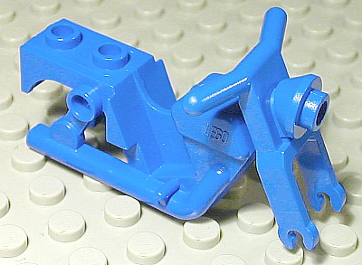

**Pièce X81**

C’est une moto petite avec laquelle il est plaisant de jouer mais attention à l’accident avec la roue avant, il ne faut pas appuyer fort sur l’avant sinon c’est la casse assurée... Son évolution dans les années 80 est assez faible et l’habillage reste assez classique quelque soit le set. Cependant il est à noter deux petites anecdotes :  
**–** la première concerne la couleur des jantes qui passe de "red" (rouge) à "trans-clear" (transparent clair) durant les années 80 mais LEGO n’a pas respecté à la lettre les sets : pour avoir ouvert le set 6522 en MISB j’ai eu la mauvaise surprise d’avoir des jantes différentes de celles annoncées : je me suis retrouvé avec les vieilles jantes.  
**–** la deuxième concerne les phares : un coup carrés, un coup ronds, un coup les 2, un coup avec tenon, un coup lisses... Ce qui fait que vous avez des sets motos classiques mais qui restent montés de façon originale.

Notez qu’au départ les motos de police sont grises avec visière police (1983-1984)...

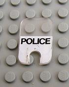

**visière moto**

visière police qui ne réapparaitra que 2 fois dans les sets N°6309 de 1988 (boite complémentaire) et N°6540 de 1991 (port de police).

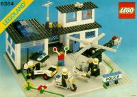

**set 6384 de 1983**

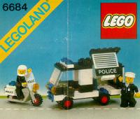

**set 6684 de 1984**

Puis les motos deviendront blanches

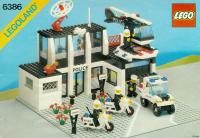

**set 6386 de 1986**

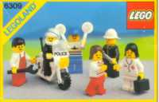

**set 6309 de 1988**

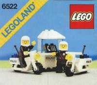

**set 6522 de 1988**

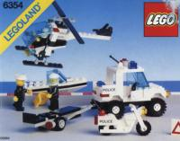

**set 6354 de 1990**

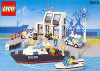

**set 6540 de 1991 premier port de police et dernière apparition de la visière moto de police**

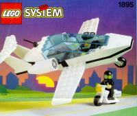

**set 1895 de 1992 un modèle pas très connu mais très facile à remonter, ce modèle n’a pas du tout était commercialisé en France**

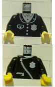

**uniforme police de 1979 à 1992**

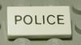

**Pièce 3069bp18 de 1983-1992 ancien logo de police des motos**

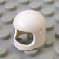

**Casque de police de 1979 à 1992**

**3) relookink (1993-1997) : les motos stylées**

Peut-on aller jusqu’à parler de carénage ? Il est clair que les motos de police allaient continuer à évoluer dans le temps. Tout en gardant la pièce maitresse vu ci-dessus les modèles motos vont pour chaque set trouver leur propre personnalité. Les couleurs d’habillage changent : nouveau logo de police, grossissement des sacoches, nouveau uniforme de police, nouveau casque...

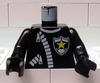

**Uniforme de police de 1993 à 2000 pièce 973px9**

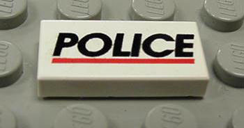

**Pièce 3069bpx29 de 1993 à 2006 logo moderne pour les motos de police**

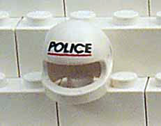

**apparu sans logo de police en 1988, ce casque au design moderne va se voir ajouter le logo police de 1993 à 2002. Pratique pour le réalisme en pouvant y mettre une visière transparente.**

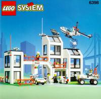

**Set 6398 de 1993, le plus beau QG de police avec l’arrivée du nouveau logo police présent d’ailleurs sur la moto**

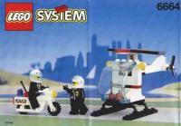

**set 6664 de 1993 avec nouveau logo de police**

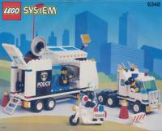

**Set 6348 de 1994 moto escorte du qg mobile, il aurait été plus judicieux d’avoir 2 motos pour l’escorte.**

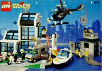

**set 6598 de 1996 QG police/port avec 2 motos de police (très bon choix)**

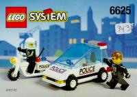

**set 6625 de 1996 avec l’apparition de sacoches agrandis**

**4) les 3 roues (1997-2004) : les motos peu enivrantes et en déclin.**

Ce ne sont pas des motos routières et difficile de pouvoir attribuer à cette nouvelle moto les missions du passé. Cette moto est fait pour le tout terrain et donc il est mieux d’associer cette moto au thème de la montagne et de la plage. LEGO exploitera faiblement ce modèle pour la police et il y aura une absence de moto de police entre 1999 et 2002.

Malgré le renouveau du design police en 2003 les motos ne sont pas du tout soignés sur la jouabilité et l’esthétique.

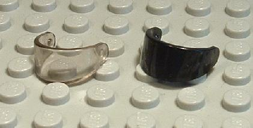

**visière existe depuis 1988. D’abord trans-blue de 1988 à 1997 la visière deviendera trans-green de 1998 à 2002 et trans black à partir de 2003**

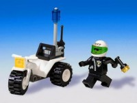

**set 6324 de 1998 avec nouveau casque:visière verte. moto 3 roues**

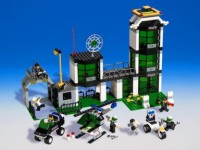

**set 6332 de 1998, l’un des QG les plus moches début du n’importe quoi chez Lego**

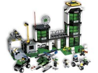

**horreur suite set 6636 de 2002 SOS seters de la ville**

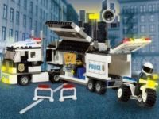

**set 7034 de 2003, le camion est de toute beauté mais la moto n’évolue pas et on comprend pourquoi on peut la cacher dans la remorque pour ne pas faire tache. Mais avec les nouveaux set de 2003 un espoir est né pour un changement de moto**

**5) la renaissance (2005-2007) : les motos modernes.**

LEGO a enfin remis de l’ordre dans sa gamme City, l’apparition d’une nouvelle forme de moto de police est la confirmation d’une modernisation du thème de la ville.  
La moto de police qui sort en 2005 est révolutionnaire par son réalisme esthétique et sa jouabilité amusante. Présent pour l’instant dans 2 sets, ce nouveau modèle offre le retour aux missions du passé dont principalement les missions d’escorte et de prévention routière... bref tout un programme pour les grands et les petits. Je ne vous en dis pas plus et vous laisse regarder la troisième partie consacré au set 7235 de 2005.

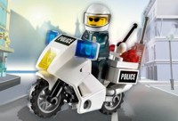

**set 7235 moto de police : une pure merveille**

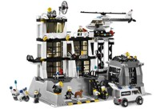

**set 7237 de 2005, la continuité du renouveau**

## III) Présentation du set 7235

_Un petit set bien sympa_  
**–** Date : 2005-2007  
**–** Nombre de pièces : 28  
**–** Prix : entre 3 et 3.99euros

Bien que j’ai été dans ceux qui en premier ont traité ce set de Playmobil avant de l’avoir eu dans les mains, je dois avouer m’être largement trompé... Je critique aujourd’hui seulement le design de la boite trop proche de Playmobil... et je suis tombé largement fou de ce set puisque j’en possède 140 exemplaires.

La nouvelle moto utilise toute la nouveauté LEGO : nouvelle coque moto, moto en 2 parties, nouvelle roue avec jante grise, nouveaux phares triangulaires jaunes/bleus/rouges, phares rouges mis en évidence à l’arrière, phare jaune génialement mis sur le devant de la moto, les gyrophares bleus devant comme dans la réalité, nouveau design du torse du personnage avec un bleu particulier et logo très attractif, béquilles surprenantes, autocollant franco-anglais / allemand (laissant le choix du logo)... bref une pure réussite...

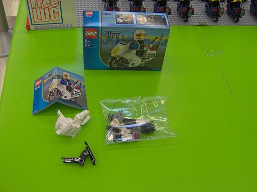

**ouverture de la boite**

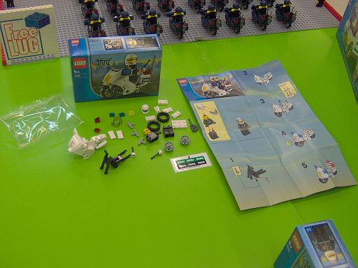

**détail des 28 pièces du set**

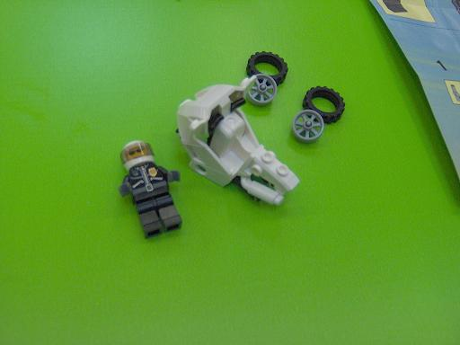

**les 2 pièces moto s’emboitent**

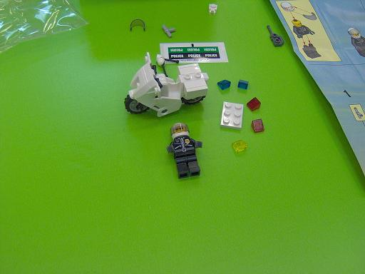

**mise en place des roues**

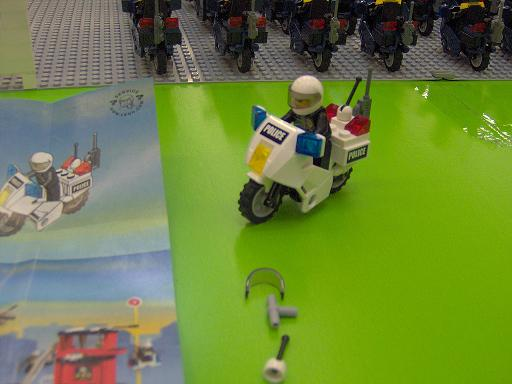

**Produit fini**

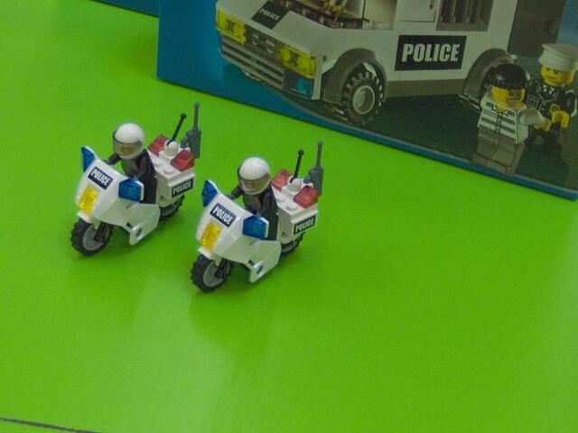

**escorte : 2 motards**

**Les petits sets qui font de grandes choses :**

Je n’ai pas pu résister malgré d’être un puriste de sets officiels de tenter une expérience hors du commun. Après avoir longuement réfléchi j’ai décidé de peindre 121 motos au couleur de la gendarmerie nationale française. Face à un tel sacrilège, je devais mettre la barre haute en arrivant à un résultat très réaliste. Pour cela je me suis adressé à des spécialistes qui m’ont donné la meilleure façon pour arriver à la perfection. Le pinceau est à proscrire... il faut travailler avec un pistolet (à projection fine) pour voiture et un apprêt pour faire en sorte que la peinture voiture se fixe bien sur la pièce. Avec les nouvelles technologies des garages, un appareil calcule exactement la couleur désirée. Pour cela un appareil doit être placé sur la surface colorée, l’enregistrement donne les quantités de chaque couleur pour arriver à la couleur voulue. Aujourd’hui mes 121 motos qui ont défilé le 14 juillet 2007 à Toy’s R Us de Dijon ont la couleur véridique des grandes et la couleur se confond avec la pièce.

[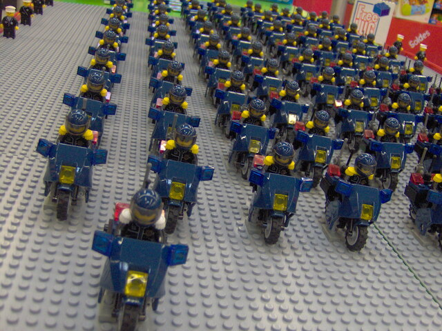](https://www.freelug.org/IMG/jpg/0000_les_83_very_next.jpg)

**défilé du 14 juillet 2007**

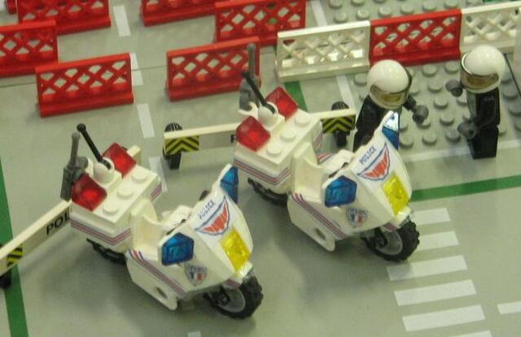

**Dès 2005 mes motos de police ont été francisé : vive les CRS :)))**

_Le prochain objectif : la lumière (voire le son :)_

J’ai découvert un allemand qui a travaillé sur le principe des diodes incorporées dans différents modèles dont le 7235 [http://www.mnop.de/steinbohrer/](http://www.mnop.de/steinbohrer/)  
(d’ailleurs si la cellule traduction de FreeLUG pouvait faire un article dessus je pense que cela pourrait être sympa)

[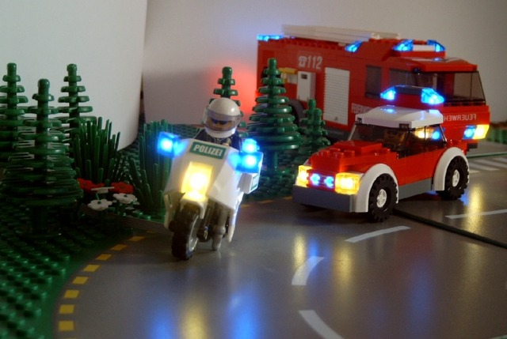](https://www.freelug.org/IMG/jpg/alarm0.jpg)

**quand les afols bricolent...**

P.S. : je ne pouvais pas finir cet article sans parler d’un set d’exception qui bien qu’un peu dépassé par son âge (1992) a su influencer les motos de police modernes dont les doubles sacoches du set 6625 de 1996 repris dans les sets motos de police de 2005, mais aussi la plate 2 par 3 posée à l’arrière, idée reprise en 2005 sur les nouvelles motos de police !!! J’ai bien sûr nommé le set 6346 :

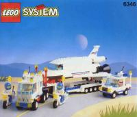

**set 6346 de 1992**

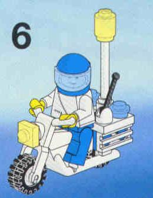

**moto du set 6346**

## Pour conclure

La taille des différents sets varie selon le nombre de pièces... mais chaque set compte et une simple petite moto peut devenir une grande aventure dans toute une vie... la preuve !!! ;0)

Liens internet :  
**–** [http://www.brickshelf.com/cgi-bin/g...](http://www.brickshelf.com/cgi-bin/gallery.cgi?f=114908)  
**–** [http://www.brickshelf.com/cgi-bin/g...](http://www.brickshelf.com/cgi-bin/gallery.cgi?f=263028)  
**–** [http://www.brickshelf.com/cgi-bin/g...](http://www.brickshelf.com/cgi-bin/gallery.cgi?f=116057)  
**–** [http://www.mnop.de/steinbohrer/](http://www.mnop.de/steinbohrer/)  
**–** [http://www.brickshelf.com/cgi-bin/g...](http://www.brickshelf.com/cgi-bin/gallery.cgi?f=227459)

Liens sympas :  
**–** [http://www.brickshelf.com/cgi-bin/g...](http://www.brickshelf.com/cgi-bin/gallery.cgi?f=252156)  
**–** [http://www.brickshelf.com/cgi-bin/g...](http://www.brickshelf.com/cgi-bin/gallery.cgi?f=165744)  
**–** [http://www.brickshelf.com/cgi-bin/g...](http://www.brickshelf.com/cgi-bin/gallery.cgi?f=172657)  
**–** [http://www.brickshelf.com/cgi-bin/g...](http://www.brickshelf.com/cgi-bin/gallery.cgi?f=112861)

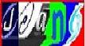
