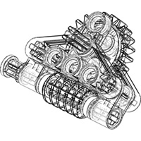
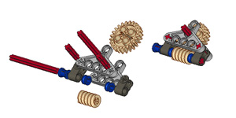
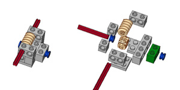
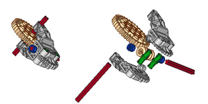
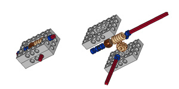
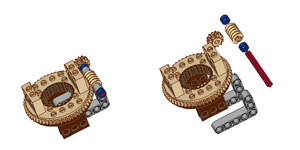
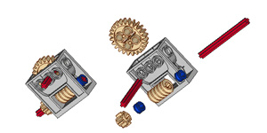

Cet article est une traduction de [l’article de Christopher Snead](http://www.mechahub.com/index.php?option=com_content&task=view&id=112&Itemid=167) publié sur [Mechahub](http://www.mechahub.com/) et fait suite à l’article [Les techniques d’articulation](/articles/les-techniques-d-articulation/).

Quand on s’imagine un mecha avançant dans le désert, écrasant les troupes ennemies avec une débauche de force et de puissance de feu, on l’imagine souvent doté d’engrenages gigantesques entraînant ses membres.

Il est donc ironique, qu’en tentant d’apporter une réponse à la difficulté de soutenir le poids d’imposantes créations LEGO, de nombreux constructeurs s’appuient sur les engrenages et les vis sans fin pour créer leurs articulations.

Les articulations à engrenages et à vis sans fin diffèrent des autres techniques d’articulation parce qu’elles ne s’appuient pas sur les frottements pour fonctionner (même les charnières à clic LEGO® peuvent être considérées comme des articulations à frottements au niveau macroscopique).

Les vis sans fin sont de réels objets de mécanique ; elles peuvent être entraînées par des moteurs pour mouvoir, faire rouler ou même marcher des créations. Examinons certains avantages et inconvénients de cet élégant mais parfois complexe système d’articulation.

Ill. 1

L’illustration ci-dessus présente un montage vis sans fin. Le fait de tourner l’axe de la vis sans fin fait tourner très doucement la roue dentée à 24 dents, créant une grande force (couple) même en appliquant un couple faible en entrée. A l’inverse, on ne peut entraîner la vis sans fin en faisant tourner la roue dentée. On cassera une dent sans jamais faire tourner la vis sans fin. La vis sans fin est un de ces mécanismes géniaux qui nous sont parvenus à travers les siècles ; c’est heureux que la société LEGO nous en fournisse une version dans sa gamme Technic. Si vous voulez en savoir plus consultez [cet article sur les engrenages (en anglais)](http://science.howstuffworks.com/gear5.htm).

Ill. 2

Cette seconde illustration nous montre un assemblage utilisant la roue dentée à double chanfrein à 21 dents - vous avez sans doute beaucoup de ces roues dentées si vous collectionnez les Bionicles (NdT : salut Manu). J’aime ce montage car il est compact et peut s’insérer dans les plus petites créations. Comme il est constitué de briques, il doit être renforcé si il est prévu de le solliciter par un fort couple. Quand vous construisez un mecha à une échelle donnée, il est important de tenir compte de l’importance des efforts aux niveaux de chacune des articulations. Les chevilles, la flexion des épaules et des hanches supportent les plus grands efforts alors que la torsion du bras est moindre (à moins que votre mecha tienne un très gros pistolet). Une articulation telle que celle de l’illustration sera suffisamment solide pour n’importe quel mecha d’au plus 40cm mais pour un mecha de 60cm ou plus, il faudra le renforcer ou le cantonner à un mouvement de torsion.

Bien que les vis sans fin soient solides et qu’elles peuvent résister à de gros efforts, elles ont quelques inconvénients mineurs. La vis sans fin est légèrement plus courte que la longueur de deux briques. En conséquence, la vis glisse un peu sur l’axe, ce qui cause des allers-retours de celle-ci. Je devine que la société LEGO à fait cela afin de limiter l’usure des pièces. Quoi qu’il en soit, Brian Cooper a fort justement nommé cette curiosité "la subtile torture" des créateurs de mecha.

Si un engrenage glisse de quelques degrés, ce n’est pas gênant pour recréer un coude. Mais cela devient très problématique si vous l’utilisez en guise de hanche ou de cheville - dans ce cas vous aurez du mal à faire tenir l’équilibre à un mecha de 75cm de haut.

J’appelle ce glissement de la vis sans fin le glissement primaire. D’autre appelle cela un jeu.

Il y a de nombreuses façons de supprimer ce glissement primaire. Le plus simple consiste à utiliser la boîte Throwbot (Illustration 3). Si vous ne savez pas ce qu’est le Throwbot, ne vous en souciez pas et sachez simplement que c’est une gamme LEGO intermédiaire entre le Technic et le Bionicle. Cette gamme nous apporte deux pièces intéressantes : la rotule et la boîte Throwbot.

Ill. 3

L’espace destiné à recevoir la vis sans fin est plus petit que la longueur de deux briques mais reste plus grand que la vis sans fin ; la vis glissera encore mais dans une moindre mesure. Vous aurez du mal à trouver ces boîtes Throwbot qui ne sont plus fabriquées.

Il y des combinaisons d’éléments qui permettent de supprimer le glissement primaire dont un exemple est présenté par l’illustration 4. On pourrait faire une base de données de l’ensemble des solutions mais je vous conseille en attendant d’expérimenter par vous-même à l’aide de différentes pièces des montages visant à éliminer complètement le glissement.

Ill. 4

Maintenant que nous avons éliminé le glissement primaire, un autre se présente à nous. Car même si nous empêchons la vis sans fin de glisser sur son axe, le pignon mené peut encore légèrement tourner. En effet, l’épaisseur des dents des roues dentées est inférieure à l’espace qu’elles occupent dans les sillons de la vis sans fin. Je qualifie ce glissement de secondaire. Il est plus notable avec les pignons à 8 dents. Le meilleur moyen d’éviter ce glissement est d’employer des roues avec des dents plus larges. C’est pourquoi j’apprécie particulièrement les roues dentées à double chanfrein de 12 dents ; elles génèrent très peu de glissement secondaire. Ainsi le montage de l’illustration 4 ne présente ni glissement primaire, ni secondaire. Un autre moyen de supprimer ce type de glissement est d’utiliser des grandes roues dentées avec plus de dents ; c’est une méthode générale pour supprimer à la fois le glissement primaire et secondaire.

Il reste encore une source de glissement que j’appellerai tertiaire, qui est du à la nature même des axes qui sont flexibles. Je ne connais qu’un moyen d’éliminer ce glissement : n’utilisez pas d’axes Technic.

Ill. 6

Si vous voulez en apprendre plus sur la technologie de la vis sans fin, je vous recommande le projet Teknomeka de Brian Cooper. Expérimentez aussi les techniques de montage Technic par exemple en montant un set comme la pelleteuse 8419. Il contient deux vis sans fin et une plaque tournante (NdT ou table de rotation : turntable).

Ill. 7

**Conclusion**

Bien que parfois difficile à inclure, les vis sans fin sont les articulations les plus solides disponibles à ce jour en LEGO. Les vis sans fin sont la solution qui permet à des modèles de plus de 50cm d’être articulé et plus simplement de tenir debout. Gardez en mémoire que les exemples présentés ne sont que quelques montages parmi beaucoup d’autres. Comme d’habitude, essayez toujours de construire aussi compact qu’il est possible avec un type d’articulation donnée tout en essayant de conserver un maximum de liberté de mouvement et de soutien.

Christopher Snead.
