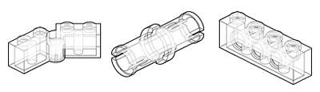
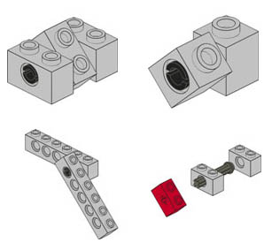
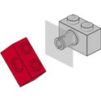
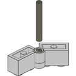
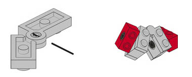

Cet article est une traduction de l’article de Christopher Snead publié sur [Mechahub](http://mechahub.com/).

Peut-être étiez-vous en train de regarder un épisode de la série télé « Gundam » ou alors étiez vous en train de feuilleter un magazine manga. Quelque fut le point de départ, vous avez décidé d’appliquer vos talents de constructeur LEGO® à un projet « mecha » [^1].

Par où commencer ? La plupart des gens ne veulent pas construire une simple statue immobile mais plutôt quelquechose qu’ils vont pouvoir articuler dans diverses positions donnant l’idée de mouvement. Cela suppose qu’ils disposent de techniques pour créer des articulations. Les pièces LEGO sont denses et un assemblage devient rapidement lourd. Quelles articulations vont soutenir ce poids ? Quelle taille peut faire un mecha pour un type d’articulation donné ? Ce sont à ces questions que nous allons répondre en montrant comment le problème a évolué au cours du temps avec l’avènement de nouvelles pièces.

**Les premières techniques**

Si vous faisiez déjà des mechas il y a neuf ans de cela, vous êtes familier des [briques-charnières](http://www.bricklink.com/catalogItemPic.asp?P=3830c01) et [plaques-charnières](http://www.bricklink.com/catalogItemPic.asp?P=2429c01) 1x4/2x2. Elles sont toujours appréciées pour leur simplicité et leur disponibilité.

L’articulation avec cheville à friction est simple : placer une cheville Technic™ à friction dans le trou d’une brique Technic 1xn et placer une autre brique Technic sur l’autre extrémité de la cheville. Cette combinaison s’utilise pour pivoter ou plier. Le principal avantage de ce type d’articulation est sa versatilité et sa compacité. Comme vous pouvez le voir sur les illustrations ci-après, il y a de nombreuses variantes de ce type d’articulation.

Le principal inconvénient de ce type d’articulation est sa fragilité et, sans renforcement, un mecha ainsi construit ressemblera plus à un pantin désarticulé.

Certains ont essayé de durcir l’articulation en intercalant une enveloppe de plastique ou une fine bande de papier ; en augmentant le diamètre de la cheville, on augmente le frottement de l’articulation. Cela fonctionne, mais il est difficile d’avoir des résultats reproductibles et les puristes n’apprécient pas ces modifications de pièces.

D’autres savent que les anciennes chevilles Technic ont beaucoup plus de frottements que les nouvelles ; en fait c’est sans doute la raison pour laquelle elles ne sont plus produites : il était difficile de les retirer des briques Technic. Elles sont donc utiles mais difficiles à trouver de nos jours ; de plus les frottements importants endommagent à la fois la cheville et la brique.

Malgré ces inconvénients, ces chevilles sont largement employées dans les constructions mechas modernes. Le [Teknomeka](http://www.members.aol.com/thoughtmorph/TEKNOMEKA/TEKNOMEKA.html) de Brian Cooper utilise ces chevilles dans des articulations à deux endroits.

Les briques-charnières et plaques-charnières font parties des premières pièces utiles pour faire des articulations. Les briques-charnières sont aussi anciennes que le [Galaxy Explorer](http://www.bricklink.com/catalogItemPic.asp?S=497-1) [^2].  
Les principaux avantages des briques charnières sont leur disponibilité, leur compacité et qu’elles s’intègrent directement dans un modèle. Mais elles n’offrent pas de frottement. Le frottement peut être augmenté en insérant un bout de tuyau flexible LEGO dans le trou sous la brique-charnière. Malheureusement il faut couper l’excès et le tuyau ainsi que la brique sont modifiés de façon définitive.

Si modifier les briques-charnières n’est pas votre tasse de thé, vous pouvez superposer trois plaques-charnières pour créer une brique-charnière renforcée. Cette technique a été utilisée dans les modèles mechas de la gamme [« Life on Mars »](http://www.peeron.com/scans/7314-1/6/). Les plaques-charnières peuvent aussi être employées séparément, par exemple pour prendre en sandwich une brique Technic 1x2, l’assemblage ainsi réalisé créant une articulation compacte à deux degrés de liberté. Encore une fois, on peut augmenter le frottement des plaques-charnières en introduisant un fil d’une section bien choisie dans la rainure sous la plaque-charnière. Ce procédé est réversible.

Si vous utilisez uniquement des chevilles Technic ou des plaques- et briques-charnières, essayez de ne pas construire un modèle de plus de 30cm, sinon il risque de s’effondrer sous son propre poids (surtout si c’est un mecha bipède). Un bon précept pour construire des modèles stables est de construire plus petit que le maximum qu’autorise une articulation d’un type donné.

A suivre...

[^1]: Sous-genre très populaire du manga caractérisé par des robots-armures de formes humanoïdes. Prononcez "méca"

[^2]: 1979
