Cet article est la version française de l’article paru dans le BrickJournal n°5 ([consultez http://www.brickjournal.com](https://www.freelug.org/consultez%20http://www.brickjournal.com)).

**Introduction**

Qu’est-ce que l’échelle micro ? Ce sont les échelles inférieures à l’échelle minifig qui est environ au 48ème [^1]. Certains auteurs considèrent que les personnages à cette échelle ne doivent pas être plus haut que 3 plaques [^2], ce qui conduit à une valeur d’échelle de 1:150. Après une rapide recherche sur l’internet, on constate que la grande majorité des trains à l’échelle micro est large de deux tenons [^3], ce qui correspond à une échelle de 1 pour 200 [^4].

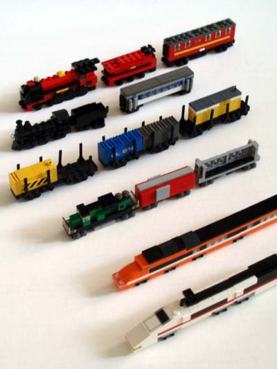

Les modèles officiels de trains LEGO sont "en 6 de large" (comprendre larges de 6 tenons). Les pièces spécifiques qui existent peuvent être utilisées dans des créations personnelles même en 7 ou en 8 de large : essieu, tampon, base de train, pare-brise, moteur... mais vous comprenez aisément qu’il en va autrement quand vous faites du train en échelle micro. Chacune des pièces maîtresses du modèle doit être repensée.

**Les bases de train**

En échelle micro, on utilise beaucoup les plaques 2xn en guise de base de trains. Elles sont courantes, disponibles dans une grande variété de longueurs et de couleurs. Faites attention à ne pas les remplacer par deux plaques 1xn côte à côte car, comme nous allons le voir, cela pourrait avoir des conséquences fâcheuses sur le reste de votre construction.

**Les techniques de montage**

L’échelle micro à des avantages : il vous faudra peu de pièces et vous pourrez réaliser des décors et paysages même si vous ne disposez que de peu de place... mais cela demande aussi de la créativité. La connaissance et l’usage pertinent des techniques de montage font partie de cette créativité.

Les techniques de décalage (offset) sont pleinement employées en échelle micro. Quand vous travaillez à l’échelle minifig, une résolution d’un tenon (8mm) est suffisante. L’échelle micro pour sa part nécessite une résolution d’un demi-tenon pour créer des détails. En d’autres mots, les techniques de décalage vous permettent de centrer des pièces sur ou sous des plaques 2xn ou plus généralement de centrer des pièces entre deux tenons. Quelles sont ces techniques ?

La plus connue (et la plus simple) fait usage de la plaque lisse 1x2 avec un tenon (la plaque "jumper"). Elle est employée de manière intensive dans les modèles de trains en micro, veillez à en avoir un paquet à portée de main.

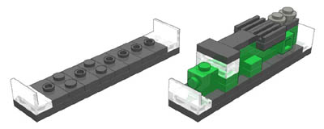

La seconde technique de décalage est la technique du tenon dans le tube. Elle aussi est plutôt simple. Plutôt que d’empiler les briques de manière à ce que les tubes sous les pièces s’insèrent ENTRE les tenons de la manière habituelle, on imbrique les tubes directement SUR les tenons. Cette technique ne fonctionne que si la plaque sur laquelle vous emboîtez est plus grande que celle sur laquelle vous la placez, à cause d’effets de bords.

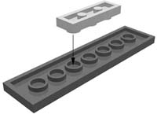

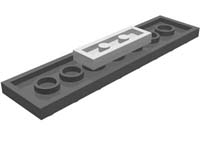

Vous comprenez pourquoi les base de train en échelle micro sont des plaques 2xn et non pas deux plaques 1xn côte à côte : cela rendrait impossible le centrage des boggies.

Il y a d’autres techniques de décalage, parmi elles l’astuce des oreilles de poneys (plaques placées verticalement entre les tenons),

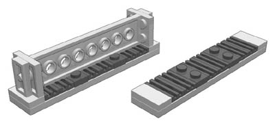

et la technique de la barre et du clip.

**Les boggies**

La créativité est une bonne chose mais elle a ses limites. Nous allons créer des essieux pour nos trains micro mais ils ne seront pas fonctionnels, simplement décoratifs. La taille des roues et le choix de l’échelle nous conduisent naturellement à des choix restreints :

Les [hauts de charnières 1x2](http://www.peeron.com/inv/parts/3938) sont faciles à mettre en oeuvre et ne demandent pas à faire du SNOT mais elles sont sous dimensionnées. Elle conviendront bien pour des métros, des unités multiples (voir le BOB de James Mathis) ou pour des modèles de wagons surbaissés ou à boggies partagées (voir le micro porte-conteneurs TTX de David Vinzant).

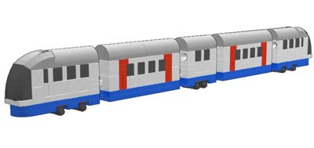

Les [roues de skateboard](http://www.peeron.com/inv/parts/2496) clipsées sur des [plaques 1x1 avec clip](http://www.peeron.com/inv/parts/2555) nécessitent un montage inversé à 180 (SNOT180). Plus grandes, elles conviendront à la plupart des modèles de wagons mais l’absence de flancs les fait apparaître peu réalistes.

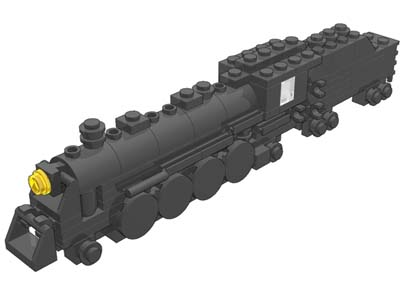

Les [plaques 1x1 rondes](http://www.peeron.com/inv/parts/4073) sont bien souvent le meilleur choix. Elles représentent parfaitement les roues des trains avec leur bande de roulement et leur flanc. Elles aussi nécessitent un montage SNOT, le plus simple dans ce cas précis étant l’emploi de [plaques 1x1 avec clip](http://www.peeron.com/inv/parts/4081b).

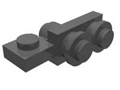

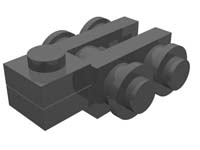

Ces solutions valent aussi pour les roues porteuses non motrices des locomotives vapeurs. Par contre les roues motrices de grands diamètres bénéficieront de l’utilisation des pièces rondes 2x2 comme les [plaques lisses](http://www.peeron.com/inv/parts/4150) ou les paraboles [1](http://www.peeron.com/inv/parts/2654) et [2](http://www.peeron.com/inv/parts/4740).

**Les voies ferrées**

Les voies sont faites de rails et de traverses. Les rails seront très bien reproduites par des plaques 1x8 avec sillon placées sur le côté ou par des panneaux 1x4x1. Les traverses pour leur part profiteront de plaques lisses modifiées ou non avec grilles en brun (pour imiter le bois) ou en gris (pour imiter le béton).

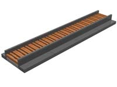

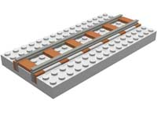

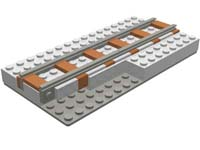

**Les couplages**

Comme les trains en 2 de large ne sont pas fonctionnels (ils ne roulent pas), les couplages ne sont pas d’un grand intérêt. Vous pouvez toutefois en équiper vos modèles dans un but décoratif, par exemple avec des plaques 1x1 avec clip.

Les systèmes de pièces LEGO du type boule de remorquage sont trop grosses pour les trains micro. Jason Allemann a trouvé une solution élégante dans son modèle micro de tracteur agricole en utilisant un levier coincé entre deux plaque 1x1 avec clip.

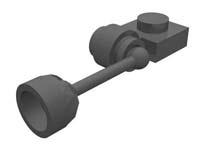

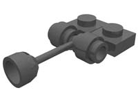

Et c’est encore Jason qui propose l’utilisation d’une plaque 3x2 avec un trou et d’une plaque 1x2 avec une barre pour faire des couplages. La plaque 3x2 avec un trou peut aussi être utilisée en combinaison avec une des chevilles Technic.

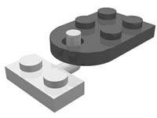

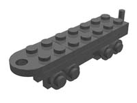

James Mathis propose lui l’utilisation d’une barre et d’un clip, le couplage est plus compact mais n’est pas complètement libre en rotation, il y a des frottements (voir le BOB).

**La motorisation**

Motoriser de si petits modèles semble tout simplement inaccessible. Cela ne l’est pas. Deux possibilités s’offrent à nous :

Placez un aimant dans le modèle. Au lieu de créer des rails, fabriquez juste une piste avec des plaques lisses. Dès lors, à l’aide d’un moteur 9V Technic et de quelques engrenages et chaînes que vous placerez sous la piste, un autre aimant entraînera votre modèle dans une folle farandole.

La seconde possibilité ne sera pas explorée par les puristes. Créez votre modèle, collez-le et évidez-le par le dessous. Vous aurez alors assez de place pour introduire des accessoires de modélisme ferroviaires (échelle Z 1:220) : moteur, boggies, couplages.

De nombreuses choses ont été faites. D’autre sont encore à faire. Par exemple, je n’ai pas vu jusqu’à aujourd’hui un train motorisé à l’aide d’un micromoteur Technic. Merci à Erik qui a retrouvé [ce lien](http://www.brickshelf.com/gallery/ea-the-smile/FreeLUG/LW2003/lw03.jpg) vers une photo de petites voitures de courses motorisées avec le micromoteur.

**Liste de liens**

Pour le couplage [Jason Alleman](http://www.truedimensions.com/lego/customs/micro.htm)

Train motorisé :

Par aimant : [Peer Kreuger](http://news.lugnet.com/announce/moc/?n=2998)

Par accessoire Z : [John Barnes](http://www.brickshelf.com/cgi-bin/gallery.cgi?f=108296)

Différents modèles :

[Paul Janssen](http://news.lugnet.com/build/microscale/?n=573)

[Tony Hafner1](http://www.hafhead.com/lego/mytrain/index.html)

[Tony Hafner2](http://www.brickshelf.com/cgi-bin/gallery.cgi?f=13862)

[Tony Hafner3](http://www.hafhead.com/lego/mytrain/2wmckee/)

[Alban Nanty](http://www.brickshelf.com/cgi-bin/gallery.cgi?f=107483)

[Didier Deses](http://www.brickshelf.com/cgi-bin/gallery.cgi?f=77092)

[Ross Neal](http://www.brickshelf.com/cgi-bin/gallery.cgi?i=339317)

[James Mathis 1](http://www.brickshelf.com/cgi-bin/gallery.cgi?f=3416)

[James Mathis 2](http://www.brickshelf.com/cgi-bin/gallery.cgi?f=170973)

[Sullis3](http://www.brickshelf.com/cgi-bin/gallery.cgi?f=15285)

[David Vinzant](http://www.brickshelf.com/cgi-bin/gallery.cgi?f=118430)

[Kecia Hansen](http://www.brickshelf.com/cgi-bin/gallery.cgi?f=77728)

[Hitahita](http://www.brickshelf.com/cgi-bin/gallery.cgi?f=141239)

[mijasper](http://www.brickshelf.com/cgi-bin/gallery.cgi?f=127994)

[Timothy Gould](http://www.brickshelf.com/cgi-bin/gallery.cgi?i=1654347)

Roues round plate 2x2  
[anders-isak](http://www.brickshelf.com/cgi-bin/gallery.cgi?i=565188) (et suivante)

[^1]: Bien sur cette valeur est sujette à discussion en fonction des différentes hypothèses qui servent aux calculs

[^2]: Voir à ce sujet la présentation en anglais d’Edward Kohl sur le micro-castle : [http://www.classic-castle.com/howto...](http://www.classic-castle.com/howto/articles/microscalecastlebuildingtechniques.pdf)

[^3]: Des exemples de micro-trains larges de 1 ou 4 tenons existent. Ce n’est pas le sujet de cet article.

[^4]: ...et vous avez maintenant compris que cette valeur est approximative, de part la nature même des pièces LEGO. Elle a le mérite de donner un ordre de grandeur
