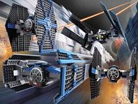
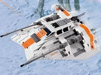
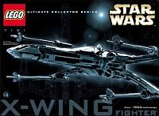
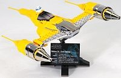
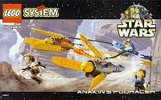
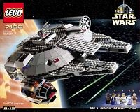
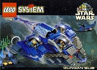
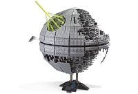

Après quelques années de licence StarWars (depuis 1999 exactement) et avant la sortie de l’épisode III, une revue de détail des sets officiels représentant des vaisseaux et autres véhicules s’impose.

Il est assez difficile de définir ce qu’est un véhicule ou un vaisseau. Certains engins volent seulement dans l’atmosphère planétaires, d’autres uniquement dans le vide de l’espace, parfois les deux. Les Speeders même si ils ne touchent pas le sol ne sont pas à proprement parler des aéronefs. Certains roulent, d’autres marchent. La limite entre véhicule et robot est même parfois mince, pensez par exemple au Hailfire Droïd. Nous proposons ici une autre classification partiellement arbitraire, qui coïncide avec le nom des engins :

**TIEs :**

**–** TIE Advanced (Mini : [4484](http://guide.lugnet.com/set/4484))  
**–** TIE Bomber (System [4479](http://guide.lugnet.com/set/4479) [^1])  
**–** TIE Fighter (System : [7146,7150,7152,7262,7263](http://guide.lugnet.com/set/?q=7146%2C7150%2C7152%2C7262%2C7263) Mini : [3219](http://guide.lugnet.com/set/3219))  
**–** TIE Interceptor (UCS [^2] : [7181](http://guide.lugnet.com/set/7181) Mini : [6965](http://guide.lugnet.com/set/6965))

4 TIEs différents, qui pour les novices se ressemblent plus ou moins. Le TIE Fighter, comme on le voit, est une vedette qui à fait l’objet de plusieurs modèles LEGO® et de rééditions.

**Speeders :**

**–** SnowSpeeder (UCS [10129](http://guide.lugnet.com/set/10129) System [4500,7130](http://guide.lugnet.com/set/?q=4500%2C7130) Mini [4486](http://guide.lugnet.com/set/4486))  
**–** LandSpeeder (System : [7110](http://guide.lugnet.com/set/7110))  
**–** FlashSpeeder (System : [7124](http://guide.lugnet.com/set/7124))  
**–** Speeder Bikes (System : [7128](http://guide.lugnet.com/set/7128))

4 Speeders et la aussi une vedette, le SnowSpeeder.

**Les "Wings" :**

Le nom des "Wings" fait correspondre une lettre de l’alphabet à la forme général du vaisseau.

**–** A-Wing Fighter (System : [7134](http://guide.lugnet.com/set/7134))  
**–** B-Wing (System : [7180](http://guide.lugnet.com/set/7180))  
**–** X-Wing Fighter (UCS : [7191](http://guide.lugnet.com/set/7191) System : [4502,7140,7142](http://guide.lugnet.com/set/?q=4502%2C7140%2C7142) Mini : [4484, 6963](http://guide.lugnet.com/set/?q=4484%2C+6963))  
**–** Y-Wing Fighter (UCS : [10134](http://guide.lugnet.com/set/10134) System : [7150, 7152, 7262](http://guide.lugnet.com/set/?q=7150%2C+7152%2C+7262))

4 Wings, mais 2 vedettes ,le Y-wing et surtout le X-wing :

**Autres Fighters (6) :**

**–** ARC-170 [^3] StarFighter (System : [7259](http://guide.lugnet.com/set/7259) Mini : [6967](http://www.brickshelf.com/gallery/dickydidier/ARC172/arc1470.jpg))  
**–** Droid Fighter (System : [7111](http://guide.lugnet.com/set/7111))  
**–** Droid Tri Fighter (System : [7252](http://guide.lugnet.com/set/7252))  
**–** Geonosian Fighter (System [4478](http://guide.lugnet.com/set/4478))  
**–** Jedi StarFighter (System : [7143](http://guide.lugnet.com/set/7143) Mini : [4487, 6966](http://guide.lugnet.com/set/?q=4487%2C+6966))  
**–** Naboo fighter (UCS : [10026](http://guide.lugnet.com/set/10026) System : [7141](http://guide.lugnet.com/set/7141))

**PodRacers (2) :**

**–** Sebulba’s Podracer (Mini : [4485](http://guide.lugnet.com/set/4485))  
**–** Anakin’s Podracer (System : [7131](http://guide.lugnet.com/set/7131) Mini : [4485](http://guide.lugnet.com/set/4485))

**Autres (10) :**

**–** Desert Skiff (System : [7104](http://guide.lugnet.com/set/7104))  
**–** Imperial Shuttle (System : [7166](http://guide.lugnet.com/set/7166) Mini : [4494](http://guide.lugnet.com/set/4494))  
**–** Imperial Star Destroyer (UCS : [10030](http://guide.lugnet.com/set/10030) Mini : [4492](http://guide.lugnet.com/set/4492))  
**–** Millenium Falcon (System : [4504,7190](http://guide.lugnet.com/set/?q=4504%2C7190) Mini : [4488](http://guide.lugnet.com/set/4488))  
**–** Republic Gunship (System : [7163](http://guide.lugnet.com/set/7163) Mini : [4490](http://guide.lugnet.com/set/4490))  
**–** Sith Infiltrator (System : [7151](http://guide.lugnet.com/set/7151) Mini : [4493](http://guide.lugnet.com/set/4493))  
**–** Slave I (System : [7144,7153](http://guide.lugnet.com/set/?q=7144%2C7153) Mini : [4487, 6964](http://guide.lugnet.com/set/?q=4487%2C+6964))  
**–** T-16 Sky-hopper (System [4477](http://guide.lugnet.com/set/4477))  
**–** Tantine IV / Rebel Block Runner (UCS : [10019](http://guide.lugnet.com/set/10019))  
**–** Twin Pod Cloud Car (System : [7119](http://guide.lugnet.com/set/7119))

Cette catégorie réunit un ensemble hétéroclite de vaisseaux parmi les plus populaires : Le Star Destroyer (ISD), Le Rebel Block Runner (RBR) et le Faucon Millénium

**Véhicules de transport :**

**–** AT-AT [^4] (Mindstorms : [9754](http://guide.lugnet.com/set/9754) Mini : [4489](http://guide.lugnet.com/set/4489))  
**–** Imperial AT-AT (System : [4483](http://guide.lugnet.com/set/4483))

**–** AT-ST [^5] (Mini : [4486](http://guide.lugnet.com/set/4486))  
**–** Imperial AT-ST (System : [7127](http://guide.lugnet.com/set/7127))

**–** AT-TE [^6] (System [4482](http://guide.lugnet.com/set/4482) Mini : [4495](http://guide.lugnet.com/set/4495))

**–** MTT [^7] (System : [7184](http://guide.lugnet.com/set/7184), Mini :[4491](http://guide.lugnet.com/set/4491))

6 ou 4 modèles suivant que l’on différencie les versions impériales.

**Autres (5) :**

**–** AAT [^8] (System : [7155](http://guide.lugnet.com/set/7155))  
**–** BattleDroid Carrier (System : [7126](http://guide.lugnet.com/set/7126))  
**–** Clone Scout Walker (System : [7250](http://guide.lugnet.com/set/7250))  
**–** HailFire Droid (Technic : [4481](http://guide.lugnet.com/set/4481))  
**–** Clone Turbo Tank (System : [7261](http://guide.lugnet.com/set/7261))

**Véhicules Marin et Sous-Marin (2) :**

**–** Wookie Catamaran (System : [7260](http://guide.lugnet.com/set/7260))  
**–** Gungan Sub (System : [7161](http://guide.lugnet.com/set/7161))

**Véhicules et vaisseaux dans des sets complets :**

**–** LandSpeeder dans _Mos Eisley Cantina_ ([4501](http://guide.lugnet.com/set/4501))  
**–** Speeder dans _Jedi Du_el ([7103](http://guide.lugnet.com/set/7103))  
**–** Speeder dans _LightSaber Duel_ ([7101](http://guide.lugnet.com/set/7101))  
**–** Speeder dans _Tusken Raider Encounter_ ([7113](http://guide.lugnet.com/set/7113))  
**–** Deux Speeders dans _Bounty Hunter Pursuit_ ([7133](http://guide.lugnet.com/set/7133))  
**–** Speeder bike dans _Ewok Attack_ ([7139](http://guide.lugnet.com/set/7139))  
**–** Podracers dans _Podracer Bucket_ ([7159](http://guide.lugnet.com/set/7159))  
**–** Podracers dans _Mos Espa PodRace_ ([7171](http://guide.lugnet.com/set/7171))  
**–** Imperial Shuttle dans _Imperial Inspection_ ([7264](http://guide.lugnet.com/set/7264))  
**–** Ties dans le _Tie Collection_ ([10131](http://guide.lugnet.com/set/10131))

Sans oublier la Death Star (UCS : [10143](http://guide.lugnet.com/set/10143))

Notons deux absents de marque : La [Barge de Jabba](http://www.starwars.com/databank/vehicle/sailbarge/index.html) et le [SandCrawler](http://www.starwars.com/databank/vehicle/sandcrawler/index.html)même si nous gardons espoir de les voir apparaître dans les futurs catalogues LEGO®.

La liste totalise donc plus de 36 modèles différents. On note que les modèles ["minis"](http://www.freelug.org/article.php3?id_article=376) existent pour la plupart aussi en modèle System ou UCS.

**Liens**

Cette liste, non exhaustive, à été réalisée grâce à :  
**–** [Lugnet](http://guide.lugnet.com/set/?qc=lego/system/starwars)  
**–** [From Bricks To Bothans (FBTB)](http://www.fbtb.net/sets/)  
**–** [StarWars.com](http://www.starwars.com/databank/)

Les fans de SW repèrerons sans doute de nombreuses inexactitudes, imprécisions ou omissions : je les rermercie par avance à la fois des commentaires qu’ils peuvent laisser ainsi que de leur indulgence :-)

Avertissements :

**–** Les images qui illustrent cet article sont la propriété de la société LEGO® ([Site officiel LEGO®](http://www.lego.com/))  
**–** Certains des produits cités ne sont pas encore disponibles (Sortie 2005), d’autres ne sont plus disponibles, d’autres encore uniquement disponibles sur le [Shop@Home](http://shop.lego.com/default.asp).

[^1]: Un notice de montage de TIE Bomber est proposé avec l’ensemble des sets 4484,4485, 4486 et 4487

[^2]: UCS : Ultimate Collector’s Series, Série de modèles Star Wars pour les collectionneurs et les constructeurs chevronnés.

[^3]: Aggressive ReConnaissance

[^4]: All Terrain Armored Transport

[^5]: All Terrain Scout Transport

[^6]: All Terrain Technical Enforcer

[^7]: Multi Troop Transport

[^8]: Armored Assault Tank
