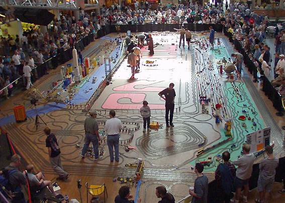
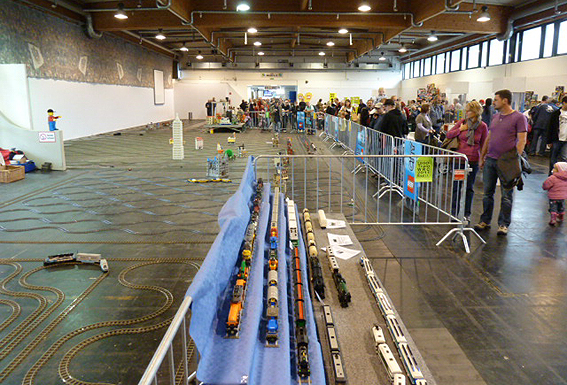
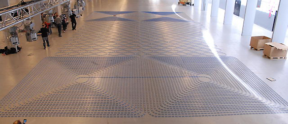
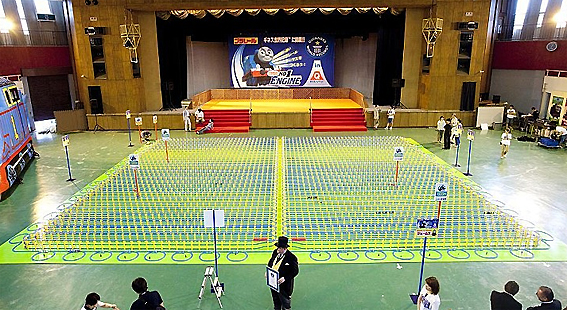
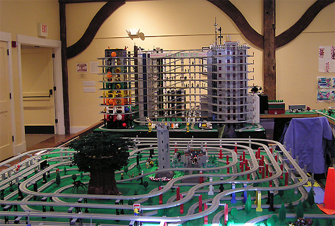

Ce petit article, pour faire un point sur les différents records actuels des voies (train) LEGO construites avec la plus grande longueur. Peut-être un jour en France ?

## USA : 545 m (1788 ft) en 1992

On ne sait quasiment rien de ce premier (?) record établi en 1992 par le Pacific Northwest LEGO Train Club ([PNLTC](http://www.brickwiki.org/wiki/Pacific_Northwest_LEGO_Train_Club)).

## USA : 1019 m (3343 ft) en aout 2000

Ce record, le second connu sur voies LEGO, a été réalisé par le PNLTC au Center House à Seattle, état de Washington, du 17 au 20 août 2000.

Le circuit est entièrement en voies LEGO 9V (dont beaucoup de rails neufs pour l’événement). Il est alimenté par 6 (8 ?) régulateurs 9V LEGO, chacun d’entre eux étant connecté à deux ou trois points sur la voie.

Le circuit, dont une partie représente de sigle "PNLTC" est partiellement décoré : ponts, maisons, triage, gare, bateaux, etc. (il y a même un monorail et une base lunaire).

Le train ’du record’ a mis environ 30 minutes pour réaliser le tour complet du circuit.

Les galeries d’images ici :  
**–** [Chapeau](http://www.brickshelf.com/cgi-bin/gallery.cgi?f=1102)  
**–** [17/08/2000 AM](http://www.brickshelf.com/cgi-bin/gallery.cgi?f=1104)  
**–** [17/08/2000 PM](http://www.brickshelf.com/cgi-bin/gallery.cgi?f=1105)  
**–** [18/08/2000](http://www.brickshelf.com/cgi-bin/gallery.cgi?f=1128)  
**–** [19/08/2000 (day of record)](http://www.brickshelf.com/cgi-bin/gallery.cgi?f=1137)  
**–** [20/08/2000](http://www.brickshelf.com/cgi-bin/gallery.cgi?f=1144)

## Autriche : 1190.88 m (3907 ft) le 9 octobre 2011

Ce record a été réalisé par l’Austrian LEGO team LIGA+MB au Model Building Fair à Ried (Autriche).  
Le train a mis 44 minutes pour effectuer le tour complet du circuit.

Le circuit est composé de rails LEGO 9V et de rail lego RC (75% de rails 9V ?).

La décoration est plus que minimaliste : une quinzaine de bâtiments et rien d’autre.

[Vidéo](http://www.youtube.com/watch?v=2UITKf-u5sU) | [Photos](http://www.brickshelf.com/cgi-bin/gallery.cgi?f=485939)

## Danemark : 1500,64 m (4923,36 ft) le 21 juillet 2012

Ce nouveau record de longueur de voie en LEGO a été établi par le LUG Danois [Byggepladen](http://www.byggepladen.dk/) au Bella Centret (au même lieu où s’est tenu le LEGO World 2012 au Danemark) pendant le week end des 21 et 22 juillet 2012.

Pour faire le circuit complet, le train utilisé, qui est alimenté par des piles, a mis 1 heure et 55 minutes.

La surface de layout était de 300 mètres carrés pour environ 35 000 pièces LEGO utilisées car la voie était faite uniquement de rails bleus.  
Il n’y a aucune décoration, juste la voie.

Une particularité : tous ces rails bleus appartiennent à une seule personne (Henrik Ludvigsen) qui les a rassemblés depuis des années avec l’idée de ce record.

Pour Henrik, ces 1500 mètres sont juste un test car il voudrait en fait battre le record Guinness Book de "la plus longue voie en plastique de train jouet" actuellement de 2221 mètres, en faisant une voie LEGO d’environ 3000 mètres !

En effet, le Guinness n’a pas une catégorie LEGO, et il classe les trains et voies LEGO dans la catégorie "plastic toy train track".

[Vidéo](http://youtu.be/NitIxL7iLEY) | [Photos](http://www.youbrick.com/v/Trains/Togbane/) | [Photos](http://www.grehan.dk/lego/byggepladen/2012%20rekord%20forsog/lordag/index.html)

## Guinness ; The longest plastic toy train track : 2221,51 mètres (7288 ft)

Le record actuel n’est pas sur une voie LEGO.

Il a été réalisé le 28 juillet 2011 par le "Thomas and Friends Team Japan 2011" : des enfants et parents de tout le Japon, Sony Creative Products, Inc, Fuji Kyuko Co. Ltd and Tomy Company Ltd au Fuji Q Highland, à Fujiyoshida, Yamanashi, Japon.

La voie est faite de rails Thomas & Friends ( 10 575 pièces).

Le train a mis 2 heures et 53 minutes pour faire le tour complet du circuit.

Il n’y a aucune décoration le long de la voie. Il est à noter que la voie a été montée sur plusieurs niveaux (5) en hauteur.

Avant ce record, d’autres records avaient déjà été faits avec les mêmes types de voie et de train Thomas & Friends comme par exemple : [http://www.theworkshops.qm.qld.gov....](http://www.theworkshops.qm.qld.gov.au/Events+and+Exhibitions/Events/2010/11/Thomas+Track+World+Record+Attempt)

\==> [http://community.guinnessworldrecor...](http://community.guinnessworldrecords.com/_Longest-plastic-toy-train-track/blog/4974742/7691.html)

## Monorail : 222,5m (730 ft) le 11 fevrier 2012

La plus longue voie monorail a été construite pas les membres de [NELUG](http://www.nelug.org/) le 11 février 2012 au [Musée de Wenham](http://www.wenhammuseum.org/) (USA)

[Vidéo](http://www.youtube.com/watch?v=6k7iOzm0UWM) |[Photos](http://www.flickr.com/groups/1922421@N21/)

\=========

## Et maintenant ?

La première chose qui vient à l’esprit et que tout cela est assez confus.  
Le Guinness n’a pas une catégorie particulière pour LEGO et les trois derniers records purement LEGO ont été réalisés sur 3 types de rails différents :  
**–** tous les rails en 9V,  
**–** mixte rails 9V et rails ’RC’,  
**–** rails bleus dit rails 4,5V.

A partir de là, il y a plusieurs pistes différentes pour continuer sur la voie des records :

**1- Si l’on vise le Guinness**, cela exclut sans doute de fait les rails 9V (cela reste tout de même à vérifier), mais il semblerait que rien n’empêcherait de mixer tous les autres rails LEGO ’full plastic" : RC, bleu 4,5V et gris 12V.

\==> Actuellement plus de 2221 mètres

**2- Un record tout en rails LEGO toutes catégories** où l’on mixe tous les types de rails : 9V, RC, bleu 4,5V et gris 12V.

\==> Pas encore fait, mais forcément plus de 1500 mètres

**3- enfin des record LEGO par catégorie de rails :**  
**–** 9V ==> plus de 1019 mètres  
**–** RC ==> à faire  
**–** Bleu 4,5V ==> plus de 1500 mètres  
**–** Bleu 12V ==> à faire  
**–** Gris 12V==> à faire  
**–** Monorail ==> plus de 222,5 mètres

**4- indoor ou outdoor ?**

Il est aussi à noter que tous ces records sont réalisés en salle ; on peut donc bien parler de longueur.

**De la LGL à la LGD ?**  : reste à faire aussi la même chose à l’extérieur par monts et par vaux, à travers prairies et forêts : le record absolu grande distance quoi ! ;-)

Donc, il y a de quoi faire !

cdhd.
