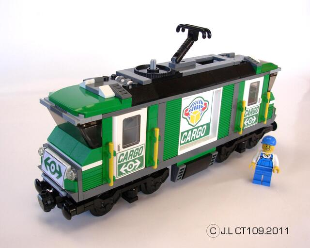
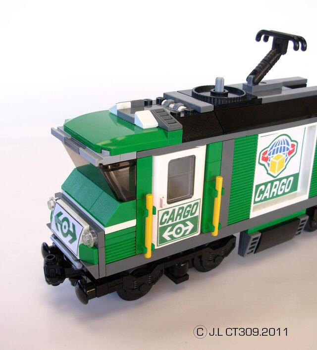
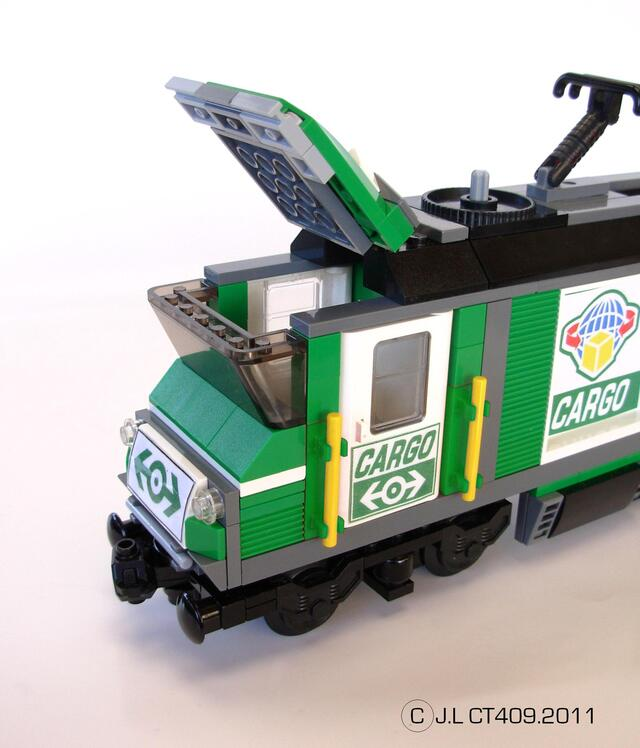
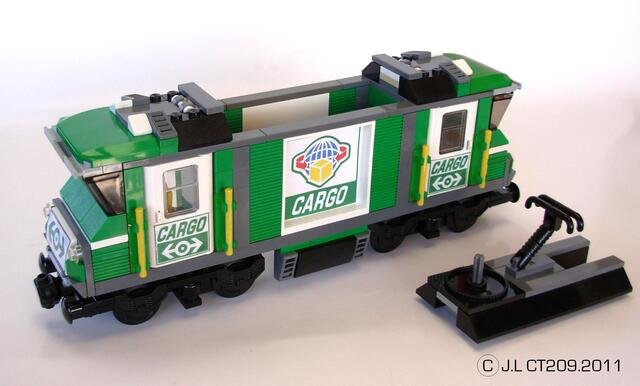
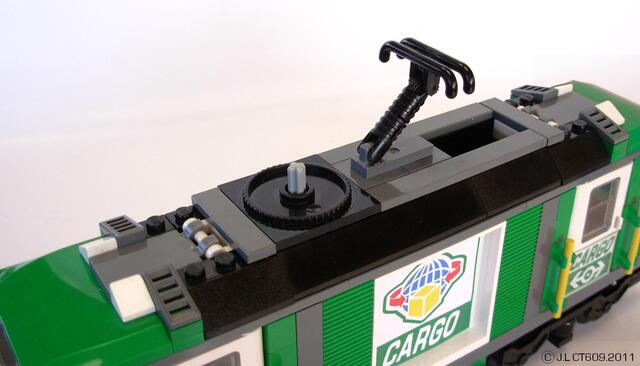
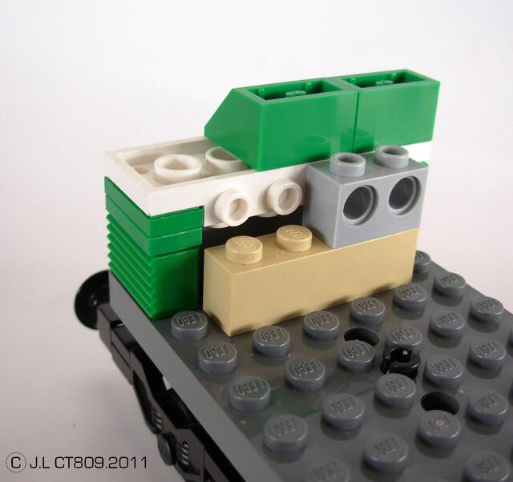
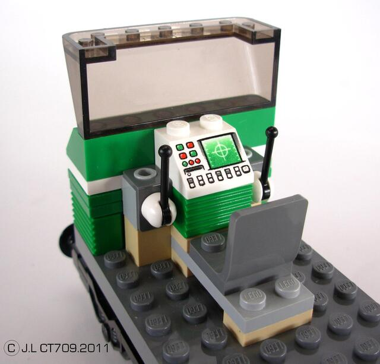

Ce nouvel article vous propose de découvrir ma toute dernière création en date, mais aussi ma première dans le domaine ferroviaire, une locomotive CARGO pour le transport de marchandises.

Tout juste sortie de mes ateliers de construction, voici donc une locomotive pour le transport de fret. Principalement de couleur verte, elle reprend les couleurs de certains modèles LEGO de la gamme CITY sortis en 2008 à savoir notamment le [camion remorque CARGO 7733](http://www.brickset.com/detail/?Set=7733-1) et l’[avion CARGO 7734](http://www.brickset.com/detail/?Set=7734-1).

**Locomotive CARGO CT1**

Cette locomotive possède deux postes de pilotage et il est possible d’y accéder soit par les portes latérales, soit par le toit qui peut s’ouvrir, pour installer le conducteur du train.

**Locomotive CARGO CT3**

**Locomotive CARGO CT4**

Bien entendu, il est possible de faire fonctionner réellement cette locomotive avec les moteurs pour trains existants. Ainsi, la partie centrale du toit peut également s’ouvrir afin d’y faire entrer le moteur et le récepteur. Ne possédant pas de moteur pour train (hélas), je ne peux pas fournir de photos avec le moteur mis en place, mais l’intérieur de la locomotive est tout de même conçu pour en accueillir un.

**Locomotive CARGO CT2**

Pour faire fonctionner la locomotive sans soulever le toit à chaque fois, il suffit d’appuyer sur la tige TECHNIC qui sort discrètement d’une tuyère de ventilation près du pantographe.

**Locomotive CARGO CT6**

Ce modèle de locomotive peut se rapprocher à première vue d’une locomotive BB 22200, principalement au niveau du pare-brise. Il a donc fallu utiliser un pare-brise classique qui est ensuite monté à l’envers. Les photos ci-dessous permettent de mieux comprendre la construction.

**Locomotive CARGO CT8**

**Locomotive CARGO CT7**

Enfin, les accessoires pour le poste de pilotage permettent de dissimuler les briques creuses et de renforcer la construction.

Voilà donc une petite locomotive prête à transporter du fret à LEGO CITY

N’hésitez pas à laisser un petit commentaire.

Je vous remercie d’ailleurs pour vos commentaires sur mes précédentes réalisations. la prochaine fois, nous nous retrouverons normalement dans le centre de LEGO CITY, mais ça, c’est une autre création...

Julien
