Dans la [première partie de cet article](/articles/moc-locomotive-cc-6500-rc-1ere-partie/), nous avions découvert la CC 6500 grandeur nature et les raisons qui avaient motivé sa reproduction. Attaquons à présent le vif du sujet : la conception de son [MOC](/articles/liste-d-acronymes/) !

Du dessin numérique à la brique ABS...

## Cahier des charges

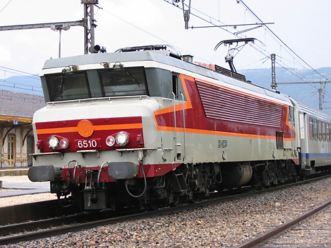

**CC 6510 (Photo Roland BADOSA)**

Ma CC 6500 faite de briques se devait d’être :

-   De la première sous série (livrée Arzens Grand Confort, avec persiennes horizontales)
-   A l’échelle minifig (env. 1/45ème)
-   De 8 tenons de large
-   Avec de nombreux détails
-   Des postes de conduite aménagés
-   Equipée du châssis RC issu du train de marchandises 7898
-   Pourvue de bogies C (triple essieu)
-   Bi motorisée
-   Euh... Et qui roule !

## La faisabilité

La réutilisation du châssis RC qui équipe la nouvelle génération de trains LEGO est une gageure. Ce dernier présente en effet deux inconvénients majeurs (abstraction faite de l’alimentation embarquée tant décriée) :

-   Il impose un empattement fixe et assez conséquent excluant la conception de machines plus courtes, plus longues et/ou équipées de trains roulants autres que des bogies B.

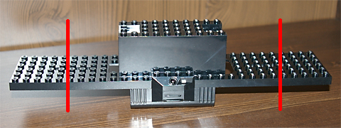

**Les orifices sont un leurre, l’empattement est figé dans la pratique !**

-   Le volume du boîtier supérieur renfermant l’électronique (4 x 10 x 3 tenons tout de même !) bride les élans de créativité, surtout lorsqu’on lorgne vers des locomotives à caisse étroite et/ou à cabine centrale aménagée - ce qui n’est pas le cas ici.

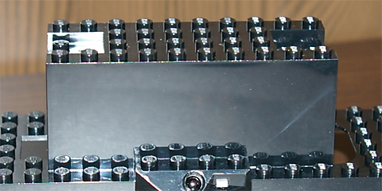

**Locomotive à taille de guêpe s’abstenir :-(**

L’éventualité d’une locomotive factice tirant (ou plutôt poussée par !) un wagon RC esclave ne m’a jamais effleuré ;-/ Ma CC 6500 RC est une grande fille autonome ;-)

Pour parvenir à mes fins, je devais donc composer avec l’impossible et ruser...

**Un châssis RC en sandwich !**

On peut résumer la chose ainsi ! L’idée d’enrober ce châssis RC sonna comme une évidence. L’opération consiste à prolonger ses extrémités et à l’élargir. Par ce stratagème, le châssis RC devient la colonne vertébrale d’un châssis composite dont le greffon de briques définit le nouveau gabarit.

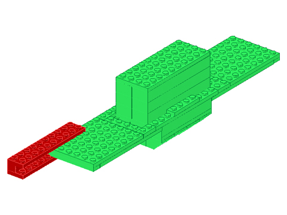

**Enrobage de briques**

[L’échelle 8 tenons](/articles/6-contre-8/) s’avère alors providentielle, et le châssis disparait littéralement sous l’enrobage de briques. Seuls les panels translucides qui couvrent à titre esthétique les récepteurs infrarouge et le compartiment des piles trahissent sa présence.

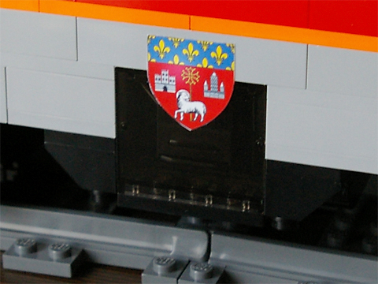

**Un châssis RC assez discret**

Toutefois, cette astuce se limite aux locomotives d’une envergure au moins égale à celle du châssis RC et n’apporte pas de solution à la reproduction des poids plume et des engins exotiques (draisines, crocodiles articulées...).

Autre bémol de cette structure stratifiée : une masse accrue. Un point noir que l’on pressent dès l’entame de la construction... Et qui se confirmera :-(

**La bimotorisation par bogies C en RC**

L’allongement du châssis permet enfin l’utilisation de bogies C. Yes !

En fait de bogies C, ce sont plus exactement des bogies B + 1, constitués du moteur train (le moteur RC est un faux jumeau du moteur 9 volts) relié à un essieu simple par une articulation.

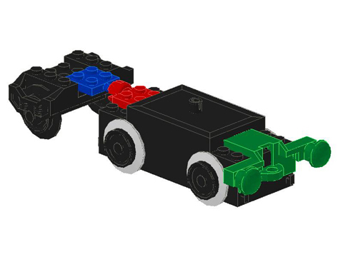

**Détails du bogie B1**

L’articulation du bogie est obligatoire. Le faible rayon de courbure des rails LEGO interdit tout bogies rigides d’une longueur supérieure à 10 tenons sous peine de déraillement systématique.

Si le bogie articulé ne pose aucun soucis en 9 volts, il n’en est pas de même en RC. Alimenté par le dessus et non plus par rails conducteurs, le moteur doit obligatoirement s’ancrer à proximité de l’orifice de passage du câble électrique qui ne peut circuler sous le châssis.

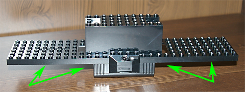

**De fortes restrictions d’ancrage moteur**

Qui plus est, en l’état, la demi charnière (en rouge) et les tampons (en vert) ne permettent plus aucune connexion électrique.

Je n’ai pas eu d’autres solutions pour viabiliser mon choix de bogie que d’inverser son ordonnancement habituel. Le bogie B1 devient alors un bogie 1B.

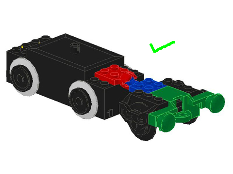

**Détails du bogie 1B**

La bimotorisation ne représente quant à elle aucune difficulté d’implantation ou de connexion. Le châssis RC dispose de deux orifices d’accès à son dessous. Notez cependant qu’ils ne sont pas symétriques, seul le plus grand ayant plausiblement cette vocation dans l’esprit des ingénieurs. On les remerciera tout de même d’avoir laissé la porte ouverte... en créant le second :-)

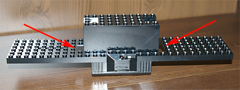

Au premier abord, le bogie 1B semble moins stable que le B1. A l’usage, ce retournement n’a pas d’incidence notoire sur le comportement dynamique de la locomotive. Néanmoins, l’esthétique en pâtit un peu. L’essieu porteur, du fait de ce positionnement, de la charnière et d’une caisse volontairement compressée, ne possède pas le même degré de détail que les deux autres tiers du bogie. J’ai du ainsi par exemple faire l’impasse sur les marches-pieds...

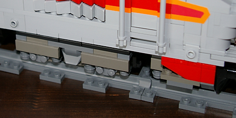

**Détails du bogie 1B définitif**

Les bogies sont la partie la moins flatteuse de ma CC 6500 RC. Avec l’inévitable débord qu’engendre une machine de grande longueur.

**Bien, ma foi, le cahier des charges ne semble désormais plus recéler d’obstacles infranchissables... Entamons donc les hostilités !**

## Le prototype

**MLCAD : un outil, pas une finalité**

[LDRAW](http://www.ldraw.org/) et les logiciels de modélisation, tel le célèbre [MLCAD](http://www.lm-software.com/mlcad), s’appuyant sur ce format ont considérablement modifié l’approche de la création en briques LEGO. Il est désormais possible de concevoir un MOC sans avoir besoin de plonger les mains dans la moindre caisse de pièces !

Si certains y voient une finalité, réalisant des modèles aboutis sans aucune limite de pièces et de coloris, cet apport technologique ne reste pour moi qu’un outil parmi d’autres. Il ne remplacera jamais à mes yeux le plaisir de manipuler physiquement les briques :-) J’estime d’ailleurs que l’élan créatif est dans ce dernier cas bien plus intense. A la recherche d’une pièce précise, on en (re)découvre souvent une autre qui vous aiguille vers une nouvelle direction, fait jaillir une nouvelle idée : un jeu de piste épuisant mais exaltant !

Dans l’esprit de [l’article d’Erik sur la pré-conception de MOCs](/articles/pre-concevoir-ses-mocs-sur-mlcad/), je ne me sers de MLCAD qu’à titre de cahier de brouillon, modélisant un pan de structure, estimant un nombre de pièces nécessaires. L’économie de temps est substantielle, ayant comme bon nombre d’AFOLs un stock considérable et un système de rangement inadapté par manque de place. Atteindre une boîte de plates ou de tiles d’une couleur définie parmi d’autres revient souvent à jouer au taquin ou à Tetris ;-)

Voici le premier jet de ma CC 6500 RC sous MLCAD. Le modèle semble déjà très abouti : nez, bogie C, livrée... et néanmoins, ce n’est qu’une tranche qui dépasse à peine les deux tenons d’épaisseur ! Cet aplat de briques m’a permit de visualiser plus concrètement ce que j’avais déjà imaginé.

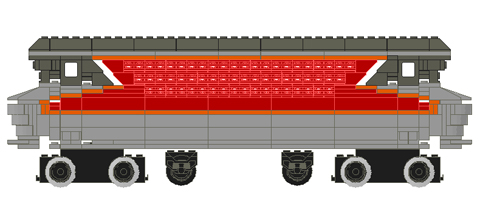

**La première esquisse sous MLCAD**

Souhaitant vous faire partager ma construction jusqu’au bout, j’ai dû, pour générer une notice de montage grâce à [LPUB 4](http://www.kclague.net/LPub4.htm) (un logiciel de création simplifié de notice à partir de fichiers MLCAD), remodéliser l’intégralité de la locomotive. Un travail de longue haleine qui m’a permis d’explorer quelques fonctionnalités du logiciel que je n’utilisais jamais tels l’enregistrement d’étapes avec orientation de vue ou l’utilisation de pièces non officielles de la librairie.

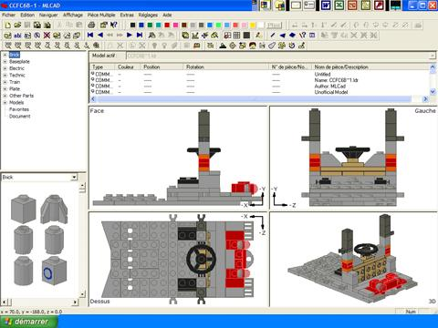

**La réalisation d’une notice nécessite la modélisation intégrale du modèle définitif...**

**De jaune et de gris**

Photos de CC 6500 réelles sous les yeux, quelques esquisses numériques de différentes parties et sous différents angles se succédèrent sur mon écran... Après en avoir imprimé quelques-unes en guise de jalons, je me lançai dans l’élaboration d’un prototype « physique ».

Deux caisses de vrac abondant et varié, une de jaune et une de grise, dédiées exclusivement à la réalisation de mes prototypes furent mises à contribution.

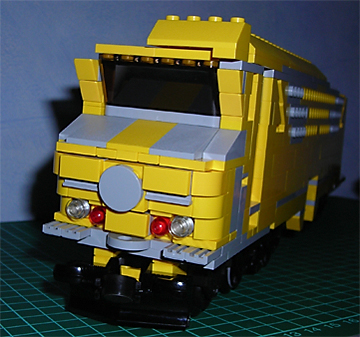

**L’essentiel est déjà présent**

**Cette étape fut fondamentale**. Elle me permit de valider ou d’invalider certains choix et combinaisons d’assemblage, de jauger des proportions, et surtout de m’assurer que la locomotive tant attendue aurait un rendu et des fonctionnalités à la hauteur de mes ambitions. Et que dire du plaisir de la tenir enfin entre mes mains :-)

Le moment le plus critique fut la définition de la cinématique du modèle : ma CC 6500 devait rouler et de négocier sans heurt les courbes à faible rayon, sur la base du châssis RC chaussé de bogies C.

## Quelles couleurs ?

On peut réduire la livrée Arzens Grand Confort de la CC 6500 à trois teintes principales : le gris clair, le bordeaux et l’orange.

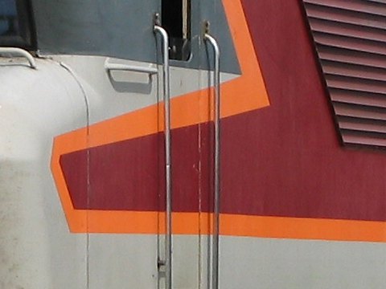

J’ai tout d’abord opté pour une reproduction fidèle de celles-ci, à base du nouveau gris clair (light bluish gray), du rouge foncé (dark red) et de l’orange classique.

Néanmoins, l’esquisse de briques ne fut pas à la hauteur de mes espérances... A la faute : l’utilisation inappropriée du rouge foncé, trop fade.

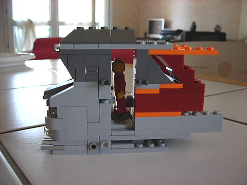

**Une combinaison de couleurs peu convaincante**

Je décidai de troquer cette couleur au profit du rouge classique. A la clef un rendu plus pepsi :-)

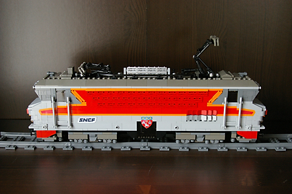

**CC 6524 RC - Vue 1**

Je me suis appliqué dans la foulée à vérifier l’existence des formes des pièces choisies dans les teintes définitives. Je n’avais aucune appréhension à l’égard du gris et du rouge, très courantes. Mais comme prévu, l’orange, dont l’offre est assez restreinte, m’imposa quelques modifications mineures de la structure.

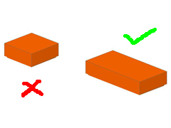

**Certaines pièces modélisées demeurent virtuelles...**

Il est agaçant de constater que certaines pièces banales n’existent pas dans une couleur qui l’est pourtant devenue ! Et que dire de la plate Technic 1 x 4 qui, jamais produite en gris foncé (ancien ou nouveau), me priva de cette combinaison pour les bogies :

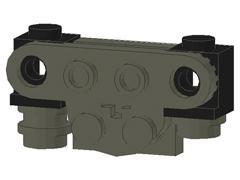

Inadmissible ;-D

## La finalisation du modèle

**La juste brique**

Vint enfin le moment de substituer les briques provisoires du prototype au profit des pièces définitives. Je possédais déjà la majeure partie des références requises. Ainsi, je suis dans l’incapacité de définir le coût de revient de cette locomotive, tout comme le temps que j’y ai consacré d’ailleurs, pas tant que ça tout de même...

Je fus néanmoins contraint de commander quelques briques en grande quantité (comme les tiles grille rouges qui font office de persiennes) via le site marchand [BrickLink](http://www.bricklink.com/). Et je ne m’étendrais pas sur la pièce idiote et anodine que tout le monde a dans ses caisses en mille exemplaires... sauf votre serviteur qui en avait seulement besoin d’une ou deux ;-(

La recherche de la structure optimale est une véritable procession. Réduire deux briques à une, compacter les SNOT tarabiscotés, faire, défaire, refaire, en quête de simplicité et de légèreté pour un résultat identique voire supérieur... Pfff, un puits sans fond ;-)

Les clichés qui suivent seront à rapprocher de la notice de montage que je réserve au troisième et dernier article. De menus détails évoluèrent au grès de la collecte des pièces dans mon stock chaotique. Pour les curieux, pêle-mêle :

-   La structure latérale dont la solidité sera en fin de compte confiée à des arches et non plus aux très lourdingues briques 1 x 4 à tenons protubérants.

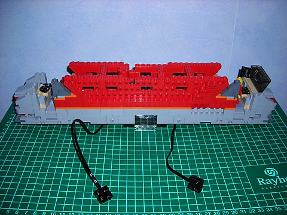

**Une première mouture en couleurs définitives à affiner...**

-   Quelques infimes détails de la cabine ou de la livrée Arzens Grand Confort, dont le Z orangé passera de une à deux plates d’épaisseur dans sa diagonale afin de mieux coller à l’original.

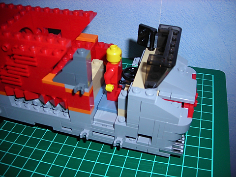

**La minifig étalon paraît satisfaite de l’ergonomie des cabines ;-)**

Ou le hublot de la porte d’accès au corridor qui traverse la machine d’un poste de conduite à l’autre.

_Pour l’anecdote, j’ai volontairement centré le pupitre de conduite alors que dans la réalité le poste et son sacro-saint manipulateur de traction (« le volant » qui est en fait un variateur de vitesse !) sont décentrés sur la gauche._

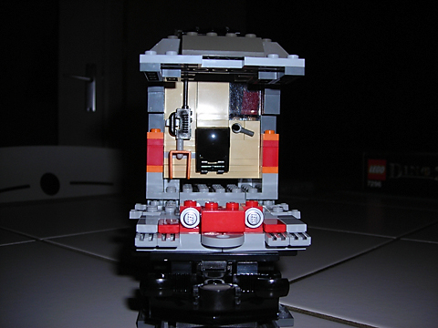

**L’aménagement des cabines a fait l’objet d’une attention particulière**

-   Des bogies plus agressifs. La version originelle me convenait... mais les pièces n’étaient pas toutes disponibles en ancien gris foncé (old dark gray). Grrr...

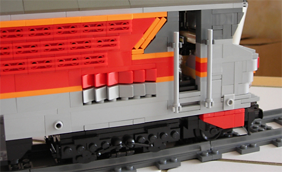

**La version initiale des bogies**

**Marquages, immatriculation...**

Afin de parfaire le rendu de cette CC 6500 RC, j’ai choisi de compléter sa robe de quelques autocollants. Les puristes hurleront à l’hérésie ; la société LEGO ne s’en prive pourtant pas. Tout ce qui me paraissait raisonnablement réalisable en briques l’a été...

Ainsi, j’ai créé une planche contenant :

-   La pointe du Z de la livrée Arzens Grand Confort (le motif fait de briques, dont on devine encore l’ossature, s’avéra assez décevant ; peut-être le reprendrai-je ultérieurement...) (**C**réation **P**ersonnelle)

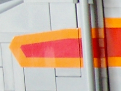

-   Le logo SNCF de 1937 sur les nez

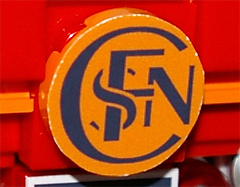

-   Le logo SNCF de 1972 sur les flancs

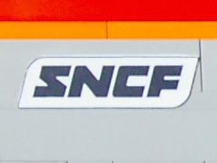

Toulousain, il ne pouvait en être autrement... J’ai personnalisé ce modèle avec :

-   Le blason de la ville de Toulouse

-   L’immatriculation n°6524 (**CP**)

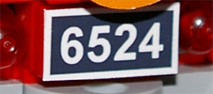

A l’image de la locomotive originale qui parcourut près de 9,5 millions de kilomètres ;-)

_Avertissements : Les éléments que je n’ai pas créés ont été puisés dans la bibliothèque vectorielle du site [La Logothèque](http://www.lalogotheque.com/) et dans la médiathèque du site [Wikimedia Commons](http://commons.wikimedia.org/)._

_

Ces derniers demeurent la propriété de leurs auteurs et propriétaires respectifs.

La [SNCF](https://www.sncf.com/) ne parraine ni ne cautionne ce travail artistique amateur à but non lucratif ni l’association FreeLUG qui l’héberge sur son site.

_

_Toutes utilisations commerciales, frauduleuses ou autrement préjudiciables faites à partir de tels documents vous exposent à des poursuites dont l’auteur de cet article ou FreeLUG ne sauraient être tenus pour responsables !_

## A suivre...

Dans le dernier volet de cet article, nous verrons cette CC 6500 RC, oups pardon ! CC 6524 RC passer ses premiers crans. Puis viendra l’heure du bilan... Et pour ceux d’entre-vous que cela titille, nous apprendrons à la construire à l’aide de sa notice ;-)

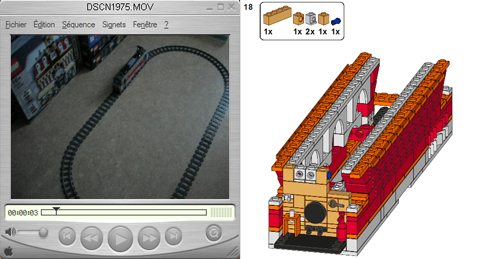

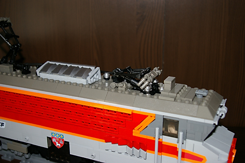

**CC 6524 RC - Vue 3**
