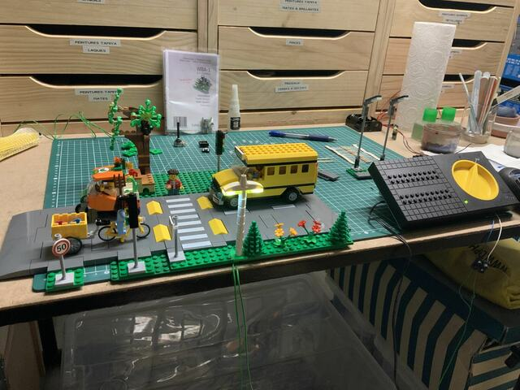
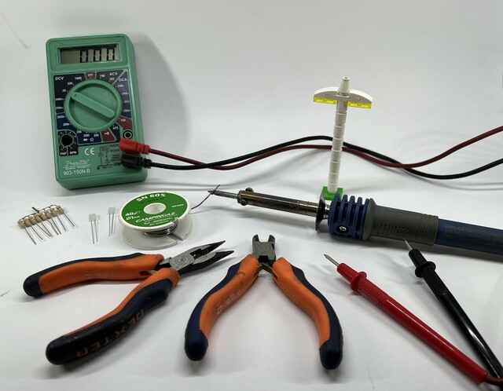
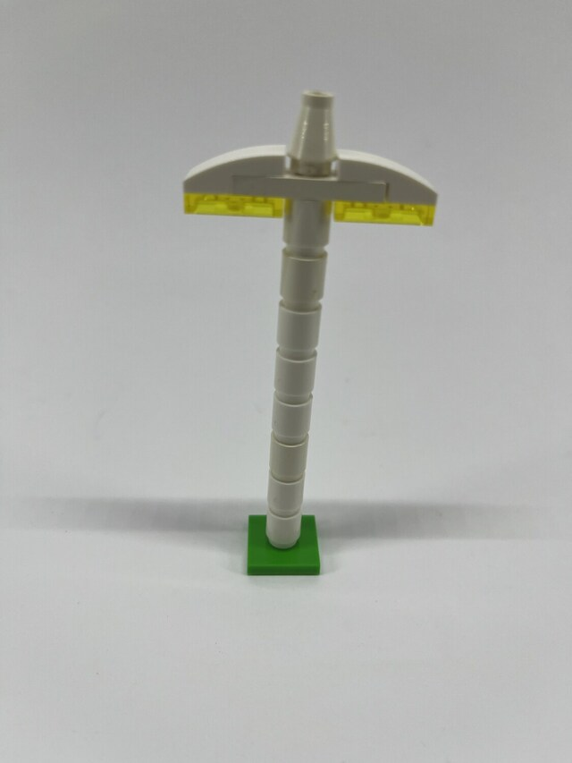
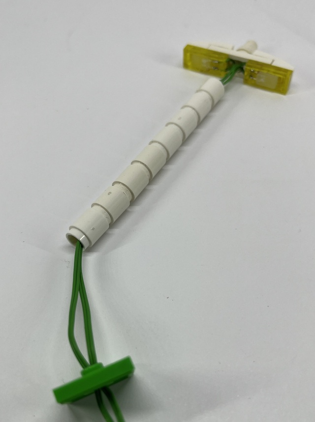
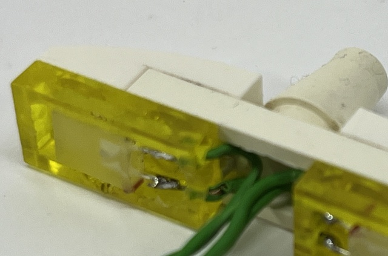
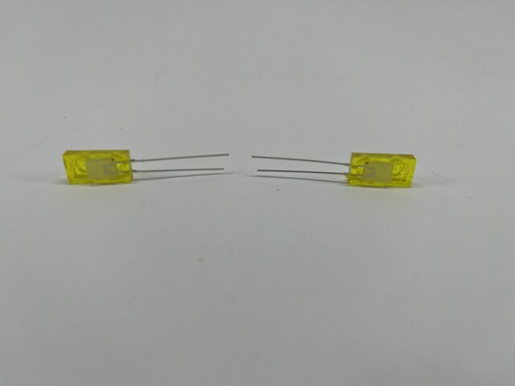
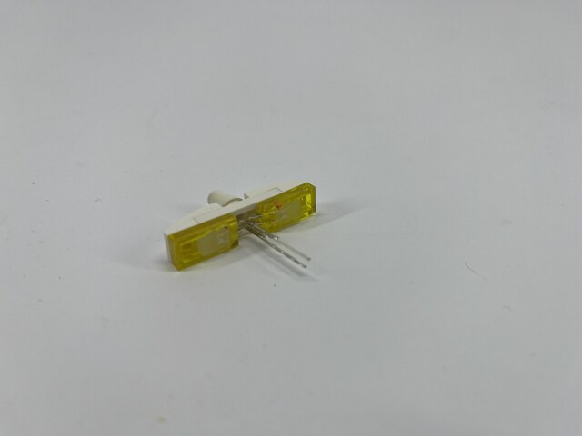
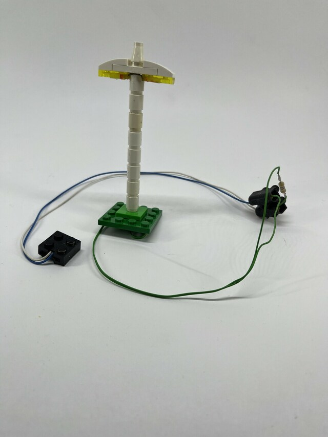
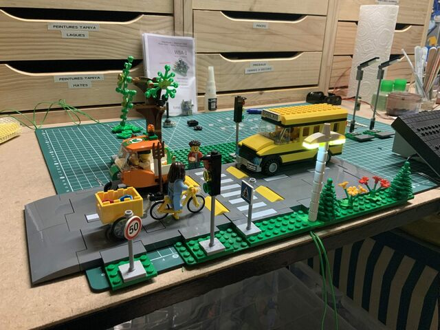
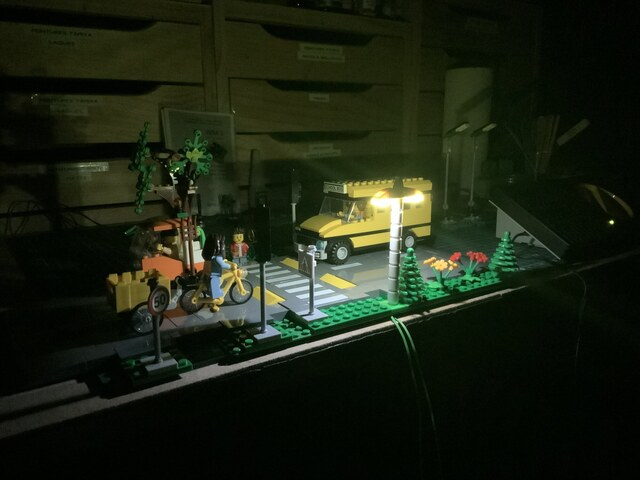

Je vous propose dans cet article de faire toute la lumière sur la façon d’égayer nos dioramas City avec une solution d’éclairage à base de Leds, que vous pourrez facilement reproduire si vous êtes un peu bricoleur.

Pour cet article, je vais d’abord vous lister les fournitures nécessaires et vous détailler les différentes étapes de fabrication pour terminer par quelques photos en situation.

_A l’attention de nos plus jeunes lecteurs : faites vous accompagner par un adulte._

## 1) Les fournitures nécessaires :

Pour réaliser mes lampadaires, j’ai choisi quelques composants électroniques assez simples à trouver et des briques actuellement disponibles en pick-a-brick. Bien évidemment vous pouvez utiliser d’autres composants et d’autres briques en fonction de vos goûts et envies.

Nous aurons donc besoin :

-   De Leds carrées blanches 2x5mm, référence Conrad [1577314](https://www.conrad.fr/p/tru-components-1577314-led-blanc-rectangulaire-2-x-5-mm-175-mcd-120-20-ma-1577314). Le choix des Leds par rapport à des voyants lumineux est à la fois économique, écologique et plus fiable, tant par la consommation réduite des Leds que par l’absence d’échauffement.
-   De résistances carbone 470 Ohm 0,5W 5% , référence Conrad [405213](https://www.conrad.fr/p/resistance-a-couche-carbone-weltron-405213-470-sortie-axiale-0411-05-w-1-pcs-405213).
-   De fil mono ou bi-conducteurs. Pour ma part j’ai utilisé du fil bi-conducteur 2x0,08mm2 vert, référence Conrad [1437316](https://www.conrad.fr/p/114-44-fil-de-cablage-2-x-008-mm-vert-5-m-1437316) la bobine de 5m. Deux fils de couleurs différentes vous permettront de mieux repérer l’alimentation positive de la négative. Pour ma part j’ai pris un câble monochrome de couleur verte pour que la couleur ne se remarque pas, si jamais je dois faire courir mes câbles sur des plaques de base vertes.
-   D’un fer à souder et d’étain pour la soudure de composants électroniques.
-   D’une éventuelle [platine d’épreuve](https://www.conrad.fr/p/tru-components-su527831-platine-pour-circuits-integres-epoxy-l-x-l-160-mm-x-100-mm-35-m-pas-254-mm-contenu-1-pcs-1570124) pour souder les composants, si on ne décide pas de les cacher dans une construction ou de les coller au double face sous le plateau de présentation du diorama.
-   D’un jeu de pinces pour maintenir les composants lors des soudures et couper câbles et pattes.
-   D’une mini-perceuse pour trouer quelques briques (pas beaucoup) et araser quelques surfaces dans les briques translucides. A minima une mèche à forer et une petite lime.
-   D’un contrôleur universel ou à minima un voltmètre pour mesurer la tension d’alimentation, si comme moi vous décidez d’utiliser un transformateur 9V.
-   De la colle cyanocrylate pour bien fixer les Leds dans les briques translucides et la tête du lampadaire sur son mat.

Pour les briques, je vous renvoie vers le fichier pdf ci-joint qui liste les références et quantités de briques nécessaires à la réalisation d’un lampadaire.

**Inventaire pour lampadaire**

On peut ajouter si on le souhaite une plaque 4x4 pour améliorer la stabilité de l’ensemble, auquel cas, il faudra également percer cette plaque pour laisser passer les fils.

Ce qui donne ceci une fois le modèle assemblé :

## 2) Les étapes de montage :

Il sera nécessaire de percer la plate en son centre pour pouvoir passer les 2 paires de câbles électriques, ainsi que les deux briques translucides.

Pour les briques translucides, percer 2 trous permettra de protéger les soudures entre les câbles et les Leds et donc vous évitera de devoir rajouter de l’isolant sur les 2 pattes des Leds coupées à bonne longueur.

L’arrivée (+) du courant électrique sera raccordée à l’anode de le Led, à savoir la patte la plus longue. Comme il faudra couper les pattes de la Led pour avoir une longueur de 2/3 mm, il sera judicieux de marquer directement sur le côté de la Led l’anode avec un petit point rouge.

Le schéma de câblage est donc le suivant, l’alimentation positive est délivrée par le transfo 9V. On prendra soin de mesurer la position permettant de délivrer une tension de +5V et on attaquera ensuite une résistance dont le rôle sert à limiter le courant dans la Led. Un fil sera ensuite relié de la résistance à l’anode de chaque Led et un autre fil bouclera le circuit depuis la cathode de la Led vers la borne (-) du transfo. Le circuit sera répété en parallèle pour chaque lampadaire.

Les pattes des Leds seront soudées ensemble, anode avec anode et cathode avec cathode, le raccordement aux fils d’alimentation sera masqué par le mat du lampadaire. Le mat devra être échancré en son haut pour permettre le passage des pattes des Leds. Une petite pointe de colle cyanocrylate permettra de fixer les Leds dans les briques translucides ainsi que la tête du lampadaire sur le haut du mat.

La résistance sera soudée au fil relié aux anodes en dessous du plateau de présentation.

## 3) En situation :

Si les lampadaires sont posés sur des plaques de base, il faudra percer les plaques et le plateau sur lequel les modules seront exposés. Le câblage pourra ensuite courir sous les plaques et/ou sous le plateau afin d’être masqué du public.

On pourra ajouter un ou plusieurs interrupteurs dans le circuit pour éclairer ou pas telle ou telle portion du diorama. On peut aussi se contenter de jouer avec le transfo pour déclencher l’éclairage. On contrôlera bien sûr la tension délivrée pour ne pas dépasser 5V.

Vue de jour :

Vue de nuit :

