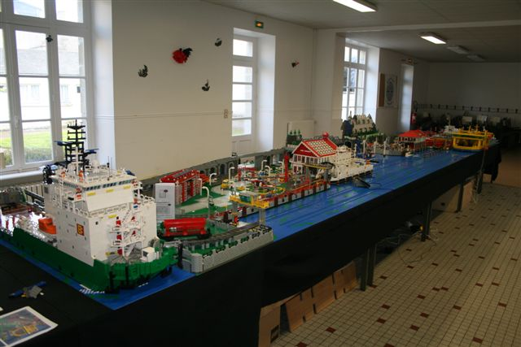
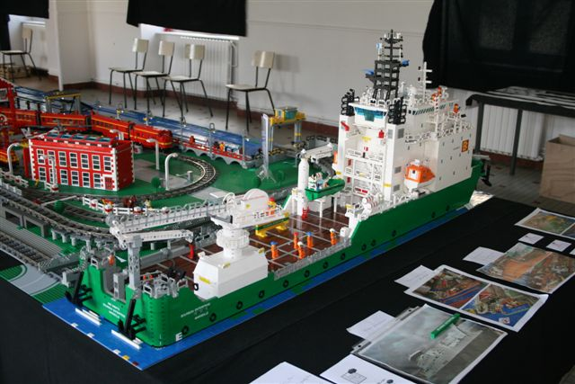

En septembre dernier, dans le cadre des Journées du Patrimoine de Roscoff, Mr le Maire de la Ville est venu voir mon club de la Maquette. J’ai profité de cette occasion, pour lui soumettre un projet de présentation du diorama trains et ferries à la population et surtout aux élèves des écoles locales.

Cette "exposition" devait avoir lieu avant Noël 2010, malheureusement ma voiture a brulé entre temps, entrainant la perte d’une certaine quantité de briques. Le projet est donc reporté à début 2011.

Après le salon de Séné (15 et 16 janvier), j’ai recontacté la mairie, expliqué de nouveau mon projet qui a emballé les élus.

Finalement, une salle m’a été attribuée gratuitement pour une durée de 2 semaines du 14 au 27 mars.

En échange, j’ai demandé à la Mairie que les écoles soient invitées à venir me voir.

Malgré mes efforts et ceux de l’adjointe au maire déléguée à l’Enfance, les directeurs d’école ne m’ont pas donné suite car les classes accusaient un retard dans leur programme scolaire, motif pas partagé par les parents d’élèves lors des journées portes ouvertes.

J’avais aussi précisé aux élus que durant l’exposition, je procéderai à une révision complète du diorama sans gêner la visite.

Au final, sans les classes, j’avais beaucoup avancé dans mon travail et je me suis même permis d’améliorer la lisibilité du réseau. Toutes les leds ont été révisées, certaines avaient laché depuis le Legoworld 2010.

Le BOURBON ENTERPRISE, nouveau bateau de ma collection, a trouvé sa place définitive, je termine son canal.

J’avais même demandé à la presse et aux élus pour faire deux journées portes-ouvertes avec entrée libre : 19 mars (50 personnes) et 26 mars (plus de 100 personnes). Accord unanime... J’ai amélioré le balisage alors que la presse parlait de jeux de construction, trop vague dans l’esprit des gens.

Lors de ces journées, des Anglais, fraichement débarqués à 8h du matin pour shopping, ont vu par hasard des pancartes L...(je ne cite pas la marque !) en ville, des parisiens et beaucoup de personnes de la région très surprises de voir des briques.

J’ai reçu des invitations, propositions de personnes travaillant à la compagnie Brittany ferries. A voir...

Un bon point pour les salons du coin. Pour remercier la municipalité de leur accueil et surtout du prêt de la salle, je leur ai offert un vin d’honneur. Des cadeaux ont été échangés.

A la suite de cette réception, j’ai officialisé mon accord pour les fêtes de la mer (28 au 31 juillet).

En conclusion, malgré un couac avec l’Education Nationale, j’ai passé une quinzaine légotique très positive, me voilà prêt pour de nouvelles aventures en Bretagne, Parigné, Laval et Cholet.

**–** [Galerie photos](http://photos.freelug.org/main.php/v/barr__/expositions/2011/quinzaineroscoff/)  
**–** [Coupure de presse](http://photos.freelug.org/main.php/v/barr__/presse/quinzaineroscoff/)

_Jean-Marc_

Prochaines manifestations :  
**–** 7 et 8 mai : Briqu’Expo Parigné-l’Evêque  
**–** 15 mai : salon des passionnés dans une école à morlaix  
**–** 22 mai : salon de Pontivy  
**–** 28 et 29 mai : fête de la patate à l’ile de Batz, je suis en discussion pour le transport de mes caisses (pas de grand diorama) par bateau et l’hébergement  
**–** 25 et 26 juin : anniversaire de la plate forme rail-toute à Morlaix
