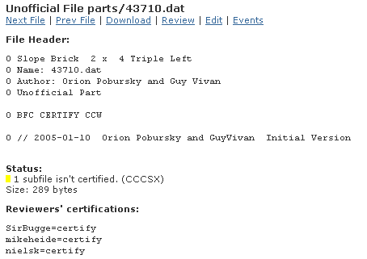
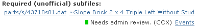

La bibliothèque LDraw s’enrichit de nouveaux éléments au fil du temps, de nouvelles pièces LEGO apparaissant chaque année. Voici la méthode pour mettre à jour sa librairie LDraw.

Je ne reviendrais pas sur l’installation de LDraw et de MLCad dont le sujet a déjà été abordé dans un autre article. Ici, nous nous concentrons sur les façons de mettre à jour sa bibliothèque.

## Pourquoi mettre à jour sa bibliothèque LDraw ?

Tout simplement car chaque année, LEGO sort de nouvelles pièces, et que si nous voulons en profiter dans notre logiciel de CAD, il faut les inclure dans la bibliothèque LDraw.

Les pièces sont modélisées par des passionnés, puis mises à disposition sur LDraw.org. Avant d’être officiellement distribuées, les pièces soumises sont validées par un comité qui se charge de vérifier la qualité et le respect des normes de la modélisation. Il y a ainsi deux statuts pour des éléments LDraw : officiel (qui a été validé) et non officiel (qui n’a pas encore été validé).

Lorsqu’un certain nombre de nouvelles pièces a été validé, un paquetage de mise à jour est mis à disposition. Ce paquetage est proposé sous deux formes : une archive .zip ou un exécutable .exe.

Par exemple, le paquetage lcad0501 signifie qu’il s’agit du premier paquetage mis à disposition en 2005 (et non pas qu’il s’agit de la version de janvier 2005).

Suivant la date d’installation de votre bibliothèque LDraw, celle-ci peut ne pas contenir les derniers paquetages. A vous de vérifier.

Vous pouvez également souhaiter insérer dans votre bibliothèque des éléments qui ne sont pas encore dans un paquetage. Par exemple, vous avez besoin d’une pièce récente qui n’est pas encore intégrée. Ou bien encore vous avez téléchargé un modèle au format LDraw et en cherchant à le lire, le logiciel vous dit qu’il manque des pièces. Cela signifie que l’auteur du modèle a utilisé des pièces qui ne sont pas intégrées.

Voici la recette pour mettre à jour votre bibliothèque.  
Supposons pour la suite que vous avez installé LDraw dans l’arborescence suivante : `c:\lego\LDRAW` et que vous souhaitez ajouter le paquetage lcad0501.exe. N’oubliez pas de fermer toutes vos applications CAD utilisant la bibliothèque LDraw.

Les paquetages de mise à jour sont disponibles à l’adresse suivante : [http://www.ldraw.org/modules.php?op...](http://www.ldraw.org/modules.php?op=modload&name=News&file=index&catid=&topic=26)

## A partir des fichiers .exe

Placer le fichier lcad0501.exe dans le répertoire `c:\lego\`. Puis, depuis le menu Démarrer, faire Exécuter puis taper "command". Depuis cette fenêtre DOS, taper `c:\lego\lcad0501.exe -y` (l’option -y permet de confirmer automatiquement que vous souhaitez remplacer les fichiers déjà existants). Selon les configurations de votre Windows, il se peut que vous n’arriviez pas à utiliser cette méthode. Il faut alors utiliser le paquetage sous forme d’archive zip.

## A partir des archives .zip

Placer le fichier lcad0501.zip dans le répertoire `c:\lego\` puis en utilisant votre logiciel d’archives zip, extraire les fichiers dans le répertoire courant. Confirmer le remplacement des fichiers déjà existants.

## Ajouter des pièces en dehors de ces paquetages

**Ajouter une pièce manuellement**

Pour trouver une pièce, il faut se rendre dans le [Parts Tracker de LDraw](http://ldraw.org/library/tracker/) dans lequel on peut faire une recherche d’une pièce d’après sa référence LDraw (que vous pouvez trouver dans les inventaires Peeron ou Bricklink).

Prenons un exemple : nous cherchons la pièce [43710](http://www.bricklink.com/catalogItem.asp?P=43710). Cette pièce là n’est pas à la date de rédaction de cet article une pièce officielle.

[http://www.ldraw.org/cgi-bin/ptdeta...](http://www.ldraw.org/cgi-bin/ptdetail.cgi?s=43710)

Quelles sont les informations que nous trouvons sur cette page ?  
**–** la description de la pièce ;  
**–** sa référence ;  
**–** son ou ses auteurs ;  
**–** son statut ;  
**–** la liste des personnes ayant certifié la pièce.

Parmi les informations importantes qui nous intéressent dans cette page, regardons si cette pièce utilise des sous fichiers (subfiles). On découvre que cette pièce nécessite la sous-pièce 43710s01.

Pour le bon fonctionnement, nous avons donc besoin de la pièce et de sa sous-pièce. Téléchargeons les deux éléments (lien Donwload sur le haut de la page pour télécharger le fichier 43710.dat et sur le lien parts/s/43710s01.dat pour télécharger la sous-pièce.

L’intitulé de ce dernier lien nous indique dans quel dossier nous devons placer la pièce : parts/s/ (depuis le dossier d’installation LDraw, `c:\lego\LDRAW`. La pièce principale va dans le dossier parts.

Donc après téléchargement nous devons avoir :  
**–** `c:\lego\LDRAW\parts\43710.dat`  
**–** `c:\lego\LDRAW\parts\s\43710s01.dat`

**Ajouter toutes les pièces non officielles**

Vous pouvez aussi ajouter toutes les pièces non officielles en téléchargeant l’archive zip complète suivante :  
[http://www.ldraw.org/Article14.html](http://www.ldraw.org/Article14.html)

Il vous faudra alors suivre la même procédure que pour utiliser une archive officielle.

## Faire en sorte que votre logiciel détecte les nouvelles pièces

Insérer les nouvelles pièces ne suffit pas à votre logiciel pour les prendre en compte. Il faut régénérer l’index des pièces. Pour cela, supprimons le fichier Parts.lst (qui se trouve aussi dans `c:\lego\LDRAW\`). Votre logiciel doit vous proposer de régénérer ce fichier : au lancement de MLCad, si celui-ci ne trouve pas le fichier, il propose de le recréer.

Les nouvelles pièces doivent alors apparaître !

## Avertissement

L’utilisation des pièces non officielles est à votre risque. Comme ces pièces sont susceptibles d’évoluer dans le temps, il se peut que certains de vos fichiers ne soient plus tout à fait corrects lorsque la pièce sera officielle et intégrée à un paquetage.
