J’ai eu la chance d’essayer le 4x4 crawler 9398 lors du [salon kidexpo](/articles/resume-de-notre-participation-a-kidexpo-2012/).  
Ce véhicule m’a vraiment surpris par sa maniabilité et ses aptitudes en tout-terrain.  
Ce qui ma décidé à en acheter un.

Dès le montage fait, j’ai eu envie de le modifier.

Pour commencer, j’ai jumelé les essieux.

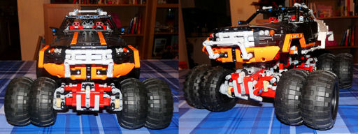

Les premières constatations :  
**–** Il gagne en gueule ;  
**–** Le servomoteur de direction n’a pas de mal à entrainer les essieux jumelés ;  
**–** Le fait de rajouter 4 roues n’influe pas sur la vitesse : ce 4x4 est toujours aussi lent ;  
**–** Je trouve que l’arrière du pick-up est trop court.

_Je n’ai fait aucun test sur ce que ces roues ajoutent ou enlèvent à la capacité de franchissement._

Je me lance donc dans de profondes modifications avec comme but :  
**–** Remplacement des moteurs L par des XL (plus puissants) pour le rendre plus rapide ;  
**–** Rajout d’un troisième essieu à l’arrière, essieu qui sera moteur et directeur.

Des modifications bien plus ardues que je ne le pensais (mais tout le plaisir est là).

## 1° étape : Le calcul du rapport de transmission

Toutes les données techniques des moteurs viennent du [site de philo](http://www.philohome.com/)

Le 9398 a des moteurs L qui tournent à 390 t/min et fournissent 18 N.cm de couple. Sa chaine de transmission est composée de trois étages de réduction de rapport 12/20 soit un rapport total de 27/125 ou 0.216. La vitesse théorique de rotation des roues est de 84,24 t/min et le couple (dans un monde parfait) sur chaque essieu de 83,33 N.cm.

Les moteurs XL ont une vitesse de 220 t/min et un couple de 40 N.cm.  
J’ai opté pour une chaine de transmission ne comportant qu’un seul rapport de réduction de 12/20.  
J’aurai donc une vitesse théorique des roues de 132 t/min et un couple par essieu de 66,66 N.cm.  
Le couple par essieu est inférieur au couple du 9398 mais vu que je mettrai 3 essieux (donc 3 moteurs). Le couple total sera supérieur : 199,98 > 166,66.

_A cette étape il y a déjà une inconnue et du coup une erreur d’appréciation..._

## 2° étape : La réalisation de l’essieu central

C’est là que les Athéniens s’atteignirent.  
C’est l’essieu le plus compliqué car en plus d’assurer la motricité, il reçoit la commande de direction et doit la renvoyer sur l’essieu arrière.

Les photos de l’essieu d’origine.

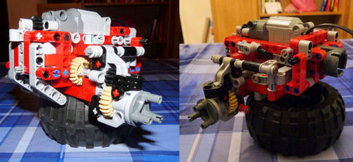

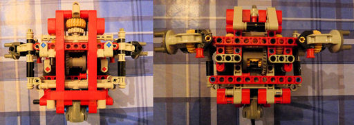

Les photos du nouvel essieu.

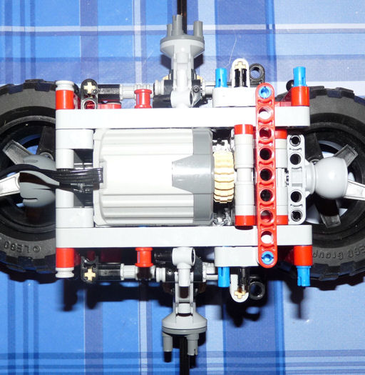

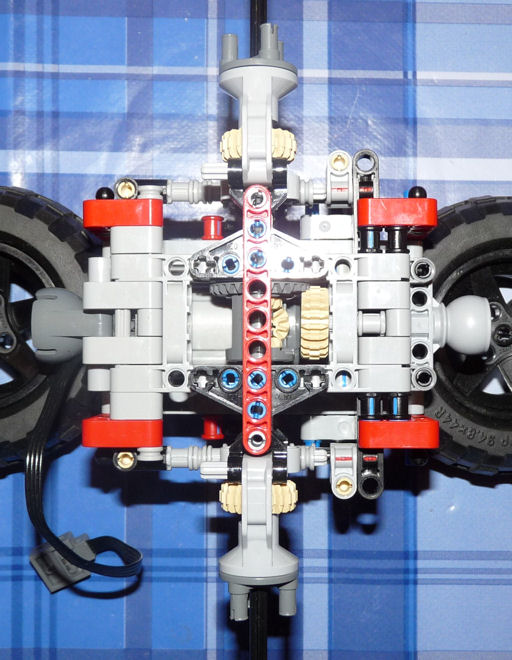

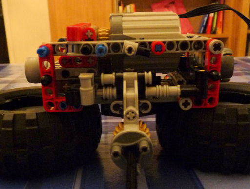

Les remarques :  
**–** L’ensemble est beaucoup plus gros que sur le 9398. Ce qui se traduit par 2 tenons de plus en largeur et 1 de plus en hauteur au niveau des accroches de suspension.  
**–** La voie au niveau des roues intérieures est 2 tenons inférieure à celle du 9398.  
**–** N’ayant plus besoin que d’un rapport de réduction, les roues se trouvent en face du différentiel.  
**–** Le transfert de la direction vers l’essieu AR se fait par l’intermédiaire de l’essieu. Le mouvement est transmis de la façon suivante : Servomoteur -> Action sur la crémaillère avant -> Rotation de l’essieu -> Mouvement de la crémaillère arrière -> rotation de l’axe dans la rotule arrière. L’avantage de ce système est de contourner le moteur naturellement. Les inconvénients sont de créer beaucoup de jeu, et d’inverser le sens de rotation de l’axe de sortie.

## 3° étape : La réalisation de l’essieu arrière

Cet essieu bien que plus simple que le précédent a la particularité d’intégrer un arbre intermédiaire sur la direction. Cet arbre a pour rôle de remettre dans le bon sens la commande de direction (inversée dans l’essieu central), augmenter le déplacement de façon à rattraper les jeux.

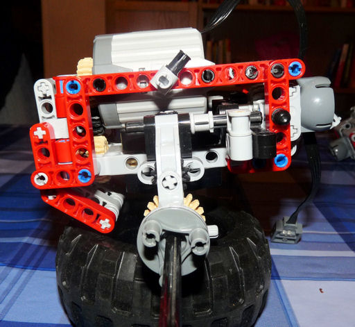

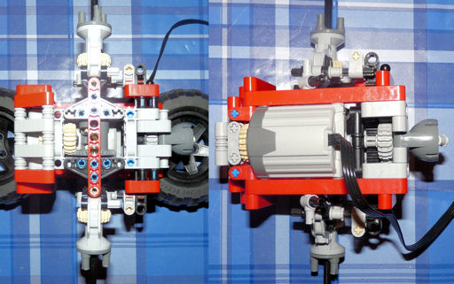

Les remarques :  
**–** Comme sur l’essieu central : c’est gros et les roues sont dans l’axe du différentiel.  
**–** Le rapport entre l’arrivée de l’essieu central et le pignon de la crémaillère de direction est de 20/12.

## 4° étape : La réalisation de l’essieu avant

Après la réalisation des 2 autres essieux, celui-ci ne présente aucune difficulté majeure.

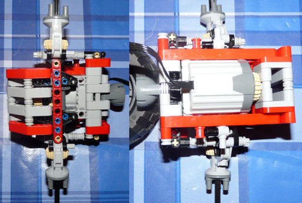

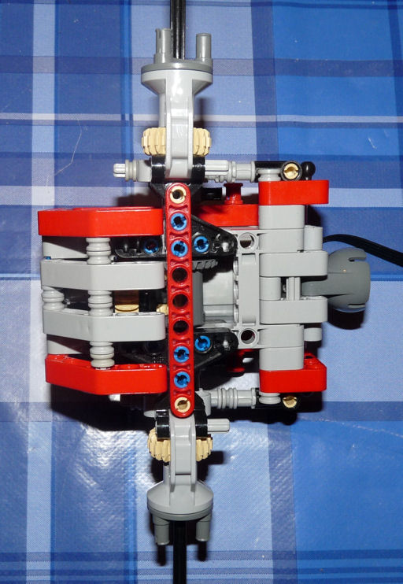

Les remarques :  
**–** Comme sur les 2 autres essieux : c’est gros et les roues sont dans l’axe du différentiel.

## 5° étape : La modification du châssis

Cette étape qui ne paraît pas compliquée a demandé pas mal de travail.

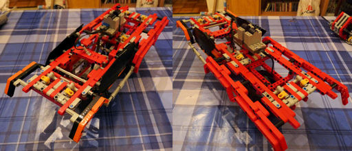

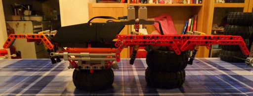

Au début cela paraît simple : juste remonter et élargir les accroches de suspension puis rallonger le châssis. Sauf que pour d’obscures raisons de puissance électrique, il faut aussi intégrer un deuxième récepteur IR (facile) et rajouter un deuxième boitier pile (ouille et pas que pour le volume). Il a aussi fallu rigidifier la partie arrière, ce qui n’est pas forcement évident vue la géométrie trapézoïdale du châssis. Mais en LEGO, un peu de temps et quelques opérations de montage-démontage viennent à bout de tous les maux.

## 6° étape : La carrosserie

Dans un premier temps je ne souhaitais pas me casser les pieds à créer un nouveau look. J’ai donc juste réadapté la carrosserie existante. Opération presque simple.

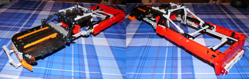

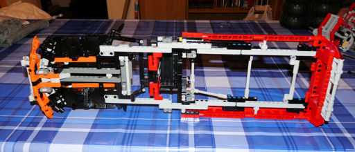

Les points particuliers :  
**–** Sur le modèle de base les poutres avant passent juste sur les supports de suspensions. Donc avec les modifications du châssis, il a fallu démonter tout l’avant pour les déplacer.  
**–** Le rallongement de la benne est de 15 tenons hors les panneaux font 11 tenons. Ce qui provoque l’apparition de LEGO System sur le coté.

## 7° étape : l’assemblage final

Ce n’est pas une étape en soit mais je sais que vous l’attendez depuis le début de l’article.  
Voici donc les photos d’ensemble du modèle.

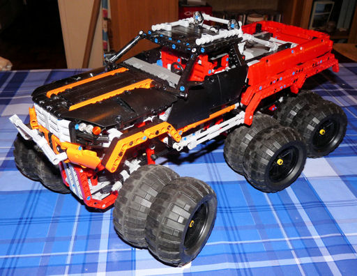

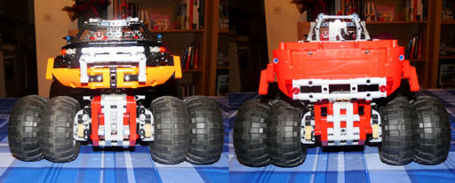

## 8° étape : Le but est il atteint ?

Souvenez-vous des raisons de cette modification :  
**–** Donner une allure plus agressive au véhicule ;  
**–** Lui donner plus de vitesse tout en gardant ses capacités de franchissement ;  
**–** Passer du bon temps à jouer au LEGO (ça c’était implicite).

Voici quelques éléments pour juger.

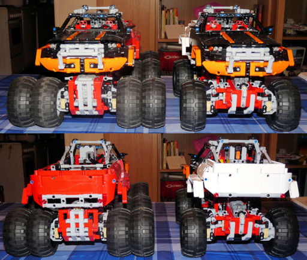

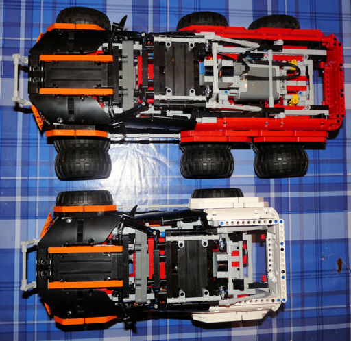

Les caractéristiques des 2 modèles :

|  |  |  |  |
| --- | --- | --- | --- |
|  | _Longueur_ | _Largeur_ | _Poids_ |
| 9398 (4x4) | 47 tenons | 26 tenons | 1,300 kg |
| MOC (6x6) | 62 tenons | 35 tenons | 2,600 kg |

**–** Il est clair que le troisième objectif est rempli avec succès, ce montage m’a occupé pendant de longues heures.  
**–** Le premier, à mon goût, est aussi atteint. La mise côte à côte des 2 modèles met en évidence les mauvaises proportions du 9398 et le rend tout petit.  
**–** Pour Le second objectif, c’est plus délicat. Sur ce tableau apparaît l’inconnue de la phase 1 : Le POIDS. A force de mettre plus de trucs plus gros, c’est beaucoup plus lourd. Si l’augmentation en vitesse est bien au rendez-vous, le couple n’est plus suffisant pour passer le moindre obstacle. Ce qui serait très bien si j’avais voulu faire une formule 1, mais ce n’est pas le cas.

## En conclusion :

Il va falloir que je reprenne ma copie, au chapitre des modifications à apporter :  
**–** Changement des suspensions du dernier essieu par des modèles plus souples (celles de la 8880).  
**–** Refonte complète de la motorisation avec comme but une augmentation du couple. Donc 2 options : soit je garde les moteur XL et j’augmente la réduction, soit je reviens sur des moteur L et je réduis la réduction de base. La deuxième solution offre l’avantage d’un gain de poids et peut être la possibilité de supprimer un boitier de piles.  
**–** Remplacement des boitiers de piles par des batteries (à acheter, snif).  
**–** Modifier la carrosserie pour lui donner une allure plus personnelle.

[Plus d’images](http://photos.freelug.org/main.php/v/-PZ/moc/6x6/)

_Une affaire à suivre..._
