Construit il y a maintenant trop d’années, je prévois enfin le démontage de ce petit diorama. C’est le dernier moment pour faire une présentation de mon auberge fortifiée avec une petite cloche brune.

Je me souviens avoir construit cette auberge, pour compléter un petit diorama avec ma tour de garde. C’était en 2008...

J’avais dans l’esprit de construire un bâtiment à colombage, avec toit de chaume et protégé par un petit rempart. La petite tour avec la cloche est venue au moment de la construction. C’est ce qui m’a donné aussi l’idée du nom de l’auberge.

Dans mon cahier des charges, je voulais avoir accès facilement à la cave située évidement tout en dessous. Le bâtiment est donc construit avec les différents niveaux démontables, montés sur pièces lisses.

[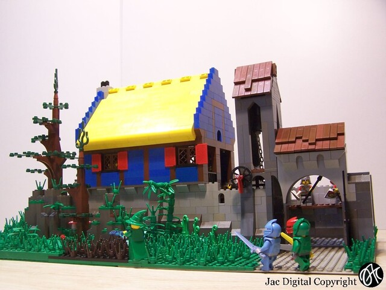](https://www.freelug.org/IMG/jpg/photo_02-3.jpg)

Aujourd’hui, il existe pas mal de techniques de construction pour représenter des colombages. Des petites pièces qui n’existaient pas forcément il y a 12 ans auraient bien aidé. Pour donner l’effet croisé comme en réalité, il fallait plus de pièces et de place, au détriment de l’aménagement intérieur. C’est donc avec des piliers droits que j’ai représenté les bois.

[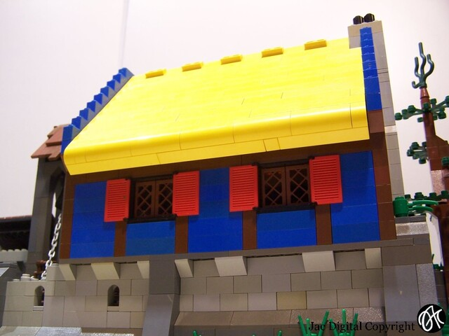](https://www.freelug.org/IMG/jpg/photo_13.jpg)

J’aime bien le principe de fortification de certains édifices, sans que ce soit pour autant un château. Il y a des fermes, des églises et c’est comme cela que j’ai eu l’idée de fortifier une auberge. Ça permet d’être plus serein pour déguster un bon repas. Forcément, avec un tel bâtiment, il y a besoin de quelques gardes et d’un grand portail d’entrée.

[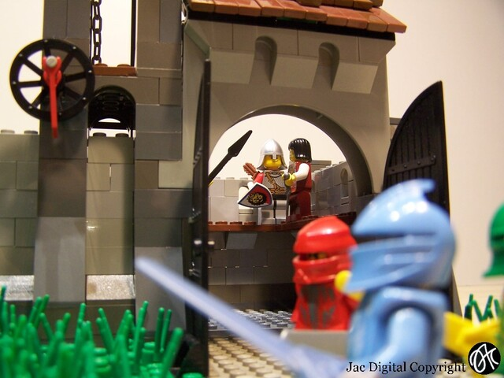](https://www.freelug.org/IMG/jpg/photo_40.jpg)

Tous les murs sont construits en briques 1X2. Ça donne un aspect pierre de construction. C’est une idée de Denis que j’avais appliquée ici. Il se reconnaîtra.

Le toit de chaume, représenté en briques jaune, est simplement posé sur les murs penchés. Je n’ai pas représenté la charpente. Il y a une poutre de faîtage qui est aussi démontable facilement.

[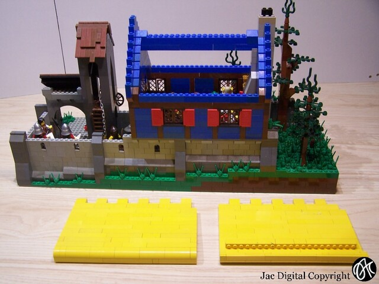](https://www.freelug.org/IMG/jpg/photo_53.jpg)

[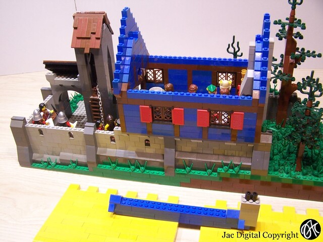](https://www.freelug.org/IMG/jpg/photo_57.jpg)

On a ainsi accès au niveau principal de l’auberge, que l’on peut aussi enlever.

[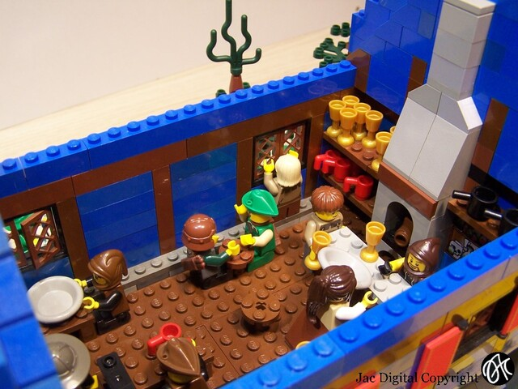](https://www.freelug.org/IMG/jpg/photo_61.jpg)

[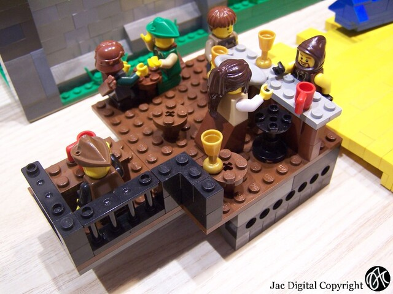](https://www.freelug.org/IMG/jpg/photo_70.jpg)

C’est alors que la cave se dévoile, hantée par une méchante chauve-souris vampire, brrrrr ! Il ne fait pas bon aller chercher du vin seul, pourtant il y a pas mal de tonneaux !

[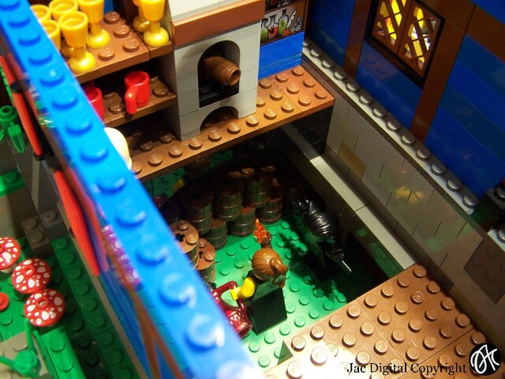](https://www.freelug.org/IMG/jpg/photo_79.jpg)

Avant de prendre toutes les photos, il y a une préparation du diorama à faire. Mettre toutes les plantes, des arbres, rajouter des champignons. Je m’amuse aussi à mettre des personnages en situation, dans l’auberge, des gardes et aussi un apprenti sorcier qui vient de cramer quelques plantes. Heureusement un trio de chevaliers passait par là. Que vont-ils faire ?

[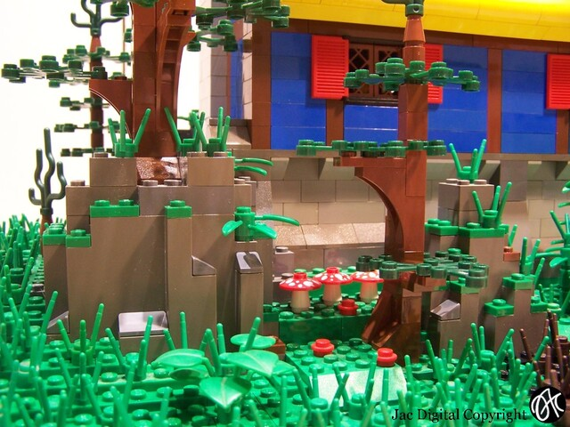](https://www.freelug.org/IMG/jpg/photo_29.jpg)

[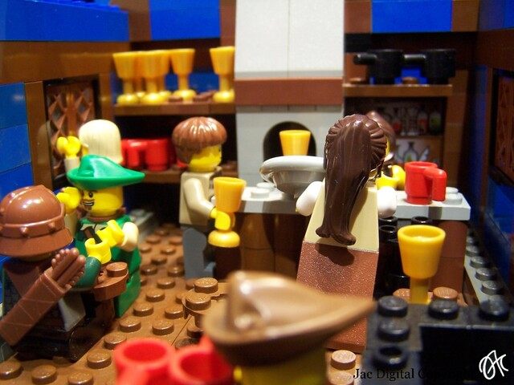](https://www.freelug.org/IMG/jpg/photo_63.jpg)

[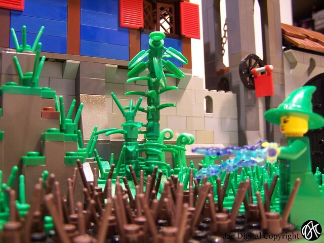](https://www.freelug.org/IMG/jpg/photo_31.jpg)

Comme je l’ai dit, cette construction a quelques années. Aujourd’hui j’aurais mis plus de détails, comme un vrai accès à la cave, un dallage sur le sol, un souterrain et des loges pour les gardes. Sûrement que le bâtiment serait plus grand et mieux construit. Ce sera pour d’autres projets.

[La galerie avec toutes les photos](https://photos.freelug.org/main.php/v/JAC/MOC/Batiment/Medieval/AubergeCloche/)
