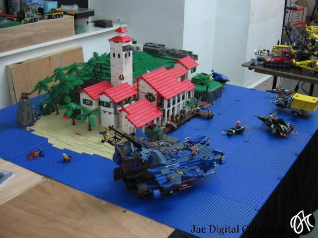
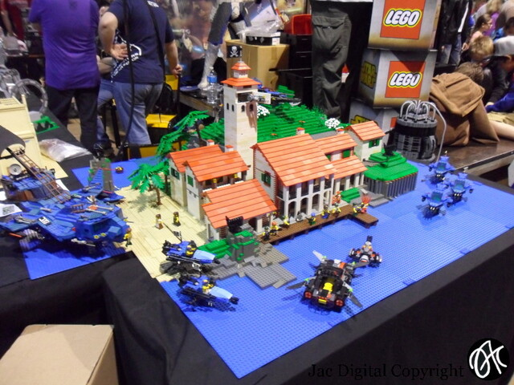
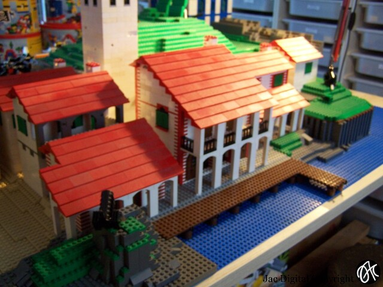
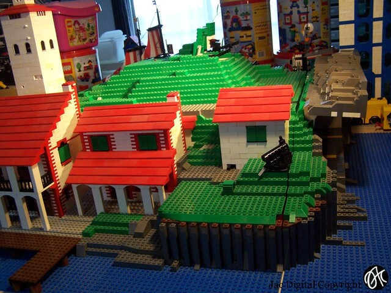
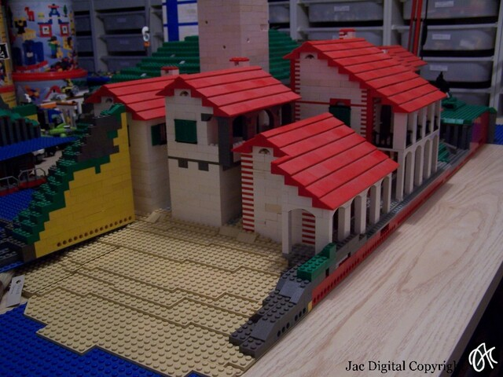
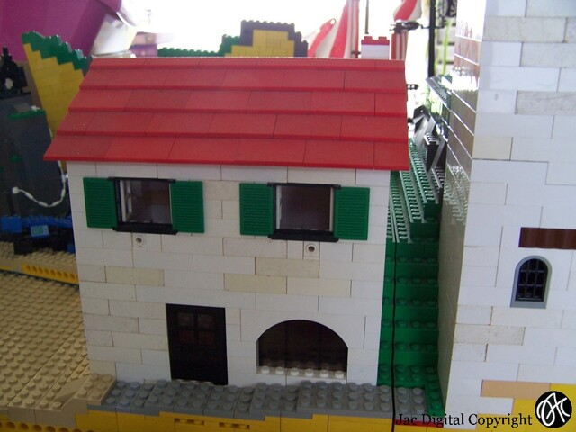
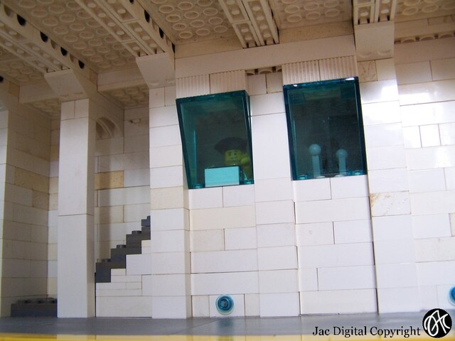
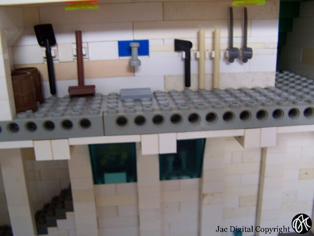

Présentation et finalisation de ma base. De la conception à la réalisation et au fil des expositions, son évolution.

J’ai commencé à présenter les premiers vaisseaux de ma base spatiale à ma première exposition. C’était à la convention SW et SF de Cusset en 2002, sauf erreur. De là, germait déjà dans ma tête l’idée d’une base spatiale cachée derrière un village, sous une montagne. J’avais de bons souvenirs de Lady Penelope. Mais les briques me manquaient pour un tel projet.

En 2010, je présentais une version brouillon de l’ile et le mot n’est pas trop faible, à la première exposition de l’année "Festibriques 2010". Je suis sûr que les organisateurs s’en souviennent. Je ne l’ai même pas prise en photos ! Ce sont eux, d’ailleurs qui m’ont fait promettre de présenter la version finalisée à l’exposition "Festibriques 2010 bis". Pari tenu et voilà la version finale qui n’a pas beaucoup changé ensuite. Seuls les arbres et plantes variaient d’une exposition à l’autre ainsi que la position des vaisseaux.

Pour la mise au point de ce montage important, je m’étais donné un ordre de marche. Il fallait que le principal des troupes puisse être abrité dans un village qui pouvait cacher la réelle activité de l’ile. La colline derrière devait abriter un hangar avec quelques vaisseaux de défense. La porte était dissimulée dans la roche, de manière à pouvoir disparaitre lorsqu’elle était fermée. L’ile était du type volcanique, avec des orgues volcaniques sur certaines parties. Le vent passant ayant souvent la même orientation, une plage de sable a pu se former d’un coté.

Depuis j’ai fait beaucoup d’expositions avec, il y a eu [Fanabriques (Rosheim)](/articles/fana-briques-2010/), [WE de l’imaginaire (St Etienne)](/articles/un-week-end-pour-jouer-a-saint-etienne/), [Model show (Avignon)](/articles/24e-model-show-avignon-6-et-7-novembre-2010/), [Génération SW et SF (Cusset)](/articles/17e-convention-star-wars-et-sf/), [Briqu’Expo de Parigné l’Evêque](/articles/briqu-expo-parigne-l-eveque-2011/) et j’en oublie sûrement. Ca a été à chaque fois un réel plaisir de la présenter et d’apprécier les commentaires des visiteurs. C’est aussi seulement en exposition que j’ai pu la prendre en photos car trop grande pour la placer dans mon mini studio.

Dans les évolutions, il y a eu les personnages, avec une belle série de minifigs pirates munies d’armes spéciales créées sur mesure. Les vaisseaux ont été améliorés et parfois augmentés en nombre, avec deux "[renard noir](https://photos.freelug.org/main.php/v/JAC/MOC/Vaisseaux/pirate/RenardNoirV2/)". Certains ont été inventés après comme les "[Orbicom](https://photos.freelug.org/main.php/v/JAC/MOC/Vaisseaux/pirate/orbicom/)", ça impressionne plus. Il y a eu aussi l’éclairage intérieur du hangar, car même en blanc on ne voyait pas bien le fond. J’ai rajouté plus tard un aménagement plus poussé des locaux avec une salle de contrôle au dessus du hangar, un accès par escalier, un ascenseur pour le pigeonnier de défense et un bureau de gestion du hangar. Des canons pouvaient sortir du sol du haut de la colline. Tout cela ne se voyait pas bien, mais je savais que ça y était. Tout est venu au fur et à mesure des expositions et en fonction des avis que je recevais.

Puis est venu le moment du démontage de ce diorama imposant. Il y a plus grand aujourd’hui sur le net c’est sûr. Mais il prenait beaucoup de place et de pièces. Heureusement, j’ai pensé à prendre quelques photos. Cela m’a permis de mémoriser le tout correctement. J’en ai fait aussi une représentation virtuelle grâce à LDD et Studio. Mais elle n’est pas bien présentable, pour l’instant.

Une de mes meilleures représentations a été celle de Cusset en 2015.

Les maisons de devant étaient aménagées, avec une capitainerie, un saloon hôtel et une petite maison qui cachait un accès à l’atelier d’entretien du hangar.

Voilà une vue de la plage déserte, cette fois.

Les maisons en arrière plan n’étaient pas aménagées. Elles étaient toutes différentes, tout en gardant le même style.

Toute l’ile était construite sous forme de petits modules emboîtables de 32X32 ou 32X16 tenons suivant les endroits. Ca a grandement facilité le transport mais pour assembler les 2 pans du hangar ce n’était pas toujours évident. Par contre, une fois monté, c’était suffisamment solide. C’est seulement lors du démontage récent de tout l’ensemble que j’ai pu prendre des photos du hangar et des bureaux de contrôle. Certaines briques ont eu le temps de bien jaunir.

Toutes les photos sont visibles dans ma galerie à cette adresse, pour les expositions, il faut chercher suivant les années.  
[https://photos.freelug.org/main.php...](https://photos.freelug.org/main.php/v/JAC/MOC/Diorama/Basepirate/)
