[En conclusion du triptyque consacré à ma réplique de locomotive CC 6500 sur la base du châssis IRC](/articles/moc-locomotive-cc-6500-rc-3eme-et-derniere-partie/), j’évoquais la possibilité de décliner cette motrice en sa « version diesel », la légendaire CC 72000. Il y a quelques semaines, je décidai de relever ce défi, avec comme challenge supplémentaire l’intégration de la technologie Power Functions System et de ses futurs accessoires estampillés « train » !

## R.I.P. 9 Volts and... R.I.P. IRC !

Au cours de l’année 2008, [une série d’annonces de la Société LEGO](/articles/troisieme-annonce-train-lego-9v/) entérina l’abandon du système 9 volts. Entre les lignes, on comprenait que dans la foulée l’Infrared Remote Control subirait le même sort. Déployé au sein du [train de voyageurs 7897](/articles/autopsie-d-un-train-irc-b-7897/) et du [train de marchandises 7898](/articles/autopsie-du-train-de-marchandises-7898/), l’IRC n’était qu’une étape transitoire entre l’ère 9 volts et un système infrarouge pérenne.

Le dernier passage de témoin se fera d’ici peu, achevant avant 2010 la mutation tant redoutée. Ne subsistera alors qu’une déclinaison du [Power Functions System](/articles/power-functions-le-nouveau-systeme-electrique-lego/) adaptée aux besoins de l’univers ferroviaire LEGO.

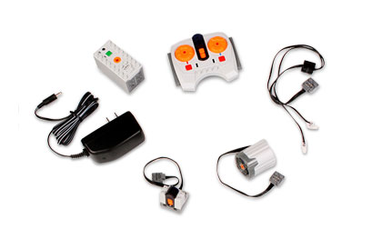

**Auteur : The LEGO Company**

Ce pack PFS se décompose de la sorte :

-   Un récepteur PFS désormais bien connu ;
-   Une nouvelle commande aux allures de pad de console de jeux, exploitant les fonctionnalités avancées du récepteur (variation de la vitesse) ;
-   Une batterie rechargeable de forte capacité (une brique géante de 4 x 8 x 4), combinée à un adaptateur secteur pour sa régénération ;
-   Un moteur PFS de type XL ;
-   Des diodes d’éclairage.

L’architecture fondamentale des futurs trains en briques LEGO sous PFS, qu’ils soient des modèles commerciaux ou des [MOC](/articles/liste-d-acronymes/)s, se présentera ainsi :

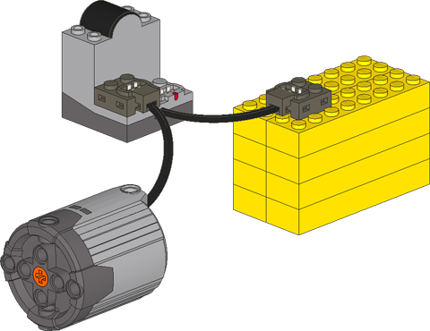

Ou mieux encore en réemployant le bogie moteur apparu dans les trains 7897 et 7898, associé au câble de conversion 9 volts/PFS :

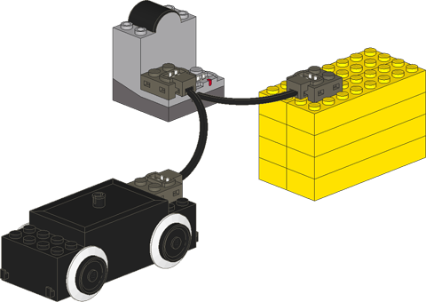

Si tant est que la commercialisation de ce bloc perdure...

Et quid d’un bogie moteur à connectique PFS ?

Car il ne sera pas aisé de concevoir une motrice autour des moteurs classiques. Sans compter que ces bougres imposent la construction d’une transmission en pièces Technic ! Gare à la fiabilité... Plus encore dans le cadre d’une utilisation AFOL.

## La CC 72000, « bonne à tout faire » de la SNCF

Les [CC 72000](http://fr.wikipedia.org/wiki/Cc_72000) sont une série de locomotives diesel-électriques françaises construites de 1968 à 1974. Elles assurent aussi bien le service voyageur que marchandise, sur les lignes non électrifiées de la SNCF.

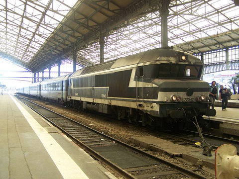

**La CC 72042 en gare de Tours le 15 Juillet 2008 (Auteur : Florian P. / Wikimedia Commons / Permission : GFDL CC-BY-SA)**

Dans un souci de réduction des coûts d’étude, elles partagent avec les CC 6500, leurs petites soeurs électriques, bon nombre d’organes, et une ligne « nez cassé » caractéristique des années 70.

Quelques exemplaires sont encore en service, même si la tendance est, hélas, à la radiation pure et simple...

On rencontre principalement les CC 72000 dans la livrée [Arzens](http://fr.wikipedia.org/wiki/Paul_Arzens) bleu pétrole « zédé » de noir et de blanc. Mais également revêtues d’autres robes, FRET ou « En voyage ».

## Une conception intégrale sous MLCAD

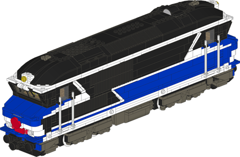

La CC 72000 reprend à son compte bon nombre de solutions développées avec la CC 6500 IRC. Son temps de conception s’en réduisit d’autant. Et sa modélisation directe sous [MLCAD](http://www.lm-software.com/mlcad/e_main.htm) s’imposa comme une évidence. L’impasse du prototype ne dispensa pas de valider physiquement certains assemblages virtuels, essentiellement aux niveaux de la livrée Arzens et de l’implantation des organes PFS.

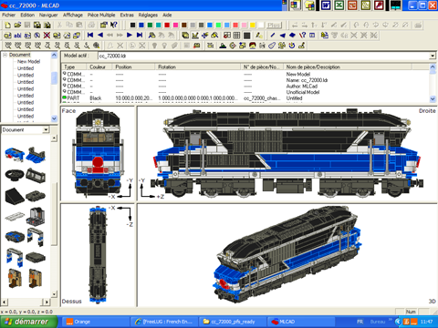

La structure de la CC 6500 IRC enrobait le châssis infrarouge des trains 7897 et 7898. Exemptée de cette contrainte, la CC 72000 PFS emploie une solution plus conventionnelle. Des orifices comparables à ceux du châssis IRC permettent le câblage des bogies.

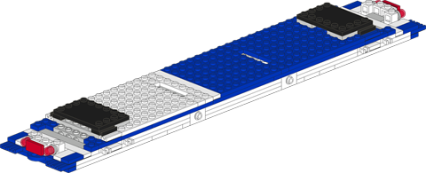

La brique-batterie, guidée par une structure d’accueil, repose sur des supports en tuiles lisses. Son extraction ne prend que quelques secondes. De multiples possibilités de cheminement garantissent un câblage aisé.

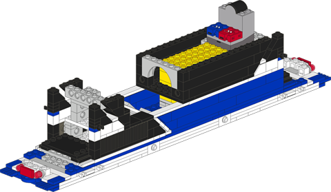

Il est envisageable d’utiliser la deuxième sortie du récepteur (rouge) pour une autre fonction électrique que la motorisation, par exemple l’éclairage des cabines.

J’ai profité de l’occasion pour revoir l’aménagement des postes de conduite. Le pupitre et le siège du cheminot prennent une position plus conforme à la réalité, décalée vers la gauche.

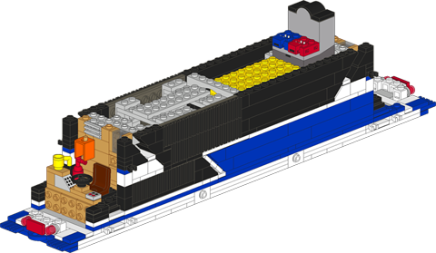

Le haut de la caisse est tapissé de tuiles lisses.

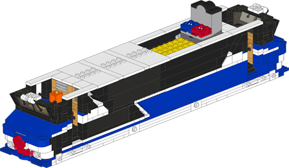

Conjuguée à un toit amovible, cette astuce permet une accessibilité simple et rapide aux entrailles de la bête.

A l’instar de la CC 6500 IRC, la CC 72000 PFS adopte un double attelage 1 + B en guise de bogies triple essieux.

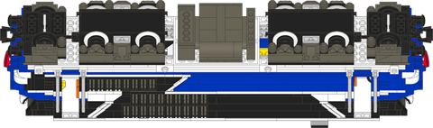

## La notice

Pour les plus courageux d’entre vous, ou tout simplement à titre de consultation, voici la notice de construction de cette locomotive. Volontairement minimaliste, elle est avant tout destinée à des AFOLs.

**Notice CC 72000 « PFS Ready »**
