Une fois n’est pas coutume ! Je délaisse mes traditionnelles revues de sets officiels pour vous faire partager le processus de création d’un de mes derniers [MOC](/articles/liste-d-acronymes/)s : une réplique de la légendaire locomotive électrique française CC 6500, aujourd’hui radiée. Si l’échelle minifig s’imposait à sa réalisation, j’ai délaissé le traditionnel gabarit de 6 tenons de large au profit du 8 tenons en vogue chez les AFOLs. Challenge supplémentaire : l’intégration de la technologie RC transitoire proposée par la société LEGO après l’abandon du système 9 volts.

En route ! Tchou, Tchou ! Euh... Pardon ! Piiimp, Puuump, Pimp !

## Survivre !

Oui, tel est bien le leitmotiv des traineux 9 volts. Les fans de 12 volts qui les ont précédés dans le trépas pourront leur témoigner de la vie quotidienne dans l’au-delà, faite de matériels à bout de souffle et de brocantes laborieuses ;-)

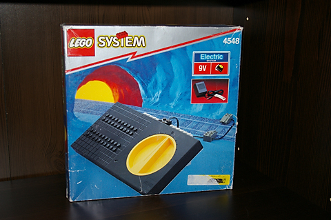

**Rest In Peace**

Plutôt que de prendre le maquis et se constituer des stocks faramineux de moteurs et de rails métallisés, ne serait-il pas plus judicieux de commencer à aborder le train LEGO sous un angle nouveau ? Celui d’une technologie certes plus contraignante et moins réaliste, mais toute aussi ludique, dotée d’un très fort potentiel et sensiblement moins chère que les précédentes.

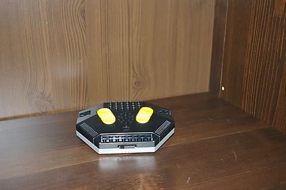

**Télécommande RC**

L’avenir du train LEGO est à terme - après l’étape RC - une déclinaison spécifique à ses besoins du [Power Functions System](/articles/power-functions-le-nouveau-systeme-electrique-lego/). Des groupes d’étude, associant des AFOLs, y travaillent depuis plusieurs mois.

Cessons de nous lamenter sur le retour du train à piles ! Approfondissons plutôt le système RC déjà disponible au travers des [trains de voyageurs 7897](/articles/autopsie-d-un-train-irc-b-7897/) et de [marchandises 7898](/articles/autopsie-du-train-de-marchandises-7898/). Et sur cette base, préparons l’avenir !

## Que faire avec ce &$#% de châssis RC ?!

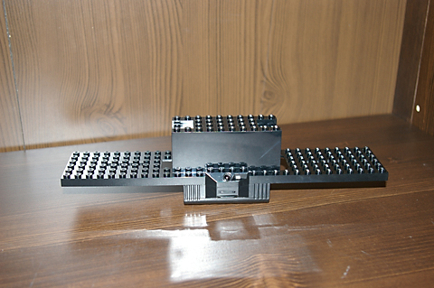

**Châssis RC**

Qui a dit le jeter ?! Attention, je vais punir ;-/

Je possède plusieurs exemplaires du train de marchandises 7898, un superbe set dont la sympathique locomotive verte fait désormais partie de la légende. Mais le montage de celle-ci achevé, se pose rapidement la question de la construction personnelle et de la réutilisation d’un châssis, hummm... pô commode. Abstraction faite de la technologie RC, il est en l’état encombrant et réducteur. Pourtant, que ce soit en 6 ou 8 tenons de large, le champ d’exploration est bien plus vaste que certains le crient.

Alors, que faire avec ce &$#% de châssis RC ?! Personnellement, une...

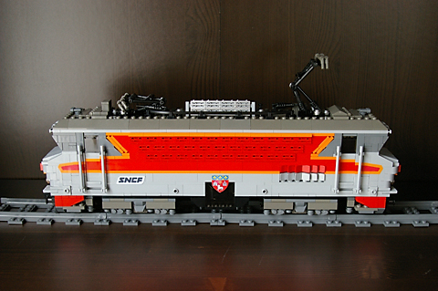

**CC 6524 RC - Vue 1**

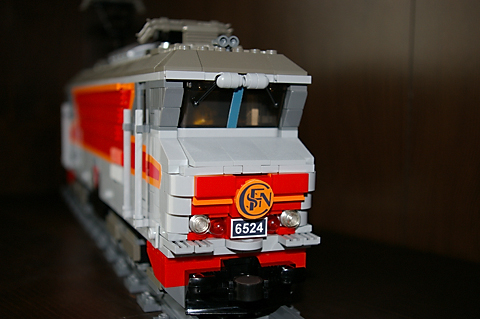

**CC 6524 RC - Vue 2**

## La CC 6500, une locomotive mythique

La CC 6500 est ma locomotive électrique française préférée, celle des voyages en express de mon enfance durant les années 70/80 et des catalogues Jouef de mon Papa :-) J’ai les mirettes encore pleines des images de nos périples vers Panam (ah ! le Capitole) et dans le lyonnais, bien calés dans les fauteuils des voitures Grand Confort que tractait la CC 6500.

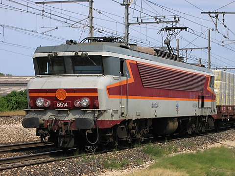

**CC 6514 (Photo Roland BADOSA)**

5900 Kw (8000 ch), 200 Km/h... La CC 6500, aujourd’hui radiée, fut longtemps le fleuron de la traction électrique française sous courant continu. Une locomotive aux performances phénoménales pour l’époque, et à l’esthétique avant-gardiste sous le crayon audacieux du designer [Paul Arzens](http://fr.wikipedia.org/wiki/Paul_Arzens).

Les CC 6500 marquèrent durablement notre paysage ferroviaire, mais firent également carrière au sein d’autres sociétés de chemin de fer, européennes et maghrébines. L’une d’elles s’offrit même une escapade sur le sol américain sous les traits du [prototype AMTRAK X996](http://us.leforum.eu/t1439-X996-Amtrak.htm) !

La CC 6500 fut déclinée en quatre livrées : [Béton, Arzens Grand Confort, Fret et Maurienne](http://yvaugeois.free.fr/html/electriques/CC6500.htm). Mon choix de reproduction en briques se fixa sur la seconde robe, grise « zédée » de bordeaux et d’orange - la plus emblématique de la série.

Pour de plus amples informations sur cette fabuleuse locomotive, consultez donc le [site de l’APCC 6570](http://pagesperso-orange.fr/apcc6570/index.htm), l’Association de Préservation de la CC 6570. Un site remarquable qui fourmille de photos et d’informations.

Domiciliée en Avignon, l’APCC 6570 oeuvre à la conservation de la locomotive n°6570 (troisième sous série, aux persiennes inox caractéristiques), un des derniers exemplaires de CC 6500 existants.

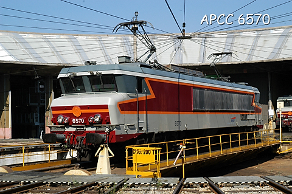

**La CC 6570 au dépôt d’Avignon, le 03 Septembre 2005 (Photo APCC 6570)**

La CC 6570 est la propriété de la SNCF qui l’a mise à disposition temporaire de l’APCC 6570 pour qu’elle la maintienne en parfait état de présentation et de fonctionnement.

Cette machine est un témoin majeur d’une époque ferroviaire faste, de celle où les locomotives avaient une vraie gueule... A l’occasion, rendez-lui visite ;-)

Je tiens à remercier l’APCC 6570 et son président Roland BADOSA - des passionnés, comme nous le sommes - pour leur gentillesse et les autorisations de publication des photos de CC 6500 qui émaillent cet article.

## Passez par la case départ ! Touchez des briques !

[La BB 7200 créée par Alban « Banban » Nanty](http://www.brickshelf.com/cgi-bin/gallery.cgi?f=152867) est à l’origine de mon désir de créer ma propre « locomotive d’exception ».

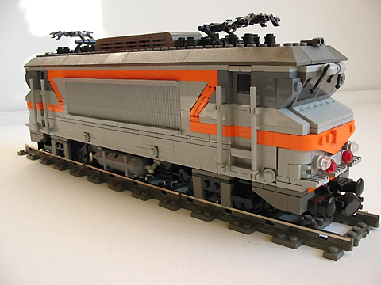

**BB 7200 - Avec l’aimable autorisation d’Alban NANTY**

Je ne saurais vous témoigner ma stupéfaction et mon admiration lorsque j’ai découvert cette locomotive durant de la [Rencontre Estivale FreeLUG 2006](/articles/ref-2006-3-jours-chauds/).

« Je veux la même ! » me dis-je alors. Puis vint l’instant de l’interrogation suprême : « Serais-je capable d’en créer une autre ? Qui soit mienne ? Et d’une envergure comparable à celle d’Alban ? ». Ce projet en forme de défi s’est longtemps cantonné à ma « to do list », jusqu’à ces derniers jours.

Afin de ne pas être trop influencé (on l’est toujours ;-)) par les choix de conception d’Alban, j’ai soigneusement évité de m’attarder sur son travail durant le mien. Et si nos philosophies créatives convergent, ma CC 6500 RC se démarque par des solutions souvent plus différentes qu’il n’y parait.

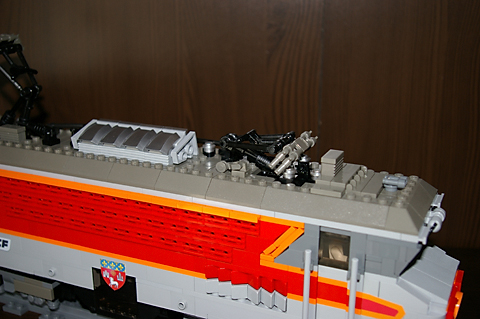

**CC 6524 RC - Vue 3**

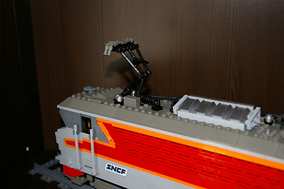

**CC 6524 RC - Vue 4**

Ce MOC n’est qu’une vision parmi d’autres de la CC 6500. Il recèle bon nombre d’approximations et de compromis, soit qu’ils furent ma volonté de focaliser tel ou tel détail, soit qu’ils furent imposés par l’architecture du châssis RC. Quant ce n’était pas le fruit de mes lacunes... :-)

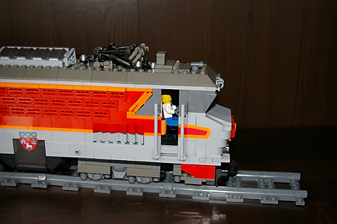

**CC 6524 RC - Vue 5**

**Mon souhait le plus cher est que - comme la locomotive d’Alban avec moi-même - cette CC 6500 RC vous incite à aller plus loin !**

_D’autres locomotives, voitures et wagons ont déjà fait l’objet de reproductions en briques, souvent très pointues. Ces matériels ferroviaires sont présentés au sein de la [base de données des modèles pour trains français](/articles/base-de-donnees-pour-modeles-de-trains-francais/) de FreeLUG._

## A suivre...

[Dans le deuxième volet de cet article, nous découvrirons les différentes étapes de la conception de cette CC 6500 RC](/articles/locomotive-cc-6500-rc-2eme-partie/), du prototype fait de vrac d’après des esquisses MLCAD jusqu’au modèle final ;-)

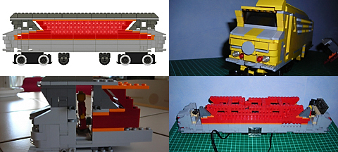

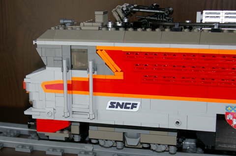

**CC 6524 RC - Vue 6**
