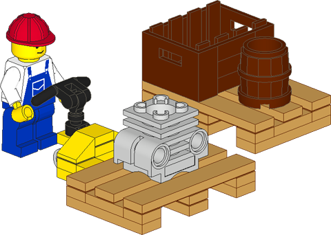
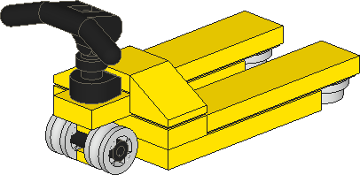

Un décor pharaonique se doit toujours d’être complété de petits accessoires afin de parfaire son réalisme et d’accroître son potentiel ludique. Ce transpalette et ces palettes s’insèreront sans difficulté dans un de vos chantiers, quais de chargement ou encore pourquoi pas supermarchés.

## Ça me fait une belle jambe

On ne croit pas si bien dire ! C’est grâce à [la jambe de minifig squelette noire](http://www.peeron.com/inv/parts/6266) apparue dans [la boîte Harry Potter 4766](http://www.peeron.com/inv/sets/4766-1) puis banalisée avec [la nouvelle gamme Castle](http://shop.lego.com/ByTheme/Leaf.aspx?cn=473&d=70) que ce petit [MOC](/articles/liste-d-acronymes/) a pu voir le jour.

J’avais essayé d’autres combinaisons afin de restituer le bras de l’engin, mais sans résultat probant. Cette pièce providentielle a tout résolu :-D

Remarquez que les galets arrières sont quant à eux formés d’un petit morceau de [tube rigide de 3mm de diamètre](http://www.peeron.com/inv/parts/75) où viennent s’emboîter deux [bagues Technic étroites](http://www.peeron.com/inv/parts/4265c).

## La notice

Bonne construction ;-)
