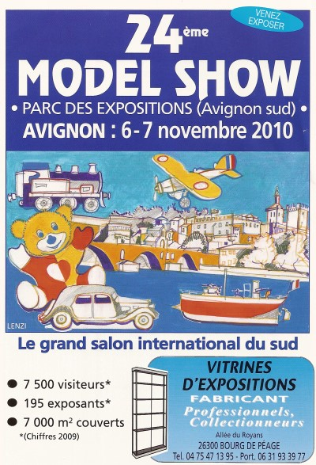

Nous avons pu prendre contact avec l’agence 1515 qui s’occupe de l’organisation de cette grande exposition multi-thèmes qui aura lieu les 6 et 7 novembre 2010 au parc des expositions de la ville d’Avignon, dans le Vaucluse (84).

Le salon est multithème et accueille bon nombre d’exposants, ce qui en fait sa diversité. Pour les chiffres 2009, il y avait 195 exposants pour 7500 visiteurs, sur 7000m² couverts. C’est un salon assez important et qui existe depuis 24 ans. Ce sera une première pour notre association.

Cette année, la préférence va un peu plus aux jeux de construction, comme les LEGO bien sûr, mais aussi le Meccano, qui nous suivent souvent sur les expositions.

Pour participer, pas besoin de construire forcément un élément de décor de train, une maquette simple suffit. Donc, n’hésitez pas à vous inscrire sur la page wiki si l’aventure vous tente, avant le 17 octobre.  
**–** [Inscription](http://wiki.ipsyn.net/tiki-index.php?page=MODEL+SHOW+Avignon)

Une bourse d’échange sera aussi sur place pour les deux jours.  
**–** Ouverture de **10h** à **18h** les deux jours.  
**–** Prix d’entrée **7** Euros, **5** Euros pour les 6/12 ans.  
**–** Des invitations à tarif réduit (4 Euros) sont possibles. Il faut prévenir suffisamment à l’avance.

Il est possible d’installer dès le vendredi de 10h à 19h. Le rangement se fera le dimanche soir à partir de 18h30.

Nous nous ferons un plaisir de présenter notre passion et de discuter avec vous.

**Affiche de l’exposition**
