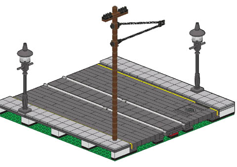
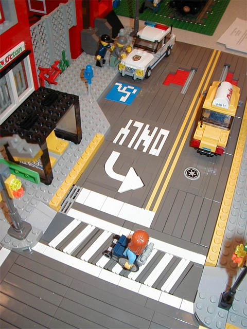

La création de modules standards est un phénomène grandissant au sein de la communauté.

On avait constaté ce phénomène avant même les ["Modular Buildings"](http://www.bricklink.com/catalogList.asp?catType=&catID=710&itemYear=&searchName=Y&searchNo=Y&q=&catLike=W) de TLC (Café Corner, Green Grocer, Market Street) et on peut donner pour exemple plus récent le [standard micro-city "Micropolis"](http://twinlug.com/micropolis-micro-city-standard/) de TwinLUG.

Ce concept de modules est principalement destiné à conserver une cohérence dans les dioramas mais surtout à favoriser la collaboration, notamment pour les expositions.

Aujourd’hui, nous allons vous présenter un standard peu connu développé par un autre LUG américain : PennLUG.

Ce standard, à l’échelle Minifig, est orienté ville et train (les fans d’espace s’orienteront vers les [modules Moonbase](http://www.brickiwiki.com/page/LEGO+Moonbase)). Ce standard est clairement anti-stud : utilisation du SNOT pour des routes lisses et des plaques lisses pour les trottoirs et les traverses de chemin de fer comme le montre cet exemple.

Ce standard a un inconvénient, c’est qu’il demande beaucoup de pièces. Ce n’est pas un inconvénient majeur pour des AFOLs aux moyens conséquents (et grâce à BrickLink). De plus ces pièces ne sont pas trop spécifiques (briques 1xn, plaques).

Le fait que l’esthétisme soit lisse ne peut pas réellement être considéré comme un avantage. C’est esthétique et donc subjectif et l’absence généralisée de points de connexions pourrait même être perçue comme un inconvénient, voire une entorse à la philosophie du LEGO.

Un avantage, somme toute mineur, est le fait que le niveau moyen est surélevé, permettant de cacher des mécanismes pour animer le diorama. Il permet en outre d’enterrer les rails pour des applications ferroviaires de ville comme le tramway.

L’avantage, peut être décisif, pour vous décider à vous lancer dans ce standard est une certaine compatibilité avec vos anciens montages réalisés directement sur des plaques de base, soit en surélevant celle-ci, soit en créant des zones de transitions - la différence de hauteur étant de l’ordre d’une brique seulement.

C’est Cale Leiphart, créateur de ce standard et membre de PennLUG, qui souligne que ce standard permet d’augmenter le niveau de détail avec, par exemple, des plaques et bouches d’égout et divers marquages au sol. J’en veux pour preuve cette exemple pris en photo en 2005 lors de BrickFest.

Retrouvez [les notices de montage](http://pennlug.com/?page_id=86).

Vous pouvez trouver d’[autres exemples](http://gallaghersart.com/index.php?/forums/viewforum/26/) de Mike Gallagher (membre du Central Ohio LEGO Train Club), notamment [cette page](http://gallaghersart.com/forums/viewthread/10/) de marquages au sol. Voir aussi [la page BrickShelf](http://www.brickshelf.com/cgi-bin/gallery.cgi?f=98473) de Mike.

Enfin, les anglophones apprécieront un article sur le sujet des Brick Built Roads dans le [numéro 4 de RailBricks](http://railbricks.com/magazine-issues) (page 53-55).

Bien évidemment, ces exemples américains (marquages) seront adaptés aux routes françaises et européennes.
