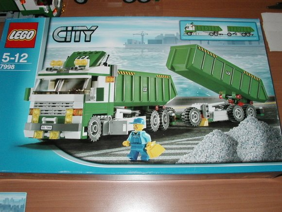
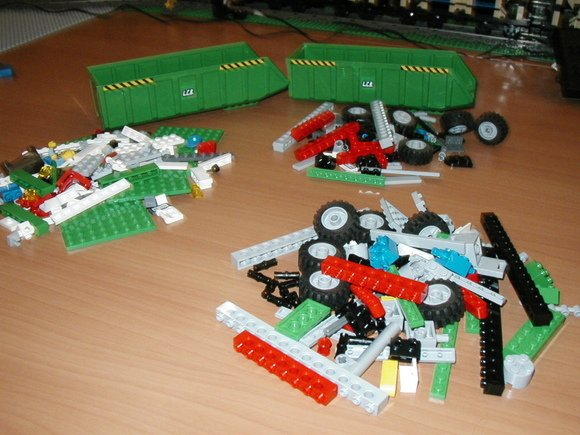
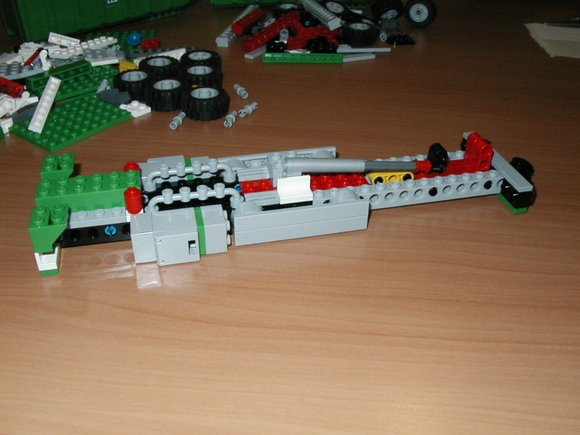
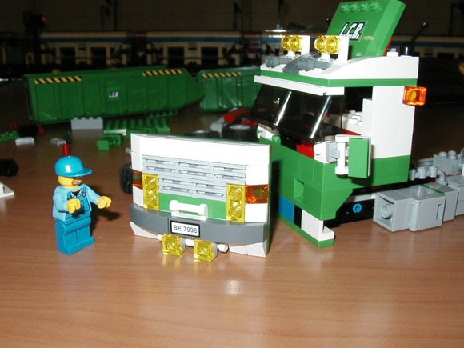
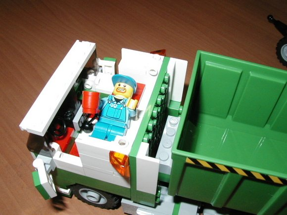
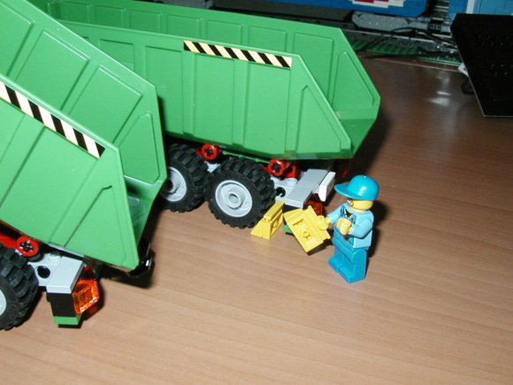
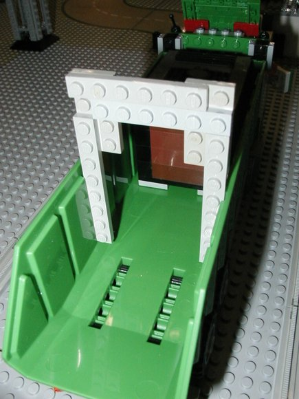
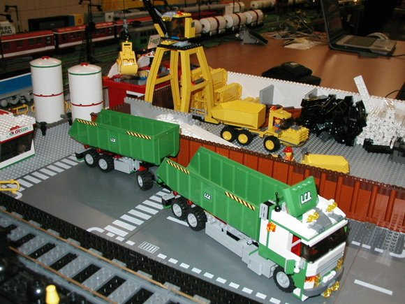
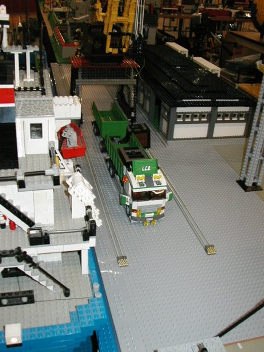

A l’occasion du Mondial du Modélisme, LEGO a été en mesure de nous fournir en exclusivité un exemplaire du camion benne 7998 dont la sortie est annoncée pour Juin.

La boite ayant été livrée chez Didier, il a eu l’honneur de l’ouvrir. Malheureusement, ne trouvant plus son appareil photo, le premier montage réalisé n’a pu faire l’objet d’une revue imagée. Je me suis donc sacrifié (hum hum) pour le démonter et remonter afin de vous faire part de mes commentaires sur ce joli set.

**Belle boîte, bô camion :)**

Je rappelle que le montage a eu lieu au salon du Modélisme.

La boite est composée de 3 sachets, un pour le chassis du camion, un autre pour la cabine, et enfin le dernier pour la remorque.

**Le contenu correspondant aux 3 sachets**

Le montage se fait sans trop de difficulté, un peu moins d’une heure en comptant diverses interruptions comme des trains qui déraillent, quelques questions du public...

Vous le voyez facilement sur les photos, ce camion fait 8 tenons de large, et ceux qui souhaitent lui faire une cure d’amincissement trouveront quelques difficultés à réduire l’énorme métapièce qu’est la benne (mais qui présente quelques particularités comme nous verrons plus tard).

**Le chassis du camion**

Désormais classique aux sets City, la façade du camion est un montage en SNOT.

**Un nez plein de SNOT**

La remorque ne présente rien de plus particulier que le camion.

Ce camion est davantage intéressant sur les détails.

Commençons par la cabine : elle peut accueillir deux minifigs. Notons la présence d’un tableau de bord et la non moins nécessaire tasse de café. Mais surtout, la cabine dispose également d’une banquette pour que notre routier qui est forcément sympa puisse se reposer.

**Un café, et dodo !**

Les petites "boites aux lettres" grises qui se trouvent sur le chassis renferment des cales qui permettront de bloquer la remorque.

**Elle ne bougera pas, là**

Le camion et la remorque disposent d’une plaque d’immatriculation (autocollants), au doux nom de BE7998.

Les bennes basculent, comme illustré sur la boîte. Le nouveau bras Technic qu’on trouve déjà dans le camion pompier de la caserne par exemple permet un maintien de la benne levée.

Parlons-en donc de cette benne. Elle fait donc 8 tenons de large, peut accueillir des éléments de 6, mais surtout, les rainures permettent d’y glisser des plaques de 7 tenons. Voilà une pièce finalement bien réfléchie laissant la possibilité de la compartimenter (qui a pensé que ça ferait alors de bons casiers pour ranger les pièces ? :)

La benne se fixe par le dessous par deux rangées de 4 trous Technic.

**8 de large, et 7 dans les rainures**

Enfin, voici quelques mises en situation du camion en deux lieux de notre réseau.

**Devant le chantier de Jérémy**

**Dans le port de Médérik, Y a un gros camion qui charge**

## Conclusion

Même si la largeur de l’engin pourrait effrayer les puristes des camions en 4 de large, ce set est quand même une belle réussite, avec une palette de couleurs agréables.

Les petits détails agrémentent vraiment l’ensemble. Merci à LEGO pour avoir offert ce set à FreeLUG en avant première. Il ne reste plus qu’à connaître le prix de vente grand public...
