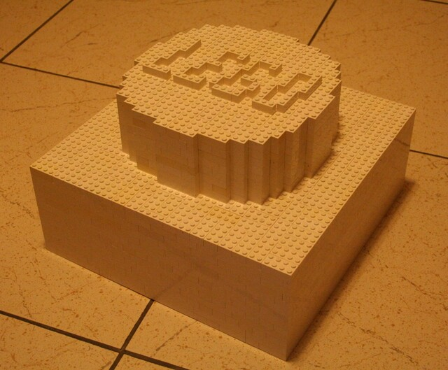
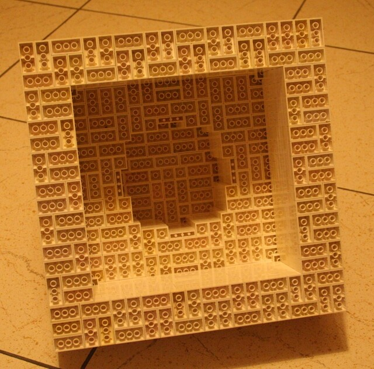

Lors des grands évènements telle une exposition, il est d’usage de réaliser des montages à l’échelle 1, c’est-à-dire de la même taille que l’objet réel, comme la Bugatti T35 réalisée pour Fana’briques 2007. Mais qu’en est-il de la réalisation à l’échelle humaine de montages initialement à l’échelle minifigurine histoire de concrétiser le désir qu’on a parfois de s’asseoir dans un véhicule LEGO de notre enfance à la place d’une minifigurine.

Dans le monde des constructeurs LEGO, la brique de base 1x1 permet de définir les unités métriques : sa hauteur hors tenon donne l’épaisseur d’une brique c’est-à-dire environ 9,6 mm, le tiers de cette mesure donne l’épaisseur d’une plaque et sa taille latérale donne la « longueur d’un tenon » (qui n’est pas la taille du tenon à proprement parlé mais la distance qui sépare le centre de deux tenons sur une brique 2x1) c’est-à-dire environ 8 mm. Ainsi la brique 4x2 référence 3001 est épaisse d’une brique et a pour taille latérale (4 « tenons »)x(2 « tenons »).

L’échelle d’une construction, quant à elle, est le rapport entre la taille réduite et la taille réelle. Ainsi, on parle d’échelle minifigurine lorsque ce rapport est de l’ordre de 1/40 si on admet que la hauteur d’une minifigurine est approximativement égale à 1/40ème de celle d’une personne humaine moyenne. On peut aussi inverser ce point de vue en considérant qu’un modèle LEGO est construit à l’échelle humaine si on multiplie ses dimensions par 40. Ainsi, une brique 1x1 à l’échelle humaine a une hauteur hors tenon de 40 briques égale à environ 384 mm et une taille latérale de 40 « tenons » égale à environ 320 mm.

Pour me faire une idée réelle de ce que suppose la réalisation à l’échelle humaine de pièces LEGO, j’ai entrepris de construire une plaque 1x1 avec des briques LEGO blanches (parce que j’ai beaucoup de briques blanches dans mon stock). En effet, c’est la pièce la plus petite avec la taille latérale unité, l’épaisseur de un tiers de l’unité et qui intègre un tenon. Cette plaque doit donc faire 13 briques de haut hors tenon et (40 « tenons ») x (40 « tenons ») de taille latérale. Quant au tenon de cette pièce, j’ai choisi de lui donner un diamètre de 28 « tenons » compatible avec l’épaisseur de 6 « tenons » de la paroi et une hauteur de 8 briques. Voici quelques photos du montage fini au bout 5 heures de montage.

**Vue de dessus de la plaque 1x1 à l’échelle humaine.**

**Vue de dessous de la même plaque où l’on peut distinguer le tenon creux.**

Un comptage rapide permet de déterminer que le nombre de briques 1x1 équivalentes à celles utilisées pour ce montage est de 16502. Evidemment, ce montage n’est pas faisable avec des briques 1x1 et j’ai utilisé des pièces plus grandes qui doivent être au nombre d’environ 3500.  
Ainsi, on peut estimer qu’il faut environ 6500 pièces pour réaliser une brique 1x1 à l’échelle humaine.

Est-il envisageable de réaliser un montage complet d’un véhicule ou d’un vaisseau à l’échelle humaine ? La réponse est oui. Mais il faut certainement un énorme nombre de pièces et probablement tricher par rapport à ce que j’ai fait ici en montant les pièces autour d’une structure rigide de bois ou de métal si on veut que tout tienne ensemble.
