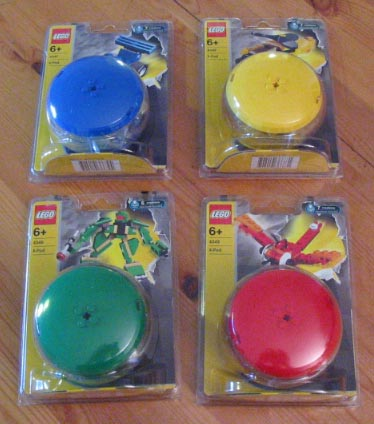
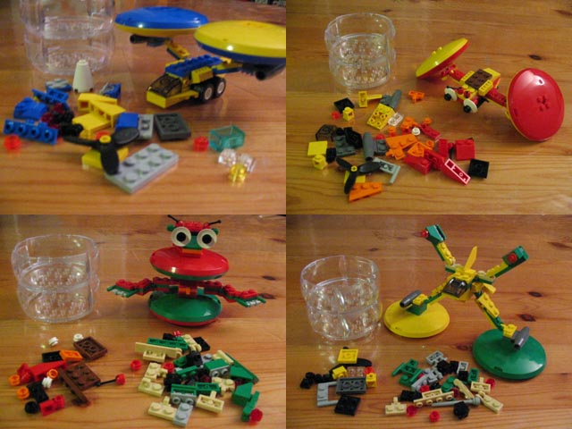
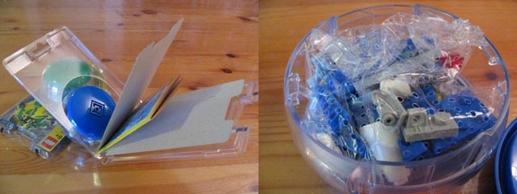
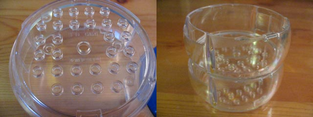
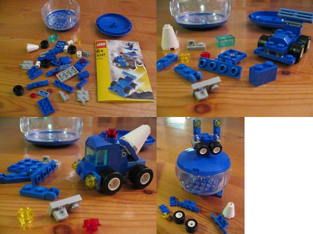
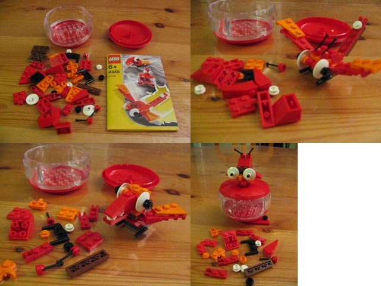
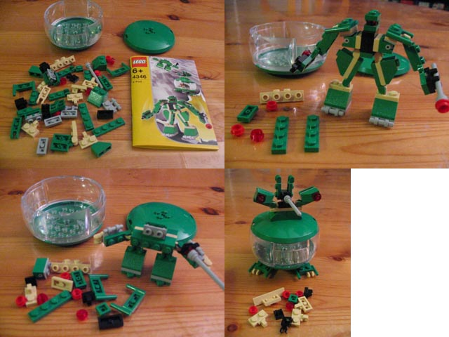
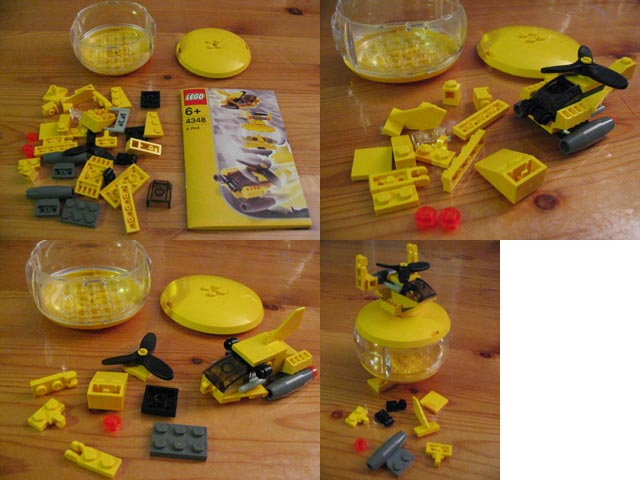
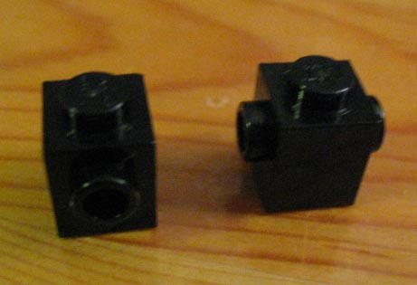
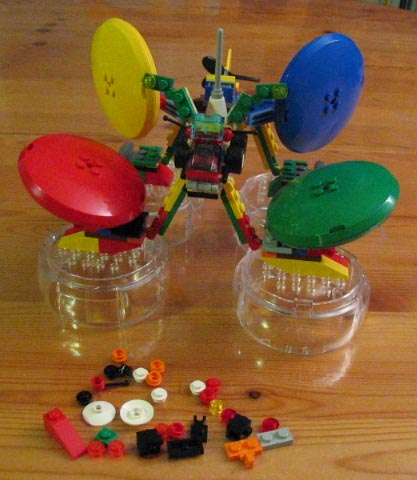

Dans le catalogue de cette année, j’ai été amusé de voir débarquer les X-Pods. Pour ceux qui se demandent de quoi je parle, il s’agit de petite boites composées d’un petit nombre de briques de base qu’on peut emmener n’importe où avec soi grace à sa boite cylindrique elle-même légèrement utilisable au sein des modèles.

Il y a 4 X-pod : Force Bleu, Force Jaune, Force Vert et Force Rouge, à moins que ce soit tout simplement X-Pod Bleu, X-Pod Jaune, X-Pod Vert et X-Pod Rouge. :-)

Comme la première série des mini starwars, le concept Xpodien vous incite à collectionner les 4 X-Pod pour les combiner ensembles. Néanmoins je note une grosse erreur dans le principe, car le X-Pod Bleu ne se combine qu’à un seul autre X-Pod au lieu des deux qu’exige la logique mathématique.

**–** X-Pod Bleu : 1 combinaison  
**–** X-Pod Rouge : 2 combinaisons  
**–** X-Pod Vert : 2 combinaisons  
**–** X-Pod Jaune : 3 combinaisons

Si bien que si vous achetez les Vert, Jaune et Rouge en premier, rien ne vous pousse à acheter le Bleu...  
Le vilain Jaune qui à piqué une place au Bleu méritera donc d’être ouvert en dernier !

L’ouverture de l’emballage est assez facile, comme souvent chez Lego(c). Il suffit de couper les deux petits scotch sur le dessus (contrairement généralement à ce type d’emballage tout en plastique nécessitant l’éventrage au cutter).

En ouvrant l’emballage on a l’heureuse surprise de voir la notice glissée à l’intérieur du carton de présentation.  
Les pièces sont dans un seul sachet plastique à trou (pour éviter que les briques n’étouffent comme chacun sait).

J’ai compté sommairement (après avoir réunies les pièces qui vont ensembles, comme les deux parties des hinge brick) :  
**–** X-Pod Bleu : 29 pièces  
**–** X-Pod Jaune : 33 pièces  
**–** X-Pod Rouge : 45 pièces  
**–** X-Pod Vert : 47 pièces

Le Bleu est encore une fois bon dernier de la classe...

Concernant les boites cylindriques : Le couvercle du dessus se clipse à la façon d’un couvercle de pot de confiture (sauf que ça tient moins bien), et bonne surprise, les boites transparentes peuvent aussi se clipser ensembles. Autre bonne nouvelles, il y a des tenons sur le fond de la boite et un trou permettant de passer un axe.

Par contre mauvaise nouvelle : le couvercle du dessous se dé-clipse très difficilement (j’ai dû y aller au tournevis). D’ailleurs ils ont dû s’en apercevoir, car sur les 4 X-Pod, seul un avait son couvercle du dessous de clipsé. Et je vous le donne en mille, il s’agissait du Bleu ! :-) Les autres avaient simplement leur courvercle du dessous posé.

Chaque X-Pod propose deux petits modèles à construire, plus un modèle utilisant la boite et un modèle combiné à un autre X-Pod.

Voici maintenant les différents modèles des 4 X-Pod photographiés à coté des pièces restantes.

Le premier modèle du X-Pod Vert utilise quasiment la totalité des pièces disponibles, et heureuse surprise il possède deux nouvelles pièces (du moins je pense qu’elles sont nouvelles) qui me paraissent forte utiles dans beaucoup de MOC. On connaissait déja la brique 1x1 avec 4 tenons sur les cotés, voici la brique 1x1 avec deux tenons sur les cotés et de surcroit en noir, donc facilement réutilisable !

Enfin, puisque les X-Pod sont fait pour s’accoupler, j’ai osé me lancer dans un MOC utilisant les 4 X-Pod et uniquement ceux-là. Je sais c’est moche mais c’est du Lego ! :-))

Enjoy !
