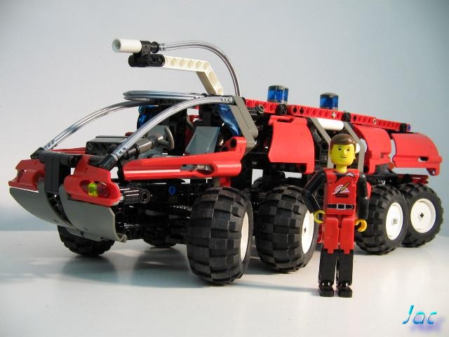
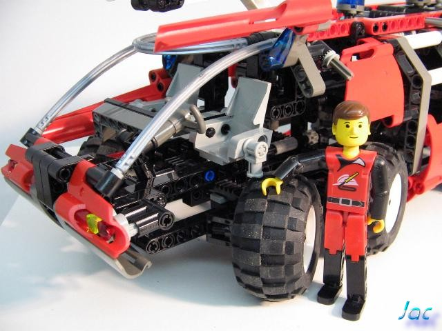
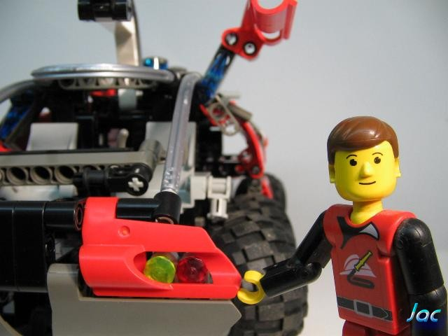
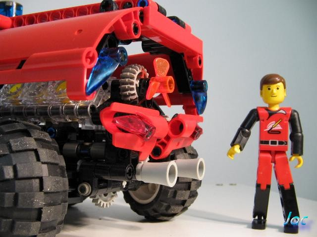
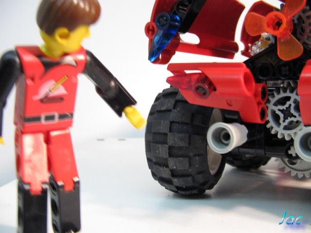
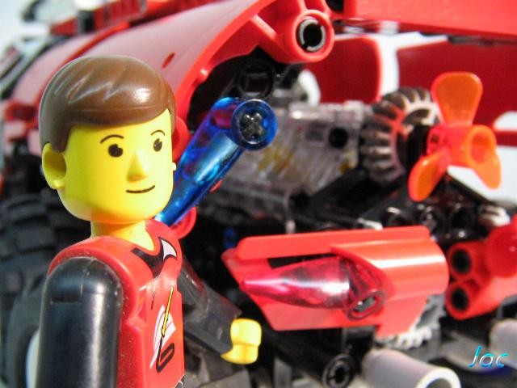
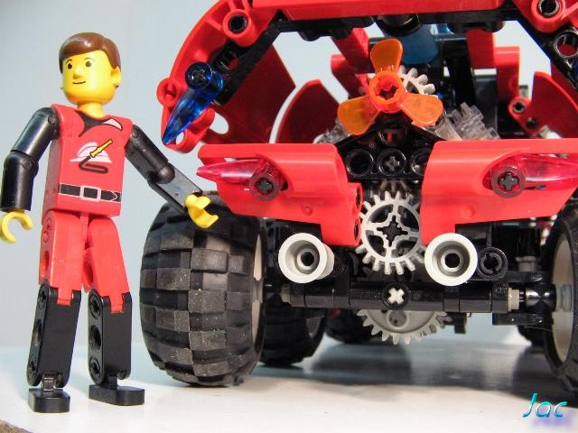
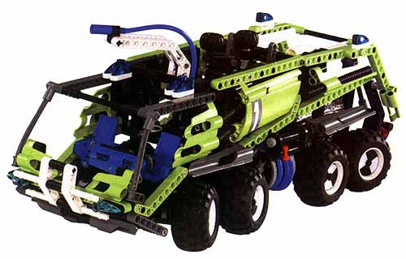

Les améliorations du modèle, et quelques critiques

En ces temps de soldes générales, les moins fortunés d’entre nous, dont je fait partie, peuvent se permettre d’acheter les boîtes qui les faisaient rêver. C’est mon cas pour l’achat de cette "grosse" référence Technic : le camion de pompier 8X8 référence [8454](http://guide.lugnet.com/set/8454). On peut dire qu’il est l’évolution d’un modèle plus ancien, référence [8280](http://guide.lugnet.com/set/8280). Je pourrais mettre entre guillemet évolution, car vous aller voir que cela en est une, oui, mais, pas pour tout.

J’aime bien monter les modèles Lego, ça me plait de suivre une notice à la lettre, et d’assembler les différentes parties, en me demandant, par moment, ce que je suis en train de construire. Mais, j’ai un défaut, un modèle reste rarement monté tel quel chez moi. C’est à dire qu’il est soit démonté pour faire d’autres chose, soit amélioré. Enfin, c’est à mon goût, évidemment. C’est donc la raison de mon article. D’abord les commentaires sur cette référence, et puis, les modifications que je lui ai apporté.

Tout d’abord, la boîte contient une bonne quantité de pièces. Par moment, on a l’impression de jouer au “Tetris”, avec ces formes bizarre. Mais, ça se passe bien, et il m’a fallu environ trois heures pour tout finir. Première constatation, il faut faire bien attention à l’alignement des roues. Je suis allé un peu vite, et l’essieu arrière qui braque à l’envers des deux premiers, ripe un peu. C’est pas vraiment gênant, l’engin a quand même un rayon de braquage très petit, au vu de sa longueur. En tous cas, l’engin est superbe, avec un beau moteur à 6 cylindres en V. Mais, c’est là que vient la critique méchante. J’ai voulu installer un personnage Technic aux commandes. Et bien, c’est impossible. J’ai compris pourquoi ils n’étaient pas dans la boîte. Le conducteur s’assied correctement, mais la tête dépasse largement du haut de la cabine. Franchement, c’est dommage. Cela ne m’a pas empêché de faire les modifications qui suivent. Il faudrait quelque chose d’énorme pour placer un conducteur, je ne me suis pas lancé la dedans, mais, dans quelques rajouts esthétiques que je vais vous présenter, grâce à mon pilote, que j’ai mis de corvée !

Voici mon camion de pompier fini. Je ne regrette pas cet achat, je le trouve superbe.

Je lui ai rajouté des portes qui s’ouvrent, pour l’accès à la cabine. C’était plus facile de faire une ouverture papillon, mais, ça fait très bien. Alors voilà le premier camion de pompier avec des portières de ce type.

J’ai rajouté un feu supplémentaire à l’avant, en plus du jaune. Oups, j’ai laissé la porte de la cabine ouverte........

J’ai rajouté une petite plate lisse, juste pour que l’on ne voit pas tous ces trous, sur la barre du haut.

J’ai mis deux pots d’échappement à l’arrière du moteur. Ca change la gueule de l’engin.

Le moteur entraîne maintenant un petit ventilateur de refroidissement. Ca je sais pas pourquoi ça n’y était pas, y’a largement la place ! J’ai rajouté les feux rouges, ils n’y étaient pas.

Une vue générale de l’arrière. Il manque peut être une grille, il faut que je vois ça.

C’est tout pour l’instant, je suis obligé de coucher le pilote pour qu’il passe. Si j’ai le temps de refaire tout le camion, je vous le dirais.

Voilà tous ces petits trucs qui font que mon camion n’est plus « sortie de boîte », et qu’il me plait encore plus. J’ai une photo de ce que je pense être le pré-modèle. Il était de couleur verte, car, sûrement que dans certains pays les camions incendie aéroport sont de cette couleur. J’en avais gardé une photo, la voilà aussi.

J’espère vous avoir donné des idées, et puis, si vous avez des problèmes pour le montage, ou que vous ayez fait d’autres modifications, vous pouvez me demander.
