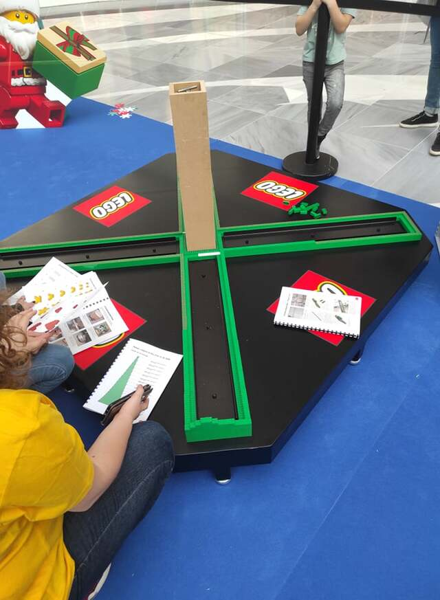
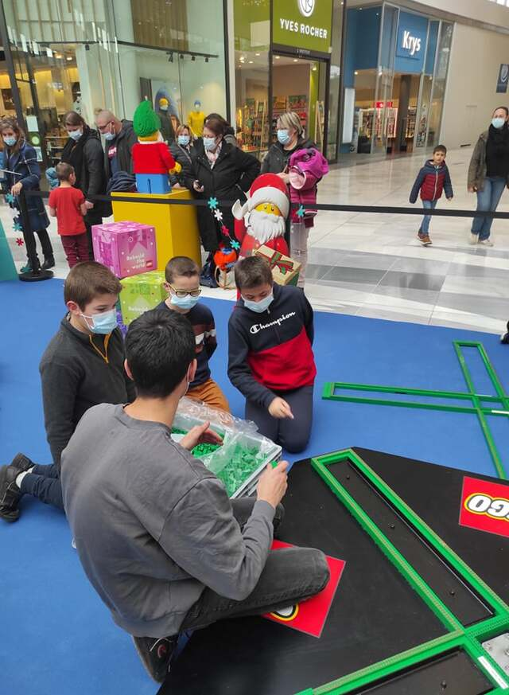
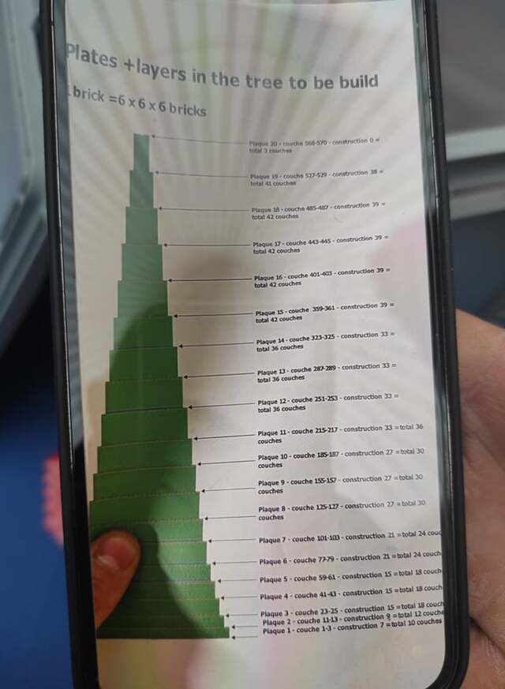
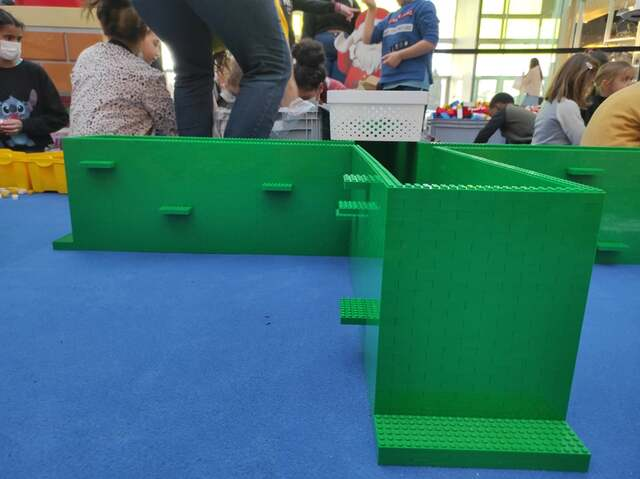
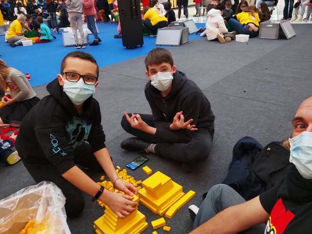
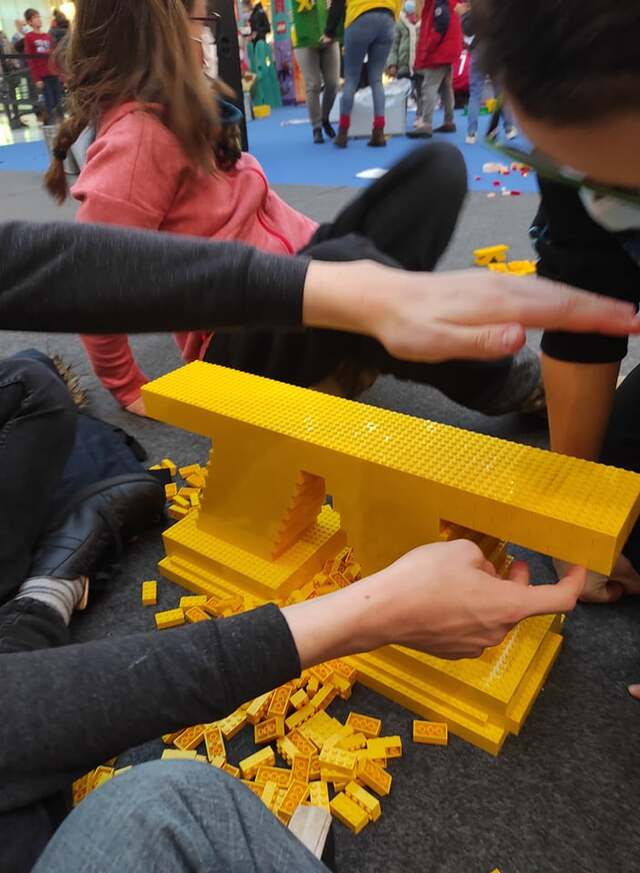
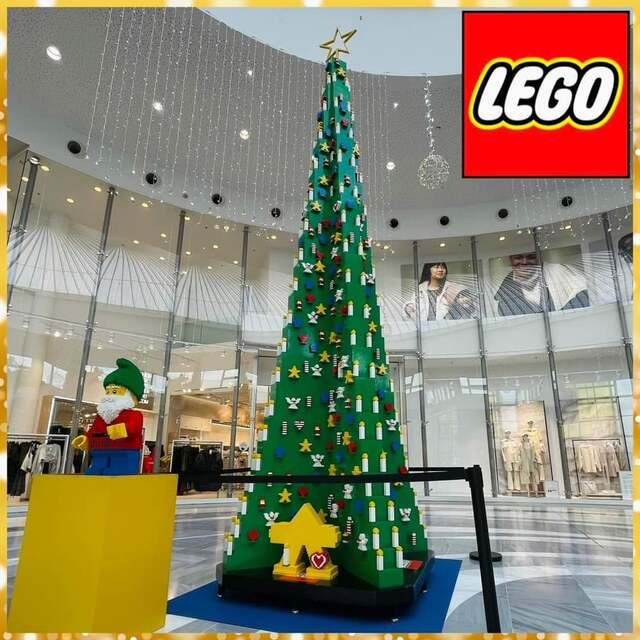

Tout commence par un article lu sur la page Facebook du Leclerc de Barjouville (28630), où je vois : « Venez nous aider à monter le plus grand sapin de France ».

Il n’en fallait pas plus pour moi pour me dire bon je vais y participer. C’est alors que je demande si : « Les adultes peuvent aussi y participer ? sachant que je suis un AFOL et tout nouveau membre FreeLUG ». C’est alors que l’on me répond que bien sûr et direct je suis contacté sur Messenger par Virginie, la responsable de la galerie marchande, Epicentre.

S’en suit un appel téléphonique, où elle m’explique le projet vu avec leur commercial LEGO et que mon profil allait sûrement les aider. Et hop rendez-vous pris, le mercredi 17 novembre de 14h à 18h, et le samedi 20 novembre de 9h30 à 18h30 on installe les plus de 150000 briques, livrées en caisses par la société LEGO. Une douzaines de caisses de briques 2x4 vertes, blanches, bleues et rouges et une caisse de 2x6 vertes (qui servira notamment à créer les supports de décorations). La notice fournie par LEGO est digne d’une notice 4+, mais largement suffisante pour le montage.

Comment est constitué le sapin ? Il est constitué d’une base métallique de 1,5 x1,5m environ. A cela, la société LEGO nous a fourni plusieurs niveaux avec 2 rangées de plates 4x6 collées. Ensuite on avait juste à suivre le montage et mettre le nombre de niveaux de briques adéquat, le tout sur plusieurs étages. La construction est maintenue au centre par une tige métallique, et une plaque métal tous les 4-5 étages vient comprimer le tout. Ce qui rend la structure vraiment solide, la preuve j’ai mis un pied dessus pour aider le conducteur de nacelle. Le tout bien serti par l’Etoile en métal par contre, j’y reviendrai plus tard.

Le sapin en chiffre c’est :  
**–** 7 mètres de hauteur, ce qui en fait le sapin le plus grand de France en pièces LEGO  
**–** Plus de 150000 briques (quasiment 160000).  
**–** 12 heures de construction.

Pour faire participer les enfants au maximum, les décorations ont été faites en briques 2x4, on peut y voir des cœurs, des anges, des bougies, des boules de neige bleues. Certains enfants ont même fait des décorations plus élaborées pour les reconnaître sur le sapin.

Le petit souci que l’on a eu le samedi à 12h c’est que les enfants construisaient vite, je me suis proposé à défaire 2 bases, pour l’après-midi, j’étais le seul bénévole et membre de FreeLUG, la passion m’a guidée, et à 13h20 j’avais enfin fini de démonter les plus de 2000 briques des bases.

Mais les enfants allaient être contents, c’était l’essentiel. Un café et un beignet framboise plus tard, le retour des enfants et de 2 pré-ados que j’avais déjà vu le matin… Le montage continuait, c’était la folie. J’ai aidé les plus petits, corrigé les erreurs de montage, mais j’avais l’œil, c’était top.

Mais une chose me chiffonnait, il est 16h30, l’Etoile… la société LEGO a prévue une étoile métallique, je trouvais cela pas folichon. Du coup il reste quasiment un bac de briques jaunes, je prends les 2 pré-ados, qui étaient là depuis le matin, je leur explique mon idée, je leur donne les bases de quelques techniques de construction, j’écoute leurs idées et hop c’est parti.

On défie la gravité, mon idée était meilleure mais le but était que les enfants soient contents donc leur idée est retenue, je leur explique bien pourquoi c’était assez dur de faire tenir en équilibre, merci madame Gravité et hop un cours de physique. Au final, l’Etoile est finie à 17h45, je la pose au pied du sapin et là tous les enfants autour disent « WHAOUUU trop belle l’Etoile », pari gagné, ce n’est pas la plus belle, on a vu les erreurs mais l’effet est là et les deux pré-ados ont fait leur premier MOC.

Je remercie le Leclerc Barjouville, Virginie la responsable de l’Epicentre, Mattéo le responsable rayon jouet, et tous les encadrants.

Je remercie l’association dont je fais partie, FreeLUG, pour avoir pu parler au nom de l’asso (mais aussi du mien :p )

Et un énorme merci aux enfants présents.

J’ai vécu une expérience unique, dont j’ai posé deux jours pour aider au démontage et rangement :D. Vivement la prochaine...

Sur ce j’arrête sur un "Merci à tous" car j’ai une larme à l’œil tellement j’ai adoré.

Edit : Je mets beaucoup de « je » car j’exprime juste mon ressenti.

[Vidéo de la publication d’origine](https://www.youtube.com/embed/Vuq14Zabu8A)
