J’aime bien ces petits 4X4, les nouveaux gardes boues de cette nouvelle version permettent de faire passer des roues plus grosses. Mais j’ai aussi acheté cette boite pour faire une amélioration...

**–** Prix : 13,49 Euros sur le Shop, mais je l’ai payé moins cher  
**–** Disponibilité : dans tous les magasins en ce moment.  
**–** Taille de la boîte : 26 X 14 cm  
**–** Nombre de pièces : 128  
**–** Gamme : City  
**–** Contenu : un 4X4, une remorque, un Zoddiack qui flotte et 2 minifigs.  
**–** Temps de montage : environ une heure, mais je n’ai pas mis les autocollants.

## La boîte

Pas très grosse, voir les dimensions, mais c’est un modèle de petite gamme, donc c’est normal. La boite est bien remplie et on trouvera la notice et les autocollants en vrac à l’intérieur.

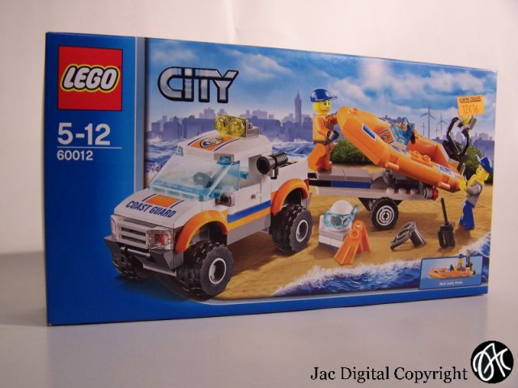

Au dos on peut admirer quelques photos du modèle assemblé pour avoir encore plus d’idées de jeux dans le sable...

## Le contenu

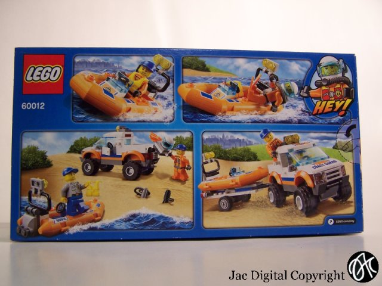

On trouve dans la boite deux sachets numérotés. Le zodiac orange, la notice et les autocollants sont en vrac. La planche d’autocollants est très petite, j’ai failli la perdre. Même si je ne les mets pas en place, je les conserve avec la notice.

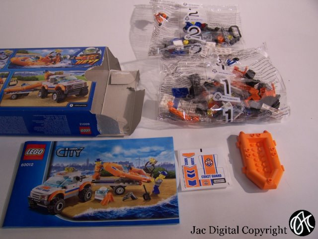

## Montage

Ouverture du sachets numéro 1 qui contient les pièces pour le 4X4 et les 2 minifigs.

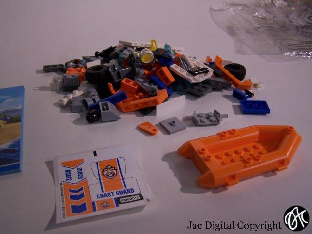

Le montage commence par les deux minifigs. Rien d’exceptionnel dans ces personnages que l’on connais déjà.

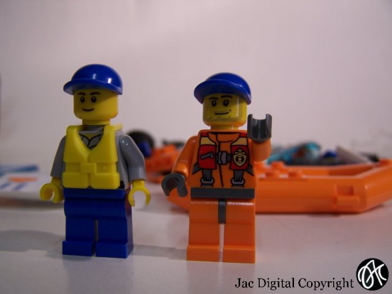

Le montage du 4X4 se passe sans histoire. Ce sont des pièces et des types de montage que l’on connait maintenant. Je trouve qu’il est un peu étroit mais vous verrez plus loin.... Les gros pneus lui donne un air bien fun.

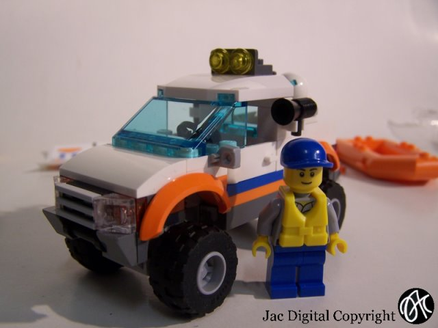

A l’ouverture du deuxième sachet on trouve les pièces pour le Zodiac et pour la remorque.

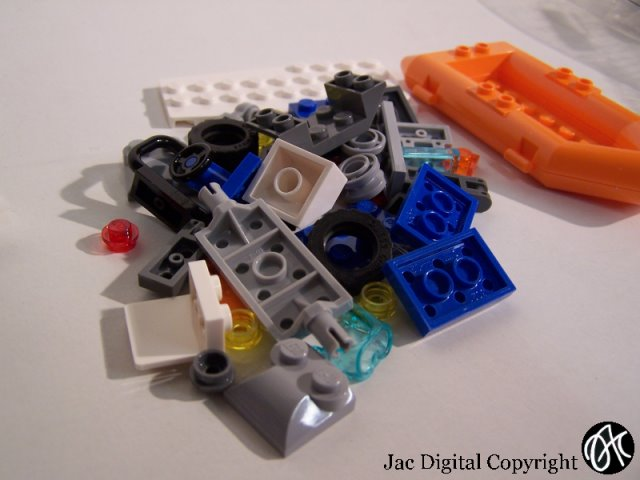

On commence par le montage de la remorque qui est toute simple. Il y a même pas une béquille pour la poser sans le véhicule. Mais bon, ça n’enlève rien au jeu.....

[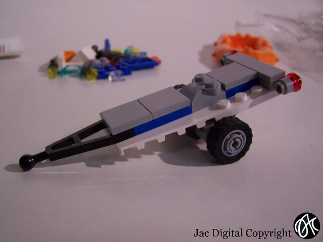](https://www.freelug.org/IMG/jpg/Photo_8_.jpg)

Le Zodiac est vraiment sympa avec le petit arceau sur l’arrière. Le moteur "jet" est simple et très bien représenté. Pas beaucoup de pièces à assembler mais bon ce n’est pas un gros bateau. Comme à mon habitude, je n’ai pas collé les autocollants. Mais l’ensemble est bien réussi même sans.

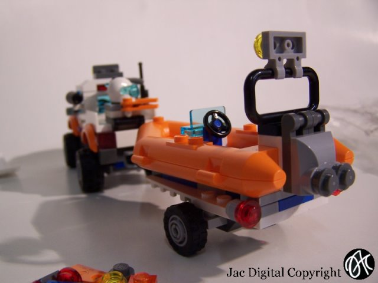

Les extras parts, alors là je me retrouve avec une plate bleue de 2X3. J’ai vraiment cherché où elle pouvait se placer, mais c’est vraiment une pièce en trop. Je ne sais pas si c’est la même chose dans toutes les boites.

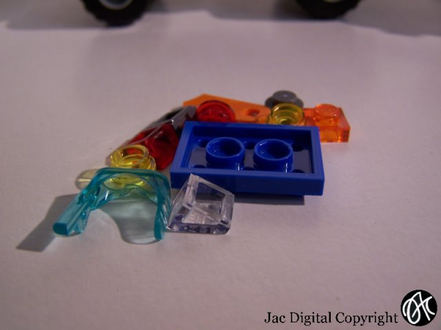

## Conclusion

L’ensemble est bien sympa, même si on se rapproche pas mal des dernières versions. C’est une boite très abordable qui doit faire bien plaisir, en tout cas, pour ma part cela fonctionne bien.

## Modification

Maintenant, place au jeux sur la plage me direz vous et bien non, on va passer à une autre phase de construction, qui est aussi du jeu en fait.

Comme je vous l’ai écrit plus haut, je trouve le véhicule un peu étroit. Surtout que l’on a vu dans d’autres sets des 4X4 plus larges que celui là. Alors pourquoi ne pas retravailler un peu dessus pour le rendre un peu plus imposant. C’est le résultat que je vous présente aussi ici en faisant d’une pierre deux coups.

Le véhicule est un peu court, mais j’ai voulu garder la longueur du modèle LEGO. Je me suis amusé à créer un capot permettant une bonne visibilité sur tout les angles au conducteur. J’ai un peu amélioré les rétroviseurs par la même occasion. Il faut quand même y voir quelque chose derrière...

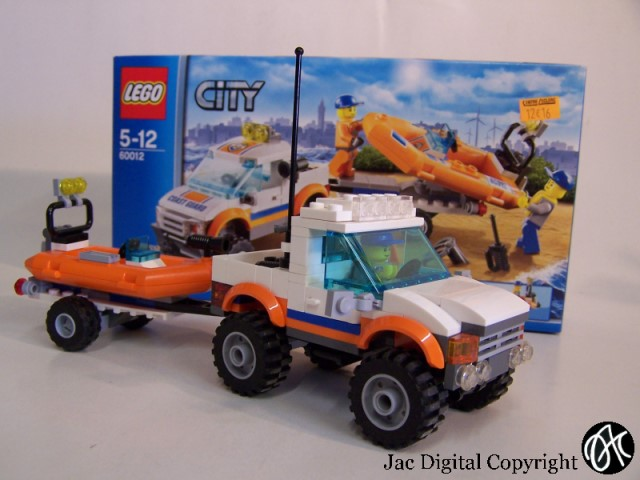

Et puis tant que j’y étais, je me suis aussi lancé dans une version moto.

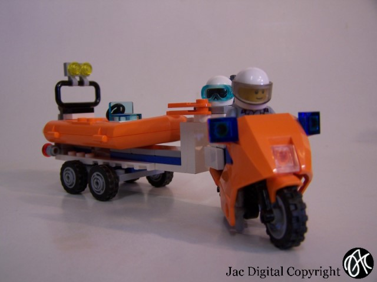

[Galerie pour plus de photos](http://photos.freelug.org/main.php/v/JAC/review/60012/)
