Avant de parler du déroulement de la construction, laissez-moi vous parler de la génèse de ce projet...

Nous sommes fin mai 2011, juste après Briqu’Expo Parigné. C’est ma première exposition avec FreeLUG, j’ai la tête pleine de briques qui s’entrechoquent et me font parler de ça sans arrêt (à 32 ans la plupart de nos interlocuteurs non Afols doivent d’ailleurs nous croire fous !) notamment à une amie institutrice en CP dans une école du Mans. Et comme elle n’est pas venue voir notre expo, je lui explique tout en détails !

Est-ce parce qu’elle en avait assez de m’entendre parler de cela , ou est-ce parce que cela lui donnait envie ? Toujours est-il qu’elle me coupe à un moment en me demandant si je ne pourrais pas faire quelque chose avec les élèves de sa classe. Et moi de répondre du tac au tac "pas de problème" ! Dans quoi me suis-je engagé ?

Après encore quelques jours dans ma bulle LEGO, je redescends sur Terre, et me demande alors ce que je vais bien pouvoir proposer aux élèves. L’animation est prévue pour la rentrée en septembre ou octobre. Il faut rapidement trouver le thème et toutes les activités pédagogiques que nous pourrons faire autour de la fusée. En effet, nous devons, avec l’institutrice, monter un projet pour le soumettre à l’inspecteur d’académie et obtenir son autorisation.

Après avoir constaté que ma collection de briques ne suffira pas, l’idée me vient de demander à FreeLUG si un prêt des briques de la fusée serait possible sur une période de 3 semaines après la rentrée scolaire. En attendant la réponse du CA de FreeLUG, nous allons, l’institutrice, son fils et moi-même voir à quoi ressemble la fusée lors de la fête du jeu de Parigné l’Evêque. Ce sera l’occasion pour l’institutrice de monter les premiers LEGO de sa vie, avec plus ou moins de réussite... Son fils de 7 ans nous sert de « cobaye ». Comme il revient enchanté et que Jérémy me donne l’accord pour le prêt des briques, nous décidons d’utiliser la fusée comme thème pour notre projet.

Les vacances d’été me servent à étudier la façon d’aborder la construction avec des élèves en début de CP. Je travaille aussi sur des exposés (sur le thème de l’espace et des fusées) que je veux présenter aux enfants. La maîtresse travaille quant à elle à la formalisation du projet qu’elle devra soumettre à l’inspection pour accord. Nous développons nos idées pédagogiques autour de la construction. Il y aura du vocabulaire, de la numération, de la géographie, de l’expression orale, etc... Tout cela sera réparti sur 6 séances, à raison de deux par semaine, de 1h15 chacune.

A la rentrée, nous soumettons notre projet dès le premier jour ! Il est assez rapidement validé, avec néanmoins une condition à tenir, s’assurer que la fusée une fois assemblée ne pourra chuter sur les enfants. Je dois donc repenser le support de la fusée en quelques jours !

Ne voyant pas comment stabiliser la fusée seule, je décide de faire construire aux enfants une tour de lancement qui servira de retenue à la fusée. Il faut donc un nouveau support ! Il y aura donc un emplacement pour la tour couplé à un emplacement pour la fusée.

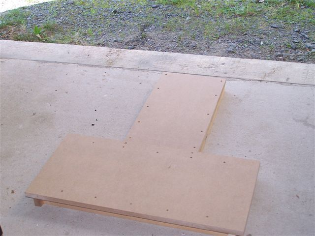

Nouveau support pour la fusée incluant un emplacement pour une tour de lancement.

La tour sera articulée autour d’une poutre en bois maintenue dans le support, et la fusée sera reliée à la tour par l’intermédiaire de deux câbles en acier qui empêcheront la chute. Ces câbles sont prévus aux même niveaux que les ombilicaux de la vraie fusée pour faire plus vrai...

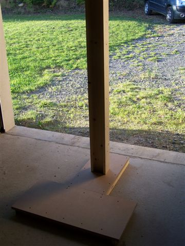

Le nouveau support équipé de la poutre de maintien de la tour.

Je me lance ensuite dans la réalisation de la structure de la tour. En effet, si j’ai bien les plans de la fusée, fournis par l’association, il faut que je crée rapidement ceux de la tour. Ils doivent être simples. Je fais des essais plusieurs soirées pour arriver à une tour composée de 4 sous-ensembles très simples de formes carrées ou rectangulaires.

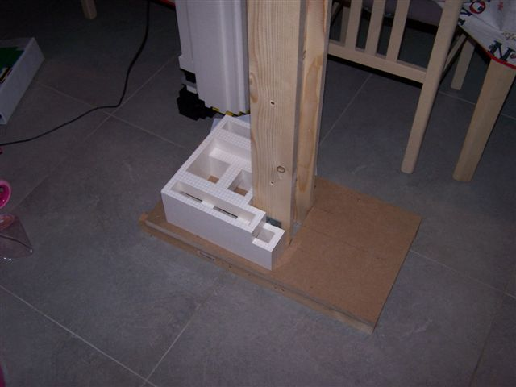

Ebauche du montage de la tour de lancement autour de la poutre de maintien.

J’édite des plans des sous-ensembles pour les enfants. Je décide de les faire commencer par la tour, car le montage des sous-ensembles y est plus facile que pour ceux de la fusée. Je ne le sais pas encore mais ce sera trop compliqué quand même !

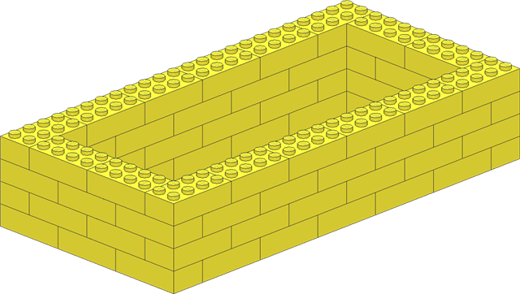

Exemple de sous ensembles composant la tour. Il en faudra 198 de ce type là !

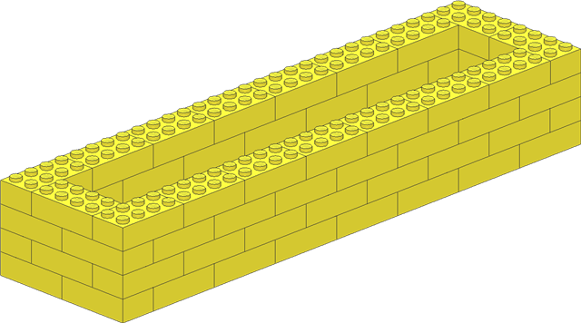

Un autre exemple de sous ensemble. Toujours le plus simple possible.

La veille de l’animation, petit coup de peinture blanche sur le support histoire de le rendre plus joli.

**1ère séance**

Le lendemain, début de l’animation avec la classe des CP. C’est une classe de 25 élèves. Je suis assez attendu et cela fait plaisir ! Pour cette première, l’institutrice et moi-même avons décidé de garder la classe entière, histoire de ne frustrer personne. Je débute l’animation avec un exposé interactif que j’ai réalisé pour les élèves. Le thème est l’espace. Je suis obligé de tout lire car ils commencent seulement à apprendre à lire. C’est l’occasion pour eux d’apprendre des nouveaux mots, comme satellites, astronautes, cosmonautes, etc...

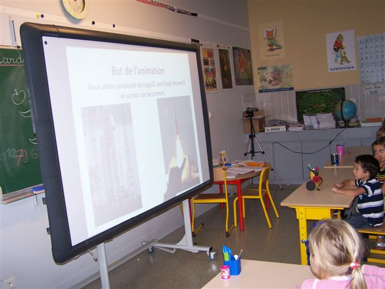

Avant de commencer le montage les élèves assistent à mon exposé sur l’espace.

La fin de l’exposé comporte une partie liée à nos chères briques. Là aussi du vocabulaire (brique, tenon, etc...), de la géométrie (largeur, longueur) et tout ce dont nous pouvons tirer parti. Je teste aussi leurs connaissances en matière de LEGO. Bilan :  
**–** 100% des élèves connaissent les LEGO  
**–** 75% des élèves en possèdent  
**–** un peu plus de 50% des élèves ont déjà monté des LEGO en suivant un plan (ça fait surtout presque 50% qui n’ont jamais lu de plans !!)

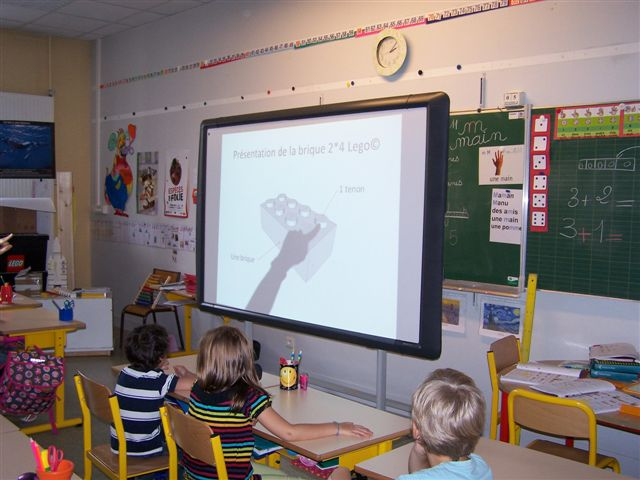

Et bien sûr à la fin de l’exposé, petite présentation de l’outil de travail, la brique 2x4...

La fin de la séance consiste, pour chaque élève, à réaliser un sous-ensemble de la tour à l’aide du plan de montage de celui-ci... Et là, ça a été la grosse surprise... Seulement une poignée d’enfants (3 en fait !) a été capable de réaliser le montage d’après le plan. La grosse difficulté a en fait été de faire les deux premières rangées de chaque sous-ensemble, car les briques encore non liées entre elles ne tenaient pas en place. Néanmoins avec mon aide, et celle de ceux qui ont réussi, tous les enfants parviennent à réaliser leur montage.

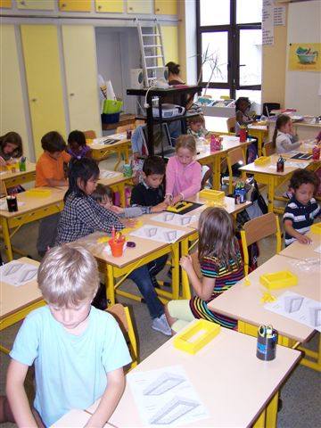

Première et dernière séance de montage... suivant plans !

**2ème séance**

Suite aux problèmes de lecture de plans rencontrés, je décide de changer de technique pour le montage. Je prépare donc les deux premières rangées de 25 sous-ensembles, soit un par enfant. Je vais leur faire rajouter 6 rangées à chacun. Je prépare donc des sachets de briques pour tous.

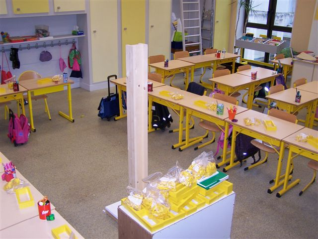

Les sous ensembles et les sachets préparés par mes soins attendent les élèves...

La classe est scindée en deux groupes que nous intervertissons à mi séance.  
J’installe les « monteurs » autour du support de la fusée pour qu’ils soient plus faciles à aider et pour qu’ils voient tous le travail avancer.

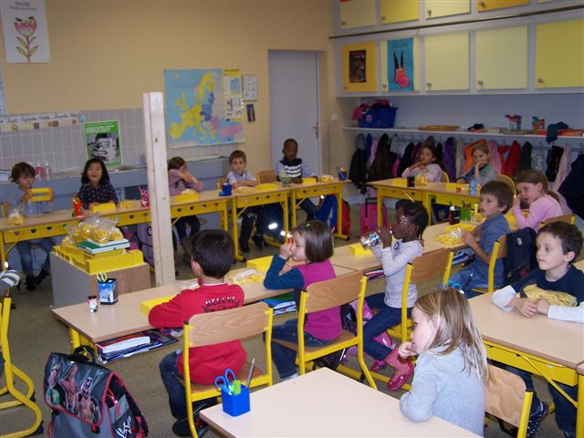

Les enfants installés autour de la future construction.

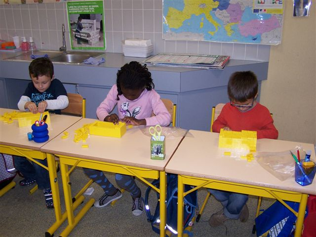

Chacun son sous ensemble et c’est parti...

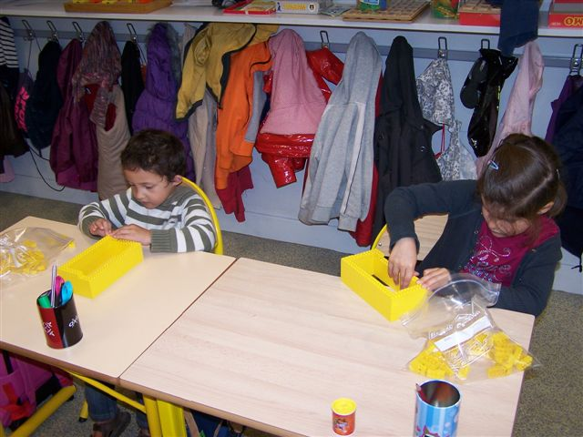

Toute le monde est très appliqué !

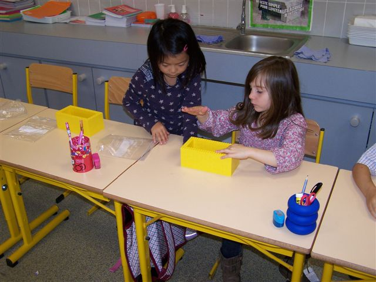

Les plus rapides aident leurs copains. Comme chez les adultes les Lego sont un bon moyen de fraterniser !

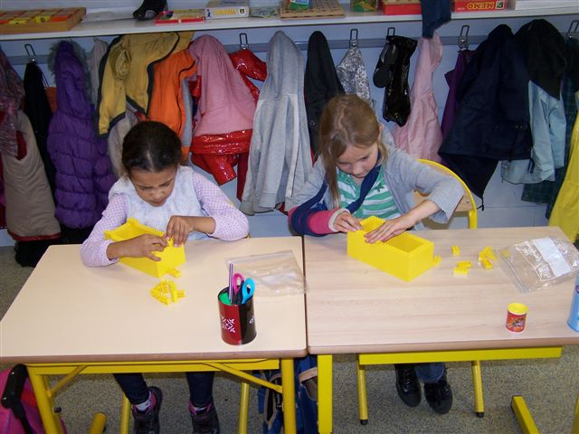

Même avec 1 main dans le plâtre tout le monde participe au montage !

Pendant le montage, l’autre demi-groupe prépare les sachets de briques nécessaires à la prochaine séance. C’est l’occasion de faire travailler les enfants sur la numération, c’est à dire les notions d’unités et de dizaines. Il faut en effet 96 briques par sachet, chiffre que la plupart ne connaissent pas !

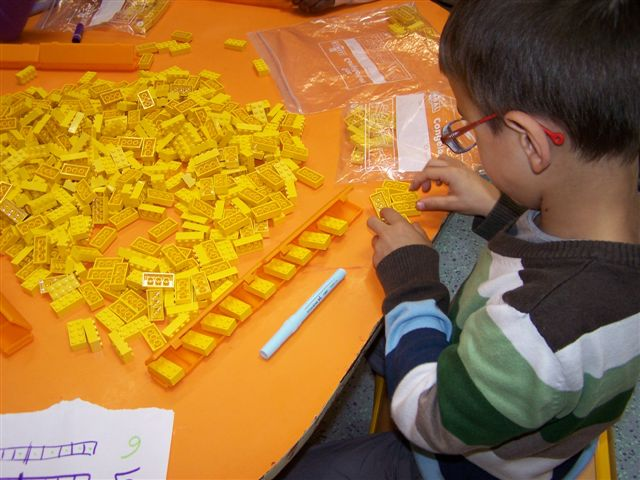

Séance "comptage de briques".

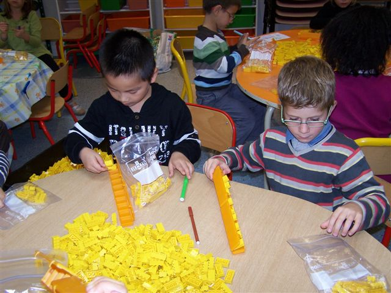

Pas facile de compter jusqu’à 96 en tout début de CP !!

**3ème séance**

Séance relativement identique à la précédente, à savoir montage d’un côté et numération de l’autre.

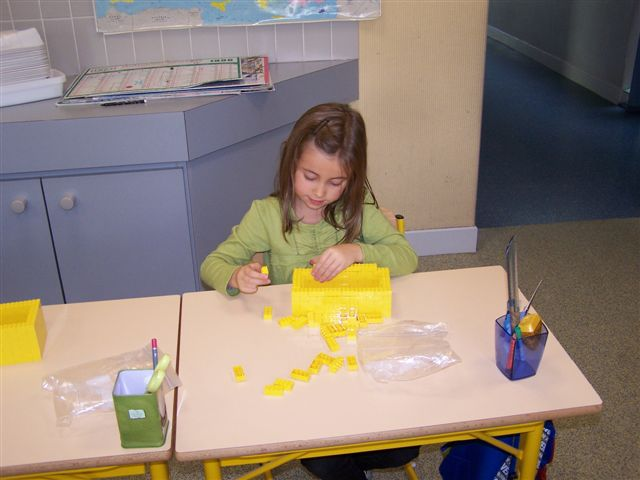

Chacun dans son coin...

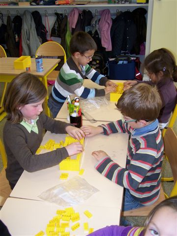

mais s’il le faut, toujours beaucoup d’entraides entre les enfants.

La fin de séance permet de constater à quel point nous sommes en retard sur le planning !

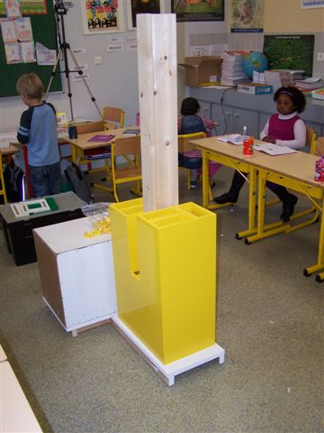

Résultat à la fin de la 3ème séance...

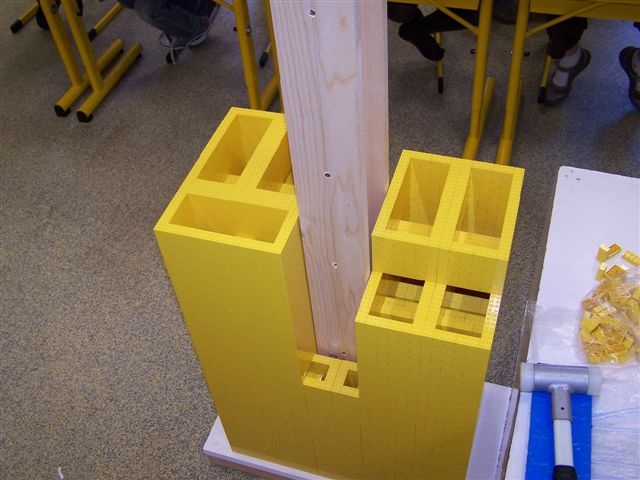

nous devrions avoir fini la tour !

**4ème séance**

Afin d’avoir une chance de terminer dans les délais, je décide de donner un coup de main aux enfants pendant la pause déjeuner en avançant un peu la tour. J’en profite pour intégrer le premier câble de maintien de la fusée.

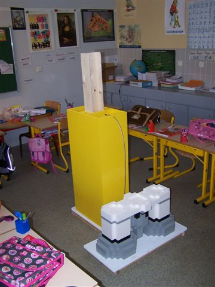

Avec un petit coup de main de ma part nous en sommes là en début de 4ème séance.

Lors de cette séance, les enfants les plus à l’aise avec le montage débutent le montage de la fusée pendant que les autres continuent la tour. Cela nous amène donc à ce point...

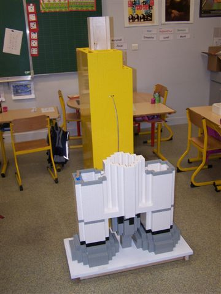

A la fin de la 4ème séance, il manque 30 cm de la tour mais nous avons commencé la fusée...

Pendant le montage, le demi-groupe encadré par la maîtresse travaille sur un exposé de géographie qui sera présenté aux parents.

A la fin de la séance, je présente un exposé aux enfants retraçant les différences entre fusées et navettes spatiales. Pour illustrer mes propos, je me sers de ma navette 10213.

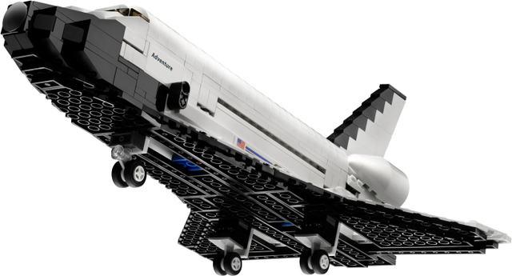

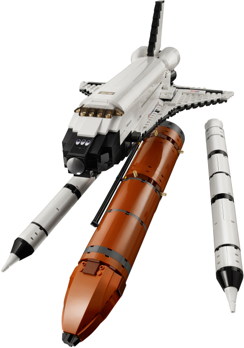

**5ème séance**  
Grosse préparation pour cette avant dernière... En effet, je dois assembler les deux premières rangées de briques de chaque sous-ensemble pour la fusée. Les formes étant bien plus compliquées que pour la tour, je ne veux pas revivre le fiasco de la lecture de plans ! Je passe donc une soirée complète à faire du montage (la maîtresse, elle aussi, a emmené des devoirs...) et à préparer des sacs avec le nombre exact de briques dont les enfants vont avoir besoin. Je fabrique des supports pour éviter trop de casse pendant le transport.

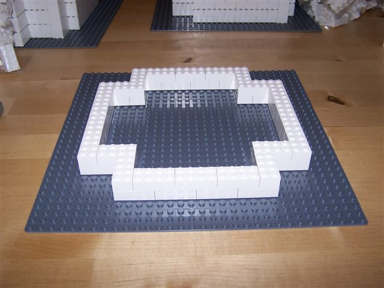

25 sous ensembles de 2 rangées à préparer...

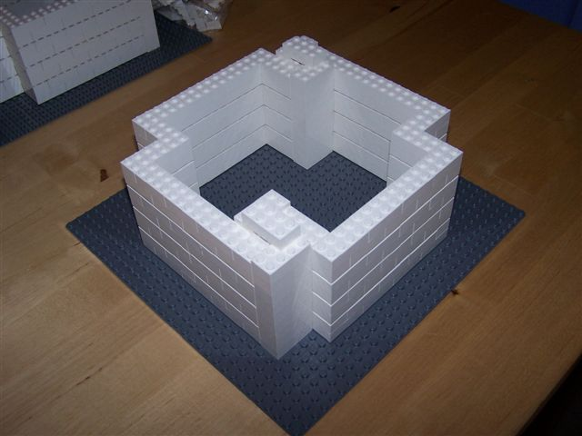

puis à caler pour le transport...

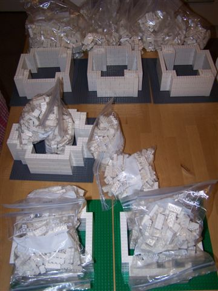

les sachets à préparer en plus...

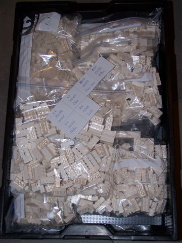

et ensuite loger le tout dans une caisse de transport en espérant que cela supporte le voyage !

Je n’ai pas de photos de cette séance car, ce jour-là, un conseiller pédagogique de l’académie est venu assister à la séance pour me superviser.

Tous les enfants réussissent à assembler leurs sous-ensembles, mais je prends la décision de ne pas les monter sur la base de la fusée. Comme celle-ci devra être transférée dans la bibliothèque de l’école pour l’exposé aux parents, je ne veux pas prendre de risque en cas de chute. Et puis ça fera un peu moins lourd à déplacer !

**6ème séance**

J’arrive très tôt à l’école pour finir la tour. Car à quelques heures de la venue des parents, voilà où nous en sommes...

Bon ok, il y a la plupart des éléments de la fusée déjà assemblés mais non montés, mais il reste quand même du travail... Surtout qu’il faut également décorer la salle de la bibliothèque, préparer les récompenses pour les enfants et la présentation aux parents...

Après le transfert de l’assemblage complet dans la bibliothèque, je finis la tour en intégrant un deuxième câble de maintien et le logo de l’agence spatiale européenne (ESA).

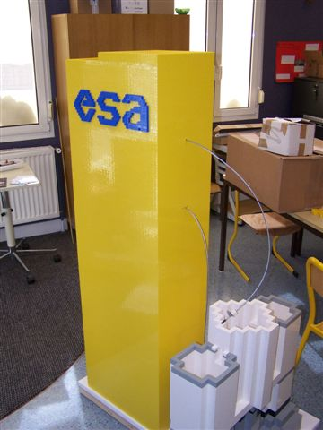

La tour en passe d’être achevée.

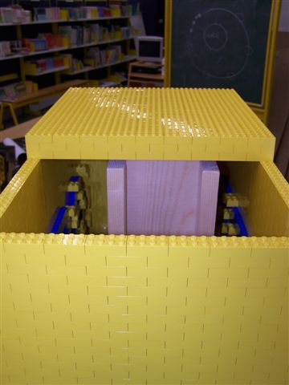

Pose du toit de la tour.

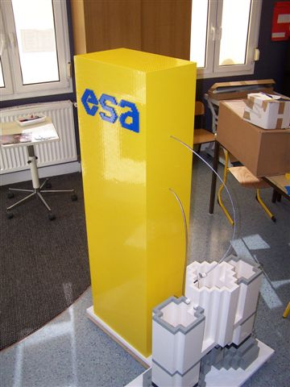

La tour terminée.

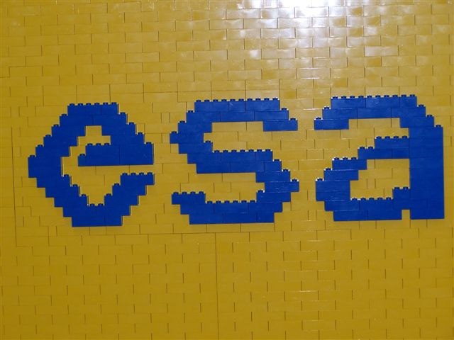

Le logo de l’Agence Spatiale Européenne.

Avec les enfants, nous procédons au montage final de la fusée. Chaque enfant vient poser la partie de la fusée montée par ses soins. En une petite demi-heure, la fusée fait plus de deux mètres ! Les enfants sont ébahis... Et je suis très fier d’eux !

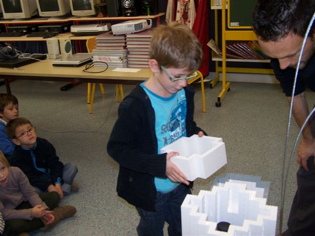

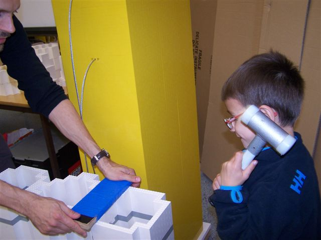

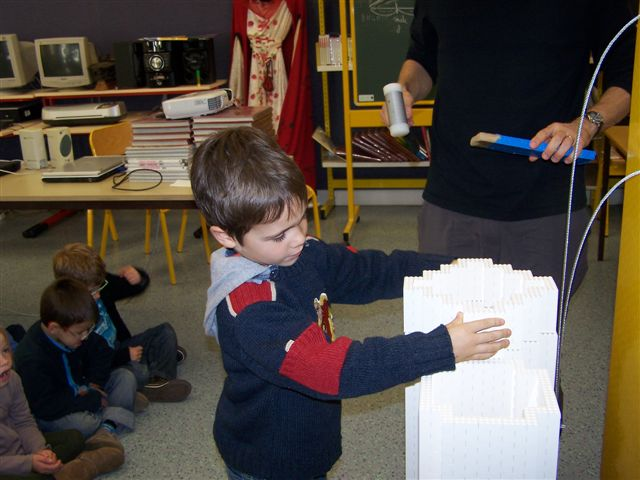

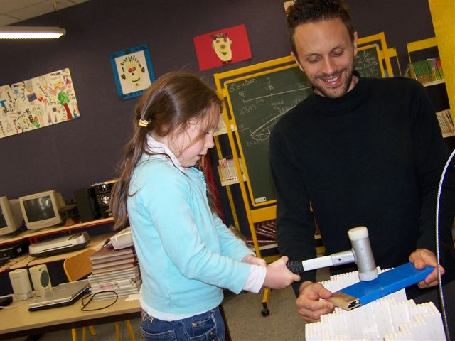

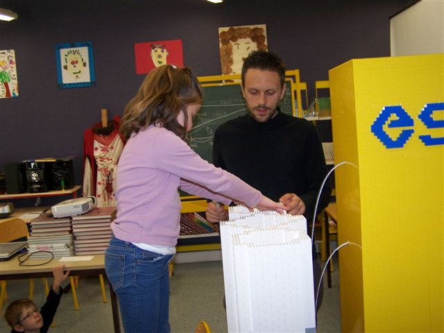

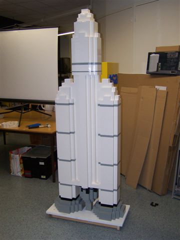

Après une petite demi heure de montage voilà le travail !

Après la récréation de l’après midi, nous présentons notre « oeuvre » à tous les élèves de l’école. Ce sont les CP qui animent la présentation et qui commentent leur création et les exposés réalisés. Les réactions des élèves sont à la hauteur du travail fourni. Les plus grands n’en reviennent tout simplement pas, les plus jeunes (grande section de maternelle) quant à eux ont les yeux qui brillent...

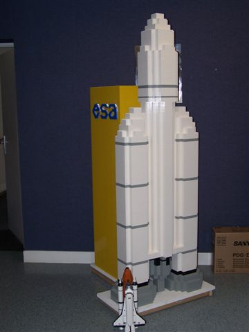

Voilà ce que nous présentons aux enfants des autres classes et aux parents.

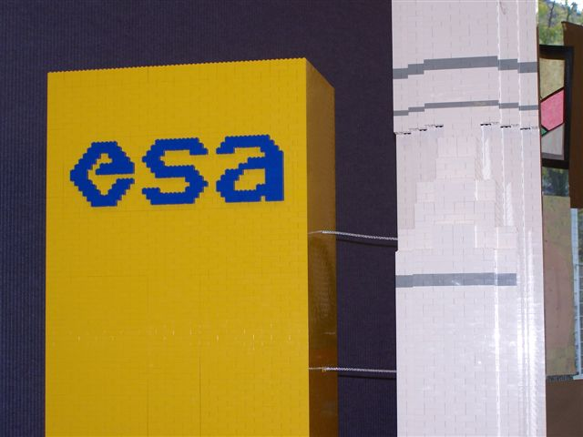

Détail des câbles de maintien.

S’ensuit une petite séance de remise de récompenses pour les enfants avec un badge personnalisé de « monteur de fusée » et des stylos en forme de fusée ariane.

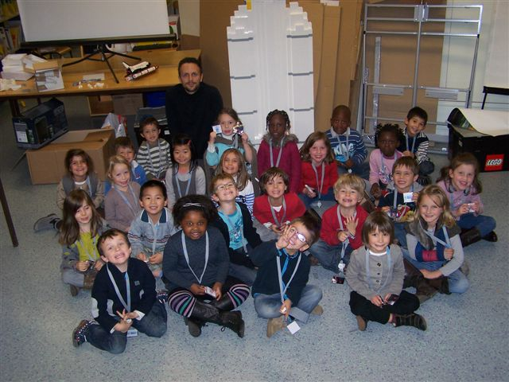

Nous posons les enfants et moi devant notre réalisation.

Le soir, c’est au tour des parents de venir voir notre réalisation et d’écouter nos exposés. Encore une fois, ce sont les enfants qui font la présentation. Ils sont très fiers devant leurs parents. Il faut dire que les parents sont « scotchés » par leur réalisation ! Avant de rentrer chez eux, un bon nombre d’enfant se fait prendre en photo devant la fusée, c’est pour moi le meilleur moyen de juger de la réussite de mon animation.

**7ème séance**

Ajoutée au dernier moment cette séance est nécessaire pour démonter la fusée et la tour, chose que j’avais un peu oublié... Les vacances de la Toussaint débutent le soir même. Les enfants s’en donnent à coeur joie ! Pendant la récréation, des élèves d’autres classes viennent nous aider, signe du succès de l’animation. Tous veulent toucher les LEGO !

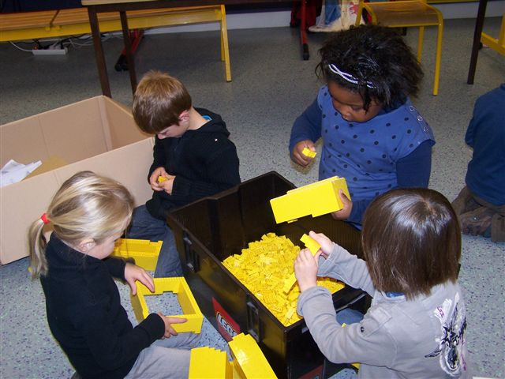

Démontage collectif !

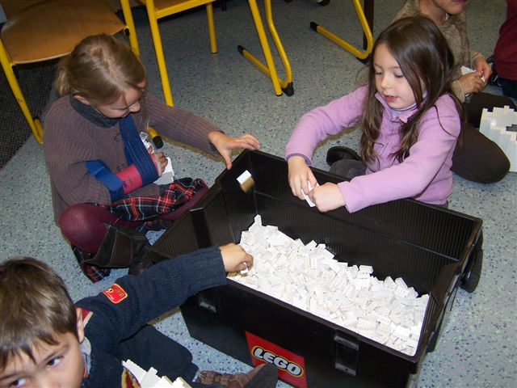

Rangement dans les caisses... Fin de l’animation...

En un peu plus de deux heures nous démontons donc plus de 27000 briques 2x4 que nous chargeons dans les caisses de rangement. Beau travail les enfants !!

**Bilan**

C’est une énorme satisfaction que cette première animation pour moi. Les enfants ont accroché dès le départ avec mon projet et se sont beaucoup investis. Je pense que l’animation a également beaucoup marqué l’école. Pour preuve, lors du spectacle de Noël de l’école (auquel j’ai assisté anonymement), le speaker (un instituteur de l’école) a présenté le spectacle des CP comme suit : « Pour les CP, ils vont vous interpréter un spectacle ayant pour thème l’Espace, afin de rester dans la continuité de la construction de la fusée LEGO, dont vous avez dû entendre parler ». J’étais donc très fier je dois bien le dire, et je n’ai qu’une idée, recommencer !

Je termine cet article avec mes remerciements envers Catherine (l’institutrice des CP) et Claudine (la directrice de l’école) qui m’ont donné la possibilité de réaliser cette animation dans leur école. Merci également à FreeLUG pour le prêt des briques. Enfin un immense merci aux enfants pour leur accueil et leur investissement dans mon projet, j’espère vous retrouver bientôt pour une nouvelle animation.

Damien
