L’Empire étend son manteau de peur et de dévastation sur la galaxie. Le princesse Leia, détentrice des secrets de l’étoile noire s’apprête à rejoindre les forces rebelles. Mais voilà, point de vaisseau disponible à l’horizon. Heureusement, quelques briques traînent au fond d’un vieux hangar....

Robert, une minifig expérimentée de niveau 7b, décide de construire une petite navette de croisière qu’il baptisera Tantive IV, en hommage aux trois premières qui ont malheureusement explosées lors des vols préliminaires.

Bon, voici mon premier article qui vous montrera les différentes étapes de construction de ce très bon set de la gamme StarWars. Ce set est une réplique du [set 10019](http://guide.lugnet.com/set/10019) mais avec la possibilité d’ajouter des minifigs (le 10019 contenait 1748 briques). J’ajouterai à la fin quelques commentaires sur l’ensemble.

Le set 10198 contient 5 figurines, 1408 briques et coute 170 €. Ce qui revient à 12c la brique.

On va commencer rapidement par les photos de la boite et des sachets (qui ne sont pas numérotés).

[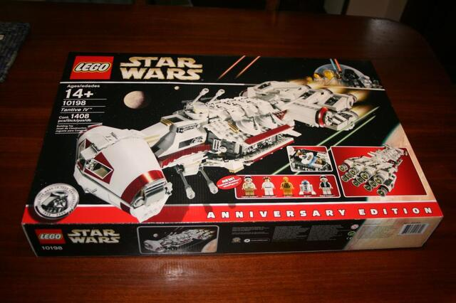](https://www.freelug.org/IMG/jpg/IMG_4055.jpg)

[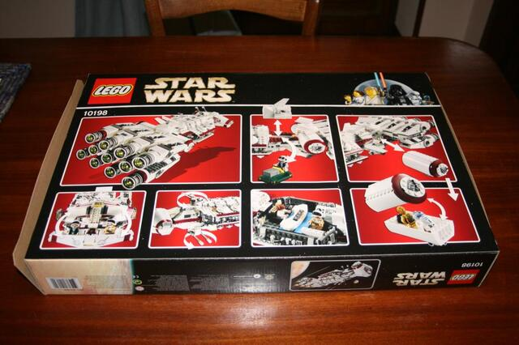](https://www.freelug.org/IMG/jpg/IMG_4056.jpg)

[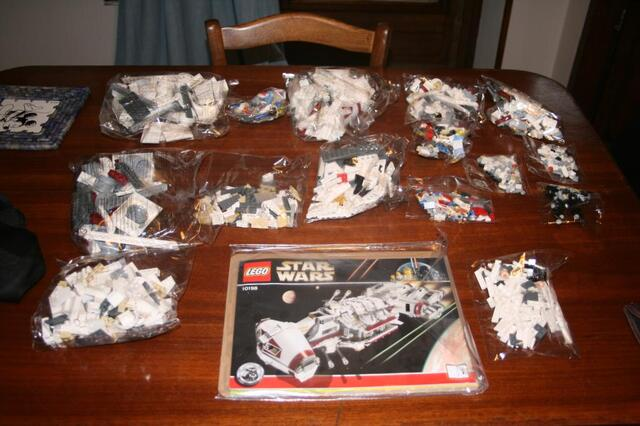](https://www.freelug.org/IMG/jpg/IMG_4057.jpg)

16 sachets en tout (1 petit sachet dans un grand). Les 2 livres sont protégés par un sachet et une plaque cartonnée.

La phase suivante est assez simple. On trie et on monte les minifigs. Ma technique de tri est basée sur des boites de glace... Les Cartes d’Or sont mieux que les Leroy Merlin.... Bon, sur ce coup, je n’ai pas tout trié car j’étais trop impatient de commencer.

[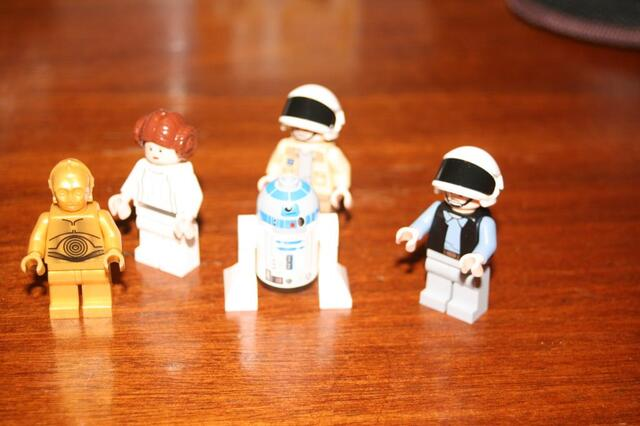](https://www.freelug.org/IMG/jpg/IMG_4067.jpg)

**Minifigs**

Allez, c’est parti... Ca ressemble à n’importe quel modèle Technic.

[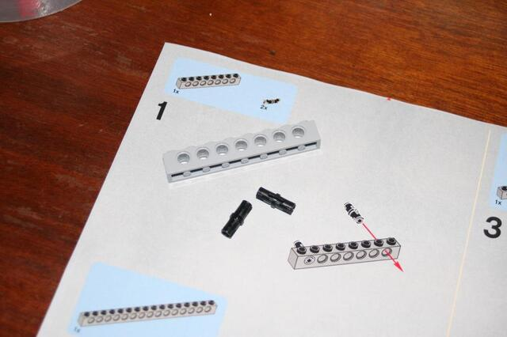](https://www.freelug.org/IMG/jpg/IMG_4059.jpg)

[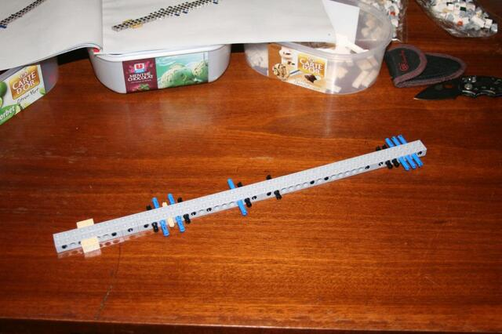](https://www.freelug.org/IMG/jpg/IMG_4061.jpg)

Le Tantive IV commence à prendre un peu forme...

[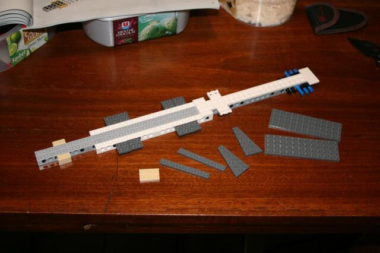](https://www.freelug.org/IMG/jpg/IMG_4062.jpg)

[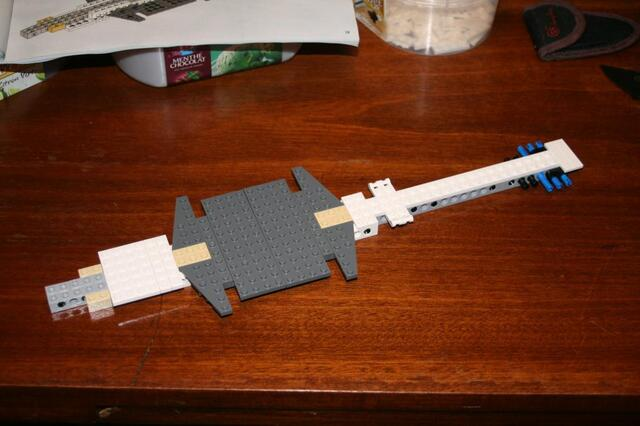](https://www.freelug.org/IMG/jpg/IMG_4063.jpg)

[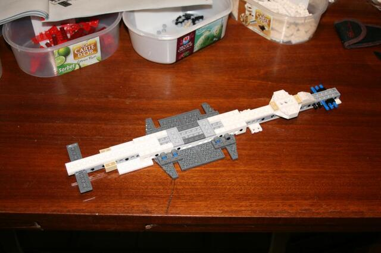](https://www.freelug.org/IMG/jpg/IMG_4064.jpg)

[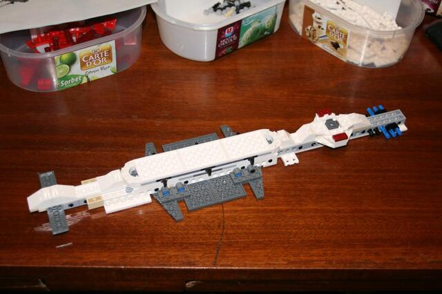](https://www.freelug.org/IMG/jpg/IMG_4065.jpg)

[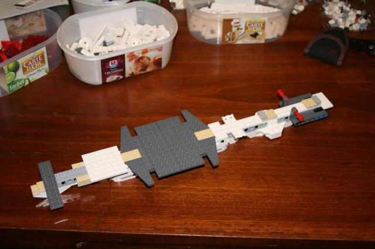](https://www.freelug.org/IMG/jpg/IMG_4066.jpg)

[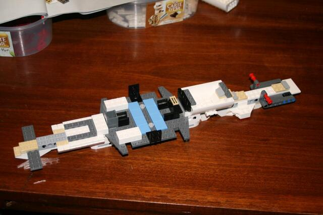](https://www.freelug.org/IMG/jpg/IMG_4068.jpg)

[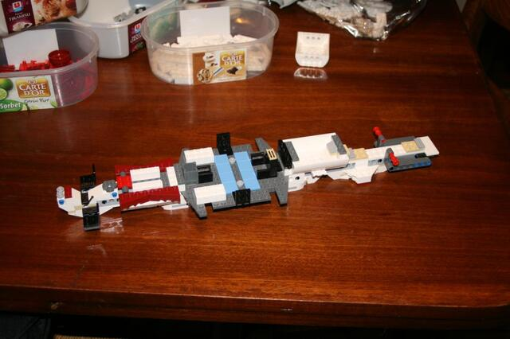](https://www.freelug.org/IMG/jpg/IMG_4069.jpg)

[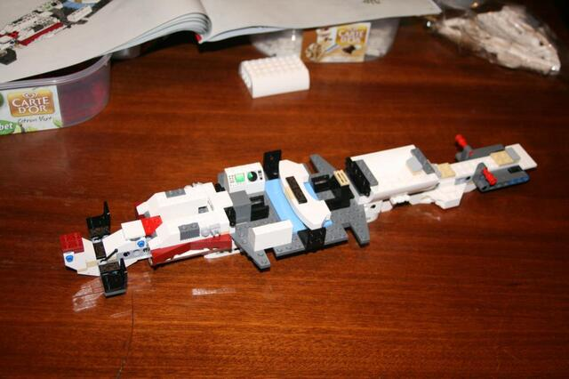](https://www.freelug.org/IMG/jpg/IMG_4070.jpg)

A partir de là, on va construire ce qui servira de support aux nombreux réacteurs.

[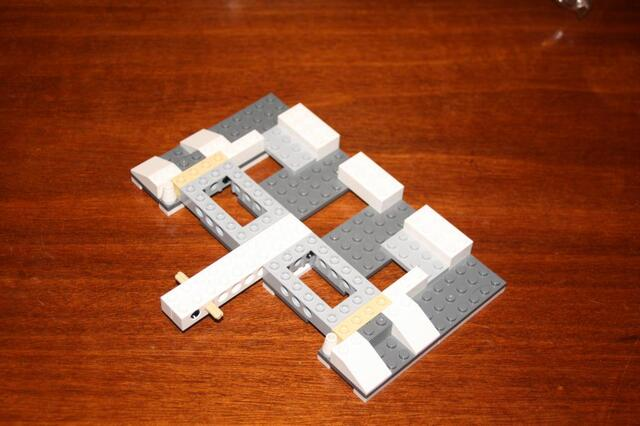](https://www.freelug.org/IMG/jpg/IMG_4071.jpg)

[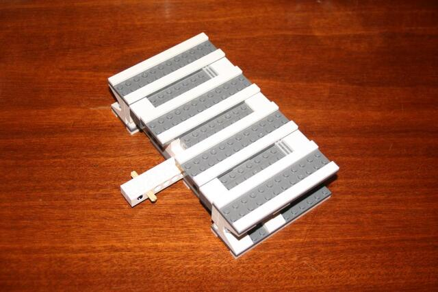](https://www.freelug.org/IMG/jpg/IMG_4072.jpg)

On branche les moteurs !

[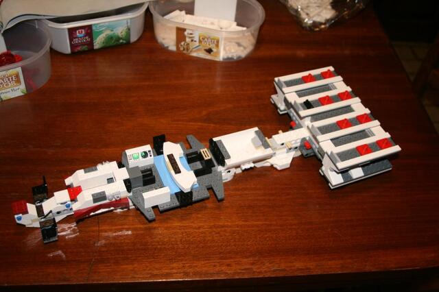](https://www.freelug.org/IMG/jpg/IMG_4073.jpg)

Robert et les ingénieurs vérifient un peu l’électronique. La princesse Leia vérifie le plan de vol. C-3PO (Z-6PO si on veut coller à la VF) vérifie la compatibilité dans son programme de traduction.

[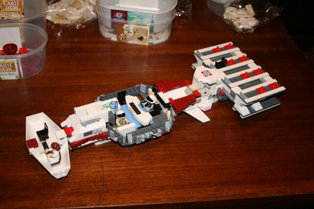](https://www.freelug.org/IMG/jpg/IMG_4074.jpg)

[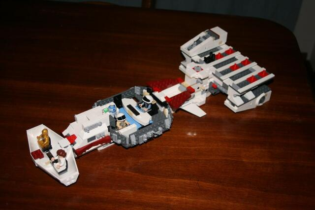](https://www.freelug.org/IMG/jpg/IMG_4076.jpg)

Installation des tuyères (je me suis trompé dans la disposition sur la première photo. Par contre, celle avec toutes les tuyères est OK. LEGO a choisi volontairement de ne pas tenir compte de la symétrie.

[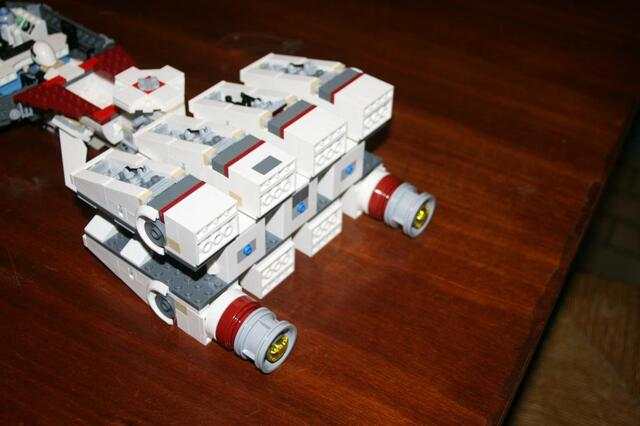](https://www.freelug.org/IMG/jpg/IMG_4077.jpg)

[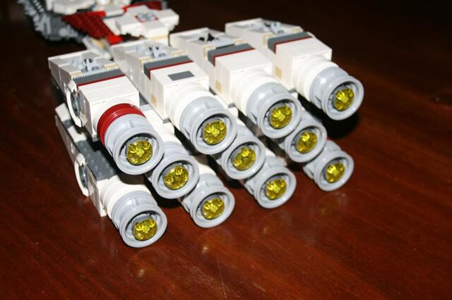](https://www.freelug.org/IMG/jpg/IMG_4078.jpg)

Et voilà, plus rien à faire en dessous.

[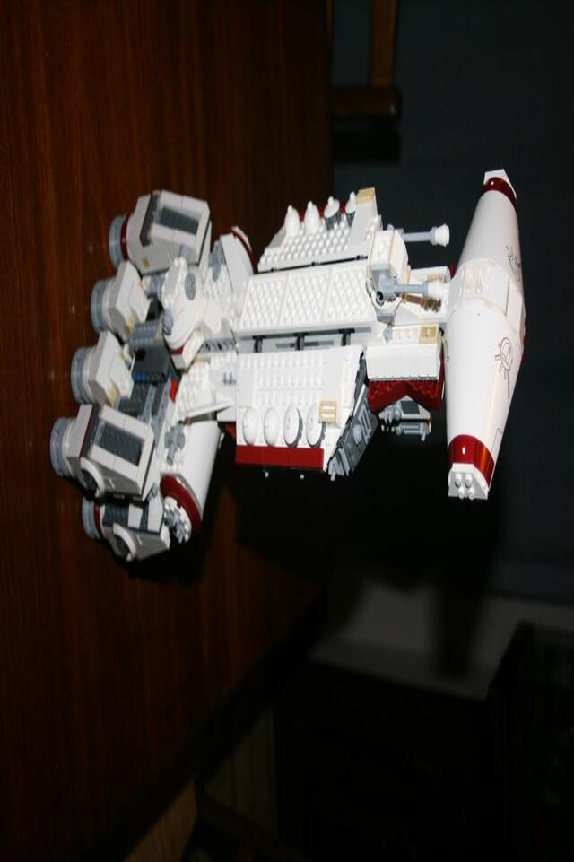](https://www.freelug.org/IMG/jpg/IMG_4079.jpg)

Bon, le reste est assez basique à construire. Il ne faut pas oublier de ranger C-3PO et D2R2 dans leur capsule de secours. Le cockpit avant bascule. Les tourelles et le radar pivotent. La face supérieure qui ouvre accès au vaisseau ne tient sur aucun tenon. Un capot supérieur permet de dévoiler un petit véhicule monoplace utilisé par Robert pour vérifier les moteurs avant le décollage. Le vaisseau étant censé transporter la princesse, il ne faudrait pas qu’il arrive malheur.

[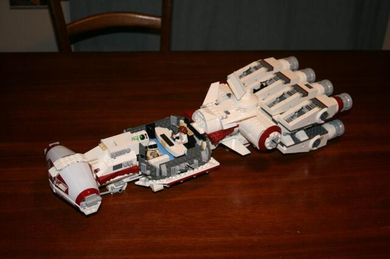](https://www.freelug.org/IMG/jpg/IMG_4080.jpg)

[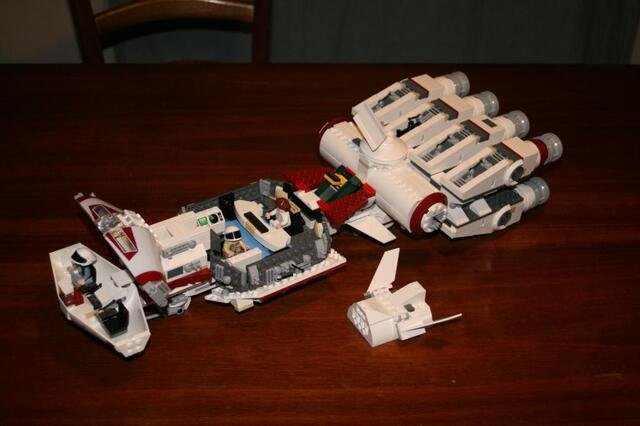](https://www.freelug.org/IMG/jpg/IMG_4081.jpg)

[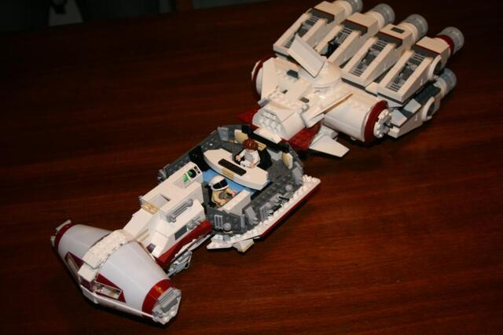](https://www.freelug.org/IMG/jpg/IMG_4082.jpg)

[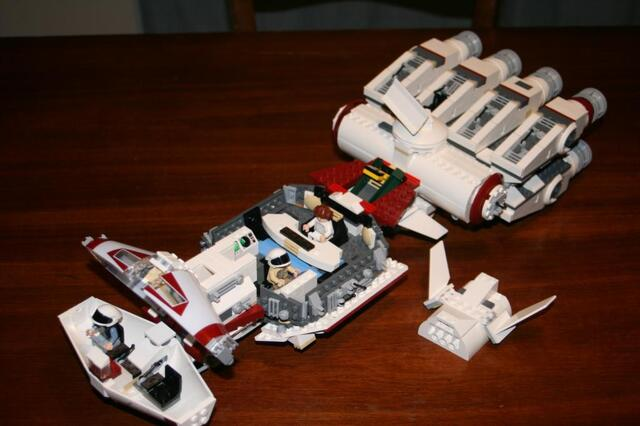](https://www.freelug.org/IMG/jpg/IMG_4083.jpg)

[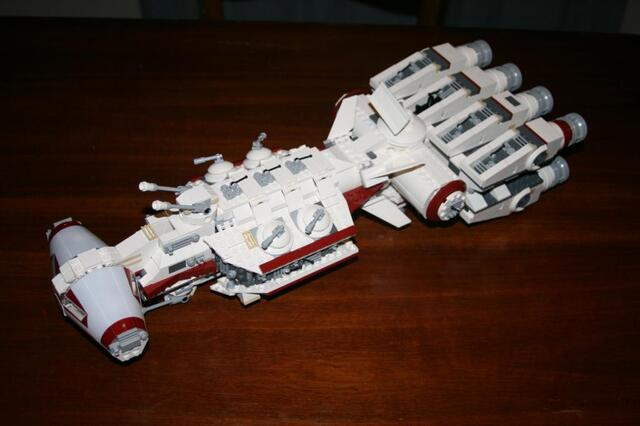](https://www.freelug.org/IMG/jpg/IMG_4084.jpg)

Et c’est fini !

Voilà, c’est ma première revue d’un set. J’espère que vous aurez pris autant plaisir à la lire que j’en ai eu à la rédiger.

Pour ce qui est du bilan de ce modèle, je lui mettrais un bon 8/10. C’est un modèle conséquent et très agréable à construire. Toutes les plaques avec des motifs sont imprimées et on évite ainsi les autocollants.

Quelques remarques négatives cependant :  
**–** la jouabilité me semble un peu compliquée. On ne sait pas trop par où tenir le vaisseau (les ailerons latéraux s’enlèvent facilement).  
**–** La partie sur laquelle repose le modèle est un peu courte. C’est basé sur un axe en croix noir de 4 qui dépasse un peu et empêche le bouchon réalisé avec une tile plate blanche 2\*2 de tenir correctement. Je ne modifie que très rarement un modèle mais sur ce coup, je pense qu’il serait bon de rajouter juste en dessous une Round Flat Plate 2x2 Part 4211042. Ca compenserait le 1/2 millimètre de jeu.  
**–** le prix... Un peu cher... (mais moins disproportionné que le 10195)

J’aurais pu mettre avec le 10019 pour comparer la taille (ou encore le modèle mini fourni avec le 10030) mais je n’ai pas eu le temps... Oups et désolé d’avance...

Voilà, à bientôt.

Vincent
