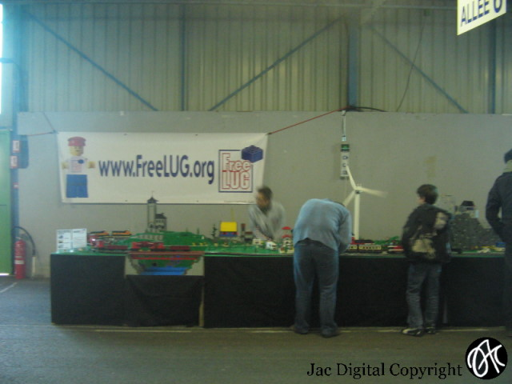
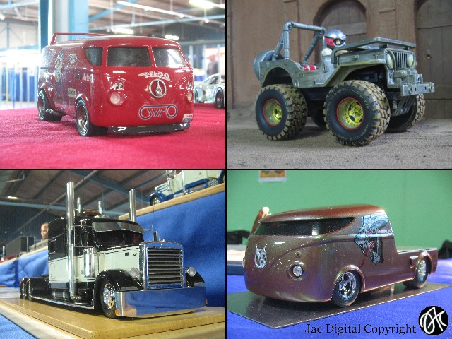
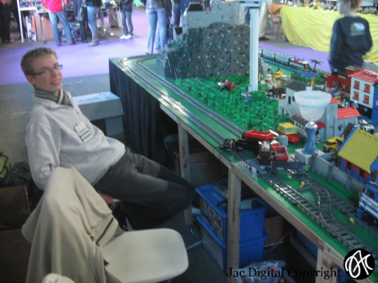

FreeLUG était invitée à participer au premier grand salon du modélisme, organisé par le Montlu model à Montluçon (03), qui s’est tenu les 17 et 18 octobre 2009.

C’est toujours avec grand plaisir que j’attends la venue d’un AFOL chez moi. Et cette fois, c’est Pierre Charles qui passait la nuit à Randan, afin d’être prêts à partir tôt le samedi matin. Ce n’était pas beaucoup de route qui nous attendait, mais plutôt, et ce dès 7h pour l’ouverture aux exposants, le grand déballage, l’assemblage des tables Bab, la mise en place des nappes et pour finir, l’amusement avec nos briques.

Après la prise de contact et la recherche de l’emplacement pour le stand FreeLUG, la construction commence.

Après 3h et demi de "travail" acharné, un joli petit réseau a pris forme. L’emplacement est idéal. On est visible de la buvette, à l’autre bout du hall puisque en bout d’une allée. L’éolienne, de par sa hauteur, a bien servi à attirer l’oeil des visiteurs. Elle a aussi fourni le courant aux trains 9V qui circulaient sur les rails. Enfin, c’était surtout dans les rêves de certains visiteurs imaginatifs...

**Vue générale du stand freeLUG**

L’exposition se déroule sans problème, le stand est très bien accueilli par le public. Ce qui nous vaudra d’ailleurs une très belle coupe "coup de coeur du public". Alors, messieurs dames public de cette exposition 2009, merci beaucoup.

Comme nous étions trois personnes sur le stand, nous pouvions nous permettre quelques escapades. Et là, c’était fantastique. L’exposition était d’un grand niveau. Il y avait de très beaux réseaux de trains et de superbes maquettes. C’était un régal pour nos yeux. Du coup nous n’allions pas bien loin à chaque fois, et il a fallu quitter notre stand à plusieurs reprises afin de tout voir. De plus, on se rend compte que nous sommes connus, et très demandés pour d’autres expositions...

**Quelques maquettes....**

Le reste du week-end a connu quelques déraillements impressionnants. Jonathan et Pierre réunis se sont bien amusés. Sans pour autant les provoquer, de beaux arrêts resteront en mémoire. Le coup de la voiture postale, et celui de l’erreur d’aiguillage ! Même petit, et sans voie de triage, le réseau était très amusant.

**Erreur d’aiguillage devant la coupe....**

Nous avons reçu beaucoup de visites des stands voisins, mais aussi de l’entourage de Jonathan, qui habite tout proche du parc des expositions.

Jérôme - JAC

* * *

Pour une première exposition, les organisateurs de Montluçon on frappé très fort d’entrée. Celle-ci était une réussite tant au niveau qualité des exposants qu’au niveau de l’enthousiasme du public.

Ce fut un plaisir d’exposer avec JAC et "John". Et ce fut aussi pour moi un premier test grandeur nature pour le montage en exposition de Quéribus (article sur le château à venir) qui partait la semaine suivante au LEGOWorld.

Encore une réussite pour mon coordinateur préféré, JAC !

Pierre - Tribolego

* * *

## Galerie photos

**–** [Galerie de Jac](http://photos.freelug.org/main.php/v/JAC/Exposition/Expositions2009/MontluExo-2009/)
