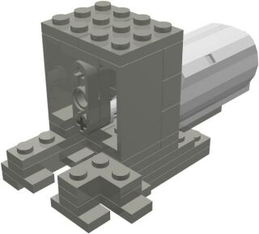
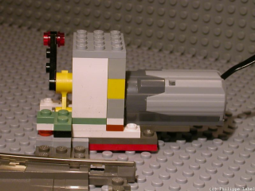

Après la [motorisation des aiguillages de train avec un mini-moteur Technic](/articles/automatiser-les-aiguillages-9v/), voici une solution pour actionner vos aiguillages en utilisant le moteur [Technic Power Functions taille M](http://shop.lego.com/ByTheme/Product.aspx?p=8883&cn=57&d=70) sorti à l’été 2007.

Quand le réseau de train commence à grandir, on finit toujours par se demander : _"mais comment vais-je actionner l’aiguillage qui est placé tout au fond là-bas ?"_. Ne cherchez plus ! Voici une solution simple et assez économique en utilisant un moteur Power Functions taille M (PF-M).

Pour être juste, ce montage est une adaptation au moteur PF-M du [mécanisme de commande proposé par Mark Riley](http://pagesperso-orange.fr/chezfilou/montages-lego/Mark%20Riley%20Evolution/MoteurEvolution.html) en son temps pour le [mini-moteur Technic 9V](http://www.peeron.com/inv/parts/71427c01).

Le moteur Technic PF-M développe une puissance mécanique plus grande que son prédécesseur le mini-moteur Technic. Allez voir [l’étude complète de Philo sur ce moteur (et bien d’autres...)](http://www.philohome.com/motors/motorcomp.htm) pour plus d’informations. A cause de cette puissance élevée, le montage proposé souffre d’une certaine aptitude au démontage spontané... et brutal :) Mais, grâce à cette puissance, aucun besoin d’ouvrir l’aiguillage ni de le modifier en quoi que ce soit : ça marche sorti de boîte. Néanmoins, pour limiter la puissance mécanique délivrée, nous recommandons de réduire la tension électrique apportée au moteur et dans ce but, il vaut mieux alimenter ce moteur à l’aide du [câble adaptateur 9V-PFS](http://shop.lego.com/ByTheme/Product.aspx?p=8886&cn=57&d=70) qui permettra le branchement d’un [régulateur de train 9V](http://www.peeron.com/inv/parts/2868b). Outre le fait de ne pas utiliser de piles, ce mode d’alimentation offre un autre avantage que nous exposerons plus loin.

Le montage fait appel à des pièces classiques. Voici à quoi il ressemble une fois monté.

**Le montage complet**

Et le [plan de montage réalisé avec MLCad est disponible ici](http://pagesperso-orange.fr/chezfilou/montages-lego/AiguillagePFS/moteurAiguillagePFS-M_couleurFinale.ldr). En plus, il y a une page web à votre disposition pour la [notice de montage](http://pagesperso-orange.fr/chezfilou/montages-lego/AiguillagePFS/moteurAiguillagePFS-M_couleurFinale_table.html).

En situation sur un aiguillage, voilà à quoi ça peut ressembler.

**En situation sur l’aiguillage**

Vous n’êtes pas obligé de choisir les couleurs des pièces avec autant de soin... :) Mais vous noterez qu’on peut ajouter un sémaphore sur le levier jaune pour visualiser de loin la position de la voie. [D’autres photos ici](http://photos.freelug.org/main.php/v/Frogleap/Motorisation-des-Aiguillages/MotorisationPFS/).

Maintenant que le montage est réalisé, voyons comment utiliser le dispositif facilement. Si vous n’avez vraiment rien d’autre sous la main, vous pouvez utiliser un boîtier de piles Power Functions avec son inverseur intégré. Tout se branche directement. Au moins ça dépanne pour basculer l’aiguillage du fond de la pièce qui n’attendait que ça. Mais si vous avez plusieurs aiguillages à commander, alors la solution d’alimenter le moteur par un régulateur 9V de train devient vite une meilleure solution. Le plus intégré est d’utiliser un inverseur Technic 9V ancien système pour piloter l’aiguillage. Pour connecter le moteur PF-M à l’inverseur Technic 9V, utilisez le [câble adaptateur 9V-PFS](http://shop.lego.com/ByTheme/Product.aspx?p=8886&cn=57&d=70). Au final, inspirez vous fortement de [cet article publié antérieurement](/articles/un-levier-modulaire-pour-commander-les-aiguillages-9v/), qui reste d’actualité. Le régulateur 9V sera utilisé pour alimenter la batterie d’inverseurs en lieu et place du boîtier de piles 9V, c’est là le second avantage de son utilisation. Et n’oubliez pas d’abaisser la tension aux deux tiers, voire la moitié, pour limiter la puissance du moteur PF-M. En pratique, vous trouverez rapidement la bonne tension pour que l’aiguillage bascule sans que le montage n’explose.

Enfin, pour les plus fanatiques, il est aussi possible d’utiliser un tel moteur d’aiguillage associé à un [pilotage par une centrale DCC](http://www.brickshelf.com/cgi-bin/gallery.cgi?i=2132074). Nous recommandons d’employer un circuit décodeur d’accessoires [Lenz LS150 à six sorties](/articles/module-de-commande-dcc-pour-six-aiguillages-motorises-9v-lego/). Dans ce cas, il faut régler la durée d’impulsion sur le minimum, soit 0,1 seconde et alimenter le moteur en 12 V alternatif _via_ le LS150 et dont les sorties sont redressées en mono-alternance, ce qui produit une tension de 5,7 V en moyenne pour le moteur PF-M.

Amusez-vous bien,

Niconico57 et frogleap.
